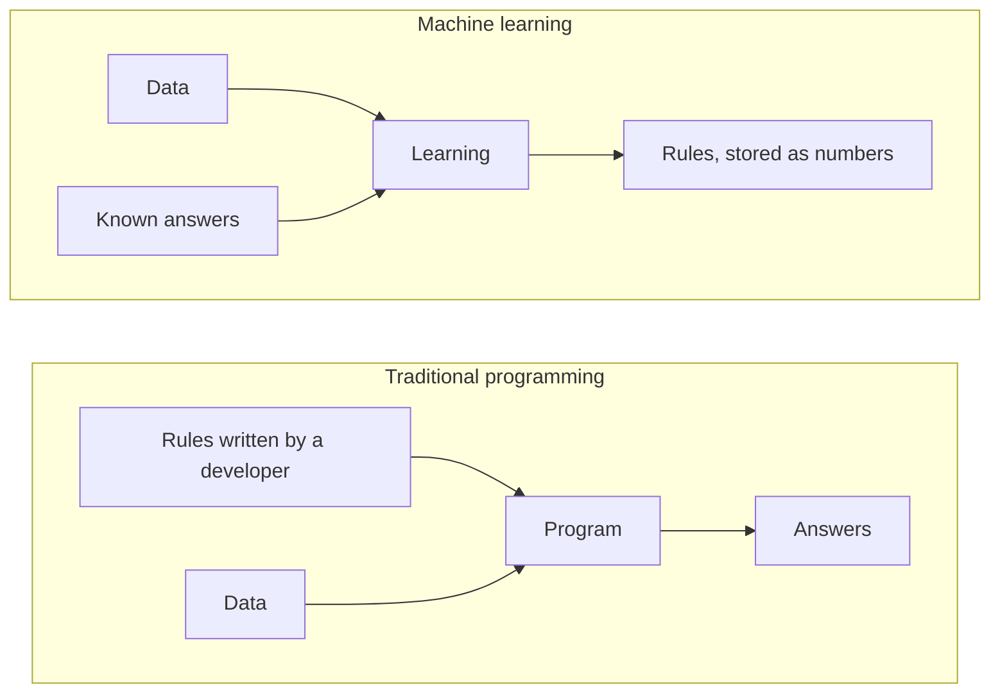
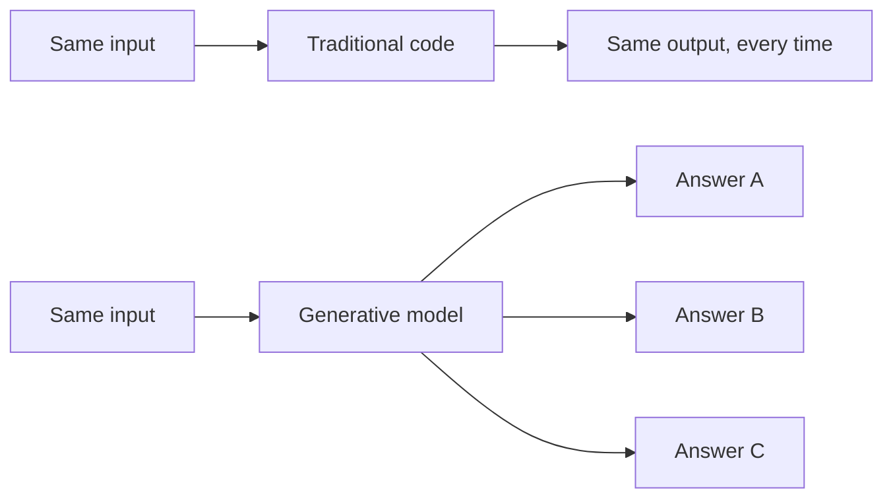
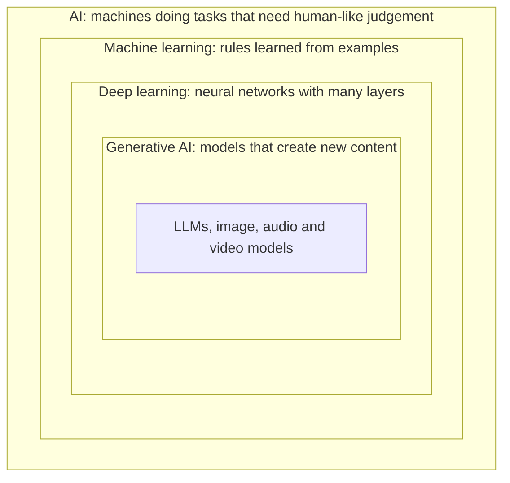
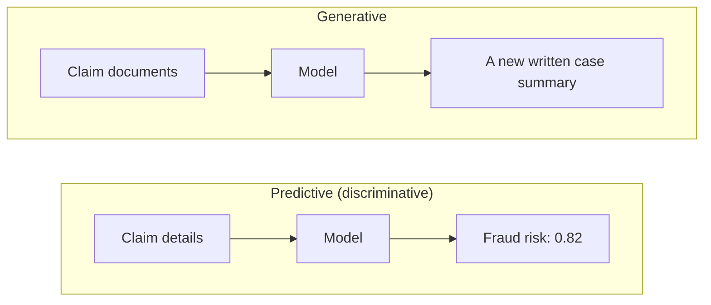
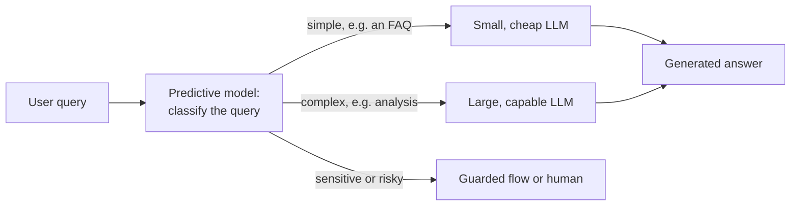
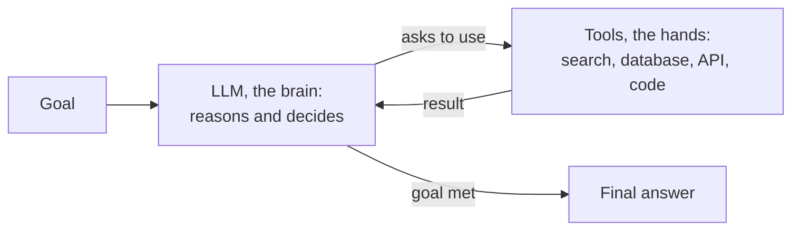
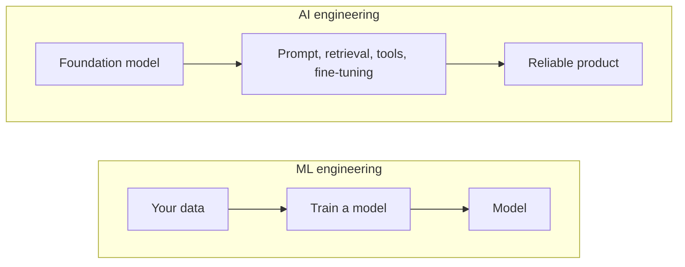
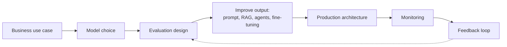

# Chapter 1: Introduction to AI

## 1. The concept, from scratch

### Traditional software vs machine learning

Traditional software is **rule-based and deterministic**. A developer writes the rules, the computer follows them, and the same input always gives the same output.

Machine learning flips this. You don't write the rules. You give the machine lots of examples (inputs and the right answers) and it **learns the rules itself**.

Use code when you can write the rules (tax calculation, routing a parcel by postcode). Use ML when you can't, because there are too many rules or they are too fuzzy (is this email phishing, will demand spike next week).

### Deterministic vs probabilistic

This is the sentence to remember: **traditional software is deterministic, generative AI is probabilistic.**

A normal function returns the same answer every time. A generative model works out a probability for every possible next piece of text and *samples* from them. Ask twice, you may get two different answers, both reasonable.

That one difference drives most of AI engineering. You can't unit-test a probabilistic system the way you test a function. You have to **evaluate** it, add **guardrails**, and design for the occasional wrong answer.

### How the terms nest

- **AI** is the broad goal. It also includes non-learning approaches like hand-written expert-system rules.
- **Machine learning** is the subset that learns from data.
- **Deep learning** is ML using neural networks with many layers.
- **Generative AI** is deep learning that creates new content. A **large language model (LLM)** is a generative model for text: trained on huge amounts of text to predict the next token (a small chunk of text, covered in [Chapter 3](../03-tokens-and-embeddings/README.md)).
- An **AI agent** isn't a model type. It's a system built around an LLM that decides, uses tools and loops until a goal is met ([Chapter 18](../18-from-llm-calls-to-agents/README.md)).

### Predictive vs generative

Models do one of two jobs.

- **Predictive AI** (the technical term for the model type is *discriminative*) decides or forecasts: classify, score, rank, predict a number. Fraud or not fraud. Next month's sales. It's trained on labelled data and gives a bounded answer.
- **Generative AI** creates new content: text, images, code, audio. It learns the pattern of the data itself and produces new samples that look like it.

Predictive AI answers "which one?" or "how much?". Generative AI answers "write me one." Most real systems use both: a predictive model scores the claim, a generative model drafts the summary.

### Predictive and generative working together

The cleanest example is **model routing**. Not every question needs the biggest, most expensive LLM. A small predictive model (a classifier) first analyses the query and decides which LLM should handle it. Then the chosen LLM generates the answer.

First the query is classified (predictive), then text is generated (generative). The classifier is cheap and fast, so you save money on every easy query. Other common pairings:

- **Intent classifier, then LLM:** a classifier picks which workflow or tool to use, and the LLM writes the reply.
- **Safety classifier around an LLM:** one model checks the input and output for harmful content or personal data, and the LLM does the generating in between.
- **Reranker, then LLM:** a model scores retrieved documents for relevance, and the LLM answers from the best few ([Chapter 14](../14-improving-retrieval/README.md)).
- **Fraud score, then summary:** the claims example above.

### Three ways a machine learns (preview)

**Supervised** (labelled examples), **unsupervised** (find structure with no labels), **reinforcement** (trial and error with rewards). Details in [Chapter 2](../02-how-machines-learn/README.md).

### An LLM in one picture

Three lines you can say in any interview:

1. **An LLM is stateless.** It has no persistent memory, it cannot act on the world, and it stops after each generation. Every call is independent. Chat apps feel like they remember you because they send the whole conversation again each time ([Chapter 6](../06-inference-and-generation/README.md)).
2. **Its value is in reasoning, not in serving as a knowledge store.** What it "knows" is frozen at training time and is not a reliable database. For facts, give it documents and data at question time.
3. **The LLM is the brain, tools are the hands.** A tool is anything the model can ask for to act: search, a database, an API, code. An **agent** is simply an LLM running in a loop, using tools, trying to achieve a goal.

A good picture of an LLM is a very well-read new joiner. They have read everything public up to last year and write fluently, but they have no access to your systems, and they will guess confidently if you don't hand them the file. Agents are covered in [Chapter 18](../18-from-llm-calls-to-agents/README.md).

### AI vs AGI

**AGI** (artificial general intelligence) means AI that matches human ability across most cognitive tasks. What we build with today is narrow or general-purpose within limits. There is no agreed definition or test for AGI, and experts disagree on the timeline, so don't predict dates.

### What AI engineering is

Almost nobody trains a large model from scratch: it takes huge datasets, specialist hardware and very large budgets. A few providers build **foundation models**: general-purpose, often multimodal models (they handle text, images, audio) that can be adapted to many tasks. Everyone else builds on top of them.

- **Closed models you call through an API:** OpenAI's GPT models (the model behind the ChatGPT app), Anthropic's Claude models, Google's Gemini models.
- **Open-weight models you can download and run yourself:** Meta's Llama, Mistral's models, Alibaba's Qwen, DeepSeek (as of Nov 2026).

One model can summarise, translate, write code and answer questions. That is what "general-purpose" means. Note the difference between the *model* (GPT, Claude) and the *product* wrapped around it (ChatGPT, the Claude app). You choose among these models in [Chapter 8](../08-the-model-landscape/README.md).

**Creating a model is machine learning. Making it work reliably in the real world is AI engineering.** The job is quality, safety, latency, cost and feedback, and those five pull against each other. A bigger model gives better quality and costs more and runs slower.

### The lifecycle

Evaluation comes early. If you can't measure it, you can't tell whether a change helped.

## 2. Analogies across industries

- **Rules vs learning (insurance).** Traditional code is the underwriting rulebook: "refer any claim over 10,000". ML is a new adjuster who has seen ten thousand claims and picked up patterns nobody wrote down. The rulebook is exact but limited by what its authors thought of. The adjuster is more flexible and sometimes confidently wrong.
- **Predictive vs generative (healthcare).** Predictive is the radiologist saying "fracture: yes or no". Generative is the same radiologist dictating the full report. A wrong yes/no is one bounded error. A fluent report can hide one invented sentence.
- **The LLM as a new joiner (insurance).** Picture a graduate who has read every public insurance textbook up to last year. They write fluently, but they have never seen your policy system and will happily guess if you don't give them the policy file. Retrieval and tools are how you hand them the file.
- **AI engineering vs ML engineering (retail).** ML engineering designs a new engine. AI engineering buys a proven engine and builds a reliable vehicle around it, with brakes (guardrails), a dashboard (monitoring) and a service schedule (evaluation). Most companies are in the second business.

## 3. How it's used in industry

- **Insurance, claims triage.** A predictive model scores claims for fraud risk. A generative model drafts the case summary for the investigator.
- **Healthcare, clinical notes.** An LLM turns a recorded consultation into a draft note. The doctor reviews and signs, because the draft can contain plausible mistakes.
- **E-commerce, support.** An LLM answers order and returns questions using the retailer's own policies. Classical ML still ranks the search results.
- **Customer support, model routing.** A classifier labels each incoming message (simple FAQ, complex complaint, sensitive case) and sends it to a small LLM, a large LLM or a human. Easy queries stay cheap.
- **Logistics, delays.** A forecasting model predicts which shipments will be late. An LLM reads carriers' free-text emails and pulls the new delivery date into a structured field.

## 4. Common misconceptions

- **"AI, ML and deep learning are the same thing."** They're nested, as in the diagram.
- **"Generative AI replaced classical ML."** No. Forecasting, fraud scoring and ranking are still mostly classical ML, often cheaper and more predictable. Picking the simpler tool is a sign of a good engineer.
- **"An LLM remembers our previous chats."** It is stateless. The app resends the history each time.
- **"An LLM is a database of facts."** Its value is reasoning, not storage. It stores learned patterns, not records. It can state something false with full confidence (hallucination, [Chapter 6](../06-inference-and-generation/README.md)).
- **"An LLM predicts the next word, so it's a predictive model."** Interview trap. An LLM does predict the next token, but that's how it *generates*. In the predictive-vs-generative split it's a generative model, because its output is new content, not a label or forecast.
- **"AI engineers train LLMs."** Mostly they don't. They build systems around models someone else trained.
- **"Agents are a type of model."** They're systems built around a model.
- **"More AI is better."** If the steps are known and fixed, plain code or a fixed workflow is more reliable, cheaper and easier to audit.

## 5. Interview questions

### Q1. What's the difference between AI, machine learning, deep learning and generative AI?

They're nested. AI is the broad goal of getting machines to do tasks that normally need human judgement. Machine learning is the part of AI where the system learns its rules from data instead of a developer writing them. Deep learning is machine learning using neural networks with many layers, and it's what powers things like image recognition and speech. Generative AI sits inside deep learning: models that create new content like text, images or code. An LLM is a generative model for text. I'd also mention that AI is slightly wider than ML, because old-style rule-based expert systems are AI too even though they don't learn. And agents aren't a further layer of models, they're systems built on top of an LLM.

### Q2. How is traditional programming different from machine learning and generative AI?

In traditional programming I write the rules and the program applies them, so it's deterministic: same input, same output, easy to test and audit. In machine learning I give the system examples and it learns the rules, so the behaviour is statistical. It's right most of the time, not all of the time. Generative AI goes further and is probabilistic in how it produces output: it calculates probabilities for the next token and samples, so the same prompt can give different answers. That changes how I engineer it. I can't just unit-test it, I need evaluation sets, guardrails and monitoring. And it's why, if the rules are known and stable, I'd still write normal code. It's cheaper, faster and fully explainable to a regulator.

### Q3. What's the difference between predictive and generative AI?

Predictive AI, which technically we call discriminative models, decides or forecasts something: classify this transaction as fraud or not, predict next month's demand, score this lead. It's trained on labelled data and gives a bounded answer. Generative AI creates new content: a summary, an email, an image, code. It learns the pattern of the data and produces new samples. A good example is an insurer: a predictive model scores the claim for fraud risk, then a generative model writes the case summary for the investigator. The risk profile is different too. A wrong prediction is one wrong label. A generative output can read perfectly well and still contain something invented, so it needs grounding, review or guardrails. And if they ask whether an LLM is predictive because it predicts the next token, I'd say it's a generative model, because the output is new content rather than a label or forecast.

### Q4. Can you give an example of predictive and generative models working together?

The one I use most is model routing. Not every query needs the most expensive LLM, so I put a small predictive model, a classifier, in front. It analyses the incoming query and decides which model should handle it: an FAQ goes to a small, cheap model, a complex analytical question goes to a large one, and a sensitive case goes to a guarded flow or a human. Then the chosen model generates the answer. So the first step is classification, which is predictive, and the second is text generation, which is generative. The benefit is cost and latency, because most traffic is simple and the classifier is cheap. There are other pairings: an intent classifier choosing the workflow, a safety classifier checking inputs and outputs around the LLM, a reranker scoring retrieved documents before the LLM answers, or a fraud score followed by a generated case summary.

### Q5. What's AI engineering, and how is it different from ML engineering?

ML engineering is about building and training models from data. AI engineering is about building reliable products on top of foundation models that someone else trained. Training a large model from scratch needs enormous data, hardware and budget, so very few companies do it. As an AI engineer I choose a model, shape it with prompts, retrieval, tools or fine-tuning, design the evaluation, add guardrails, and then run it with monitoring and cost control. The way I put it: creating a model is machine learning, making it work reliably in the real world is AI engineering. The deliverable is a system that hits targets for quality, safety, latency and cost, not a model.

### Q6. What does "production-ready" mean for an AI system?

It means it holds up under real use, not just in a demo that worked on three hand-picked questions. I look at five things: quality, safety, latency, cost and feedback. And they trade off, so I'd make that explicit with the client, for example "faster and cheaper means a smaller model, and we'll measure it against your quality bar." In practice that means I've defined the use case and success measures up front, I have an evaluation set that I re-run whenever the model, prompt, data or tools change, I have guardrails, I trace and monitor in production, and I have a way to collect feedback and improve. If someone only mentions the model and the prompt, they're describing a demo.

### Q7. What's AGI, and how is it different from what we build today?

AGI, artificial general intelligence, usually means AI that can match human ability across most cognitive tasks, rather than being good at one thing. Today's systems, even very capable LLMs, are strong but uneven. They can write good code and then fail a simple task, and they can state falsehoods confidently. There's no agreed definition or test for AGI, and experts disagree about how far away it is, so I don't make predictions. What matters for my work is that the systems I deploy are fallible, so I design in evaluation, guardrails and human oversight regardless of where the long-term trajectory goes.

### Q8. When would you not use an LLM?

When the rules are known and stable, I'd use plain code: it's deterministic, fast, nearly free and easy to audit. When the task is a prediction on structured data, like fraud scoring or demand forecasting, classical ML is usually more accurate, cheaper and more predictable. And when the steps are fixed, I'd use a workflow rather than an autonomous agent. I'd use an LLM where language or content creation is central: summarising documents, answering questions over text, extracting fields from messy emails. Often the best system mixes them, with an LLM handling the language part and normal code or ML handling the rest.

### Q9. How would you explain an LLM and an agent to a non-technical client?

I'd say an LLM is like a very well-read new joiner. They've read everything public up to a certain date and write fluently, but they have no access to your systems, they don't remember yesterday's conversation, and they'll guess confidently if you don't give them the facts. So it's stateless and its real value is reasoning, not being a knowledge store. An agent is that same LLM given hands. The LLM is the brain and tools are the hands, things like search, a database or an API. An agent is simply an LLM running in a loop with tools, trying to achieve a goal: it decides what to do, uses a tool, looks at the result and decides again until it's done. Then I'd add that for known, fixed steps we'd use a normal workflow instead, because it's more predictable.

## 6. Scenario exercise

**The brief.** A regional insurer's head of claims says: "We want AI for claims. Our adjusters spend half their day reading documents and typing up case notes, and some fraud slips through. Can you make that go away?" You have ten minutes with them and little else is known.

**Your task, from memory, before opening the answer:**

1. Which parts are predictive ML, which are generative AI, and which might just be plain software?
2. What are the first five questions you would ask?
3. How would you define "success" so you can evaluate it?
4. What is your biggest risk and how would you contain it?

Model answer

**Split the problem.** "AI for claims" is three problems:

- *Reading documents and drafting case notes:* generative AI (an LLM), with an adjuster reviewing every draft, because the model can introduce plausible mistakes.
- *Fraud slipping through:* a predictive ML problem. Score claims for risk using historical claims data. An LLM isn't the natural fit here and may be worse and more expensive.
- *Fixed checks* (is the policy active, is the claim inside the limit): plain code or a fixed workflow. A rules engine is easier to audit.

**First questions:**

1. What does "half their day" consist of? Can we sample a real day?
2. What data exists: past claims, confirmed fraud labels, document formats, volumes?
3. What are the regulatory and privacy constraints (personal and health data, where it can be processed, audit requirements)?
4. Who is accountable for a wrong decision, and what must always stay with a human?
5. What does failure cost: a missed fraud case, an honest claim wrongly delayed?

**Success measures**, decided before building: time saved per claim and adjuster edit rate on drafts; for fraud, precision and recall against confirmed outcomes with an agreed cost for false positives; plus latency, cost per claim and safety (no leaked personal data). Build a small golden set of real cases reviewed by senior adjusters.

**Biggest risk:** a fluent but wrong draft, or a wrongly flagged customer, being trusted without review. Contain it with human sign-off, citations back to source documents, restricting the model to supplied documents, and logging every output for audit.

**Staging:** start with the drafting assistant (lowest risk, fastest value), measure, then handle fraud scoring as a separate ML workstream.

## 7. Key takeaways

- Traditional software is deterministic; generative AI is probabilistic. That's why AI needs evaluation and guardrails, not just tests.
- AI ⊃ ML ⊃ deep learning ⊃ generative AI. Foundation models (GPT, Claude, Gemini, Llama) are the general-purpose models everyone builds on.
- Predictive models decide or forecast; generative models create. Real systems combine them, for example a classifier routes the query and then an LLM generates the answer.
- An LLM is stateless and valued for reasoning, not as a knowledge store. LLM is the brain, tools are the hands, and an agent is an LLM in a loop with a goal.
- Creating a model is ML; making it work reliably is AI engineering: quality, safety, latency, cost and feedback, which trade off.

## 8. Further reading

- Russell and Norvig, [*Artificial Intelligence: A Modern Approach*](https://aima.cs.berkeley.edu/): the standard textbook for the AI, agent and learning vocabulary used here.
- Google, [Machine Learning Crash Course](https://developers.google.com/machine-learning/crash-course): a free, practical introduction to ML concepts that Chapter 2 builds on.
- Vaswani et al., [*Attention Is All You Need*](https://arxiv.org/abs/1706.03762) (2017): the paper that introduced the transformer architecture behind modern LLMs (Chapter 4).
- Anthropic, [Building effective agents](https://www.anthropic.com/engineering/building-effective-agents): a vendor engineering guide on workflows vs agents, useful context for Part 5.
