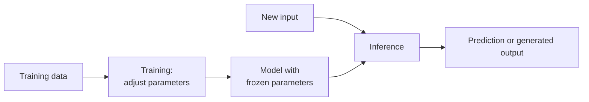
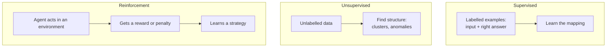
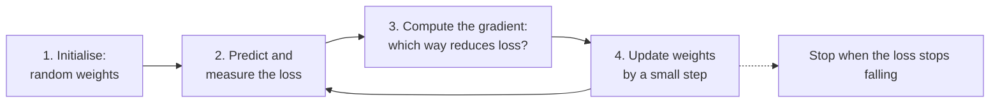
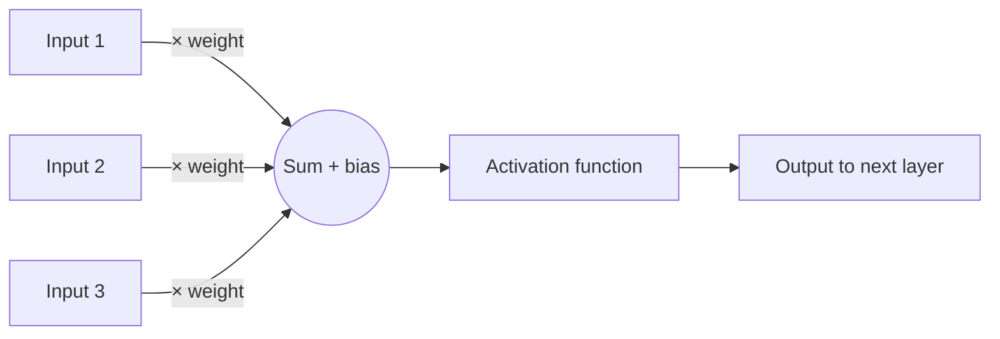
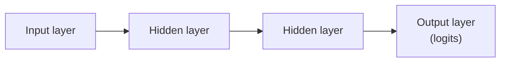
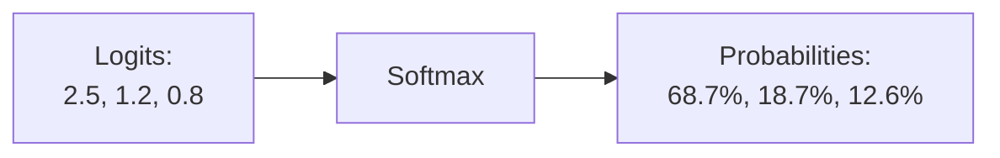

# Chapter 2: How Machines Learn

## 1. The concept, from scratch

### Training, parameters and inference

A machine learning **model** is a function with a lot of adjustable numbers inside it. Those numbers are called **parameters** (mostly **weights** and **biases**). **Training** is the process of adjusting them using data. **Inference** is using the finished model to produce an answer for new input.

After training, the parameters are frozen. The model doesn't learn from your conversations unless someone trains it again. Inference is just running the model.

Crisp interview line: **tokens are what the model processes, parameters are what the model learned.**

Training is far more expensive than inference. You need the data, many passes over it, and extra memory to hold the learning state. That is why almost nobody trains large models from scratch (Chapter 5).

### Three ways a machine learns

- **Supervised learning.** You give the model examples with the right answer attached. It learns to map input to answer. Two flavours: **classification** (pick a category: fraud or not) and **regression** (predict a number: next month's demand). Most predictive AI is supervised.
- **Unsupervised learning.** No answers given. The model looks for structure on its own: group similar customers (**clustering**), spot unusual behaviour (**anomaly detection**).
- **Reinforcement learning (RL).** An **agent** takes actions in an **environment** and receives rewards or penalties. Over many tries it learns a strategy that maximises reward. Think game-playing, robotics, and fine-tuning chatbots from human feedback (RLHF, Chapter 5).

There's a fourth you need for LLMs: **self-supervised learning.** The labels come from the data itself. Hide the next word in a sentence and ask the model to predict it; the answer is already in the text. No human labelling needed, so you can train on enormous amounts of text. That's how LLMs are pre-trained.

### How a model actually improves: loss and gradient descent

How does the model know it's wrong, and how does it fix itself?

- The **loss function** is a score for how wrong the model's predictions are. Lower is better.
- **Gradient descent** is the algorithm that reduces the loss. It's the engine behind almost all machine learning and deep learning.

Step 3 uses calculus: the **gradient** says, for each weight, how the loss changes if you nudge that weight. Step 4 moves every weight a little in the direction that lowers the loss. The size of the step is the **learning rate**. Too big and you overshoot; too small and training crawls. Repeat millions of times and the model converges.

Think of walking downhill in thick fog: you can't see the valley, but you can feel which way the ground slopes under your feet, so you take a step that way, then check again.

### Underfitting and overfitting

The goal isn't to do well on the training data. It's to do well on **new data the model has never seen.** That's called **generalisation**.

| | Underfitting | Good fit | Overfitting |
|---|---|---|---|
| Also called | High bias | Generalises | High variance |
| Model is | Too simple | About right | Too complex or over-trained |
| Training score | Poor | Good | Excellent |
| New-data score | Poor | Good | Poor |
| Student analogy | Didn't study | Understood the subject | Memorised last year's exam |

To detect it, split your data: a **training set** to learn from, a **validation set** to tune and compare, and a **test set** you touch once at the end. A big gap between training and test performance means overfitting. Fixes: more or better data, a simpler model, stopping training earlier, regularisation (penalising complexity).

### Neural networks

A **neural network** (or **artificial neural network, ANN**) is a machine learning model loosely inspired by the brain. It's built from layers of simple units called neurons.

Each **neuron** multiplies its inputs by weights (how important each input is), adds them up with a bias, and passes the result through an **activation function** that decides how strongly to "fire". Stack many neurons into layers and you get a network.

**Deep learning** just means a network with many hidden layers. The learning is the same gradient descent as above: the loss is pushed backwards through the layers (**backpropagation**) to work out how to adjust every weight.

Deep learning families you'll hear about:

- **CNNs** (convolutional networks): images and object detection.
- **RNNs and LSTMs**: sequences such as time series and older text models.
- **Transformers**: the architecture behind modern LLMs (Chapter 4). They replaced RNNs for language.

### Logits and softmax

**A neural network produces logits, which are passed through the softmax function to convert them into probabilities.** At the end of a classification network, the last layer outputs raw scores called **logits**. They can be any number: positive, negative, large. A higher logit means the network favours that choice more.

**Softmax** turns logits into probabilities: all positive, between 0 and 1, adding up to exactly 1.

An LLM does exactly this at every step: it produces a logit for every token in its vocabulary, softmax turns them into probabilities, and the next token is picked from them. This is where **temperature** and sampling act (Chapter 6).

## 2. Analogies across industries

- **Gradient descent (manufacturing).** A plant engineer tuning a machine: check the defect rate, adjust a setting a little in the direction that reduces defects, re-check, repeat. A big adjustment overshoots; a tiny one takes all week. That's the learning rate.
- **Overfitting (insurance).** A pricing model that memorises last year's claims, including one freak storm, will price next year's customers badly. A rate card that's too crude (one price for everyone) misses real risk differences. Underfit and overfit.
- **Supervised vs unsupervised (retail).** Supervised: you hand the model last year's baskets labelled "bought again / didn't" and it learns to predict repeat buyers. Unsupervised: you hand it all customers with no labels and it discovers natural segments, such as bargain hunters and weekly stock-up shoppers.

## 3. How it's used in industry

- **Telecom, churn prediction (supervised).** Learn from customers who stayed or left to flag who is likely to leave next month.
- **Retail, customer segmentation (unsupervised).** Cluster shoppers by behaviour to target offers, with no labels needed.
- **Logistics, route and warehouse robots (reinforcement).** Learn a strategy by trial and reward, often in simulation first.
- **Manufacturing, anomaly detection (unsupervised).** Learn what normal sensor readings look like and flag the machine that drifts away from normal before it fails.

## 4. Common misconceptions

- **"The model keeps learning from my chats."** No. After training the parameters are frozen. Memory in a chat is just earlier messages being sent again (Chapter 6).
- **"High training accuracy means a good model."** It might just be memorisation. Only performance on unseen data counts.
- **"More parameters is always better."** More capacity, yes, but also more compute and memory, and more risk of overfitting on small data.
- **"Neural networks work like the brain."** Loosely inspired by it. They're maths: multiply, add, activate, adjust.
- **"Reinforcement learning is how LLMs learn."** Mostly not. LLMs are pre-trained with self-supervised learning. RL (RLHF) is a later step that tunes behaviour.
- **"Logits are probabilities."** Logits are raw scores. Softmax makes them probabilities.

## 5. Interview questions

### Q1. What's the difference between supervised, unsupervised and reinforcement learning?

In supervised learning I train on labelled examples, input plus the right answer, so the model learns to map one to the other. That covers classification, like fraud or not fraud, and regression, like predicting demand. In unsupervised learning there are no labels, and the model finds structure on its own, for example clustering customers or spotting anomalies. In reinforcement learning an agent acts in an environment, gets rewards or penalties, and learns a strategy that maximises reward over time. I'd also mention self-supervised learning, because that's how LLMs are pre-trained: the label is the next token in the text itself, so no human labelling is needed and you can scale to huge datasets.

### Q2. What is gradient descent?

It's the optimisation algorithm that trains almost every ML and deep learning model. The model has a loss function that measures how wrong its predictions are. Gradient descent starts with random weights, computes the gradient, which tells me how the loss changes if I nudge each weight, then moves the weights a small step in the direction that reduces the loss. I repeat that until the loss stops falling. The step size is the learning rate: too high and it overshoots, too low and it takes forever. The picture I use is walking downhill in fog, feeling the slope under your feet.

### Q3. What are overfitting and underfitting, and how do you handle them?

Underfitting is when the model is too simple to capture the pattern, so it does badly on both training and new data. Overfitting is when it's too complex or trained too long and memorises noise, so it looks great on training data and fails on new data. I detect it by splitting the data into train, validation and test sets and comparing scores: a big gap between training and test performance means overfitting. To fix overfitting I'd get more or better data, simplify the model, stop training earlier or add regularisation. To fix underfitting I'd use a more expressive model or better features. And I'd mention that the test set stays untouched until the end, otherwise I'm fooling myself.

### Q4. How does a neural network learn?

A neural network is layers of neurons. Each neuron multiplies its inputs by weights, adds a bias, and passes the result through an activation function. The network makes a prediction, a loss function measures the error, and then backpropagation works out how much each weight contributed to that error, layer by layer from the output backwards. Gradient descent then adjusts all the weights a little to reduce the loss. Repeat that over a lot of data and the weights settle into values that capture the patterns. Deep learning just means many hidden layers.

### Q5. What are logits and softmax?

A neural network produces logits, and those are passed through the softmax function to convert them into probabilities. Logits are the raw, unnormalised scores from the last layer of the network. They can be any number, and a higher logit means the network favours that option. Softmax converts them into probabilities that are all between 0 and 1 and sum to exactly 1. For example logits of 2.5, 1.2 and 0.8 become roughly 69%, 19% and 13%. It matters for LLMs because at every step the model produces a logit for each token in its vocabulary, softmax turns those into probabilities, and the next token is sampled from them. Settings like temperature work on that distribution.

### Q6. What's the difference between parameters and tokens?

Tokens are the pieces of text the model reads and writes, the input and output. Parameters are the numbers inside the model, its weights, that it learned during training. So I say tokens are what the model processes and parameters are what it learned. More parameters means more capacity to store patterns, but also more compute and memory, and higher cost to run. Context windows and pricing are measured in tokens; model size is measured in parameters.

### Q7. What's the difference between training and inference?

Training is when the model learns: it sees data, computes loss and adjusts its parameters with gradient descent. It's expensive and needs a lot of memory for the learning state. Inference is when the finished model is used to produce outputs for new inputs. The parameters are frozen, so the model isn't learning from user requests. This is why a model has a knowledge cutoff, and why getting it to use new information means giving it that information at inference time, for example through RAG, rather than retraining.

### Q8. Why are LLMs trained with self-supervised learning?

Because labelling data by hand doesn't scale. In self-supervised learning the labels come from the data itself: I hide the next token in a text and the model predicts it, and the correct answer is already there. That means I can train on trillions of tokens of raw text with no human annotation, which is what lets models get so capable. Human-labelled data and reinforcement learning come in later, in fine-tuning and preference tuning, to shape behaviour rather than to teach language.

## 6. Scenario exercise

**The brief.** A retailer built a model to predict which products will sell out each week. In testing it was 98% accurate, and the team celebrated. Six weeks after launch, the buyers say the forecasts are useless. The head of data asks you: "What went wrong?"

**Your task, from memory, before opening the answer:**

1. What are the most likely explanations, given what this chapter covered?
2. What would you check first?
3. How do you stop it happening next time?

Model answer

**Most likely causes:**

- **Overfitting.** It memorised the training period, including one-offs like a promotion or a heatwave, and doesn't generalise.
- **A weak test.** If the "test set" was drawn from the same weeks as training, or the team tuned against it repeatedly, 98% means nothing. Also check for **data leakage**: a feature that quietly contains the answer, such as a stock-out flag that is only known after the fact.
- **A misleading metric.** If only 2% of products sell out, a model that predicts "never sells out" is 98% accurate and useless. Look at precision and recall on the sell-out class, not overall accuracy.
- **Data drift.** The real world changed after training: new products, seasonality, a competitor, a pricing change. The model is now seeing inputs unlike its training data.

**Check first:** how the test set was built (time-based split or random?), the class balance, and performance on the last six weeks of real data against a simple baseline such as "same as last week". If it can't beat the baseline, it adds nothing.

**Prevent it:** split by time so the test set is genuinely in the future, pick metrics that match the business cost of errors, compare against a baseline, hold back a final untouched test set, and monitor live performance with an alert when it degrades so you retrain on fresh data.

## 7. Key takeaways

- Training adjusts parameters using data; inference uses the frozen model. Tokens are what it processes, parameters are what it learned.
- Supervised (labelled), unsupervised (no labels), reinforcement (rewards), and self-supervised (labels from the data itself, how LLMs are pre-trained).
- Gradient descent reduces the loss by taking small steps against the gradient; the learning rate sets the step size.
- Overfitting is memorising, underfitting is not learning; judge a model only on unseen data.
- A neural network produces logits; softmax converts them into probabilities, which is where LLM sampling happens.

## 8. Further reading

- Google, [Machine Learning Crash Course](https://developers.google.com/machine-learning/crash-course): free and practical, covers loss, gradient descent, overfitting and neural networks.
- 3Blue1Brown, [Neural networks](https://www.3blue1brown.com/topics/neural-networks): the clearest visual explanation of neurons, gradient descent and backpropagation.
- Goodfellow, Bengio and Courville, [*Deep Learning*](https://www.deeplearningbook.org/): the standard textbook, free online.
- Sutton and Barto, [*Reinforcement Learning: An Introduction*](http://incompleteideas.net/book/the-book-2nd.html): the standard RL reference, free online.
