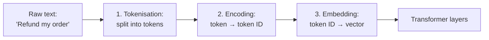
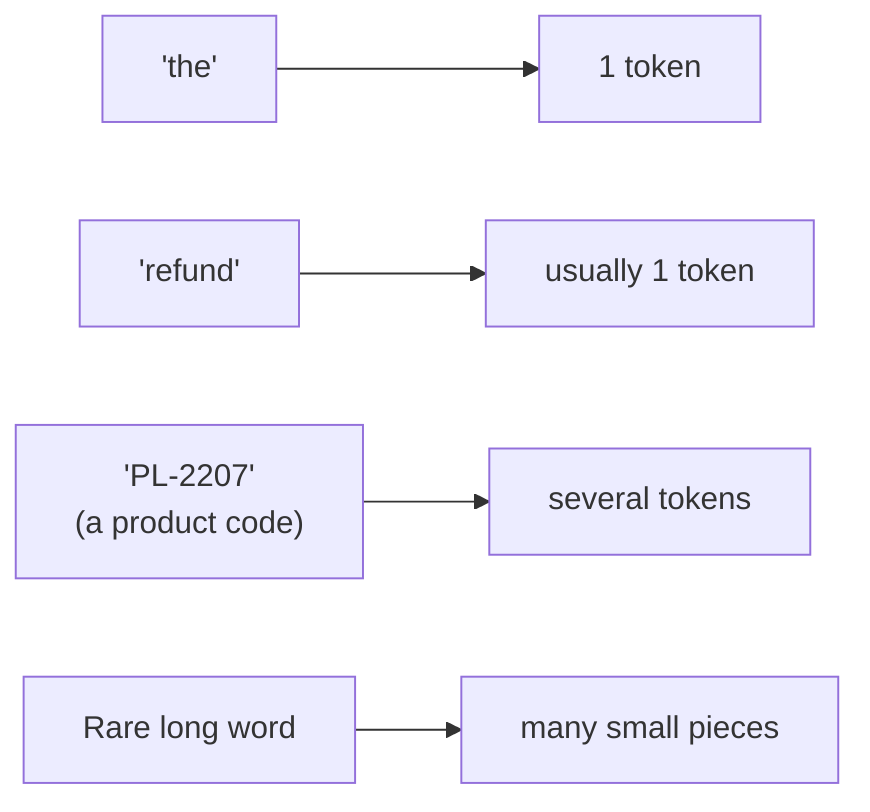
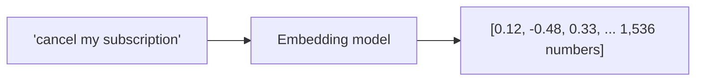
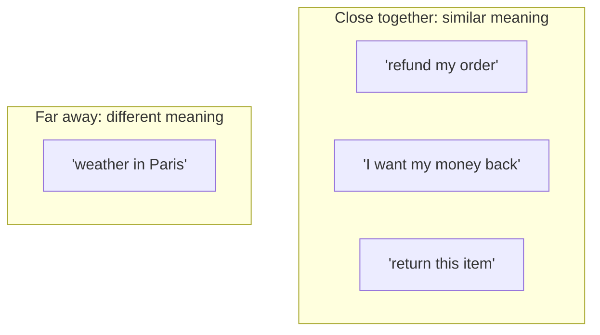
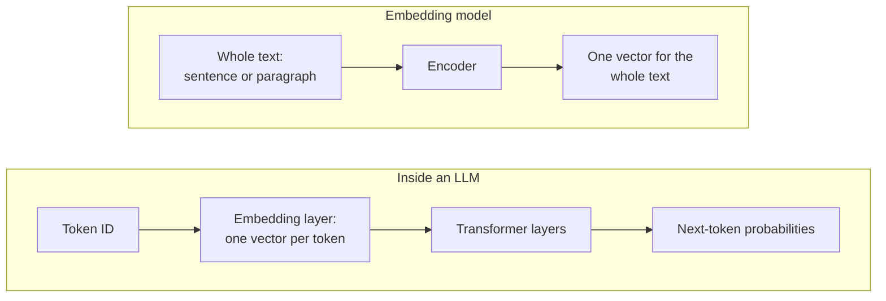

# Chapter 3: Tokens and Embeddings

## 1. The concept, from scratch

### Text becomes numbers in three separate steps

A model can't read text. It only does maths on numbers. So before an LLM sees your sentence, the text goes through three steps. Interviewers like to check that you know they are separate.

- **Tokenisation** splits text into small pieces called **tokens**. This is done by a **tokenizer**, which is plain code with a fixed rulebook, not a neural network.
- **Encoding** looks up each token in the model's **vocabulary** (a fixed dictionary) and swaps it for its **token ID**, an integer.
- **Embedding** turns each token ID into a **vector**: a long list of decimal numbers. This lookup is part of the model itself, and its numbers were learned in training.

A common mix-up is to say "tokenisation converts text into vectors". It doesn't. Tokenisation gives you tokens and IDs. Embedding is what gives you vectors.

### What a token is

A token is a chunk of text: a whole word, part of a word, a punctuation mark, or a space. Common words are usually one token. Rare or long words get split into several pieces. Most modern tokenizers use **subword** methods such as byte-pair encoding, so any text can be built from a fixed vocabulary of pieces.

The exact split depends on the model's tokenizer, so the same text can have a different token count in a different model.

**Rule of thumb for English** (as of Nov 2026, [OpenAI](https://help.openai.com/en/articles/4936856-what-are-tokens-and-how-to-count-them)): about 4 characters per token, or about three-quarters of a word. So 100 tokens is roughly 75 words. It's an estimate. Code, numbers, JSON and many non-English languages usually take more tokens for the same meaning. For an exact count, use the tokenizer of the model you're calling.

Why tokens matter to you as an engineer: **price, speed and size limits are all counted in tokens.** You pay per token in and out. The context window is a token limit ([Chapter 7](../07-context-windows-and-context-engineering/README.md)). Longer outputs take longer, because the model writes one token at a time.

A token ID is just an address in the dictionary. Token 4721 doesn't mean anything on its own. The **meaning** lives in the vector.

### What an embedding is

An **embedding** is a vector that represents meaning. A **vector** is just a list of numbers, and the number of entries is its **dimensionality**. If an embedding model has 1,536 dimensions, every piece of text becomes a list of 1,536 decimals.

Think of the dimensions as 1,536 dials the model uses to describe a piece of text. No single dial means one human-readable thing. Combinations of dials capture different facets of meaning: topic, tone, sense of the word. More dimensions give more room to separate subtle differences, at the price of more storage and slower search. 1,536 is a design choice of particular models, not a rule. For example, OpenAI's text-embedding-3-small defaults to 1,536 dimensions and text-embedding-3-large to 3,072, and both let you ask for shorter vectors (as of Nov 2026, [OpenAI embeddings guide](https://developers.openai.com/api/docs/guides/embeddings.md)).

### Meaning is closeness, relationship is direction

This is the idea that makes semantic search work. Picture every piece of text as a point in a huge space.

- **Meaning is encoded by closeness.** If two vectors are close together, the texts have similar meanings. "Refund my order" and "I want my money back" land near each other. "Weather in Paris" lands far away.
- **Relationship is encoded by direction.** If two vectors point in the same direction, they are related. The classic illustration: the step from "man" to "woman" points roughly the same way as the step from "king" to "queen". The model has learned a direction for the relationship, not just locations.

To measure it, computers use a **similarity function**. The most common is **cosine similarity**, which compares the *angle* between two vectors, in other words whether they point the same way, and ignores their length. Score near 1 means very similar, near 0 means unrelated. **Dot product** is a close cousin; on vectors normalised to length 1 it gives the same ranking as cosine and is faster. **Euclidean distance** measures straight-line distance instead.

This is what lets a search for "early repayment charge" find a passage about "prepayment penalty" even though they share no words. That's **semantic search**, and it's the heart of RAG ([Chapter 11](../11-rag-fundamentals/README.md)). The weakness: exact strings such as product codes or invoice numbers carry almost no meaning, so meaning-based search is fuzzy on them. [Chapter 13](../13-vector-search-and-databases/README.md) fixes that with keyword search.

### Two kinds of embeddings: inside an LLM, and embedding models

These get confused, and "why are embedding models different from LLMs?" is a common question.

- **Inside an LLM**, an embedding layer is a big lookup table: one learned vector per token ID. That's the model's input. The transformer layers then refine these vectors using the surrounding words ([Chapter 4](../04-transformers-and-attention/README.md)). The model's *output* is a probability for each possible next token, which becomes text.
- **An embedding model** is a separate model built for one job: take a whole piece of text and return **one vector** that captures its overall meaning. It is trained so that texts with similar meaning end up close together. It doesn't write text. You use it for search, clustering, recommendations and deduplication.

So an LLM is trained to *generate*, and an embedding model is trained to *represent*. They are different models doing different jobs, and you'll use both in a RAG system: the embedding model finds the documents, the LLM writes the answer.

Two practical rules:

- **The same embedding model must embed both the documents and the query.** Vectors from different models live in different spaces and can't be compared.
- **If you change the embedding model, you must re-embed everything.** That's why embedding model choice, and versioning it, matters in production.

## 2. Analogies across industries

- **Tokens priced like data (telecom).** A mobile plan charges per megabyte, not per web page. An LLM charges per token, not per message. A long message costs more, and so does a chatty history that is resent each time.
- **Token ID vs vector (logistics).** A token ID is like a parcel's tracking number: it identifies the parcel but says nothing about what's inside. The embedding is the contents description that tells you what it is.
- **Closeness and direction (retail).** A supermarket puts pasta next to pasta sauce: related products are placed near each other (closeness encodes meaning). And moving from "budget" to "premium" in any aisle is the same kind of step: the same direction in every aisle (direction encodes a relationship).

## 3. How it's used in industry

- **E-commerce, product search.** Shoppers type "something warm for hiking in the rain" and the system finds jackets by meaning, not only by matching words in the title.
- **Healthcare, clinical search.** Staff search guidelines with their own wording and still find the relevant protocol, because the embeddings match meaning, not exact terms.
- **Telecom, support deflation.** Incoming tickets are embedded and matched to similar past tickets and known fixes, and duplicates are grouped together.
- **Any industry, cost control.** Teams count tokens before launch to forecast the monthly bill and to set limits on how much history and how many documents go into each call.

## 4. Common misconceptions

- **"A token is a word."** Often it isn't. It can be part of a word, punctuation or a space. Rule of thumb: about three-quarters of an English word.
- **"Tokenisation turns text into vectors."** It turns text into tokens and IDs. Embedding turns IDs into vectors.
- **"The token ID carries the meaning."** The ID is just an address. The vector carries the meaning.
- **"The same text always costs the same."** Token counts differ across models, languages and content types. Code and non-English text usually cost more tokens for the same idea.
- **"More dimensions is always better."** More dimensions can separate finer differences, but cost more to store and search. Quality depends on how well the model was trained, not only on size.
- **"Each dimension has a meaning I can read."** Not individually. Meaning is spread across many dimensions.
- **"I can mix vectors from different embedding models."** No. They live in different spaces. Re-embed everything if you switch.
- **"Embedding models and LLMs are the same thing."** Different jobs: one represents text as a vector, the other generates text.

## 5. Interview questions

### Q1. What is a token, and why does it matter?

A token is the basic unit of text a model reads and writes: a whole word, part of a word, punctuation, or a space. A tokenizer splits text into tokens using a fixed vocabulary. In English a token is roughly four characters, or about three-quarters of a word, but that's an estimate and varies by model. It matters because everything is counted in tokens: I pay per token in and out, the context window is a token limit, and latency grows with output tokens because the model generates one at a time. Code, JSON and many non-English languages usually need more tokens for the same content, so I'd always count tokens with the actual model's tokenizer when forecasting cost, rather than guessing from word counts.

### Q2. What's the difference between tokenisation and embedding?

They're two separate steps in a pipeline. Tokenisation splits the text into tokens, and encoding maps each token to an integer ID using the vocabulary. That's mechanical code, no learning, and the IDs themselves carry no meaning. Embedding then maps each token ID to a vector, a long list of decimals, using a lookup table that was learned during training. The vector is what represents meaning. So the flow is text, then tokens, then token IDs, then vectors. If someone says "tokenisation converts text to vectors", that's blending two steps.

### Q3. What is an embedding, and what do the dimensions mean?

An embedding is a vector, a list of numbers, that represents the meaning of a piece of text. If the model has 1,536 dimensions, the text becomes 1,536 numbers. I think of them as 1,536 dials the model uses to describe the text. No single dial has a human-readable meaning, but combinations of them capture facets like topic and sense. The key property is that texts with similar meaning get nearby vectors, and unrelated texts end up far apart. The dimension count is a design choice of the model: more dimensions can capture finer distinctions but cost more storage and slower search. Some models, such as OpenAI's embedding models, let you shorten the vectors to trade a little quality for lower cost.

### Q4. How does a computer decide that two texts mean the same thing?

It embeds both texts into vectors and measures how close they are. The usual measure is cosine similarity, which looks at the angle between the vectors, whether they point in the same direction, and ignores their length. A score near one means very similar, near zero means unrelated. If the vectors are normalised to unit length, dot product gives the same ranking and is cheaper, so many systems use that. The way I'd say it: meaning is encoded by closeness, and relationships are encoded by direction. That's how a search for "early repayment charge" can find a passage about "prepayment penalty" even though they share no words.

### Q5. Why are embedding models different from LLMs?

They're built and trained for different jobs. An LLM is trained to predict the next token, so its output is probabilities over tokens, which become generated text. An embedding model is trained to turn a whole piece of text into a single vector so that texts with similar meaning end up close together. It doesn't generate anything. Embedding models are usually much smaller and cheaper to run, which matters because I may embed millions of documents. In a RAG system I use both: the embedding model turns the query and the documents into vectors to find the relevant passages, and then the LLM reads those passages and writes the answer.

### Q6. What happens if you switch to a different embedding model in production?

Everything you've already indexed becomes unusable for new queries, because vectors from different models live in different spaces and aren't comparable. The query and the documents must be embedded by the same model. So a switch means re-embedding the whole corpus and rebuilding the index, ideally into a new index running in parallel so I can compare retrieval quality against my test set and cut over without downtime. That's also why I record the embedding model name and version alongside each vector, and why I choose the embedding model carefully up front.

## 6. Scenario exercise

**The brief.** A logistics company launched a customer support assistant. Finance had forecast the monthly LLM bill by taking the expected word count and converting at "one word, one token". The first invoice is about three times the forecast. Customers write in several languages, the assistant receives shipment records as JSON, and the app sends the full chat history with every message. The CFO asks you for an explanation and a plan.

**Your task, from memory, before opening the answer:**

1. Why was the forecast so far off?
2. What would you measure first?
3. What would you change to bring the cost down?

Model answer

**Why the forecast was wrong:**

- **Words are not tokens.** For English it's roughly four characters per token, but code, JSON and many non-English languages need more tokens for the same content. The forecast ignored language and content type.
- **JSON is token-heavy.** Braces, quotes, field names and repeated keys all become tokens. Sending raw shipment records costs far more than the information inside them.
- **History is resent every time.** The model is stateless, so each message carries the entire conversation. Input tokens grow with every turn, and the whole history is billed again on each call.
- **Output counts too,** and output tokens are typically priced higher than input tokens (check the provider's current price list).

**Measure first:** token counts per request using the actual model's tokenizer, split by input and output, by language, by system prompt, history, retrieved or record data and answer. Look at the distribution by conversation length, not just the average.

**Plan:**

- Trim what is sent: pass only the fields the model needs from each shipment record, in a compact format, instead of whole JSON.
- Limit and compress history: keep recent turns and a summary of older ones.
- Reuse the stable prompt prefix with provider prompt caching where available, and cap output length.
- Route simple questions to a smaller model, and forecast again with measured token counts per language.
- Set budgets and alerts per conversation so a surprise shows up in a day, not on the invoice.

## 7. Key takeaways

- Text goes through three separate steps: tokenisation (text to tokens), encoding (tokens to IDs), embedding (IDs to vectors). The ID is an address; the vector holds the meaning.
- A token is about four characters, or three-quarters of an English word. Price, speed and context limits are all counted in tokens.
- An embedding is a vector that represents meaning. Meaning is encoded by closeness, relationship by direction.
- Cosine similarity compares direction; on normalised vectors, dot product ranks the same way.
- Embedding models represent text; LLMs generate it. Use the same embedding model for documents and queries, and re-embed everything if you change it.

## 8. Further reading

- OpenAI, [What are tokens and how to count them](https://help.openai.com/en/articles/4936856-what-are-tokens-and-how-to-count-them): the rule of thumb and the tokenizer tool.
- OpenAI, [Vector embeddings guide](https://developers.openai.com/api/docs/guides/embeddings.md): dimensions, similarity and shortening vectors.
- Sennrich, Haddow and Birch, [*Neural Machine Translation of Rare Words with Subword Units*](https://arxiv.org/abs/1508.07909) (2015): the paper that brought byte-pair encoding to NLP.
- Mikolov et al., [*Efficient Estimation of Word Representations in Vector Space*](https://arxiv.org/abs/1301.3781) (2013): the word2vec paper behind the king, queen example.
