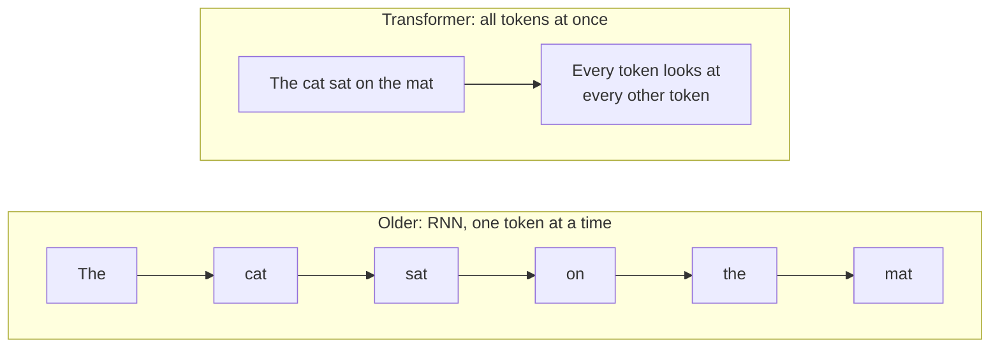
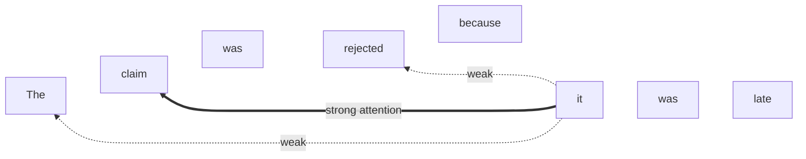
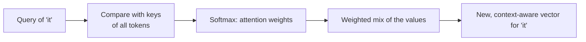
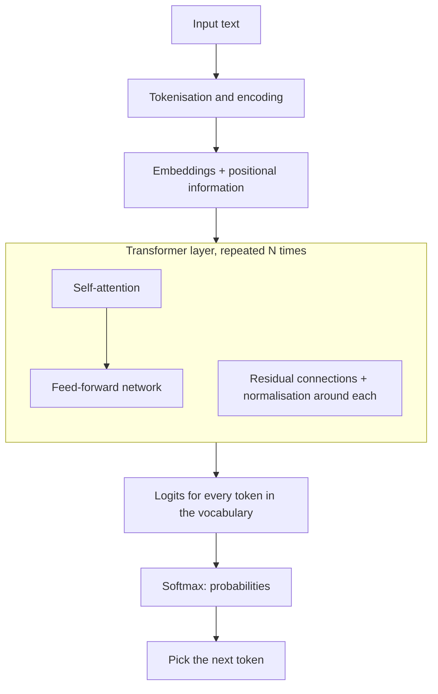
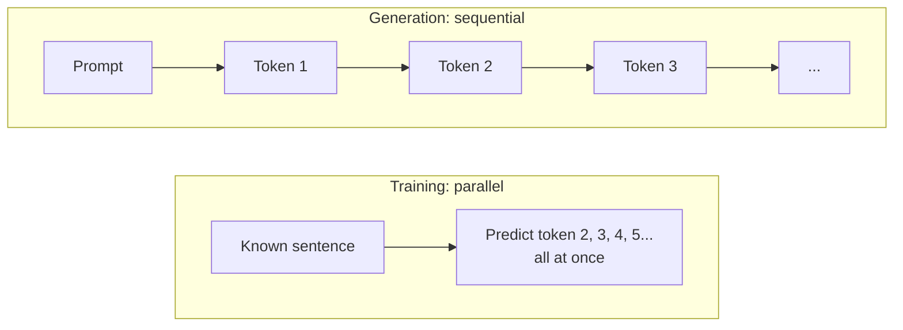

# Chapter 4: Transformers and Attention

## 1. The concept, from scratch

### What a transformer is

A **transformer** is the neural network architecture behind modern LLMs, including the GPT family and Llama. It was introduced in the 2017 paper *Attention Is All You Need*. Its big idea is simple:

**Instead of reading words one by one, the model looks at all the words at once and works out which ones matter to each other.** That mechanism is called **self-attention**.

Before transformers, text models such as RNNs and LSTMs read a sentence one token at a time and passed a running memory along. That had two problems: they forgot the early parts of long text, and they couldn't be sped up much, because each step waited for the previous one.

### Why words need context

Meaning depends on the neighbours. "Apple" in "apple pie", "Apple iPhone" and "apple juice" is three different things. In "The claim was rejected because **it** was late", what does "it" refer to? A human knows it's the claim. The model has to work that out too.

When a token enters the model, its embedding ([Chapter 3](../03-tokens-and-embeddings/README.md)) is the same wherever the word appears. **Self-attention is how each token looks at the other tokens in the sentence and updates its own vector based on them.** After attention, "it" carries a lot of "claim" in its vector. In ML terms, we say "it" *attends* more to "claim".

So attention gives a token its meaning *from its surroundings*. Same word, different context, different vector.

### How attention works: query, key, value

You don't need the maths in an interview, but the intuition is a good one to have. Each token produces three vectors:

- **Query:** what am I looking for?
- **Key:** what do I contain, what can I be matched on?
- **Value:** the information I'll hand over if I'm picked.

For one token, the model compares its query with every token's key to get a **relevance score**. Softmax ([Chapter 2](../02-how-machines-learn/README.md)) turns the scores into weights that add to 1. The token then takes a **weighted mix of everyone's values**. High-weight tokens contribute most.

Think of a library search: your query is your question, the keys are the labels on the shelves, and the values are the books. You take most from the shelves whose labels match best.

**Multi-head attention** runs several of these attention operations in parallel, each with its own learned query, key and value settings. Each "head" can pick up a different kind of pattern, such as which noun a pronoun refers to, or which words belong to the same phrase. The results are combined.

### Word order: positional information

Attention on its own treats the tokens like an unordered bag. "Dog bites man" and "man bites dog" would look the same. So the model adds **positional information** to each token's vector, so it knows where each token sits in the sequence. Order matters, so this is essential.

### The layer stack

A transformer is not one attention step. It's a stack of identical **layers** (also called blocks), often dozens of them. Each layer does three things:

1. **Self-attention:** tokens exchange information with each other.
2. **Feed-forward network:** each token's vector is transformed further, on its own.
3. **Normalisation and residual connections:** keep the numbers stable and let information skip around layers, which makes very deep networks trainable.

Early layers tend to capture simple patterns and later layers more abstract ones. The final output is **logits**, one per token in the vocabulary. Softmax turns them into probabilities, and the next token is picked from them. So at its core, **an LLM is a giant next-token prediction engine.**

### Why training parallelises, and generation doesn't

This is a favourite interview question.

Because tokens don't have to wait for each other, transformers run well on GPUs, which do thousands of operations at once. That is what let people train models with billions of parameters.

- **Training can be parallel.** The whole training sentence is already known, so the model predicts the next token at *every position at the same time*. A rule called **causal masking** stops each position from peeking at tokens to its right. One pass trains on all positions.
- **Generation is sequential.** At answer time you don't know the next token until you've produced it. So the model generates one token, appends it to the input, and runs again. Each new token depends on the previous one. This loop is why output is streamed token by token and why long answers take time.

(How the serving side speeds up generation, for example with caching, is covered in [Chapter 33](../33-inference-engineering/README.md).)

### Three transformer families

| Family | What it does | Typical use | Examples |
|---|---|---|---|
| **Encoder-only** | Reads the whole input both ways and builds a deep understanding of it | Classification, embeddings, search, reranking | BERT |
| **Decoder-only** | Generates text one token at a time, each token seeing only what came before (autoregressive) | Chat, writing, code, reasoning | The GPT family, Llama |
| **Encoder-decoder** | Encodes an input, then decodes an output from it | Translation, summarisation | T5 |

Most modern LLMs are decoder-only. That's the architecture you'll work with day to day. Encoder-only models still matter a great deal: they are behind many embedding models ([Chapter 3](../03-tokens-and-embeddings/README.md)) and rerankers ([Chapter 14](../14-improving-retrieval/README.md)).

GPT stands for **Generative Pre-trained Transformer**: it generates, it has been pre-trained on huge amounts of text, and it's a transformer.

### The cost of attention

Attention compares every token with every other token. For a context of *n* tokens, that is about *n* × *n* comparisons. So in the attention part of the model, **doubling the context length roughly quadruples the compute.** Providers use many optimisations, but longer inputs still cost more and run slower. That's one reason big context windows are expensive, and it's why [Chapter 7](../07-context-windows-and-context-engineering/README.md) is about filling the window deliberately.

### Where capabilities come from

Nobody programs a transformer to summarise, translate or write code. It's trained to predict the next token over huge amounts of text, and abilities such as summarisation, reasoning and tool use show up as a result. People call these **emergent capabilities**. How far to read into that word is debated, but the practical point stands: the same model, with the right prompt, does many tasks.

## 2. Analogies across industries

- **Self-attention (insurance).** A claims handler reading a file doesn't read each line in isolation. When they reach "he disputed it", they look back to find what "it" is: the denial, the valuation, the repair estimate. Attention is every word doing that look-back at once, weighting what is most relevant.
- **Parallel vs sequential (logistics).** Training is a warehouse where every parcel on the belt is scanned at the same moment. Generation is a courier delivering one parcel, then deciding the next stop only after the last delivery is confirmed.
- **Encoder vs decoder (healthcare).** An encoder model is like the radiologist who reads the whole scan and files a diagnosis code. A decoder model is like the doctor dictating a letter word by word, where each word depends on what was already said.

## 3. How it's used in industry

- **Healthcare, referral triage.** An encoder-style model, fine-tuned, classifies incoming referral letters by specialty at high volume and low cost.
- **Insurance, claim summaries.** A decoder-only LLM drafts a case summary from the claim file for the adjuster to review.
- **E-commerce, search.** An encoder-based embedding model turns products and queries into vectors for meaning-based search, then a decoder-only LLM answers questions about the results.
- **Travel, translation and itineraries.** Encoder-decoder and decoder-only models translate customer messages and generate trip plans.

## 4. Common misconceptions

- **"Attention means the model understands like a human."** Attention is a weighted mix of vectors. It's a mechanism, not comprehension.
- **"Transformers read left to right like us."** Self-attention looks at all tokens at once, which is why order has to be added back as positional information. (Decoder-only models do mask the future during training and generation, but within the visible part every token attends to all earlier ones.)
- **"Generation is parallel because training is."** Training is parallel. Generation is one token at a time.
- **"An LLM looks up the answer."** It predicts the next token from patterns in its parameters. It doesn't retrieve stored text.
- **"Bigger context window is free."** Attention cost grows roughly with the square of the length, and you pay per token as well.
- **"BERT and GPT are the same kind of model."** BERT is encoder-only (understanding, embeddings). GPT is decoder-only (generation).
- **"Multi-head attention means separate models."** It's several attention operations inside one model, run in parallel.

## 5. Interview questions

### Q1. What is a transformer, and why did it replace RNNs?

A transformer is a neural network architecture built around self-attention. Instead of reading text one token at a time and passing memory along like an RNN or LSTM, it looks at all the tokens at once and works out how much each token should attend to every other token. That fixed two problems. First, RNNs struggled with long-range context because early information faded as it was passed along. Second, they were sequential, so you couldn't parallelise training well. Transformers parallelise across tokens, which suits GPUs, and that's what made it practical to train models with billions of parameters. It's the architecture behind GPT, Llama and most modern LLMs.

### Q2. Explain self-attention in simple terms.

Self-attention is how each token in the input looks at the other tokens to understand itself in context. Take "the claim was rejected because it was late". The word "it" on its own is ambiguous, but through attention it gives high weight to "claim", and its vector gets updated to carry that information. Mechanically, each token produces a query, a key and a value. The query of one token is compared with the keys of all tokens to get relevance scores, softmax turns those into weights, and the token takes a weighted mix of everyone's values. The result is that the same word gets a different vector depending on the words around it, so "apple" in "apple juice" and "Apple iPhone" end up with different representations.

### Q3. What are query, key and value?

They're three vectors each token produces for attention. The query says what this token is looking for, the key says what this token offers to be matched on, and the value is the information it passes along if it's selected. I compare my query with everyone's keys, get relevance scores, normalise them with softmax into weights, and then combine the values using those weights. A library is a decent picture: the query is your question, the keys are the labels on the shelves, and the values are the books you pull from. Multi-head attention just does this several times in parallel with different learned settings, so different heads can pick up different patterns.

### Q4. Why can LLM training be parallel but generation can't?

During training, the full text is already known. So I can predict the next token at every position in the same pass, and a causal mask stops each position from seeing tokens to its right. All positions are trained at once, which GPUs handle very well. During generation, I don't know the next token until I've produced it, so I generate one token, append it to the input, and run the model again. Each step depends on the previous one, so it's inherently sequential. That's why responses stream token by token and why latency grows with output length. Serving systems then use tricks like caching to make each step cheaper, but the loop itself stays sequential.

### Q5. What's the difference between encoder-only, decoder-only and encoder-decoder models?

Encoder-only models like BERT read the whole input in both directions and build a rich representation of it. They're used for classification, embeddings, search and reranking, and they don't generate text. Decoder-only models like the GPT family and Llama generate text autoregressively, one token at a time, with each token seeing only what came before. That's what most modern LLMs are, and it's what powers chat, writing and code. Encoder-decoder models like T5 encode an input and then decode an output from it, which suits translation and summarisation. In a RAG system I typically use an encoder-based model for embeddings and reranking, and a decoder-only LLM for the answer.

### Q6. Why does a longer context make the model slower and more expensive?

Two reasons. First, you pay per token, so more tokens in means more cost. Second, attention compares every token with every other token, so the attention compute grows roughly with the square of the sequence length. Double the context and the attention work roughly quadruples. Providers use optimisations, so the real-world curve is gentler, but long inputs are still slower and costlier. On top of that, long contexts can hurt quality, because the model may pay less attention to information buried in the middle. So I don't just stuff everything in. I choose what goes into the context deliberately.

### Q7. Why do transformers need positional information?

Self-attention on its own has no sense of order. It compares tokens with each other, so if you shuffled the words, the comparisons would look the same, and "dog bites man" would be indistinguishable from "man bites dog". So the model adds positional information to each token's vector, so it knows where each token sits in the sequence. Without it, the model couldn't tell who did what to whom.

### Q8. Walk me through what happens when I send a prompt to an LLM.

First the text is tokenised into tokens and mapped to token IDs. Each ID is looked up in an embedding table to get a vector, and positional information is added. Those vectors go through a stack of transformer layers, and in each layer self-attention lets the tokens exchange information, then a feed-forward network transforms each one. At the end the model outputs logits, a score for every token in its vocabulary, and softmax turns them into probabilities. A sampling step, controlled by settings like temperature, picks the next token. That token is appended to the input and the whole thing repeats, one token at a time, until the model emits a stop token or hits the length limit. And since the model is stateless, if I want a conversation, my application resends the whole history with each request.

## 6. Scenario exercise

**The brief.** A hospital group wants AI for two jobs. First, sort about 100,000 incoming referral letters a day into 12 specialties. Second, draft discharge summaries for doctors to review. A vendor says: "Use one large GPT-style model for both, it's simplest." Your client asks whether that's right.

**Your task, from memory, before opening the answer:**

1. Which of the two jobs is predictive and which is generative?
2. Which transformer family would you consider for each, and why?
3. What would you check before agreeing to the vendor's proposal?

Model answer

**Two different jobs.**

- *Referral sorting* is predictive: put each letter into one of 12 known categories. An encoder-style model, such as a BERT-type model, fine-tuned on labelled letters, is a strong fit. It's small, fast and cheap per letter, gives a consistent label with a confidence score, and at 100,000 letters a day that cost and speed matter a lot. A large generative model can do it too, but you pay for generation capability you don't need, and the output is probabilistic text you then have to validate.
- *Discharge summaries* are generative: write new text from a record. That's a decoder-only LLM, with the doctor reviewing every draft because it can invent plausible details.

**So "one model for both" is simpler to buy but probably not the right design.** It's the predictive-plus-generative pattern from Chapter 1: a cheap classifier for the high-volume classification, an LLM for the generation.

**Check before agreeing:**

- Accuracy on a labelled sample of real referral letters for both approaches, not the vendor's demo.
- Cost and latency at 100,000 letters a day, using token counts.
- Where patient data goes and who can see it.
- Failure handling: low-confidence letters go to a human, and summaries need clinician sign-off with sources shown.

## 7. Key takeaways

- A transformer looks at all tokens at once; self-attention lets each token update its meaning from the others, so context shapes meaning.
- Each token makes a query, key and value; attention is a weighted mix of values. Positional information restores word order.
- A model is a stack of layers (attention, feed-forward, normalisation and residuals) ending in logits, then softmax, then the next token.
- Training is parallel; generation is sequential, one token at a time.
- Encoder-only (BERT) understands, decoder-only (GPT, Llama) generates, encoder-decoder (T5) transforms. Attention cost grows roughly with the square of the context length.

## 8. Further reading

- Vaswani et al., [*Attention Is All You Need*](https://arxiv.org/abs/1706.03762) (2017): the original transformer paper.
- Jay Alammar, [The Illustrated Transformer](https://jalammar.github.io/illustrated-transformer/): the clearest visual walk-through of attention and the layer stack.
- Devlin et al., [*BERT: Pre-training of Deep Bidirectional Transformers*](https://arxiv.org/abs/1810.04805) (2018): the encoder-only family.
- Raffel et al., [*Exploring the Limits of Transfer Learning with a Unified Text-to-Text Transformer*](https://arxiv.org/abs/1910.10683) (2019): the T5 encoder-decoder paper.
