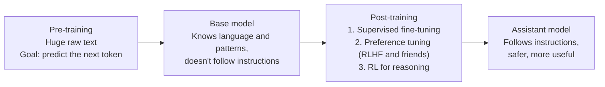
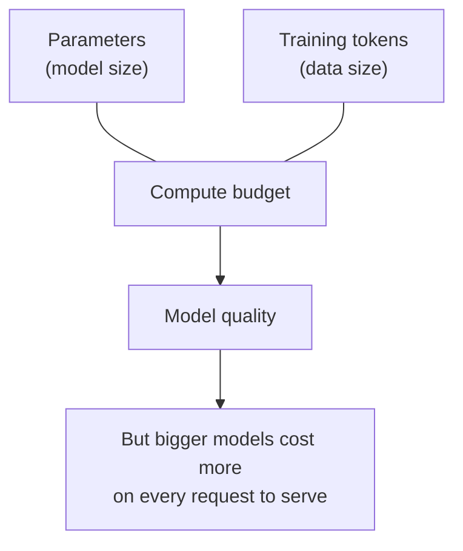
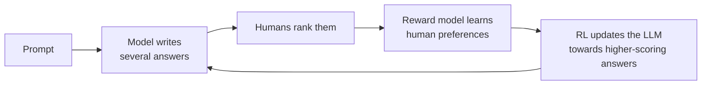

# Chapter 5: Training LLMs

## 1. The concept, from scratch

### The big picture: three stages

An LLM isn't trained once. It goes through stages, and each stage changes what the model is good at. The basic loop is the same at every stage: predict, measure the error with a loss, adjust the parameters. What changes is the data and the goal.

Say it like this in an interview: **pre-training gives the model its knowledge of language and the world; post-training teaches it how to behave.**

### Stage 1: Pre-training

In **pre-training**, the model reads an enormous amount of text and learns one thing: given the tokens so far, predict the next token ([Chapter 4](../04-transformers-and-attention/README.md)). That's it. No labels are needed, because the text supplies its own answers: the next word is the label. This is **self-supervised learning** ([Chapter 2](../02-how-machines-learn/README.md)).

To get good at predicting the next token across books, code, forums and papers, the model has to pick up grammar, facts, style and some reasoning patterns. Nobody tells it to learn any of that.

What goes in:

- **Data.** Web crawls, books, code, scientific papers, and in many labs, synthetic data generated by earlier models. Raw data is messy, so labs spend a lot of effort on **data curation**: removing duplicates, filtering low-quality and unsafe text, and balancing the mix of sources. Data quality matters at least as much as quantity.
- **Parameters.** The model's size, from under a billion to hundreds of billions. More parameters means more capacity.
- **Compute.** Thousands of GPUs running for weeks or months. This is why pre-training is a cost only a few organisations can carry.

Pre-training is a one-off, huge investment. The result is a **base model**.

### Scale: parameters, tokens and compute

Three numbers describe a training run: the number of parameters, the number of training tokens, and the compute spent. They are linked. A well-known 2022 paper from DeepMind, often called the **Chinchilla** paper, showed that for a fixed compute budget, many earlier models were too big and had seen too little data. Their 70-billion-parameter Chinchilla, trained on 1.4 trillion tokens, beat the much larger 280-billion-parameter Gopher. The takeaway is that model size and data should grow together. A commonly quoted rule of thumb is about 20 training tokens per parameter, but that's a rough approximation from the paper's findings, not a law.

Practice has moved on since. Many recent models, such as Meta's Llama 3, train on far more tokens than that rule suggests (Meta reports over 15 trillion tokens for Llama 3, as of Nov 2026). The reason is cost over the model's lifetime: a smaller model trained on more data is cheaper to serve to millions of users, so labs happily pay more at training time. The interview sentence is: **training cost is paid once, serving cost is paid on every request, so labs often over-train smaller models.**

A caution: this chapter deliberately gives no dollar figures or GPU-hour counts for specific models. Reported numbers vary across sources and many labs don't publish them. If you quote one in an interview, say where it comes from.

### What a base model is, and isn't

A base model is a brilliant autocomplete. Give it "The capital of France is" and it continues. Give it "Write me a poem about autumn" and it may continue with *another instruction*, because on the internet an instruction is often followed by more instructions. It has the knowledge but not the manners. It doesn't reliably answer questions, follow a format, or refuse harmful requests.

### Stage 2: Supervised fine-tuning (SFT)

**Supervised fine-tuning** takes the base model and trains it further on a much smaller set of high-quality examples of the behaviour you want: a prompt, and a good response written by humans (or by strong models, then reviewed). The training objective is the same next-token prediction, but now on instruction-and-answer pairs. After SFT, the model has learned the *shape* of a helpful assistant: it answers rather than continues.

SFT is cheap compared with pre-training. The same technique is used by teams adapting models to their own domain, which is the subject of [Chapter 10](../10-fine-tuning-and-distillation/README.md).

### Stage 3: Preference tuning (RLHF and relatives)

After SFT, the model follows instructions, but "follows" isn't "follows well". There are many acceptable answers, and some are clearer, safer or more honest than others. It's hard to write down what "better" means, but easy for a person to say which of two answers they prefer. That's the idea behind **reinforcement learning from human feedback (RLHF)**:

1. The model produces several answers to a prompt.
2. Humans rank them.
3. A separate **reward model** is trained to predict those human rankings, so it can score any answer.
4. The LLM is then trained with reinforcement learning to produce answers the reward model scores highly. A widely used algorithm for this step is **PPO** (proximal policy optimisation).

The landmark example is OpenAI's InstructGPT paper (2022). Human raters preferred the outputs of a 1.3-billion-parameter InstructGPT model over those of the 175-billion-parameter GPT-3, about 100 times larger. That's the proof that post-training matters as much as size.

Variants exist. **DPO (direct preference optimisation)** learns from pairs of preferred and rejected answers directly, without a separate reward model or RL loop, and is simpler to run. **RLAIF** replaces some human raters with AI feedback. **Constitutional AI**, from Anthropic, has the model critique and revise its answers against a written set of principles. You don't need the details of each, only the common idea: **use preference signals to push the model towards helpful, honest and harmless behaviour.** Safety and refusal behaviour mostly comes from this stage, which is why it connects to [Chapter 29](../29-guardrails-and-ai-security/README.md).

Note the link to [Chapter 2](../02-how-machines-learn/README.md): RLHF is reinforcement learning, where the "environment" is the reward model.

### Stage 4: Training for reasoning

A newer step is training models to **think before answering**. For problems with a checkable answer, such as maths and code, you can reward the model automatically when its final answer is correct, with no human ranking needed. This is reinforcement learning with **verifiable rewards**. Over training, the model learns to produce a long chain of intermediate reasoning before its answer: trying approaches, checking itself, backing up. DeepSeek's R1 paper (January 2025) described getting strong reasoning this way, largely with reinforcement learning and rule-based rewards. The result is a **reasoning model**.

The trade-off, which matters for production: reasoning models spend extra **thinking tokens** before they answer. That improves quality on hard problems, but costs more and takes longer. [Chapter 6](../06-inference-and-generation/README.md) covers thinking as a capability, and [Chapter 31](../31-cost-latency-and-caching/README.md) covers the cost side.

### The kinds of model you'll meet

| Kind | What it is | When you'd use it |
|---|---|---|
| **Base model** | Pre-trained only; continues text | Starting point for your own fine-tuning; research |
| **Instruct / chat model** | Base plus SFT and preference tuning | The default for most applications |
| **Reasoning model** | Trained with RL to think before answering | Hard maths, code, multi-step planning |
| **Hybrid model** | One model that can answer quickly or think longer, usually under a setting you control | When you want one model for easy and hard queries |

Real families mix these. Examples (as of Nov 2026): OpenAI GPT and its o-series reasoning models, Anthropic Claude with extended thinking, Google Gemini with thinking modes, Meta Llama and DeepSeek-R1 as open-weight options. Model names and versions change fast, so check each provider's current documentation, and [Chapter 8](../08-the-model-landscape/README.md) covers how to choose.

### Frontier, open-weight, and why you don't train from scratch

**Frontier models** are the largest, most capable models, trained by a handful of labs. **Open-weight models** publish their trained parameters so you can download and run them yourself ([Chapter 34](../34-self-hosting-open-weight-models/README.md)). Open-weight is not the same as open source: you usually don't get the training data or full code, and the licence may restrict use.

So when a client says "let's train our own LLM", the senior answer is almost always: don't. Pre-training costs millions of dollars of compute, needs scarce expertise and huge data, and a model trained on your data alone will usually be worse than a frontier model. The practical ladder, cheapest first, is: prompt a strong model ([Chapter 9](../09-prompt-engineering/README.md)), add your data with retrieval ([Chapter 11](../11-rag-fundamentals/README.md)), fine-tune only if those aren't enough ([Chapter 10](../10-fine-tuning-and-distillation/README.md)). [Chapter 17](../17-rag-vs-fine-tuning-vs-long-context/README.md) compares them properly.

### Two consequences to remember

- **The knowledge cutoff.** The model only knows what was in its training data up to a certain date. After that it's blind, unless you give it fresh information in the prompt or through tools.
- **Training data shapes behaviour.** Biases, gaps and errors in the data show up in the model. The model has no way to separate true from false in its training text, only likely from unlikely.

## 2. Analogies across industries

- **Pre-training, SFT and RLHF (healthcare).** Pre-training is medical school: years of reading everything, with no particular patient in mind. SFT is residency: supervised practice on real cases with worked examples. RLHF is the senior consultant ranking your care plans and telling you which one is better, until your judgement matches theirs.
- **Reasoning models (manufacturing).** A fast model is the operator who gives a quick call on a part by eye. A reasoning model is the quality engineer who runs a full inspection checklist before signing off. It's slower and more expensive per part, and worth it for the parts that matter.
- **Why you don't train from scratch (government).** If a city council needs a translation service, it buys one rather than building a university to teach linguistics. Building your own foundation model is the same mistake: you only need to teach it your *local rules*, and that's what prompting, retrieval and fine-tuning do.
- **Over-training smaller models (travel).** An airline buys a more fuel-efficient aircraft even though it costs more up front, because fuel is paid on every single flight. Spending extra at training time for a cheaper-to-run model follows the same logic.

## 3. How it's used in industry

- **Retail: picking the right model kind.** An e-commerce company routes simple order-status questions to a fast instruct model and complex return-policy disputes to a reasoning model. A small classifier decides which one ([Chapter 1](../01-introduction-to-ai/README.md)'s predictive-plus-generative pattern, covered fully in [Chapter 36](../36-llm-gateways-and-routing/README.md)).
- **Insurance: knowledge cutoff in practice.** A claims assistant is asked about a regulation that changed after the model's cutoff. The team connects it to a live policy database instead of retraining anything.
- **Healthcare: starting from a base or instruct model.** A hospital group that wants a model in a specialised clinical style fine-tunes an open-weight instruct model on its own approved examples, rather than pre-training anything.
- **Telecom: reasoning for hard cases only.** A network operator uses a reasoning model for root-cause analysis on complex outages, and a cheaper model for routine ticket summaries, to keep the bill under control.

## 4. Common misconceptions

- **"The model learns from my conversations."** No. Training is a separate offline process. When you chat, the parameters don't change ([Chapter 6](../06-inference-and-generation/README.md)). A provider may use data for future training depending on its policy, but that's a different thing from the model learning mid-conversation.
- **"More parameters is always better."** Not at a fixed budget. Data quantity and quality matter, post-training matters, and a smaller well-trained model often beats a larger poorly trained one. The InstructGPT result is the standard example.
- **"RLHF teaches the model new knowledge."** Mostly it shapes behaviour: style, helpfulness, refusals. Knowledge comes overwhelmingly from pre-training.
- **"Fine-tuning and pre-training are basically the same."** Same mechanics, very different scale, cost and purpose. Pre-training builds the capability, fine-tuning adjusts it.
- **"Open-weight means open source."** Usually not. You get the trained weights, often under a custom licence, but not the training data or full recipe.
- **"Base model and chat model are interchangeable."** A base model will continue your text rather than answer it. Use an instruct model unless you're planning to fine-tune.

## 5. Interview questions

### 1. How is an LLM trained, in simple terms?

I explain it as two big phases. First is pre-training: the model reads a huge amount of text and learns to predict the next token, over and over. Nobody labels that data, the next word is the answer, so it's self-supervised. That's where it gets its grasp of language and a lot of world knowledge. The second phase is post-training. Pre-training gives you a base model, which is basically a very good autocomplete. Post-training turns it into an assistant: first supervised fine-tuning on good examples of prompts and answers, then preference tuning like RLHF, where human rankings push it towards answers people prefer. Pre-training is where the knowledge comes from. Post-training is where the manners come from.

### 2. What's the difference between a base model and an instruct model?

A base model has only been pre-trained, so it predicts likely continuations of text. If I ask it a question, it might answer, or it might continue with more questions, because that's what it saw on the internet. An instruct model starts from that base and goes through supervised fine-tuning and preference tuning, so it understands that a prompt is a request and it should respond helpfully and safely. For almost every application I'd use an instruct model. I'd reach for a base model only if I'm going to do my own fine-tuning from scratch or I specifically want raw text continuation.

### 3. What is RLHF and why is it used?

RLHF is reinforcement learning from human feedback. The reason it exists is that "a good answer" is hard to write as a rule, but people can easily say which of two answers they prefer. So the model generates several answers, humans rank them, and we train a reward model to predict those rankings. Then we use reinforcement learning, historically an algorithm called PPO, to nudge the LLM towards answers the reward model scores highly. It's what makes a model feel helpful and well-behaved, and it's where much of the refusal and safety behaviour comes from. OpenAI's InstructGPT paper showed that a 1.3-billion-parameter model tuned this way was preferred by raters over a 175-billion-parameter model without it. There are simpler alternatives now, such as DPO, which learns directly from preferred-versus-rejected pairs without a separate reward model, but the idea is the same.

### 4. Do bigger models always perform better?

No. Size helps, but it's one of several factors. At a fixed compute budget, the Chinchilla work showed that a smaller model trained on more data can beat a bigger one that saw less. Data quality matters, post-training matters, and the task matters, because a smaller model tuned for a narrow job often beats a huge general one on that job. There's also a cost angle: a bigger model is more expensive and slower on every request. So I'd pick the smallest model that meets the quality bar, and prove it with an evaluation rather than assume bigger is better.

### 5. What's a reasoning model, and when would you use one?

A reasoning model has been trained, typically with reinforcement learning on problems where the answer can be checked automatically, such as maths and code, to produce a long chain of thinking before it answers. It tries approaches, checks itself and corrects course. That makes it noticeably better on hard multi-step problems. The cost is that it spends extra thinking tokens, so it's slower and more expensive. I'd use it for genuinely hard tasks like complex planning, difficult debugging or multi-step analysis, and keep a fast, cheaper model for simple requests. In production I'd often put a router in front, where a small classifier decides which model handles the query.

### 6. Why wouldn't you train your own LLM from scratch for a client?

Because it almost never makes sense. Pre-training costs millions in compute, needs very large clean datasets, scarce expertise, and months of work, and the result will probably be worse than a frontier model that already exists. What the client actually needs is the model to know their business, and there are far cheaper ways. I'd start with good prompting. If it needs company knowledge, I'd add retrieval so the model reads the relevant documents at question time. If it needs a specific style or behaviour that prompting can't deliver, I'd fine-tune an existing model, possibly an open-weight one. I'd only discuss pre-training for a very unusual case, like a language or domain with almost no coverage and a big strategic reason to own the model.

### 7. What's the knowledge cutoff, and how do you handle it?

The knowledge cutoff is the date after which the model has no training data. It simply doesn't know about later events, products or regulation changes, and it won't always tell you that. The right fix isn't retraining, it's giving the model fresh information at question time: retrieval from our own documents, a search tool, or a live data source. I'd also design the prompt so the model is told today's date and is allowed to say it doesn't know. And I'd remember that even before the cutoff, the model's knowledge of niche topics can be patchy, so for anything that must be correct I'd ground it in a source instead of trusting memory.

### 8. Explain fine-tuning versus pre-training, and where SFT fits.

Pre-training and fine-tuning use the same basic mechanism, adjusting parameters to reduce a loss, but they differ in scale and purpose. Pre-training uses trillions of tokens of raw text to build general capability from random starting weights, and only a few labs do it. Fine-tuning starts from an already-trained model and adjusts it with a much smaller, curated dataset. Supervised fine-tuning, or SFT, is the specific form where the data is prompts paired with ideal responses. Labs use it right after pre-training to make a base model into an assistant, and companies use the same technique to adapt a model to their domain. Compared with pre-training it's cheap, fast and well within a normal team's reach.

### 9. A colleague says "we'll just retrain the model on our documents so it knows our policies." What do you say?

I'd gently push back on a few points. Retraining the whole model is expensive, and even fine-tuning on documents is a poor way to teach facts: the model may absorb them unreliably, can still hallucinate, and you can't easily update or delete a fact later when a policy changes. Fine-tuning is better at teaching style, format and behaviour than at storing knowledge. For policies that change and must be cited, retrieval is the better fit. The model reads the current document at question time, I can show the source, and updating means updating the document, not retraining. I'd use fine-tuning only for the behaviour part, if prompting isn't enough. I'd frame it as choosing the cheapest technique that works, and I'd measure before deciding.

## 6. Scenario exercise

A regional government agency wants an AI assistant to help staff answer citizens' questions about benefits rules. A vendor proposes training a custom LLM on 20 years of the agency's documents so the model "knows everything". The rules change several times a year. The agency also needs every answer to point to the rule it relied on. The budget is modest and the team has two engineers.

How would you respond, and what would you build instead? Answer from memory, then check.

Model answer

I'd tell them not to train a custom LLM, and I'd explain why in terms they care about. Pre-training is far beyond a modest budget and a two-person team, and the result would likely be worse than an existing model. More importantly, it solves the wrong problem. Their rules change several times a year, and a trained-in model can't be updated cleanly or made to cite sources. It would also hallucinate in a setting where wrong answers about benefits affect real people.

What I'd build is an assistant on top of an existing instruct model, with retrieval. The agency's current rules are ingested, chunked and indexed. At question time the system finds the relevant sections and gives them to the model with an instruction to answer only from them, cite the section, and say so when the answer isn't there. Updating a rule means updating the document, so nothing is retrained. I'd start with prompting and retrieval, and only consider fine-tuning later for tone, such as plain-language replies, if evaluation shows prompting can't do it.

I'd also mention the knowledge cutoff: the model's built-in knowledge is irrelevant for local rules, so we must never let it answer from memory. I'd add an evaluation set of real citizen questions with known correct answers, so we can show the agency the quality and track it as rules change, and I'd keep a human in the loop for borderline cases. If the vendor pushes back, I'd offer a short proof of concept to compare both approaches on the same questions.

## 7. Key takeaways

- Pre-training learns to predict the next token on huge unlabelled text and produces a base model; post-training (SFT, preference tuning) turns it into an assistant.
- Pre-training builds knowledge, post-training shapes behaviour; RLHF uses human preferences, and reasoning models use RL with checkable answers.
- Model size, training data and compute are linked; bigger isn't automatically better, and labs often over-train smaller models to cut serving cost.
- Reasoning models trade extra thinking tokens, and so cost and latency, for better answers on hard problems.
- Don't train from scratch: prompt, then retrieve, then fine-tune, and handle the knowledge cutoff with fresh context, not retraining.

## 8. Further reading

- Ouyang et al., [Training language models to follow instructions with human feedback](https://arxiv.org/abs/2203.02155) (InstructGPT, 2022).
- Hoffmann et al., [Training Compute-Optimal Large Language Models](https://arxiv.org/abs/2203.15556) (Chinchilla, 2022).
- DeepSeek-AI, [DeepSeek-R1: Incentivizing Reasoning Capability in LLMs via Reinforcement Learning](https://arxiv.org/abs/2501.12948).
- Meta, [The Llama 3 Herd of Models](https://arxiv.org/abs/2407.21783): an openly documented account of pre-training and post-training at scale.
