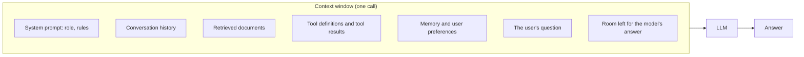
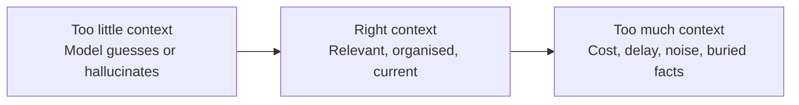
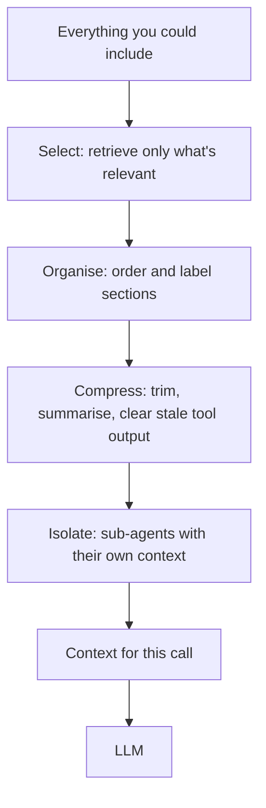

# Chapter 7: Context Windows and Context Engineering

## 1. The concept, from scratch

### What a context window is

The **context window** is the maximum amount of text, measured in tokens ([Chapter 3](../03-tokens-and-embeddings/README.md)), that the model can look at in a single call. Since the model is stateless ([Chapter 6](../06-inference-and-generation/README.md)), the context window is *everything the model knows at that moment*: your instructions, the conversation so far, any documents you pasted in, tool results, and the answer it is writing.

Think of it as the model's **working memory, or its desk**. Whatever is on the desk, it can use. Whatever isn't, it can't see. Training knowledge is like background education: useful, but not reliable for specifics.

Two details that trip people up. First, in most APIs **input and output share the window**: if the window is 200,000 tokens and your prompt is 190,000, only about 10,000 are left for the answer. Providers also set a separate, lower **maximum output** limit. Second, the window is counted in **tokens, not words**, so it holds roughly three-quarters as many words as the number says ([Chapter 3](../03-tokens-and-embeddings/README.md)).

### How big are context windows?

Much bigger than a couple of years ago. Windows of around **1 million tokens** are now offered by several frontier models, with Anthropic's Claude and Google's Gemini as examples, and other models sit at roughly 128,000 to 200,000 tokens (as of Nov 2026). Even small and mini models often have large windows, so "small model means small context" is outdated. Limits differ by model, by version, and sometimes by platform for the same model, so check the provider's current documentation before you design around a number.

A rough sense of scale: a million tokens is on the order of several novels' worth of text, or a large codebase.

### Bigger window does not mean better answers

If you can fit a million tokens, why not paste everything in? Four reasons.

1. **Cost.** You pay for every input token on every call. A big prompt resent each turn adds up fast ([Chapter 31](../31-cost-latency-and-caching/README.md)).
2. **Latency.** More input means a longer prefill before the first token ([Chapter 6](../06-inference-and-generation/README.md)), and attention gets more expensive as length grows ([Chapter 4](../04-transformers-and-attention/README.md)).
3. **Attention is not uniform.** The 2023 paper *Lost in the Middle* found that models often did best when the relevant fact was at the start or end of the input, and worse when it was buried in the middle. Newer models have improved, but the lesson stands: where you put things matters.
4. **Noise.** Anthropic describes **context rot**: as the context fills up, the model's ability to recall and use any particular piece of it tends to decline. Irrelevant or contradictory material also distracts the model and can lead it astray.

So the goal is not the *biggest* context but the *best* one. **Put the smallest set of high-signal information in front of the model that lets it do the job.**

### From prompt engineering to context engineering

**Prompt engineering** is about writing good instructions ([Chapter 9](../09-prompt-engineering/README.md)). **Context engineering** is the wider job of deciding *everything* that goes into the window for each call, and doing it systematically as the system runs. That includes instructions, but also which documents to retrieve, which parts of history to keep, which tool results to show, and what to leave out. In agents, where the context changes at every step of a loop, this becomes the main engineering problem. The term was popularised during 2025, and Anthropic's engineering post on it is a good read.

### The techniques

Here are the moves you reach for, in the order you usually need them.

**1. Be selective: retrieve instead of pasting.** Don't load the whole knowledge base. Find the few passages relevant to this question and include only those. That is retrieval-augmented generation, the whole of [Part 4](../11-rag-fundamentals/README.md). A related idea for agents is **just-in-time retrieval**: keep light references (file paths, IDs, queries) in context and let the agent fetch the detail only when needed.

**2. Order matters.** Put instructions and key facts where they'll be noticed: at the start, and often repeated near the end, close to the question. Put long reference material in clearly labelled sections, so the model can tell instructions from data.

**3. Trim history.** The simplest approach is a **sliding window**: keep only the last N turns. It's cheap but loses early facts. So combine it with pinning: always keep a short "case summary" of facts that must not be lost (the order number, the user's goal).

**4. Summarise or compact.** When the conversation or agent run gets long, ask a model to condense older turns into a short summary and carry that forward instead. This is often called **compaction**. The risk is that a summary loses detail, so what you keep (decisions, open questions, key identifiers) deserves care.

**5. Clear stale tool results.** In an agent, one tool call can return thousands of tokens that were useful once and are dead weight afterwards. Dropping or shrinking old tool outputs once they've been used is one of the cheapest context savings.

**6. Isolate with sub-agents.** Give a separate agent a clean context for one sub-task, such as researching one question, and have it return only a short result. The main context stays small. [Chapter 23](../23-multi-agent-systems/README.md) covers this.

**7. Store outside, load on demand.** Write notes or facts to external storage and pull them in later. That is the basis of agent memory ([Chapter 21](../21-agent-memory-and-state/README.md)).

**8. Cache the stable part.** If the first part of your prompt is the same on every call (system prompt, long documents, tool definitions), providers can cache it, which makes repeated calls cheaper and faster. Order your prompt with the stable content first and the changing content last ([Chapter 31](../31-cost-latency-and-caching/README.md)).

### A token budget

A useful habit is to think of the window as a **budget**. Say you have 100,000 tokens and an answer of up to 4,000. The system prompt takes 2,000, tool definitions 3,000, memory 1,000, and history and retrieved documents share what's left. Every piece you add has to earn its place. Budgeting also makes cost predictable: you can estimate cost per call from the budget and the traffic.

### Things that go wrong in the context

- **Truncation.** If the input is too long, some APIs return an error and some systems silently cut off text, usually the oldest or the middle. Silent truncation leads to "the model ignored my instruction". Count tokens before you send.
- **Context poisoning.** A wrong fact (a hallucination, or a bad tool result) lands in the context and every later step trusts it.
- **Conflicting information.** Two retrieved documents disagree, and the model picks one, or blends both ([Chapter 15](../15-enterprise-rag/README.md)).
- **Injected instructions.** Text from a web page or document can contain instructions aimed at the model. Anything you put in the context could be read as a command, so treat retrieved content as untrusted data ([Chapter 29](../29-guardrails-and-ai-security/README.md)).
- **Cross-user leakage.** If you assemble context from shared stores, one user's data can leak into another's. Access control has to apply when you *build* the context, not after.

### Long context vs retrieval, in one paragraph

Large windows have made "just put the whole document in" possible for many cases, and for a single document or a small, stable set, that can be the simplest and best answer. But it doesn't replace retrieval for large, changing or permissioned knowledge bases, because of cost, latency, accuracy at scale, and access control. [Chapter 17](../17-rag-vs-fine-tuning-vs-long-context/README.md) compares the options properly.

## 2. Analogies across industries

- **Context window as a desk (insurance).** A claims adjuster has a desk of fixed size. They can have the policy, the claim form and the photos in front of them, but not the entire archive. Good adjusters decide what goes on the desk. Piling on every file just makes it harder to find the page that matters.
- **Lost in the middle (travel).** On a long departures board, passengers notice the first few and last few flights and miss the one in the middle. A key fact in the middle of a long prompt gets the same treatment.
- **Compaction (government).** A caseworker handing over a long case writes a one-page handover note, not a copy of the whole file. Good notes keep the decisions, deadlines and reference numbers. A bad one loses the detail that turns out to matter.
- **Sub-agents with clean contexts (manufacturing).** A plant manager doesn't read every machine's logs. Each line supervisor reviews their own and reports a three-line summary up. The manager's attention stays on decisions.

## 3. How it's used in industry

- **Retail: pinned case summary.** A customer-support assistant keeps the last few messages plus a pinned summary (order ID, issue, what's been promised). A long chat doesn't lose the order number or balloon in cost.
- **Insurance: one long document.** An underwriter's tool puts a single 200-page policy document into a long-context model for question answering, because it's one stable document and avoiding a retrieval pipeline keeps things simple. For the whole policy library, retrieval is used.
- **Software and manufacturing engineering: agents on large codebases.** A coding or maintenance agent keeps file paths and search queries in context and opens files only when needed, instead of loading the repository. Old tool outputs are dropped after use.
- **Government: stable prefix for caching.** A benefits-advice assistant has a long system prompt and rules document identical on every call. The team puts it first so it can be cached, and appends the citizen's question last, which cuts cost and latency.

## 4. Common misconceptions

- **"The context window is the model's memory."** It's working memory for one call. Nothing persists after, unless your application stores it.
- **"A bigger window removes the need for retrieval."** For a single document, maybe. For large, changing or access-controlled data, no: cost, latency, accuracy and permissions still matter.
- **"If it fits in the window, the model will use it well."** Position, noise and context rot all affect how well a fact is used.
- **"Small models have small context windows."** Often they don't. Many small and mini models have windows of 128,000 tokens or more. The old "2,000 to 4,000 words" figure is out of date.
- **"Input and output have separate budgets."** In most APIs they share the window, and there is also a separate maximum output limit.
- **"Summarising history is lossless."** It's lossy by nature. Decide what must survive, and pin it.
- **"Context engineering is just prompt engineering with a new name."** Prompt engineering is the wording of the instructions. Context engineering is managing everything in the window across many calls.

## 5. Interview questions

### 1. What is a context window?

It's the maximum number of tokens the model can take into account in a single call, covering everything: the system prompt, the conversation history, any documents or tool results I've included, and the answer it's generating. Since the model is stateless, the context window is effectively all it knows at that moment. I think of it as the model's working memory or desk. Windows have grown a lot, with some frontier models offering around a million tokens, but the limit is still hard, input and output usually share it, and it's counted in tokens, not words.

### 2. If a model supports a million tokens, why not put all our documents in the prompt?

Because bigger isn't automatically better. First, cost: I pay for every input token on every call, so a huge prompt gets expensive quickly, especially in a multi-turn chat where it's resent each time. Second, latency: more input means a slower first token. Third, quality: models don't use all parts of a long context equally well. Research like *Lost in the Middle* showed facts in the middle were used less reliably, and irrelevant material adds noise. Fourth, for a big knowledge base, it may not even fit, and there are access-control issues, because I can't put one user's documents in front of another user's query. So I'd retrieve just the relevant passages. For a single document or a small stable set, though, putting it all in is perfectly reasonable.

### 3. What is context engineering, and how is it different from prompt engineering?

Prompt engineering is about writing good instructions. Context engineering is the broader discipline of deciding everything that goes into the context window on every call, and managing it as the system runs. That includes the instructions, but also which documents I retrieve, how much history I keep, how I summarise older turns, which tool results I show, what memory I inject, and what I leave out. It matters most for agents, where the context changes at every step and can easily fill up with stale output. The principle I follow is to give the model the smallest set of high-signal information that lets it do the task.

### 4. What is "lost in the middle" and what do you do about it?

It's the finding, from a 2023 paper, that models often performed best when the relevant information was at the beginning or end of the input, and worse when it was in the middle of a long context. Newer models have improved, but I still design for it. I put instructions and the most important facts at the start, and I repeat key constraints near the end, close to the question. I limit how much material I include by retrieving only what's relevant. When I include several retrieved passages, I put the best-ranked ones first or at the edges. And I label sections clearly so instructions and reference data can't be confused.

### 5. How do you handle a long conversation that is exceeding the context limit?

I'd combine a few techniques. Keep the most recent turns verbatim, since they carry the immediate context. Summarise the older turns into a compact note, which is often called compaction, being careful to keep decisions, open questions and identifiers like order numbers. Pin a small set of facts that must never be lost, so they survive trimming. For information that matters across sessions, store it outside the window, in a memory store, and load it on demand. And I'd count tokens before sending, so I never rely on silent truncation. I'd also test that the summary actually preserves what's needed, because summaries are lossy.

### 6. What do you do when an agent's context fills up with tool output?

Tool results are often big and only useful once, so I'd clear or shrink them after the agent has used them, for example keeping a one-line record of what was done and dropping the raw output. I'd make tools return concise, relevant results in the first place, rather than dumping whole pages or tables. I'd use just-in-time retrieval, where the agent keeps references like file paths or queries and fetches details only when needed. For big sub-tasks, I'd use a sub-agent with its own clean context that returns only a short result. And for very long runs, I'd compact progress into a summary and write important notes to external storage.

### 7. Does a long context window replace RAG?

Sometimes, but not generally. For a single document or a small, stable set that fits comfortably, long context can be simpler and give better results because the model sees everything. But for a large corpus, retrieval is still the right tool. A big corpus may not fit. It's cheaper to retrieve a few passages than to send everything on every call. Accuracy can degrade with very long input. Knowledge changes, and re-indexing is easier than re-sending. And access control: I need to decide what each user is allowed to see before building the context. In practice, the best systems often combine the two: retrieve broadly, then give the model a generous but curated context.

### 8. Where do the costs come from in a large-context application, and how do you reduce them?

Cost is mostly input tokens times the number of calls. In a chat, history is resent every turn, so cost grows with conversation length, and agent loops multiply it further. To reduce it, I'd first trim what goes in: retrieve selectively, trim or summarise history, and drop stale tool output. Second, I'd use prompt caching by putting the stable part of the prompt first, so repeated calls reuse it at a lower price and with less latency. Third, route simple requests to a smaller, cheaper model. And I'd measure cost per task, not just per call, so I can see whether a change really helps.

### 9. How can the context window become a security problem?

Everything in the window can be read by the model as instructions, so any untrusted text I put in, like a web page, an email or a retrieved document, can contain injected instructions that try to hijack it. I handle that by treating retrieved content as data, clearly separating it from instructions, limiting what tools the model can call, validating its outputs, and requiring approval for risky actions. There's also a data-leak side: if I build context from shared stores, I have to apply the user's permissions when retrieving, so one person's information never ends up in another person's prompt. And I'd avoid putting secrets in the context at all, since they can be echoed back.

### 10. Design the context for a customer-support assistant for a retailer. What goes in, and in what order?

I'd start with a stable section at the top: the system prompt with the assistant's role, tone, policies and hard rules, plus tool definitions. Putting this first lets it be cached, since it's the same on every call. Next is a pinned case summary: customer ID, order number, issue so far, what's been promised. Then retrieved material for this question, like the relevant return-policy passages, each labelled with its source. After that, recent turns of the conversation verbatim, with older turns summarised. The user's current message goes last, with a short reminder of the key constraints, such as cite the policy and don't promise refunds. I'd keep a token budget for each section, clear old tool output, and test it with a long, messy conversation to make sure the order number survives.

## 6. Scenario exercise

An insurer's claims assistant uses an LLM with a 200,000-token window. Adjusters upload a claim file (policy, photos' descriptions, emails, repair estimates) and chat about it, sometimes for an hour. Complaints: after a long session, the assistant gives answers that contradict something the adjuster told it early on; the monthly bill is far above the forecast; and one adjuster found the assistant quoting a clause from *another customer's* policy. The product owner asks what's going wrong and what you'd change. You haven't seen the code.

Answer from memory, then check.

Model answer

I'd treat these as three context problems and say what I'd check first for each.

The contradiction after a long session sounds like the early statement either got trimmed or summarised away, or got buried in a very long context where it was used unreliably. I'd look at the exact prompt for a failing turn. The fix is to pin the facts an adjuster states that must hold for the whole claim, such as the claim number, the agreed facts and the instructions, into a short case summary that's always included near the top and restated near the question. Older turns get compacted with care about what the summary keeps, and I'd test long sessions for this.

The bill is probably because the whole claim file and the full history are resent on every turn. I'd stop pasting the entire file each time: retrieve the relevant parts for the current question, trim or summarise history, and drop stale tool output. The system prompt and the claim documents are stable within a session, so I'd order the prompt with that stable part first and turn on prompt caching. I'd also measure cost per claim, not per call, and route simple questions to a smaller model.

The cross-customer clause is the serious one. It means context is being assembled from a shared store without applying access control, or retrieval isn't scoped to the current claim. I'd treat it as a security incident: find how another policy got in, scope retrieval strictly by claim and user permissions *before* anything enters the prompt, and add a test that tries to pull data across claims. I'd also log what went into each context so we can audit it.

I'd explain that the large window isn't the issue. Using it deliberately is: select, order, compress and protect what goes in.

## 7. Key takeaways

- The context window is the model's working memory for one call, and it holds everything: instructions, history, documents, tool results and the answer. Input and output usually share it.
- Bigger windows (around a million tokens on some models, as of Nov 2026) don't remove the need to choose: cost, latency, lost-in-the-middle and context rot all grow with length.
- Context engineering is deciding what goes into the window on every call: select, order, compress, isolate, and cache the stable part.
- Pin what must survive, summarise the rest, clear stale tool output, and count tokens so truncation is never silent.
- Treat everything in the window as potentially readable as instructions, and apply access control when building the context.

## 8. Further reading

- Anthropic, [Effective context engineering for AI agents](https://www.anthropic.com/engineering/effective-context-engineering-for-ai-agents).
- Liu et al., [Lost in the Middle: How Language Models Use Long Contexts](https://arxiv.org/abs/2307.03172) (2023).
- Anthropic, [Understanding the context window](https://docs.claude.com/en/docs/build-with-claude/context-windows).
- Google, [Long context in the Gemini API](https://ai.google.dev/gemini-api/docs/long-context).
