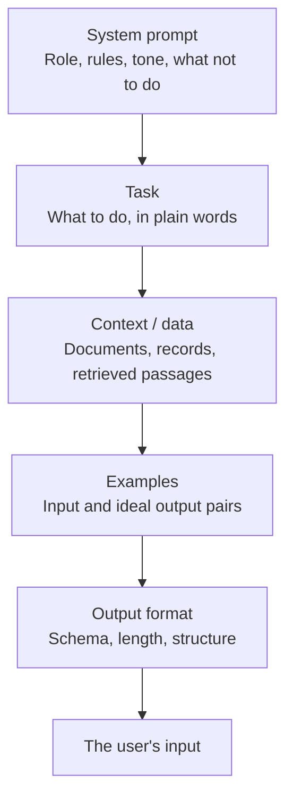
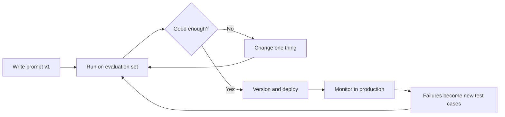
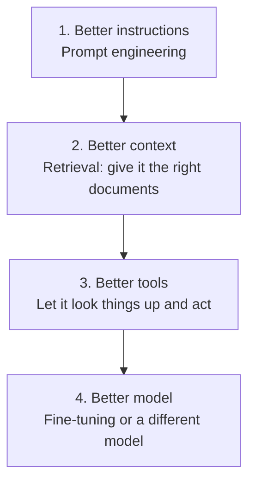

# Chapter 9: Prompt Engineering

## 1. The concept, from scratch

### What a prompt is, and why it matters

A **prompt** is everything you send the model in a call: the instructions, the data, the examples and the question. The model is stateless ([Chapter 6](../06-inference-and-generation/README.md)) and frozen after training ([Chapter 5](../05-training-llms/README.md)), so **the prompt is the main lever you have at inference time.** Same model, better prompt, noticeably better result, with no training and no new infrastructure. That's why it's the first thing to try and the cheapest thing to change.

**Prompt engineering** is writing and testing prompts so the model does what you want, reliably. In an interview, the point to land is that it's *engineering*, not magic phrases: you write a prompt, test it on real examples, measure, and iterate. It's also a subset of **context engineering** ([Chapter 7](../07-context-windows-and-context-engineering/README.md)): prompt engineering is the wording, context engineering is everything in the window.

### The anatomy of a production prompt

A production prompt usually has the same parts. Not every prompt needs all of them.

- **System prompt.** Standing instructions that apply to every turn: who the assistant is, what it must always or never do, the tone, what to do when it's unsure. Most APIs have a dedicated slot for it.
- **Task.** The specific thing to do, in plain words.
- **Context or data.** The material to work from. Keep it clearly separate from the instructions.
- **Examples.** Sample inputs with ideal outputs.
- **Output format.** How the answer should look: JSON schema, a table, three bullet points.
- **User input.** The actual question or document for this call.

### The core techniques

**1. Be clear and specific.** The most common cause of a bad answer is a vague prompt. Say what the task is, who the audience is, what a good answer looks like, how long it should be, and what to avoid. A useful test: if you handed this prompt to a smart new colleague with no background, would they know what to do? If not, the model won't either.

| Vague | Specific |
|---|---|
| "Summarise this claim." | "Summarise this insurance claim in three bullet points for an adjuster: what happened, what is being claimed, and any missing documents. Don't give an opinion on whether to approve it." |

**2. Say what you want, not only what you don't.** "Don't be verbose" is weaker than "answer in at most two sentences". Positive, concrete instructions work better than a list of prohibitions.

**3. Separate instructions from data.** Wrap documents and user input in clear delimiters, such as labelled sections or XML-style tags like `<document>` and `</document>`. This makes the prompt easier for the model to parse, and it helps with prompt injection: you can tell the model that text inside the tags is data to be analysed, not instructions to follow ([Chapter 29](../29-guardrails-and-ai-security/README.md)). It's a mitigation, not a guarantee.

**4. Give examples (few-shot).** Showing the model a few examples of input and ideal output is one of the most reliable ways to steer format, tone and edge cases. The 2020 GPT-3 paper made the term popular.

- **Zero-shot:** instructions only, no examples.
- **One-shot / few-shot:** one or a few examples. Three to five varied examples is a common starting point, and Anthropic's documentation recommends examples in clearly tagged sections.
- Choose examples that cover the awkward cases, not only the easy ones. If all your examples look alike, the model will copy that pattern even when it shouldn't.

**5. Give the model an exit.** If the answer may not be in the data, say so: "If the policy does not cover this, reply 'not covered' and don't guess." Without that exit, the model's habit of producing a fluent answer pushes it to make something up. This is a cheap, effective step against hallucination ([Chapter 28](../28-hallucination-and-grounding/README.md)).

**6. Specify the output format.** Say exactly what shape you want. For anything a program will read, use structured output with a schema ([Chapter 6](../06-inference-and-generation/README.md)) and validate in code. The prompt and the schema should agree.

**7. Let it think, when the task needs it.** For multi-step problems, asking the model to reason step by step before answering improves accuracy. This is **chain-of-thought prompting**, shown in a 2022 Google paper: giving worked examples with intermediate steps made large models much better at arithmetic and logic problems. Keep the reasoning separate from the final answer (for example, reasoning first, then an answer in a tag) so your code can use just the answer.

There's an important update. **Reasoning models** ([Chapter 5](../05-training-llms/README.md)) already think before they answer, so spelling out the steps is often unnecessary and can even hurt. Provider guidance for reasoning models generally says to keep prompts simple, state the goal clearly, and add detail only if the output falls short. The rule of thumb: for a standard model, you may need to ask it to reason, and for a reasoning model, tell it *what* you want and let it decide *how*. Check the provider's current prompting guide, because advice differs between model generations (as of Nov 2026).

**8. Break big tasks into steps (prompt chaining).** One giant prompt that does five things tends to do all five worse. Split the work into a chain: extract, then classify, then draft, then check. Each step has a simple prompt, a clear output, and can be tested on its own. The cost is more calls, so more latency and cost. The benefit is accuracy and debuggability. This is also the first step towards workflows and agents ([Chapter 18](../18-from-llm-calls-to-agents/README.md)).

**9. Put the important things in the right place.** Models pay more attention to the start and end of a long prompt ([Chapter 7](../07-context-windows-and-context-engineering/README.md)). Put the instructions first, the long reference material in the middle, and the question and key constraints at the end.

**10. Assign a role, but don't rely on it.** "You are an experienced claims adjuster" can set tone and focus, and it's common in system prompts. But it doesn't add knowledge or fix a vague task. Specific instructions beat clever personas.

### Prompts are software

This is what separates a demo from production. A prompt is code that happens to be written in English, and it needs the same discipline:

- **Version it.** Keep prompts in source control, with a change history and a name for each version.
- **Test it.** Run every change against an **evaluation set**: a collection of real examples with known good outcomes ([Chapter 26](../26-evaluation-fundamentals/README.md)). Don't judge a prompt by trying two or three inputs.
- **Change one thing at a time.** Otherwise you can't tell what helped.
- **Re-test when the model changes.** A prompt tuned for one model or version can behave differently on another. Model upgrades are a common cause of quiet regressions.
- **Roll back easily.** Be able to revert a prompt without a full redeploy ([Chapter 32](../32-observability-and-llmops/README.md)).
- **Treat prompts as sensitive.** Don't put secrets in them, and assume a determined user can get the model to reveal its system prompt.

### The ladder: four ways to make a model useful

When a model isn't doing what you need, there are four things you can change, and they are ordered by cost and effort. Always climb from the bottom.

Think of onboarding a new hire at an airline's customer desk. First you **brief** them clearly on what you expect (prompting). Then you give them the **policy handbook** to look things up (retrieval, [Chapter 11](../11-rag-fundamentals/README.md)). Then you give them **access to the booking system** so they can check and change things (tools, [Chapter 19](../19-tool-calling/README.md)). Only if they still can't do the job do you send them on a **specialist course** (fine-tuning, [Chapter 10](../10-fine-tuning-and-distillation/README.md)). You wouldn't send someone on a course before trying a clear briefing. [Chapter 17](../17-rag-vs-fine-tuning-vs-long-context/README.md) compares the options in detail.

### What prompting can't do

- It can't add knowledge the model lacks. For that, give it the data.
- It can't guarantee behaviour. The output is still probabilistic, so validate and test.
- It can't fully stop prompt injection. Defence needs layers ([Chapter 29](../29-guardrails-and-ai-security/README.md)).
- It can't fix a task that is unclear to *you*. If you can't describe what a good answer looks like, you can't evaluate it either.

## 2. Analogies across industries

- **A good prompt (logistics).** A dispatch order that says "deliver the parcel" gets you chaos. One that says pickup address, drop-off address, time window, fragile, and who to call if no one answers gets you a delivery. Models, like drivers, can only act on what's written on the order.
- **Few-shot examples (healthcare).** A senior nurse training a new one doesn't only explain how to write a handover note, they hand over three good notes. The new nurse copies the structure and level of detail. The risk is the same too: if all three examples are easy cases, the new nurse is lost on the unusual one.
- **Prompt chaining (manufacturing).** An assembly line splits the job into stations, each checkable on its own, rather than one worker doing everything. If a defect appears, you know which station caused it.
- **The exit option (insurance).** A claims form with an "information not available" box is better than one that forces an answer. Without the box, people fill in something plausible. Without an exit, so does the model.
- **Prompts as software (retail).** A retailer wouldn't change the price list in the till without testing and a way to roll back. A prompt change is the same kind of production change.

## 3. How it's used in industry

- **Insurance: claim triage.** A prompt takes a claim description and returns a category, urgency and missing documents as structured JSON. The team keeps a few hundred real, labelled claims as an evaluation set, and every prompt change must beat the current version on it before it ships.
- **Healthcare: summarising notes.** A hospital tool drafts discharge summaries from clinical notes. The prompt separates the notes (inside tags) from the instructions, tells the model to write "not documented" when information is missing, and requires a clinician to review the output.
- **Logistics: a chain for exceptions.** A carrier handles delivery-exception emails with a four-step chain: extract the shipment ID, classify the problem, draft a reply from the policy, and check the draft against the rules, with each step tested separately.
- **E-commerce: few-shot product descriptions.** A marketplace uses a handful of approved product descriptions as examples so thousands of new items get descriptions in the brand's voice and format.

## 4. Common misconceptions

- **"Prompt engineering is about finding magic words."** It's about clarity, structure and testing. There's no universal phrase that makes the model better.
- **"A longer prompt is a better prompt."** Length isn't quality. Extra instructions can conflict or bury the important ones. Be as short as the task allows.
- **"Always tell the model to think step by step."** Useful for some standard models on multi-step tasks. For reasoning models it's often unnecessary or harmful, and it costs tokens.
- **"A role like 'you are an expert' makes the model an expert."** It adjusts tone and focus, and it doesn't add knowledge.
- **"If it works on my five test inputs, it's done."** Five inputs prove very little. You need an evaluation set, and you need to re-run it when anything changes.
- **"A good prompt works on every model."** Prompts are tuned to a model. Moving to another model or version needs re-testing.
- **"Prompting can fully stop prompt injection."** Delimiters and instructions help, but they're not a security boundary.

## 5. Interview questions

### 1. What makes a good prompt?

Clarity and structure. A good prompt says exactly what the task is, who the output is for, what a good answer looks like, the format and length, and what to do when the answer isn't available. It separates the instructions from the data, usually with delimiters or tags, so the model isn't confused about what's an instruction and what's content. It often includes a few good examples, including awkward cases. My test is to imagine handing the prompt to a smart new colleague with no background, and ask whether they'd know what to do. And I never judge a prompt on a couple of tries: I test it on a set of real examples, because it's engineering, not guesswork.

### 2. What's the difference between zero-shot and few-shot prompting?

Zero-shot means I only give instructions, and the model works from those alone. Few-shot means I include a handful of examples of input and ideal output in the prompt. Zero-shot is simpler and cheaper, and with modern models it often works for clear tasks. I go to few-shot when I need a particular format, tone or handling of edge cases that is hard to explain in words but easy to show. Three to five varied examples is a reasonable start, and I make sure they include the tricky cases, not just easy ones, otherwise the model copies the easy pattern. The trade-off is that examples take up tokens, so they add cost on every call.

### 3. Does "think step by step" still matter?

It depends on the model. Chain-of-thought prompting was a real breakthrough for standard models, where asking for step-by-step reasoning improved results on maths and multi-step logic. But reasoning models are trained to think before answering, so they do it on their own. For those, provider guidance generally says keep the prompt simple, state the goal, and don't micromanage the reasoning, because spelling out steps can be unnecessary or even hurt. So with a standard model on a multi-step task I might ask for reasoning, with the final answer in a separate tag so my code can extract it. With a reasoning model I describe what I want and let it work out how. I'd check the provider's current guide, since this advice changes between generations.

### 4. How do you get reliable structured output from a prompt?

I use several layers. In the prompt, I describe the exact fields, give an example of the output, and say what to do for missing values. Where the provider supports it, I use schema-constrained structured output so the format is enforced by the API instead of by hoping. Then in my code I validate the output against the schema and check that the values make sense, because correct shape doesn't mean correct content. If it fails, I retry, maybe feeding the error back, and if that fails too I fall back to a default or a human review queue. I also keep the schema simple and make sure the max-token limit is high enough that the JSON isn't cut off.

### 5. How do you reduce hallucinations through prompting?

Prompting helps but it doesn't solve it. The main steps are: give the model the facts instead of expecting it to remember them, usually through retrieval; tell it to answer only from the provided material; give it an explicit way out, like "if the answer isn't in the documents, say you don't know"; ask it to quote or cite the source passage so claims can be checked; and keep the task narrow. Then I verify. I measure the hallucination rate on an evaluation set, and for high-stakes use I add checks outside the model, like validating citations or having a human review. Prompting lowers the rate but doesn't remove it.

### 6. How do you test and version prompts?

I treat prompts like code. They live in source control with versions and change notes. Before any change ships, I run it against an evaluation set of real examples with known good outcomes, scored automatically where possible and by people where not, and compare it with the current version. I change one thing at a time so I know what helped. I track results per version, and when a failure turns up in production, it becomes a new test case. I re-run the whole suite when the model or version changes, because behaviour can shift. And I make sure I can roll back a prompt quickly, without a full redeploy.

### 7. When would you use prompt chaining instead of a single prompt?

When the task has distinct steps, or one prompt is getting long and unreliable. A single prompt asked to extract, classify, draft and check usually does each part less well, and when it fails you can't tell which part broke. Splitting it into a chain gives each step a simple prompt and a clear output I can test and fix on its own, and I can use a smaller, cheaper model for the easy steps. The trade-offs are extra calls, so more latency and cost, and more to maintain, plus the risk of errors compounding from step to step. For simple tasks I'd keep one prompt. Chaining is also where workflows start to turn into agents.

### 8. A prompt works well in testing but gives inconsistent results in production. What do you check?

First, whether my testing was representative. A few hand-picked inputs aren't a test, and real users send messier, longer and more varied input. I'd pull real failing cases and add them to the evaluation set. Second, I'd look at the actual prompts sent in production, because the assembled context may differ from what I tested: history trimmed, retrieved passages different, a template variable empty. Third, sampling settings, because a higher temperature adds variation, and even at zero there's some inherent non-determinism. Fourth, whether the model version changed. Then I'd fix the prompt with a few targeted examples or clearer rules, add output validation, and re-run the full evaluation before shipping.

### 9. How would you decide between improving the prompt and fine-tuning the model?

I always start with the prompt, because it's the cheapest and fastest thing to change. I'd climb a ladder: better instructions and examples first, then better context through retrieval if the model lacks information, then tools if it needs to look things up or act, and only then fine-tuning if there's still a gap that's about behaviour, like a consistent style or format that prompting can't deliver, or a need to use a smaller, cheaper model. I'd measure at each step on an evaluation set so the decision is based on evidence. Fine-tuning needs data, training, evaluation and ongoing maintenance, so I want to know a prompt can't do it first.

### 10. How would you migrate a prompt to a new model version?

I wouldn't assume it carries over. First I'd make sure I have a solid evaluation set built from real traffic, including the hard cases and past failures. Then I'd run the existing prompt on the new model and compare quality, format compliance, latency and cost against the current version. If there are regressions, I'd look at what changed, for example more literal or more verbose behaviour, or different sensitivity to examples and formatting, and adjust the prompt for the new model, checking the provider's guide for it. I'd roll out gradually, perhaps to a small share of traffic first, watch the metrics, and keep the old version available to roll back to.

## 6. Scenario exercise

An insurer uses an LLM to read incoming claim descriptions and return a category (windscreen, theft, water damage, collision, other), an urgency level and a list of missing documents. In a demo it was excellent. In production, adjusters complain that identical claims sometimes get different categories, that the model sometimes invents a missing document that was actually attached, and that the output sometimes arrives as chatty text instead of the JSON the downstream system expects. The prompt is a single paragraph written by the vendor. You're asked to fix it. You haven't seen the prompt yet.

What would you do? Answer from memory, then check.

Model answer

I'd start by getting evidence instead of rewriting on instinct. I'd collect a few hundred real claims with the category an experienced adjuster would assign, including the ambiguous ones, and use them as an evaluation set. Then I'd run the current prompt on it to get a baseline: accuracy by category, how often the JSON is invalid, how often a missing document is wrongly flagged.

Then I'd fix the three symptoms in turn. For inconsistent categories, I'd rewrite the prompt with the categories clearly defined, including what counts as "other", and add a few examples covering borderline cases such as a car hit by a falling tree, which could be collision or storm damage. I'd lower the temperature for consistency. For the invented missing documents, I'd give the model the actual list of attached documents inside tags, tell it to flag only documents that appear on a required list and are absent from the attached list, and allow "cannot determine". For the chatty output, I'd use schema-constrained structured output if the provider supports it, otherwise a strict format instruction with an example, and in either case validate the JSON in code with a retry and a fallback queue.

Since the task has distinct steps, I might split it into two prompts, classify and then check documents, so each can be tested on its own. I'd change one thing at a time and re-run the evaluation after each change, and only ship a version that beats the baseline. I'd keep the prompt in source control, and set up a way to add production failures to the test set. Finally I'd tell the business that this is the cheapest path. If the evaluation shows prompting can't reach the accuracy they need, then we'd look at a better model or fine-tuning, with data to back that up.

## 7. Key takeaways

- The prompt is the main lever at inference time. Clear, specific instructions, separated from data, beat clever phrasing.
- Use examples for format and edge cases, give the model an exit when it may not know, and specify the output format.
- Chain-of-thought helps standard models on multi-step tasks, but reasoning models already think, so keep their prompts simple.
- Treat prompts as software: version, test on an evaluation set, change one thing at a time, and re-test when the model changes.
- Climb the ladder from the bottom: prompt, then context, then tools, then fine-tuning.

## 8. Further reading

- Anthropic, [Prompt engineering overview and techniques](https://docs.anthropic.com/en/docs/build-with-claude/prompt-engineering/overview) (including [XML tags](https://platform.claude.com/docs/en/build-with-claude/prompt-engineering/use-xml-tags) and [multishot prompting](https://platform.claude.com/docs/en/build-with-claude/prompt-engineering/multishot-prompting)).
- OpenAI, [Prompt engineering guide](https://platform.openai.com/docs/guides/prompt-engineering) and [reasoning best practices](https://developers.openai.com/api/docs/guides/reasoning-best-practices).
- Wei et al., [Chain-of-Thought Prompting Elicits Reasoning in Large Language Models](https://arxiv.org/abs/2201.11903) (2022).
- Brown et al., [Language Models are Few-Shot Learners](https://arxiv.org/abs/2005.14165) (2020).
