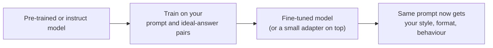
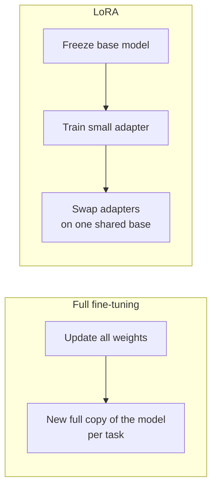
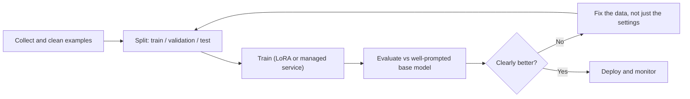
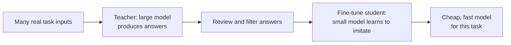

# Chapter 10: Fine-Tuning and Distillation

## 1. The concept, from scratch

### What fine-tuning is

**Fine-tuning** means taking an already-trained model and training it a bit more on your own examples, so its behaviour shifts towards what you want. It's the same mechanism as before: predict, measure the error, adjust the parameters ([Chapter 2](../02-how-machines-learn/README.md)). The difference is scale and purpose. Pre-training ([Chapter 5](../05-training-llms/README.md)) builds general ability from trillions of tokens. Fine-tuning nudges a finished model with hundreds or thousands of examples.

The most common form is **supervised fine-tuning (SFT)**, the same step labs use to turn a base model into an assistant. Each example is a prompt and the ideal response. After training, the model produces responses in that style, format and level of detail without being told each time.

### What fine-tuning is good at, and what it isn't

This is the single most important thing to say about it in an interview.

**Good at: changing behaviour.**
- A consistent tone, voice or house style.
- A strict output format that prompting keeps getting slightly wrong.
- A narrow, repetitive task done accurately, such as classification or extraction in your domain.
- Following a complex set of rules or a specialised vocabulary reliably.
- Letting a **small, cheap model** do a job that would otherwise need a big one, with shorter prompts, because the instructions are baked in.

**Poor at: storing knowledge.**
- Teaching the model new facts. It may absorb some, unreliably, and can still hallucinate them.
- Anything that changes often. To update a fact you'd have to retrain.
- Anything that needs a citation. A fine-tuned model can't point to where it learned something.
- Access control. You can't make a model forget a fact for one user and not another.

So the rule is: **fine-tune for how the model behaves, retrieve for what the model knows** ([Chapter 11](../11-rag-fundamentals/README.md)). And as the ladder in [Chapter 9](../09-prompt-engineering/README.md) says, only fine-tune after better prompts, retrieval and tools have been tried. The full comparison is in [Chapter 17](../17-rag-vs-fine-tuning-vs-long-context/README.md).

### How fine-tuning is done

**Full fine-tuning** updates every parameter. For a large model, that needs a lot of GPU memory and produces a complete new copy of the model for each task. It's powerful but expensive.

**Parameter-efficient fine-tuning (PEFT)** freezes the original weights and trains only a small number of extra parameters. The best-known method is **LoRA (low-rank adaptation)**, from a 2021 paper. The idea: the change you want to make to a big weight matrix can be approximated by two much smaller matrices multiplied together. You train only those small matrices, called an **adapter**, and the original model stays untouched. The trainable parameters drop by orders of magnitude, memory needs fall sharply, and the adapter is small enough to store and swap easily, one per task or per customer.

**QLoRA** goes a step further: it keeps the frozen base model in 4-bit precision to save memory, and trains LoRA adapters on top. The saving is mostly in memory, which is why people can fine-tune fairly large open-weight models on a single GPU.

There is also a **managed** route. Several providers run fine-tuning for you: you upload data, they train, and you call the result through their API (for example OpenAI's fine-tuning service and Amazon Bedrock's model customisation, as of Nov 2026). It's simpler, but only certain models can be tuned, the list changes, and the most capable models are often not on it. For open-weight models ([Chapter 8](../08-the-model-landscape/README.md)), you can do it yourself with common open-source libraries on your own GPUs or a cloud.

Beyond SFT there are **preference-based** methods, which train on pairs of better and worse answers, such as **DPO (direct preference optimisation)** ([Chapter 5](../05-training-llms/README.md)). These suit cases where "better" is easier to judge than to write. Some providers also offer **reinforcement fine-tuning**, where the model is rewarded for answers a grader scores well, mainly for reasoning tasks with checkable answers. Know the names and the idea. SFT is by far the most common starting point.

### The data is the real work

Training itself is the easy part. What decides the outcome is the data.

- **Quality beats quantity.** A few hundred to a few thousand clean, consistent, representative examples often beat tens of thousands of noisy ones. If your examples are inconsistent, the model learns the inconsistency.
- **Match real use.** Examples should look like the inputs the model will see in production, including the messy and borderline cases, formatted exactly as production prompts will be.
- **Where examples come from.** Past human-written work, approved outputs, expert-written answers, or outputs from a stronger model reviewed by people (see distillation below). Remove personal data and anything you don't have the right to use ([Chapter 30](../30-privacy-governance-and-compliance/README.md)).
- **Split the data.** Hold out a test set the model never trains on, as in [Chapter 2](../02-how-machines-learn/README.md). Otherwise you can't tell learning from memorising.
- **How many examples?** There's no magic number. It depends on the task and on how far the target behaviour is from what the model already does. Start small (a few hundred), measure, and add more where the errors are.

### What can go wrong

- **Overfitting.** The model memorises the training examples and does worse on new ones ([Chapter 2](../02-how-machines-learn/README.md)). The held-out test set catches it.
- **Catastrophic forgetting.** Training hard on a narrow task can erode general abilities the model had before, such as following other instructions or safety behaviour. LoRA and small learning rates reduce it, and you should test general behaviour as well as the target task.
- **Learning the wrong thing.** If every example in a category happens to share an accidental pattern, the model picks up the pattern, not the intent.
- **Stale or obsolete.** Policies change, and fine-tuned behaviour doesn't update by itself. And when the base model is replaced by a newer version, your adapter or tuned model doesn't carry over: you retrain on the new base.
- **Unexpected safety changes.** Fine-tuning can weaken the safety behaviour the provider trained in. Re-test refusal and safety behaviour after tuning ([Chapter 29](../29-guardrails-and-ai-security/README.md)).
- **Cost of ownership.** Data preparation, training runs, evaluation, hosting, and retraining are ongoing work, not a one-off.

### How to know a fine-tune was worth it

Compare against the right baseline. The test is *not* "is the tuned model better than the untuned model on a basic prompt?" It's: **is it better than the base model with a well-engineered prompt, retrieval and few-shot examples, on my evaluation set, at acceptable cost and latency?** Often the honest finding is that a better prompt gets most of the way. Where fine-tuning wins, it's usually on consistency, on lower cost per call (shorter prompts, a smaller model), or on both ([Chapter 26](../26-evaluation-fundamentals/README.md)).

### Distillation

**Distillation** means training a small **student** model to imitate a large **teacher** model's outputs. You run the teacher on many inputs, collect its answers, and fine-tune the student on those input-and-answer pairs. The student ends up much cheaper and faster, and for a *narrow task* it can come close to the teacher's quality. It will usually not match the teacher on everything.

Two points that interviewers like. First, **distillation is a use of fine-tuning**: the training data just happens to come from a stronger model instead of from humans. Second, **check the terms**. Many model providers' terms restrict using their models' outputs to train other models, especially competing ones, and some open-weight licences differ from each other. Read the provider's current terms, or use a platform's built-in distillation feature, and ask legal if unsure (as of Nov 2026; wording varies by provider, and I'm summarising secondary reporting here, not the contracts).

In the original distillation work (Hinton and colleagues, 2015), the student learned from the teacher's full probability distribution, not just its final answer. With hosted LLMs you usually only get the generated text, so training on the teacher's text outputs is the common practice. That detail goes beyond what you need for an interview. What matters is the idea: **a small model imitates a large one for a specific job.**

### Distillation, fine-tuning and quantisation are different things

People mix these up, so keep them separate:

| Technique | What it changes | Goal |
|---|---|---|
| **Fine-tuning** | The model's *behaviour*, by training on your data | Style, format, narrow-task skill |
| **Distillation** | Which model does the work: a small student trained from a big teacher | Cheaper, faster model for a task |
| **Quantisation** | The *numeric precision* of the weights, such as 16-bit down to 8-bit or 4-bit | Smaller memory footprint, faster serving |

Quantisation doesn't teach the model anything. It stores the same model in fewer bits. Commonly this is 8-bit or 4-bit, not only the 32-to-16-bit step older notes mention, and there's usually some quality cost that depends on the model and method, so measure it. [Chapter 33](../33-inference-engineering/README.md) covers it properly.

### Fine-tuning and the predictive-plus-generative picture

Fine-tuning blurs the line from [Chapter 1](../01-introduction-to-ai/README.md) in a useful way. You can fine-tune a small LLM to act as a **classifier**: given a customer message, output one of twelve labels. That's a predictive job done by a generative-architecture model. In a router ([Chapter 36](../36-llm-gateways-and-routing/README.md)) that small tuned model decides where the request goes, and a larger model then generates the answer.

## 2. Analogies across industries

- **Fine-tuning (healthcare).** A newly qualified doctor who knows medicine broadly joins a cardiology team and spends a year on their cases, learning the unit's protocols and how they write notes. Their general medical knowledge stays, and their behaviour in that unit changes. But if guidelines change next month, you don't send them back to medical school, you hand them the new guideline. That's retrieval.
- **LoRA (telecom).** An operator doesn't rebuild its whole network to launch a new tariff. It adds a thin configuration layer on top of the shared core, and can switch layers per market. A LoRA adapter is that layer on a shared base model.
- **Distillation (retail).** A master tailor cuts a pattern, and an apprentice makes hundreds of copies of that one design quickly and cheaply. The apprentice can't design everything the master can, but for this pattern they're nearly as good, at a fraction of the cost and time.
- **Quantisation (manufacturing).** A drawing at lower resolution takes less storage and prints faster, and is fine for most uses. Too coarse, and you lose details a machinist needs. That's the precision-versus-quality trade.
- **Catastrophic forgetting (insurance).** An underwriter who spends a year only on marine cargo may get rusty on motor policies. Narrow, intense training can crowd out broader skills.

## 3. How it's used in industry

- **Telecom: consistent summaries at scale.** An operator fine-tunes a small model on a few thousand agent-approved call summaries, so every summary has the same structure and tone with a short prompt. Cost per call falls, and the output is more consistent than with prompting alone.
- **Healthcare: format and vocabulary.** A hospital group adapts an open-weight model, hosted in its own environment, on approved, de-identified examples of how its clinicians structure referral letters, while clinical facts still come from the patient record through retrieval.
- **Retail: a tuned classifier for routing.** An e-commerce company distils a large model's labelling of customer messages into a small model that classifies thousands of messages per second and routes them to the right workflow or model.
- **Insurance: per-line adapters.** An insurer keeps one open-weight base model and separate LoRA adapters for motor, property and travel claims, switching adapters per request, instead of hosting several full models.

## 4. Common misconceptions

- **"Fine-tune the model on our documents so it knows our business."** This is the most common mistake. Fine-tuning is poor at storing facts, can't cite sources and can't be updated cleanly. Use retrieval for knowledge and fine-tuning for behaviour.
- **"Fine-tuning is the first step."** It's close to the last. Try prompts, retrieval and tools first.
- **"More data is always better."** Cleaner, more consistent data usually wins. Noisy data teaches noise.
- **"Fine-tuning makes the model smarter."** It makes it better at *your* task. It doesn't raise general intelligence and can reduce some general abilities.
- **"Distillation is the same as quantisation."** Distillation trains a different, smaller model. Quantisation stores the same model in fewer bits.
- **"Distillation gives you a small model that's as good as the big one."** On a narrow task, close. In general, no.
- **"Once tuned, we're done."** Base models are retired, policies change and data drifts, so tuned models need re-evaluation and retraining.
- **"LoRA is a different kind of model."** It's a way of fine-tuning cheaply by training a small adapter, not a different architecture.

## 5. Interview questions

### 1. What is fine-tuning, and when would you use it?

Fine-tuning is training an already-trained model a bit further on my own examples, usually prompt and ideal-response pairs, so its behaviour changes. I'd use it to change *how* the model behaves, not what it knows: a consistent style or format, a narrow task like classification or extraction done reliably, or getting a small, cheap model to do a job that otherwise needs a big one, with shorter prompts. I wouldn't use it as the first step. I'd try better prompting first, then retrieval if it needs knowledge, then tools, and fine-tune only if there's a behaviour gap left that I can measure.

### 2. Fine-tuning versus RAG versus prompt engineering: how do you decide?

I think of it as a ladder from cheapest to most expensive. Prompt engineering first: clearer instructions, examples, a defined output format. If the model lacks information, retrieval: give it the right documents at question time, which also gives citations and easy updates. If it needs to act or look things up live, tools. Fine-tuning comes last, when I need a consistent behaviour, style or format that prompting can't deliver, or a smaller model to cut cost and latency. The shorthand I use is: fine-tune for behaviour, retrieve for knowledge. And at each step I measure on an evaluation set rather than assuming.

### 3. Does fine-tuning teach the model new facts?

Not reliably. It can pick up some facts from the training data, but it's an unreliable way to store knowledge: the model may recall them wrongly or mix them up, it can't cite where it learned them, and when the facts change I'd have to retrain. It's also hard to control who is allowed to see what. Fine-tuning is much better at teaching patterns of behaviour, like format, tone and how to handle certain inputs. For company knowledge I'd use retrieval, so the model reads the current source and I can show the citation, and I'd fine-tune only for the behaviour part if prompting isn't enough.

### 4. What is LoRA, and why is it used?

LoRA, low-rank adaptation, is a parameter-efficient way of fine-tuning. Instead of updating all the billions of weights, I freeze the original model and train a pair of small matrices that approximate the change I want. Those small matrices are the adapter. It cuts the number of trainable parameters by orders of magnitude, so it needs far less GPU memory and time, and the adapter is small, so I can store many and swap them on top of one shared base model, say one per task or per customer. QLoRA goes further by holding the base model in 4-bit precision, which makes fine-tuning fairly large open-weight models possible on modest hardware. The usual trade-off is that LoRA can be slightly less powerful than full fine-tuning on very hard shifts, but for most business tasks it's plenty.

### 5. You have 5,000 labelled examples. How would you approach fine-tuning?

First I'd look at the data, not the training settings. I'd check quality and consistency, remove duplicates and personal data, and make sure the examples look like real production inputs, including edge cases. I'd split off a test set the model never sees, and keep a validation set to tune on. Before training, I'd get a baseline: the base model with a well-engineered prompt and a few examples, scored on the test set, because that's what the fine-tune has to beat. Then I'd train with LoRA, probably starting with a subset to check the trend, since five thousand clean examples is a good size for many tasks. I'd evaluate on the test set and on general behaviour and safety to check for forgetting, look at the errors, fix the data where they cluster, and iterate. If it doesn't clearly beat the prompted baseline on quality or cost, I wouldn't ship it.

### 6. What's the difference between fine-tuning, distillation and quantisation?

They're different levers. Fine-tuning changes a model's behaviour by training it on my data. Distillation is a way of getting a small model that imitates a large one: I run the large teacher model over lots of inputs, collect its answers, and fine-tune a small student on them, so the student can do a specific task nearly as well, much cheaper and faster. Quantisation doesn't train anything: it stores the same model's weights at lower numeric precision, like 8-bit or 4-bit instead of 16-bit, so it takes less memory and serves faster, usually with a small quality cost. So fine-tuning and distillation are about teaching, and quantisation is about compressing.

### 7. What are the risks of fine-tuning?

A few. Overfitting, where the model memorises my examples and does worse on new input, which a held-out test set catches. Catastrophic forgetting, where narrow training erodes general abilities, so I test broader behaviour too. Learning accidental patterns in the data instead of what I intended. Safety regression, because tuning can weaken the safety behaviour the provider built in, so I re-test refusals. Staleness: policies change but the model doesn't, and when the base model is replaced I have to retrain. And the ongoing cost: data preparation, evaluation, hosting and retraining are continuing work. That's why I'd want a measured benefit over a good prompt before committing.

### 8. When does distillation make sense?

When I have a well-defined, high-volume task where a large model works well but is too slow or expensive, and a small model could do the job if taught. Classification, extraction, routing and standard summarisation are typical. I use the large model to generate and label lots of examples, have people review a sample, fine-tune a small model on them, and compare it with the teacher on a held-out set. It makes sense when volume is high enough that per-call savings pay for the effort. It doesn't make sense for open-ended tasks where the small model will fall short, or when volumes are low. I'd also check the provider's terms about using model outputs for training, since some restrict it.

### 9. How would you prove a fine-tune is worth the cost?

By comparing it against the right baseline on an evaluation set built from real data. The baseline isn't the untuned model with a lazy prompt, it's the base model with a well-engineered prompt, few-shot examples and retrieval if relevant. I'd measure quality on my test set, but also consistency, latency and cost per task, because fine-tuning often pays off by letting a smaller model with a shorter prompt do the work. Then I'd account for the total cost of ownership: data preparation, training, evaluation, hosting, and retraining when the base model or the policies change. If the tuned model wins clearly on quality or on cost at my volume, it's worth it. If it's roughly equal to the prompted baseline, I'd skip it.

### 10. A client wants the model to "learn from every conversation" and get smarter over time. How do you respond?

I'd explain that a deployed model doesn't learn from conversations: its weights are frozen, and what looks like learning has to be designed. There are a few safe ways to get the benefit. I can store useful facts or preferences in a memory store and retrieve them later. I can collect conversations, with consent and with personal data removed, review them and use the good ones as new evaluation cases and, periodically, as fine-tuning data. And I can improve prompts and retrieval from the failures I see. What I wouldn't do is automatically retrain on raw conversations, because bad or malicious inputs would end up in the model, there's privacy risk, and I couldn't easily test or roll it back. So: capture feedback continuously, but retrain deliberately, with review and evaluation each time.

## 6. Scenario exercise

A telecom operator summarises about two million customer-service calls a month with a large hosted model. The summaries are good, but the format varies between calls, the prompt is long because it contains many formatting rules, and the bill is high. The team proposes fine-tuning the same large hosted model on their policy documents "so it knows our products and policies". They have about 8,000 call summaries that supervisors rated as "perfect", and a rule that customer data stays in their own cloud account. What would you advise? Answer from memory, then check.

Model answer

I'd separate the two goals they've mixed together. "Knowing our products and policies" is a knowledge need, and fine-tuning isn't the right tool: the information changes, the model can't cite it, and it may hallucinate. If summaries need product facts, I'd retrieve them from current sources at call time. The format consistency and the high cost are *behaviour and cost* problems, and those are exactly what fine-tuning is good at.

So I'd propose fine-tuning a small model for the summarising task, using the 8,000 supervisor-approved summaries. I'd clean and de-identify them, check that they're consistent and cover the awkward call types, and split off a test set. I'd start with a quick baseline: a small model with a well-engineered prompt and a few examples, because that may already get close and needs no training. Then I'd fine-tune with LoRA on an open-weight model hosted inside their own cloud account, which also meets the data rule, or use a managed service within that account if one supports it. If I wanted more data, I could use the large model as a teacher to produce extra summaries, have supervisors check a sample, and add them, after checking the provider's terms on training from its outputs.

I'd evaluate the tuned model on the held-out calls against the current large-model output: supervisor ratings, format compliance, and a check for dropped facts, plus cost and latency per call. The prompt will get much shorter because the format is learned, which cuts cost further. I'd test general and safety behaviour for forgetting. And I'd keep a process for retraining when products or formats change, and for re-testing when the base model is replaced.

If the tuned small model matches the large model's quality at a fraction of the cost, we ship it. If not, we keep the large model but shorten the prompt and cache the stable part.

## 7. Key takeaways

- Fine-tune for behaviour, retrieve for knowledge: fine-tuning is good for style, format and narrow tasks, and poor at storing facts.
- LoRA trains a small adapter on a frozen base model, so it's cheap and adapters are swappable; QLoRA adds a 4-bit base to save memory.
- Data quality and a held-out test set decide the outcome, and the benchmark to beat is a well-prompted base model.
- Distillation trains a small student to imitate a large teacher on a narrow task; it's different from quantisation, which only lowers numeric precision.
- Watch for overfitting, forgetting, safety regression and staleness, and check provider terms before training on another model's outputs.

## 8. Further reading

- Hu et al., [LoRA: Low-Rank Adaptation of Large Language Models](https://arxiv.org/abs/2106.09685) (2021).
- Dettmers et al., [QLoRA: Efficient Finetuning of Quantized LLMs](https://arxiv.org/abs/2305.14314) (2023).
- Hinton, Vinyals and Dean, [Distilling the Knowledge in a Neural Network](https://arxiv.org/abs/1503.02531) (2015): the classic distillation paper.
- OpenAI, [Fine-tuning guide](https://platform.openai.com/docs/guides/fine-tuning): methods, data format and when to use them.
- AWS, [Customize a model in Amazon Bedrock](https://docs.aws.amazon.com/bedrock/latest/userguide/custom-models.html): fine-tuning, distillation and continued pre-training on a managed platform.
