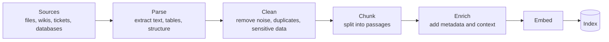
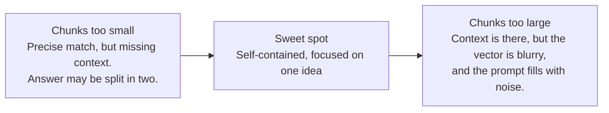
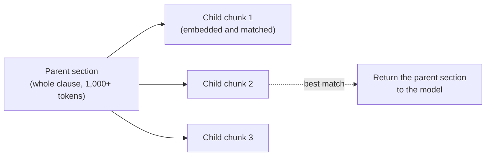
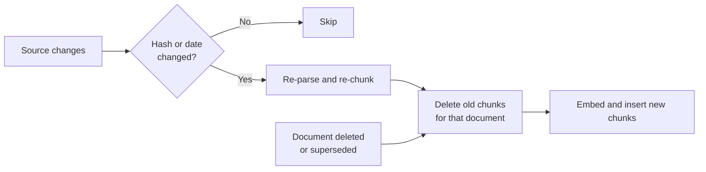

# Chapter 12: Ingestion and Chunking

## 1. The concept, from scratch

### Why ingestion sets the ceiling

If retrieval doesn't find the right passage, the model can't answer correctly. And retrieval can only find what ingestion put in the index, in a form it can match. So **ingestion quality sets the ceiling for the whole RAG system.** Many teams spend their time on prompts and models when the real problem is that a table was parsed into nonsense or an answer was cut in half by a chunk boundary.

The ingestion pipeline is the offline half of RAG:

### Step 1: Parsing real documents

Real documents are messy. A "PDF" might be a clean export from a word processor, a scan of a paper form, or a slide deck saved as PDF. The goal of **parsing** is to turn each into clean text that keeps the structure that carries meaning.

| Document type | What goes wrong |
|---|---|
| **Born-digital PDF** | Multi-column pages read in the wrong order. Headers, footers and page numbers get mixed into the text. |
| **Scanned PDF or image** | There is no text at all. You need **OCR** (optical character recognition), and OCR makes mistakes, especially with poor scans and handwriting. |
| **Tables** | Flattening a table into text loses which value belongs to which row and column. |
| **Charts and diagrams** | The key information is in the picture. Plain text extraction sees nothing. |
| **Slides** | Text is fragmentary and depends on layout and speaker notes. |
| **HTML and wikis** | Navigation menus, cookie banners and footers pollute the text. |
| **Spreadsheets and databases** | Rows need turning into meaningful sentences or records, with headers kept. |
| **Code and logs** | Splitting in the wrong place breaks a function or a stack trace. |

Layout-aware parsing tools, including open-source options such as Docling and Unstructured, managed services such as LlamaParse and Reducto, and the document-AI services of the big clouds, try to recover reading order, headings and tables (as of Nov 2026; names change, and none is best for every document type). Some use vision models to read the page as an image. The honest advice is to **test parsers on your own representative documents**, because quality varies a lot by document type, scan quality and table complexity.

A practical habit: look at the parsed output with your own eyes, for a sample of documents. If the text you'd feed the model looks wrong to a human, it is wrong.

### Step 2: Cleaning

Before chunking, clean what you've extracted:

- **Remove boilerplate**: repeated headers, footers, legal footers, navigation, page numbers.
- **Remove duplicates and near-duplicates.** The same policy saved in five places will come back five times and crowd out other results.
- **Handle versions.** Keep track of which document supersedes which, rather than indexing both as equals ([Chapter 15](../15-enterprise-rag/README.md)).
- **Deal with sensitive data.** Decide what must be redacted or excluded *before* it's embedded, because once personal data is in an index it's hard to find and remove ([Chapter 30](../30-privacy-governance-and-compliance/README.md)).
- **Keep structure.** Preserve headings, list items and table structure, for example by converting to Markdown, because structure helps both chunking and the model.

### Step 3: Chunking

Now the central question. A **chunk** is the unit of text you embed, store and retrieve. Why not just embed whole documents?

- **A vector has to summarise its text.** One vector for a 50-page document is a blurry average of everything in it. A query about one clause won't match well. Smaller pieces give sharper vectors.
- **Prompts have limited room and cost money** ([Chapter 7](../07-context-windows-and-context-engineering/README.md)). You want to hand the model the relevant paragraph, not the whole manual.
- **Precision.** Returning the exact passage makes citations meaningful.

But chunks that are too small have their own problem: a sentence without its surroundings often doesn't make sense, and the answer may be spread over several sentences.

There is no universal best chunk size. A commonly used starting point is a few hundred tokens per chunk with some overlap (often quoted as roughly 10 to 20 percent), and larger chunks tend to suit analytical questions while smaller ones suit factual lookups. But treat that as a starting point to tune on your own evaluation set, not a rule ([Chapter 27](../27-evaluating-rag-and-agents/README.md)).

### Chunking strategies

| Strategy | How it works | Good for | Watch out for |
|---|---|---|---|
| **Fixed-size** | Cut every N tokens or characters | Quick baselines, uniform text | Cuts mid-sentence and mid-idea |
| **Recursive** | Try to split on paragraph breaks first, then lines, then sentences, then words, until chunks fit the size limit | A strong default for most text | Still blind to meaning |
| **Structure-aware** | Split on the document's own structure: headings, sections, clauses, list items, table rows | Contracts, manuals, policies, wikis, anything well structured | Needs good parsing to know the structure; sections can be huge or tiny |
| **Semantic** | Use embeddings to find where the topic changes and split there | Long, unstructured prose | Extra cost, can produce uneven chunks, and reported results are mixed against simple methods |
| **Sliding window with overlap** | Neighbouring chunks share some text | Reduces the chance an answer is cut in half | Duplicate content, a larger index |
| **Parent-child (hierarchical)** | Embed small child chunks for precise matching, but return the larger parent section to the model | When you need precise matching *and* enough context to answer | More complexity, larger prompts |
| **Table and special-element chunking** | Treat each table, code block or figure as its own unit with its caption | Tables, code, forms | Large tables may need splitting by rows, repeating headers |

A few best practices that hold up well:

- **Start simple.** A recursive splitter with sensible size and overlap, plus good parsing, beats an elaborate strategy on bad text.
- **Respect the document's structure** whenever it has one. A clause, a numbered step or a FAQ answer is a natural unit.
- **Keep each chunk self-contained enough to be understood alone**, and attach the context it needs (see below).
- **Never split tables, code or lists mid-way** when you can avoid it. Repeat the header row when you split a large table.
- **Choose by testing.** Build a set of real questions with known answers, and compare strategies on retrieval quality. Public advice and vendor blogs disagree, and the best choice depends on your documents.

### Giving chunks their context

A chunk taken out of its document can lose crucial information. "The company's revenue grew by 3% over the previous quarter" doesn't say *which company* or *which quarter*. This is a classic reason retrieval fails.

Two fixes are widely used:

1. **Add a short header or breadcrumb** to each chunk: document title, section path, date. For example "Policy wording, Motor Plus, Section 4: Exclusions, effective March 2026". It's cheap and often effective.
2. **Contextual retrieval.** Anthropic described a technique where a model writes a short description situating each chunk within its document, which is added to the chunk *before* embedding and keyword indexing. On their own test sets they reported that this reduced failed retrievals in the top 20 results by about 35 percent with contextual embeddings alone, and by about 49 percent when combined with contextual keyword search. These are the vendor's numbers on their data, not a guarantee, but the idea is sound. The cost is one model call per chunk at ingestion time, which can be reduced with prompt caching ([Chapter 31](../31-cost-latency-and-caching/README.md)).

### Step 4: Metadata

Alongside each chunk's text and vector, store **metadata**: data about the chunk. Good metadata is what turns a pile of vectors into a system you can filter, secure, audit and cite.

| Metadata | What it enables |
|---|---|
| **Source document, URL or ID, page, section** | Citations that people can click and check |
| **Title and heading path** | Context for the model and the reader |
| **Date, version, status (current or superseded)** | Freshness filters and conflict handling |
| **Owner or department, document type** | Scoped search ("only HR policies") |
| **Access level, group or tenant** | Permission filtering at retrieval time ([Chapter 15](../15-enterprise-rag/README.md), [Chapter 37](../37-cloud-reference-architectures-and-multi-tenancy/README.md)) |
| **Language, region, product, jurisdiction** | Correct-context filtering |
| **Content hash** | Detecting changes for incremental updates |
| **Embedding model name and version** | Knowing what needs re-embedding |

Plan your metadata before ingesting millions of chunks. Adding a field later means re-processing everything.

### Step 5: Keeping the index fresh

Documents change. If your index doesn't, your assistant gives out-of-date answers with confident citations, which is worse than no answer. Ingestion is not a one-off job but an ongoing process.

- **Detect changes.** Compare a content hash or modified date for each source document. Process only what changed.
- **Upsert and delete.** When a document changes, replace its chunks. When it's deleted or superseded, *remove* its chunks, otherwise old content keeps being retrieved. This is the easy-to-forget step.
- **Keep an ID link** between each document and its chunks, so you know exactly which chunks to replace.
- **Use event-driven or scheduled updates**, depending on how fresh the data must be. Run ingestion asynchronously, through a queue, so a large upload doesn't block anything.
- **Re-embedding.** If you change the embedding model, every chunk must be re-embedded, because query and chunk vectors must come from the same model ([Chapter 3](../03-tokens-and-embeddings/README.md)). The safe pattern is to build the new index alongside the old one, test it, then switch over, and keep the old one for rollback. The same applies when you change your chunking strategy.
- **Track versions and keep an audit trail** of what was indexed when, so you can answer "what did the system know on that date?" ([Chapter 30](../30-privacy-governance-and-compliance/README.md)).

### Ingestion failure modes to watch

- Silent parsing failures: a page of a scanned PDF produces an empty string, and nobody notices.
- Tables turned into word soup.
- Chunk boundaries that cut through a clause or a definition.
- Stale content that was never deleted.
- Duplicates dominating results.
- Missing or wrong metadata, which breaks filtering and permissions.
- Ingestion cost surprises at scale, especially OCR and per-chunk model calls.

A good practice is to monitor ingestion like any production pipeline: count documents in and chunks out, flag empty or very short outputs, sample outputs for review, and alert on failures.

## 2. Analogies across industries

- **Parsing (insurance).** A claims team that gets a faxed form can't process it until someone types it into the system. Bad typing, such as a misread amount, flows into every later decision. Parsing is that typing step, and errors stay with the data.
- **Chunking (retail).** A big catalogue is useless as one huge block. Each product gets its own page with price, size and description, so a shopper can find exactly one. But a product page without its name and category would be meaningless. A chunk needs its context too.
- **Parent-child chunks (manufacturing).** A technician searches the manual index for a specific torque value (the small, precise child) but needs to read the whole procedure section around it (the parent) to do the job safely.
- **Metadata (logistics).** A parcel's label carries destination, weight, handling class and customs code. Without it, the parcel is just a box in the warehouse. Chunk metadata is the label that lets the system route, filter and trace.
- **Freshness (government).** A public notice board where old notices are never taken down will eventually mislead people. Ingestion needs a "take down" step as much as a "put up" step.

## 3. How it's used in industry

- **Insurance: policy wordings.** An insurer chunks policy documents by section and clause, attaches the policy name, product, version and effective date to every chunk, and uses parent-child retrieval so a matched exclusion comes back with its full section. Superseded versions are marked, not deleted outright, so old claims can still be checked against the wording in force at the time.
- **Manufacturing: maintenance manuals.** A manufacturer parses scanned and digital manuals with a layout-aware tool, keeps each procedure with its safety warnings in the same chunk, and keeps tables of torque specifications as structured units with their column headers.
- **Government: policy and guidance.** A public agency ingests thousands of web pages and PDFs, strips navigation and footers, records the publication and review dates, and runs nightly change detection so retired guidance disappears from the index.
- **Telecom: tickets and runbooks.** An operator turns resolved tickets into chunks that pair the symptom, the cause and the fix, with the product and software version as metadata, so retrieval can be filtered to the right equipment.

## 4. Common misconceptions

- **"The model is the hard part of RAG."** Often it's ingestion. Bad parsing and chunking cap quality, and no model can recover information that never made it into the index properly.
- **"There's an ideal chunk size."** It depends on your documents and questions. Start with a sensible default and test.
- **"Bigger chunks give the model more context, so they're better."** They also dilute the vector and add noise. Parent-child retrieval gives you both precision and context.
- **"Overlap solves everything."** It reduces the chance of cutting an answer in half, but it duplicates text and doesn't fix poor structure.
- **"Semantic chunking is always better."** Reported results are mixed, and it costs more. Structure-aware or recursive splitting is often as good or better.
- **"Ingest once and you're done."** Documents change, so you need change detection, deletes, re-embedding and monitoring.
- **"A PDF is a PDF."** Born-digital, scanned and slide-style PDFs behave completely differently, and each needs the right parsing path.

## 5. Interview questions

### 1. Why do we chunk documents for RAG?

Because each chunk gets one vector and one chance to be retrieved, and because the prompt has limited room. If I embedded a whole fifty-page document as one vector, it would be a blurry summary of everything, and a question about one clause wouldn't match it well. I'd also have to put the whole document in the prompt, which is expensive and noisy. Chunking gives me focused pieces that match precisely and fit in the prompt, and it makes citations meaningful. The trade-off is that chunks that are too small lose context, so the answer might be split across two chunks. So I aim for self-contained pieces focused on one idea, and I tune the size on real questions.

### 2. How would you chunk legal contracts?

I'd use the contract's own structure, not blind character counts. A clause, a numbered section or a defined term is the natural unit, so I'd parse the headings and numbering and split on them. Each chunk would carry a header with the contract name, parties, section path and date, so that "the Supplier shall not…" is never separated from who the Supplier is. Contracts cross-reference themselves a lot, such as "subject to clause 12.3", so I'd use parent-child retrieval, matching on the specific clause but returning the surrounding section, and I might keep a map of cross-references so a retrieved clause can pull in the clause it points to. I'd keep definitions available, since they change the meaning of everything else. And I'd test it on a set of real lawyer questions to see where retrieval fails.

### 3. What are the trade-offs in choosing chunk size?

Small chunks give precise vectors and precise citations, and they keep prompts cheap, but they lose surrounding context, and an answer may be spread across several chunks. Large chunks keep context together, but each vector becomes a blur of several ideas, matching gets less accurate, and the prompt fills with irrelevant text. There's no universal answer. A few hundred tokens with modest overlap is a common starting point, with smaller chunks for factual lookups and larger ones for analytical questions. I'd also use parent-child retrieval to get the best of both: match on small pieces, return the bigger section. And I'd decide by measuring retrieval quality on my own questions.

### 4. How do you handle tables, scanned documents and charts?

Each needs its own path. For scans, I need OCR, and I'd check its quality on real samples, since errors flow straight into the index. For tables, I'd use a layout-aware parser that recovers the table structure, and I'd store each table as its own unit with its caption, repeating the header row when a big table is split, perhaps also converting rows into short sentences so they embed well. For charts and diagrams, plain text extraction sees nothing, so I'd use a vision-capable model to describe them, or store the image with a generated description and a link. In all cases I'd inspect sample output by eye, because parsing failures are often silent, and I'd evaluate parsers on my own documents rather than trust a benchmark.

### 5. What is parent-child chunking and when would you use it?

It's a way to get precise matching and enough context at once. I split documents into small child chunks and embed those, because small pieces give sharp vectors. But each child is linked to a larger parent, such as the whole section. At query time I match against the children, and then hand the model the parent. I use it when answers need surrounding context, such as legal clauses, procedures and policies, where a matched sentence on its own would be misleading. The costs are a more complex pipeline and larger prompts, so I'd confirm on an evaluation set that it actually improves answers before adopting it.

### 6. What metadata would you store with each chunk, and why?

I'd store enough to cite, filter, secure and maintain the index. For citing: the source document, page and section, and title. For freshness: the date, version, and whether it's current or superseded. For filtering: document type, department, product, region or language. For security: the access level or the groups and tenant allowed to see it, so I can filter at retrieval time, before anything reaches the prompt. For maintenance: a content hash to detect changes, and the embedding model version so I know what to re-embed. I'd plan this up front, because adding a field later means reprocessing everything.

### 7. How do you keep a RAG index up to date?

I treat ingestion as an ongoing pipeline. For each source document I keep an ID and a content hash or modified date, so I can detect what changed and process only that. When a document changes, I re-parse and re-chunk it, delete its old chunks, and insert the new ones. When a document is deleted or superseded, I remove its chunks, because forgetting that step is how stale content keeps getting retrieved. I'd run it on a schedule or on change events, asynchronously through a queue. I'd monitor counts, empty outputs and failures. And for big changes, like a new embedding model or chunking strategy, I'd build a new index beside the old one, test it, switch over, and keep the old one for rollback.

### 8. What happens when you change the embedding model?

Everything in the index has to be re-embedded. The query and the chunks must be embedded by the same model, because meaning is encoded by closeness within that model's own vector space, so mixing models gives meaningless similarity scores. So I'd treat a model change as a migration. I'd store the embedding model version in metadata, build a second index with the new model, run my evaluation set against both to confirm the new one is actually better for my data, then switch traffic over, and keep the old index until I'm confident. I'd budget for the embedding cost and time, and I'd avoid changing models casually.

### 9. How do you evaluate your chunking strategy?

I'd build a set of real questions with known source passages, from users, domain experts or generated and then reviewed. For each strategy, I'd run the questions through retrieval and measure whether the right passage appears in the top results, and how high. I'd also run end-to-end and score answer quality, because a chunk can be retrieved and still be too fragmentary to answer from. I'd compare strategies and sizes changing one thing at a time, and look at the failures by hand, which usually point to causes like split tables, missing context or bad parsing. Published advice disagrees, so the evidence that counts is from my own documents.

### 10. A user says the assistant "quotes a policy that was withdrawn last month". What went wrong and how do you fix it?

That's a freshness failure in ingestion, not a model problem. Most likely the withdrawn document was never removed from the index, or it was replaced but its old chunks were left behind, so both versions come back. I'd check how the pipeline handles deletes and superseded versions. The fix is change detection tied to the source system, with explicit deletion of chunks when a document is removed or superseded, and a status and effective-date field in the metadata so retrieval can filter to current documents. I'd add a monitoring check that compares what's in the index against the source of truth, and test it with a question about a recently withdrawn rule.

## 6. Scenario exercise

An insurer wants an assistant for claims handlers over its policy wordings: about 1,200 documents, a mix of clean PDFs, older scanned wordings, and Word files. Each product has several versions, and a claim must be judged under the wording in force on the date of loss. Clauses often refer to other clauses and to a definitions section. A prototype using 1,000-character fixed chunks gives answers that look right but sometimes quote an exclusion without its exception, or cite the current wording for an old claim. The head of claims asks what you'd change. You haven't seen the data.

Answer from memory, then check.

Model answer

I'd say the prototype shows two ingestion problems, not a model problem. Fixed-size chunks are cutting clauses in the wrong places, so an exclusion lands in one chunk and its exception in the next. And the index has no sense of version, so it can't pick the wording in force on the date of loss.

For the chunking, I'd switch to structure-aware chunking based on the wording's own clauses and sections. That needs good parsing: for the clean PDFs and Word files a layout-aware parser should recover headings and numbering, and for the scanned wordings I'd add OCR and check its quality on a sample by eye, since errors there are silent. I'd use parent-child retrieval, so a matched exclusion comes back with its whole clause, exceptions included. Each chunk would get a header with the product, wording version, section path and effective dates. For the cross-references, I'd keep a map from clause to the clauses and definitions it points to, and pull those in when a chunk is retrieved, or at least ensure definitions are always available.

For versions, I'd store the version and its effective-from and effective-to dates as metadata, keep superseded versions in the index rather than deleting them, and filter at retrieval time using the claim's date of loss and product. If the handler doesn't supply a date, the assistant should ask for it. I'd set up change detection so new versions are ingested when they're published, with their predecessors' end date set.

To prove it works, I'd build an evaluation set of real claim questions with the correct clause and version, including deliberately tricky ones with exceptions and old dates, and compare the old and new pipelines on whether the right chunk is retrieved. I'd also require citations to the clause and version, so handlers can verify.

## 7. Key takeaways

- Ingestion quality sets the ceiling for RAG: bad parsing or chunking can't be fixed by a better model.
- Parse with layout in mind, check the output by eye, and use OCR or vision for scans and charts.
- Chunk by structure where you can, keep chunks self-contained, add context headers, and use parent-child retrieval for precision plus context. There's no universal chunk size, so test.
- Metadata (source, date, version, access, hash) is what makes the index filterable, secure and maintainable.
- Treat ingestion as a pipeline: detect changes, delete superseded chunks, re-embed on model changes with a parallel index, and monitor it.

## 8. Further reading

- Anthropic, [Introducing Contextual Retrieval](https://www.anthropic.com/news/contextual-retrieval): adding context to chunks before embedding, with the vendor's reported results.
- Docling, [Docling documentation](https://docling-project.github.io/docling/): an open-source document-conversion toolkit.
- LangChain, [Text splitters concepts](https://python.langchain.com/docs/concepts/text_splitters/): a clear overview of splitting approaches.
- Pinecone, [Chunking strategies for LLM applications](https://www.pinecone.io/learn/chunking-strategies/).
