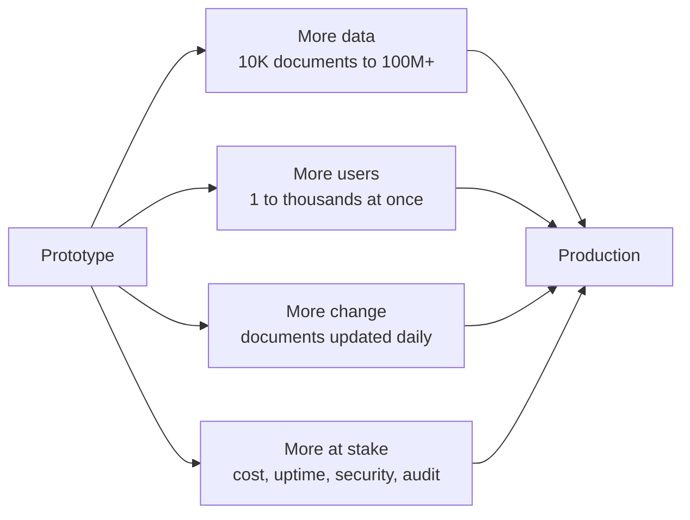
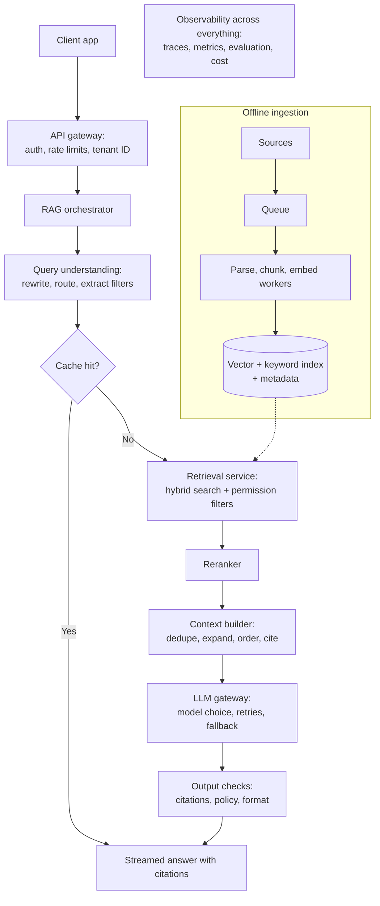
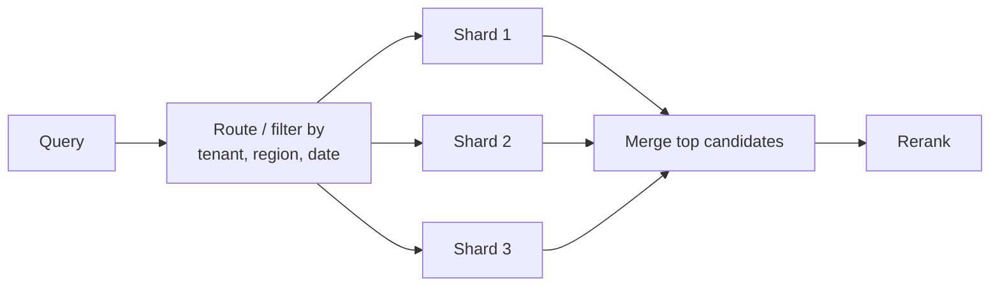
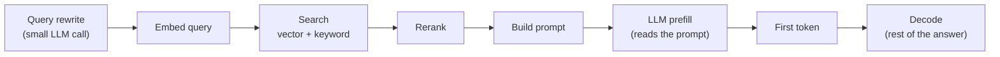

# Chapter 16: Production RAG Architecture and Scale

## 1. The concept, from scratch

### Prototype versus production

A RAG prototype runs on a laptop over a few hundred documents with one user, and it looks great. Production is the same idea under harder conditions:

Each pressure breaks something different. More data stresses the index and memory. More users stresses latency and throughput. More change stresses the ingestion pipeline. More at stake means you now need fallbacks, monitoring and cost control. This chapter walks through each, starting with a picture of the whole system.

### A reference architecture

Here is the shape most production RAG systems end up with. Don't memorise the boxes. Understand each one's job.

| Component | Its job |
|---|---|
| **API gateway** | Authenticates the user, enforces rate limits, passes identity and tenant downstream ([Chapter 15](../15-enterprise-rag/README.md)) |
| **Orchestrator** | Runs the pipeline steps in order, enforces time limits, decides fallbacks |
| **Query understanding** | Rewrites follow-ups, picks which index or source to search, extracts filters ([Chapter 14](../14-improving-retrieval/README.md)) |
| **Cache layers** | Skip work that's already been done |
| **Retrieval service** | Hybrid search with permission and metadata filters ([Chapter 13](../13-vector-search-and-databases/README.md)) |
| **Reranker** | Picks the best few passages from the candidates |
| **Context builder** | Assembles the prompt: dedupe, expand around hits, order, attach citations ([Chapter 7](../07-context-windows-and-context-engineering/README.md)) |
| **LLM gateway** | Routes to the right model, retries, falls back to another provider ([Chapter 36](../36-llm-gateways-and-routing/README.md)) |
| **Output checks** | Verify citations, format and policy before the user sees the answer |
| **Ingestion pipeline** | Queue-based, parallel, idempotent, keeps the index fresh ([Chapter 12](../12-ingestion-and-chunking/README.md)) |
| **Observability** | Traces every request through every stage, so you can find the slow or wrong part ([Chapter 32](../32-observability-and-llmops/README.md)) |

### Scaling the data: from 10 thousand documents to 100 million

**Start by counting chunks, not documents.** The index holds chunks. Ten million documents averaging twenty chunks each is 200 million chunks. At 1,536 dimensions stored as 32-bit floats, that's 200,000,000 × 1,536 × 4 bytes, about 1.2 terabytes of raw vectors, before the index structure, the text and the metadata. Arithmetic like this is the first step of any sizing answer, and it tells you immediately that a single small machine won't do.

Different scales call for different designs. These bands are rough rules of thumb from practitioner write-ups, not laws, and the right design depends on your recall, latency and budget targets.

| Scale (chunks) | Typical design | Main concern |
|---|---|---|
| **Up to hundreds of thousands** | One node. A flat or HNSW index in a general database with vector support or a small vector store | Don't over-engineer. Quality (parsing, chunking, hybrid search, reranking) matters far more than infrastructure |
| **Millions** | A dedicated vector store or search engine with an HNSW index, replicas for throughput | Latency under concurrent load, filtered search, ingestion speed |
| **Tens to hundreds of millions** | Compressed vectors, **sharding** across nodes, possibly disk-based indexes, tiering | Memory cost, rebuild and update times, recall under compression |
| **Billions** | Distributed ANN built for the purpose, specialised teams | Operations, cost, consistency |

The levers, in the order I'd reach for them:

1. **Shrink what you index.** Remove duplicates and low-value content, strip boilerplate, and consider shorter embeddings. Fewer, better chunks beats more, noisier ones.
2. **Compress the vectors.** Scalar quantisation (fewer bits per number) is commonly cited as giving roughly a four-times memory reduction with small recall loss. More aggressive methods save more but cost more recall, and are often paired with a re-check against full-precision vectors for the final candidates. Always measure recall on your own data.
3. **Narrow the search with metadata.** Filters by tenant, region, product or date shrink the candidate set before similarity search. This also serves permissions.
4. **Use a two-level index.** First search at the document level (a summary or title embedding), then search chunks only within the top documents. It's a good fit when you have millions of documents and each question concerns a handful.
5. **Tier hot and cold data.** Recent or frequently queried content in fast memory, the long tail on cheaper storage.
6. **Shard for capacity, replicate for throughput.** Sharding splits the data across machines, so each holds part of it. Replicas are copies that share the query load. They solve different problems.
7. **Disk-based indexes.** At very large scale, some designs keep compressed vectors in memory and full vectors on fast SSD, fetching them only for final ranking. Vendor write-ups often place the point where this becomes attractive around the hundreds of millions of vectors, but treat that as a hint, not a threshold.

**How to shard.** Two common choices. Shard **by data**, for example hashing the chunk ID, so shards are even and every query fans out to all of them. Or shard **by a business key** such as tenant or region, so a query touches only the shards that matter, which is cheaper and good for isolation ([Chapter 37](../37-cloud-reference-architectures-and-multi-tenancy/README.md)). The catch with business keys is imbalance: one huge tenant can overload its shard. Fan-out to many shards also adds latency, because you wait for the slowest one.

**Updates and rebuilds are the hidden pain.** Many ANN indexes are expensive to rebuild and awkward to update in place. Plan for it: write new content to a small fresh index that's merged periodically, and build replacement indexes alongside the live one, then switch ([Chapter 12](../12-ingestion-and-chunking/README.md)).

### Scaling ingestion

At scale, ingestion is a data pipeline with its own engineering:

- **Queue-based and parallel.** Documents go onto a queue, and many workers parse, chunk and embed in parallel. Add workers to go faster.
- **Idempotent.** Processing the same document twice must be safe, because retries and duplicates are certain.
- **Backpressure and rate limits.** Embedding APIs and OCR services have limits. Batch requests, back off on errors, and don't let a big upload starve everything else.
- **Priority lanes.** New and changed documents jump the queue ahead of a bulk backfill, so freshness doesn't suffer while you re-index history.
- **Dead-letter queue.** Documents that repeatedly fail are parked for inspection, not retried forever or silently lost.
- **Cost awareness.** OCR, vision parsing, and per-chunk model calls like contextual retrieval ([Chapter 12](../12-ingestion-and-chunking/README.md)) can dominate ingestion cost at scale. Estimate before you run a backfill.
- **Blue-green re-indexing.** For a new embedding model or chunking strategy, build a second index, test it, then switch traffic, keeping the old one for rollback.
- **Expose freshness.** Track and surface how far behind the index is, so a backlog is visible, not discovered through a wrong answer.

### The latency budget

Users judge a RAG assistant by how soon the first words appear. The metric is **time to first token (TTFT)**, and for the full request we look at **percentiles**: p50 is the typical request, p95 and p99 are the slow tail that users actually complain about. Averages hide the tail.

A request passes through stages, each of which adds time:

An **illustrative** budget might give tens of milliseconds to embedding and search each, tens to a few hundred to reranking, and most of the rest to the LLM's prefill and first token. Those proportions vary hugely with your models, hardware and prompt size, so don't quote them as facts. The real discipline is: **set a target, split it across stages, measure each stage per request, and fix the biggest contributor first.** Teams are often surprised by how much the reranker or the query rewrite costs.

How to cut latency:

- **Run independent steps in parallel.** Embed the query while running keyword search. Query several sources at once.
- **Cap reranker candidates.** Cost grows with the number of candidates and their length.
- **Use small, fast models** for rewriting and routing ([Chapter 8](../08-the-model-landscape/README.md)).
- **Trim the prompt.** A shorter prompt means a faster prefill ([Chapter 7](../07-context-windows-and-context-engineering/README.md)).
- **Stream the answer.** Total time doesn't change, but the wait feels much shorter ([Chapter 35](../35-reliability-scaling-and-streaming/README.md)).
- **Cache** (next section).
- **Keep services close together**, in the same region, with pooled connections.
- **Set per-stage timeouts**, so one slow component can't hold up the whole request.

### Caching layers

Caching is the cheapest speed-up and cost cut, and it has several layers ([Chapter 31](../31-cost-latency-and-caching/README.md) covers it in full).

| Cache | What it stores | Risk to manage |
|---|---|---|
| **Embedding cache** | The vector for a repeated query | Low. Invalidate if the embedding model changes |
| **Retrieval-result cache** | Retrieved chunks for a normalised query | Must be keyed by the user's **permission scope**, and invalidated when content changes |
| **Semantic cache** | A previous answer for a *similar* question | Two questions that look alike can differ in a key detail, such as a year or a product. Add exact-match checks on key terms, and never share across permission scopes ([Chapter 15](../15-enterprise-rag/README.md)) |
| **Provider prompt caching** | The model provider reuses the processed stable prefix of your prompt | Order the prompt with stable content first |
| **Answer cache** | Full responses for common questions | Staleness. Set expiry and invalidate on source changes |

### Cost: where the money goes

Know the cost components, because "reduce the bill" is a standard interview question.

- **Ingestion:** parsing and OCR, embedding every chunk (once, and again on each re-embed), and any per-chunk model calls.
- **Storage and search:** vector indexes are memory-hungry, so the index cluster is often a major fixed cost.
- **Per query:** query-side model calls, reranking, and the generation. The LLM tokens, which means the prompt plus the answer, are frequently the largest per-query cost, but measure it.
- **Overheads:** logging, evaluation runs, and the engineering time to operate it all.

Levers: pass fewer, better passages (rerank and cap), route simple questions to smaller models ([Chapter 36](../36-llm-gateways-and-routing/README.md)), cache, compress and tier the index, skip reranking when first-stage scores are decisive, batch offline work, and measure **cost per answered question** so changes can be judged by what they save and what quality they cost.

### Reliability: fail gracefully

Everything in the chain can fail, and a production system plans for each failure instead of showing an error page.

| What fails | Sensible fallback |
|---|---|
| **Reranker is slow or down** | Skip it and use the first-stage order, accepting lower precision |
| **Vector store is slow or down** | Fall back to keyword search, a cached result, or a clear "search is degraded" message |
| **LLM provider is rate-limited or down** | Retry with backoff and jitter, then switch to a backup model through the gateway |
| **Retrieval returns nothing relevant** | Abstain and escalate ([Chapter 15](../15-enterprise-rag/README.md)) |
| **Ingestion backlog grows** | Prioritise changed documents and show the index's freshness |
| **A traffic spike** | Rate limit per tenant, shed low-priority load, queue background work |
| **One tenant's heavy use** | Per-tenant quotas, so one customer can't starve the others |

Supporting patterns: **timeouts** on every call, **retries** only where it's safe and bounded, **circuit breakers** that stop calling a failing dependency, and **separate resource pools** (bulkheads) so ingestion can't take down query serving. Define **SLOs**, for example a TTFT and an availability target, and alert on them. [Chapter 35](../35-reliability-scaling-and-streaming/README.md) covers these patterns properly.

### Build or buy: managed RAG services

The big clouds sell managed RAG: you point it at your documents, and it handles parsing, chunking, embedding, indexing, retrieval and often generation (examples as of Nov 2026: Amazon Bedrock Knowledge Bases, Azure AI Search with Azure OpenAI, and Google's Vertex AI search and RAG offerings). Managed services get you to a working system fast, with security and billing integrated. The trade-off is less control over chunking, ranking, filtering and limits, and features differ between providers and change often. A sensible path is to prove value on a managed service, measure where it falls short, and take over the parts that matter, such as chunking or reranking, when the evidence says so ([Chapter 37](../37-cloud-reference-architectures-and-multi-tenancy/README.md)).

### What to monitor in production

Per request: latency per stage, TTFT, cache hit, tokens in and out, cost. Per day: retrieval recall and precision on a fixed evaluation set, groundedness of answers, empty-result and abstain rates, thumbs-down feedback, index freshness, error and timeout rates. Sample real conversations for human review. When quality drops, you want to see *which stage* changed ([Chapter 27](../27-evaluating-rag-and-agents/README.md), [Chapter 32](../32-observability-and-llmops/README.md)).

## 2. Analogies across industries

- **Sharding (logistics).** A national courier doesn't keep every parcel in one warehouse. Parcels are split across regional hubs. A query for a parcel goes to the hubs that could hold it. Splitting by region (business key) is cheap to route, but a regional hub that gets all the volume jams. Splitting evenly avoids jams, but every search has to ask every hub.
- **Tiering (retail).** A store keeps best-sellers at the front on easy-reach shelves and slow movers in the back room. Hot and cold tiers for the index follow the same logic.
- **Replicas vs shards (telecom).** Adding more call-centre agents who all handle the same product (replicas) increases how many calls you can answer. Splitting agents by product line (shards) increases how many products you can cover. They solve different problems.
- **Graceful degradation (healthcare).** When a hospital's main scanner is down, it doesn't close. It switches to the backup scanner or prioritises urgent cases. Falling back from the reranker or vector store to a simpler path is the same idea.
- **Latency budget (e-commerce).** A checkout page that must load in two seconds gets a time allowance per step: the cart, the pricing, the payment check. If one step overruns, the page has a fallback. Each RAG stage gets its allowance.

## 3. How it's used in industry

- **E-commerce: a large catalogue assistant.** A marketplace with tens of millions of product chunks uses compressed vectors, shards by category and region, a retrieval-result cache keyed by market, and a reranker capped at a fixed number of candidates. If the reranker times out, the system serves first-stage results.
- **Logistics: operations knowledge at scale.** A carrier runs queue-based ingestion across thousands of depot documents, with priority lanes for new regulations and bulk backfills at night. It surfaces an "index last updated" time in the assistant.
- **Banking: regulated, multi-region.** A bank deploys a retrieval service per region to meet data residency rules, filters on tenant and entitlement, logs each stage's latency and the sources used, and falls back to a backup model provider through an LLM gateway if its primary is rate-limited.
- **Telecom: a spike in traffic.** An operator's support assistant faces sudden load during an outage. Per-tenant rate limits, cached answers for the most common fault questions, and shedding of non-urgent background jobs keep the live assistant responsive.

## 4. Common misconceptions

- **"Scaling RAG means buying a bigger vector database."** Often the gains come from fewer and better chunks, compression, filters, caching and reranker limits, before any hardware.
- **"Count documents to size the system."** Count chunks. A million documents can be twenty million chunks.
- **"Sharding and replication are the same."** Shards split the data for capacity. Replicas copy it for throughput.
- **"Average latency is fine."** Users feel the slow tail. Watch p95 and p99 and time to first token.
- **"A semantic cache is a free win."** It can return the wrong answer for a similar-looking question, or cross a permission boundary, unless you guard it.
- **"The LLM is always the slow part."** Often reranking, query rewriting or a badly filtered search surprises you. Measure each stage.
- **"If a component fails, the request fails."** Production systems degrade gracefully with fallbacks, timeouts and circuit breakers.
- **"Managed RAG means no engineering."** It speeds the start, but you still need evaluation, security, cost control and monitoring.

## 5. Interview questions

### 1. How would you scale a RAG system from 10,000 documents to 100 million?

I'd start by counting chunks and doing the memory arithmetic, because the index holds chunks, not documents. A hundred million documents is billions of chunks, so I'd ask what's really needed: first, shrink the problem by deduplicating and removing low-value content. Then I'd use a two-level approach where I narrow by metadata filters and a document-level index before searching chunks. I'd compress vectors, for example with scalar quantisation, and measure the recall impact. I'd shard the index across nodes for capacity and add replicas for query throughput, and tier hot and cold content. Ingestion becomes a queue-based, parallel, idempotent pipeline. And I'd add caching, a latency budget per stage, fallbacks, and monitoring. At each stage I'd measure recall and latency on a fixed evaluation set, so scaling doesn't quietly cost quality.

### 2. Design a RAG system for 10 million documents.

I'd begin with sizing. Ten million documents at roughly twenty chunks each is about 200 million chunks. At 1,536 dimensions in 32-bit floats that's about 1.2 terabytes of raw vectors, which pushes me towards compression, shorter embeddings and sharding. The architecture is a gateway with authentication and tenant identity, an orchestrator, query rewriting, hybrid retrieval with permission filters, a reranker, a context builder, and an LLM behind a gateway with fallbacks, plus citation and policy checks. Offline, a queue feeds parallel workers that parse, chunk and embed, with priority lanes for changed documents. I'd use a two-level index, cache at several layers, set a time-to-first-token target split across stages, stream the answer, and instrument everything. And I'd build an evaluation set first, so I can show recall, groundedness, latency and cost per answer.

### 3. Where does the latency go in a RAG request, and how do you reduce it?

A request passes through query rewriting, embedding the query, search, reranking, building the prompt, the LLM's prefill, and then generation. The user cares most about time to first token, so I look at everything up to the first token, plus the p95 and p99, not just the average. I'd instrument each stage and fix the largest contributor first, because the culprit is often reranking or query rewriting, not just the model. To reduce it: run independent steps in parallel, cap how many candidates the reranker sees, use small fast models for rewriting, trim the prompt so prefill is faster, cache repeated work, keep services in one region, set per-stage timeouts, and stream the answer so it feels faster.

### 4. How would you reduce the cost of a production RAG system?

I'd first find where the money goes: ingestion with parsing, OCR and embeddings, the vector index which is memory-hungry, and per-query costs like reranking and the LLM tokens, which are often the biggest. Then I'd pull the levers. Send fewer, better passages by reranking and capping. Route simple questions to smaller, cheaper models. Cache at several layers and use the provider's prompt caching with a stable prefix. Compress and tier the index, and deduplicate the corpus. Skip reranking when first-stage scores are clear. Batch offline work. I'd measure cost per answered question, and for each change check that quality on the evaluation set doesn't drop.

### 5. What's the difference between sharding and replication in a vector search system?

Sharding splits the data across machines so each holds part of it, which gives me capacity for more vectors than one machine can hold, but a query has to fan out to the relevant shards and merge results, so it adds coordination and the slowest shard sets the latency. Replication keeps full copies on several machines, which increases how many queries per second I can serve and gives me resilience if one machine fails, but doesn't increase the amount of data I can hold. At large scale I need both: shards for capacity, replicas of each shard for throughput and availability. I'd choose the shard key carefully, either by data for balance or by a business key like tenant or region to reduce fan-out and help isolation, watching for hot spots.

### 6. What can go wrong with a semantic cache?

A semantic cache returns a stored answer when a new question is similar enough to an earlier one, and the risk is that similar isn't the same. Two questions can differ in one crucial detail, like a year, a product or a region, and still be very close in embedding space, so the cache serves the wrong answer. It can also cross a permission boundary if the cache is shared between users with different access, which is a data leak. And the cached answer can go stale when the underlying documents change. So I'd add exact-match checks on key terms like numbers and dates, key the cache by permission scope, set expiry, invalidate on content changes, tune the similarity threshold with real data, and measure the wrong-hit rate.

### 7. How do you make a RAG system resilient when a component fails?

I'd plan a fallback for each dependency. If the reranker times out, serve the first-stage order. If the vector store is degraded, fall back to keyword search or a cached result, and tell the user the search is degraded. If the LLM provider is rate-limited or down, retry with backoff and jitter, then switch to a backup model through a gateway. If retrieval finds nothing relevant, abstain and escalate. I'd put timeouts on every call, bound the retries, use circuit breakers so I stop hammering a failing service, and separate resource pools so ingestion can't starve query serving. I'd define SLOs for time to first token and availability and alert on them, and I'd test the failures on purpose.

### 8. How do you keep ingestion reliable and fast at scale?

I'd build it as a queue-based pipeline: documents go on a queue and a pool of workers parse, chunk and embed them in parallel. The steps must be idempotent, so retries and duplicates are safe. I'd batch calls to embedding services, respect their rate limits with backoff, and use priority lanes so new and changed documents jump ahead of a bulk backfill. Failures go to a dead-letter queue for inspection. I'd estimate the cost of OCR, vision parsing and per-chunk model calls before a large run. For a new embedding model or chunking change, I'd build a second index and switch over when it's tested. And I'd monitor queue depth and the index's freshness, and show it to users.

### 9. When would you use a managed RAG service instead of building your own?

When speed to value matters, the team is small, and the cloud provider's security and billing model fits the client. A managed service handles parsing, chunking, embedding, indexing and retrieval, so I can have a working system quickly, and I can measure how good it is on my own evaluation set. I'd build my own, or take over specific parts, when I need control the managed service doesn't give, such as custom chunking for complex documents, specific ranking, tight filtering and permissions, hybrid tuning, or cost at scale. A pragmatic path is to start managed, find where the evidence shows it falls short, and replace those parts. I'd also check each service's current feature limits, since they change.

### 10. What would you monitor once the system is live?

At the request level, latency per stage, time to first token, cache hits, tokens and cost, and errors and timeouts. Then quality: retrieval recall and precision and answer groundedness on a fixed evaluation set that I re-run regularly, the abstain and empty-result rates, and user feedback such as thumbs-down. For the data side, index freshness, ingestion queue depth, and failed documents. I'd correlate everything with a request ID, so I can trace a bad answer through the stages, and sample real conversations for human review. I'd alert on SLOs, and I'd watch for drift, since content and user questions change over time.

## 6. Scenario exercise

A company piloted a RAG assistant over 50,000 documents with 20 users, and it worked well. Now it's rolling out to 5,000 staff across the business, with about 12 million documents from many systems, mixed languages, and daily updates. In the first week at larger scale: p95 time to first token is over ten seconds, the ingestion queue is days behind so people get outdated answers, the monthly cost forecast is several times the pilot's per-user figure, and during a vendor outage the assistant returned errors for an hour. The programme director asks for a plan. You haven't seen the system.

Answer from memory, then check.

Model answer

I'd start by measuring, because several different problems are bundled together. I'd add tracing so every request shows latency per stage, and look at p95 for each. I'd expect a few usual suspects: an unfiltered search over a much larger index, a reranker reading too many candidates, a query rewrite adding a model call, and long prompts slowing the LLM's prefill. The fixes are to narrow the search with metadata filters and a document-level first pass, cap reranker candidates, use a small fast model for rewriting, trim the prompt, run independent steps in parallel, set per-stage timeouts, and stream answers so they start appearing sooner. I'd set a time-to-first-token target and a budget per stage.

The ingestion backlog says the pipeline is still pilot-shaped. I'd move it to a queue with parallel, idempotent workers, batch the embedding calls and respect rate limits, give changed documents a priority lane over the bulk backfill, add a dead-letter queue, and surface an "index last updated" time. Twelve million documents is probably a couple of hundred million chunks, so I'd redo the sizing, check that the index is sharded and compressed appropriately, and plan blue-green re-indexing for any model change.

For cost, I'd break the bill into ingestion, index infrastructure and per-query costs. Likely levers: deduplicate and remove low-value content, pass fewer and better passages, route simple questions to a smaller model, cache at several layers with permission-aware keys, use provider prompt caching with a stable prefix, and compress and tier the index. I'd report cost per answered question, so each change is judged by savings and quality.

For the outage, I'd put a gateway in front of the model with a backup provider, retries with backoff, timeouts, and circuit breakers, plus fallbacks: skip the reranker, fall back to keyword search, and show a clear degraded-mode message instead of errors. I'd define SLOs, alert on them, and test the failure.

I'd tie it together with a fixed evaluation set and a dashboard so each change shows its effect on quality, latency and cost, and I'd sequence the work: observability and the latency fixes first, then ingestion, then cost, then resilience.

## 7. Key takeaways

- Size by chunks, not documents, and do the arithmetic: 200 million chunks at 1,536 dimensions is about 1.2 TB of raw vectors.
- Scale the data with fewer and better chunks, compression, metadata filters, a two-level index, tiering, and sharding for capacity with replicas for throughput.
- Set a latency target on time to first token, split it across stages, measure each at p95 and p99, and cut the biggest contributor first. Cache with care, especially semantic caches.
- Make ingestion a queue-based, idempotent, prioritised pipeline with dead-letter handling, blue-green re-indexing and a visible freshness metric.
- Design for failure: timeouts, fallbacks, circuit breakers and a backup model. Monitor stage latency, quality, cost per answer and freshness.

## 8. Further reading

- AWS, [Retrieval Augmented Generation options and architectures on AWS](https://docs.aws.amazon.com/prescriptive-guidance/latest/retrieval-augmented-generation-options/): reference approaches from a major cloud.
- Microsoft, [Design and develop a RAG solution](https://learn.microsoft.com/en-us/azure/architecture/ai-ml/guide/rag/rag-solution-design-and-evaluation-guide).
- Google, [Site Reliability Engineering: Handling Overload](https://sre.google/sre-book/handling-overload/): load shedding and graceful degradation.
- Douze et al., [The Faiss Library](https://arxiv.org/abs/2401.08281): the speed, accuracy and memory trade-offs behind large-scale vector search.
