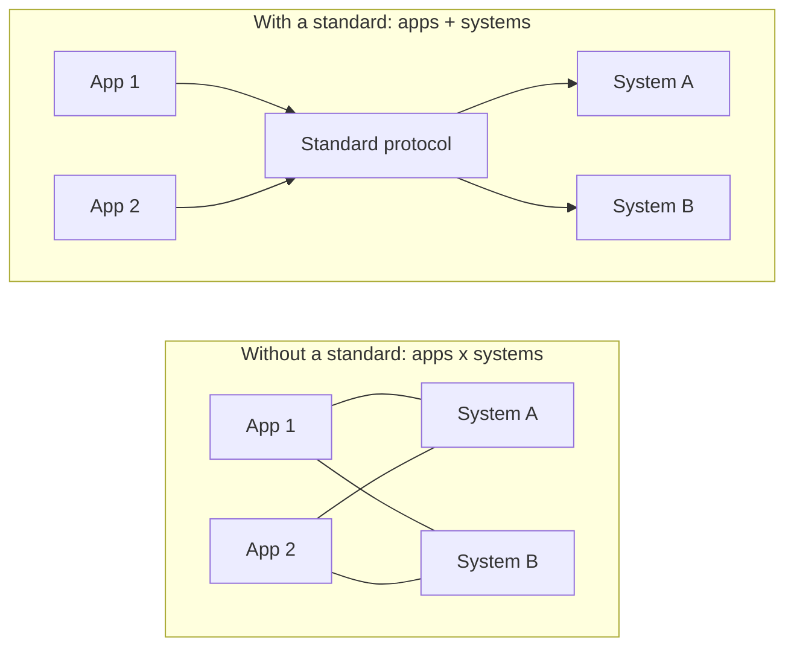
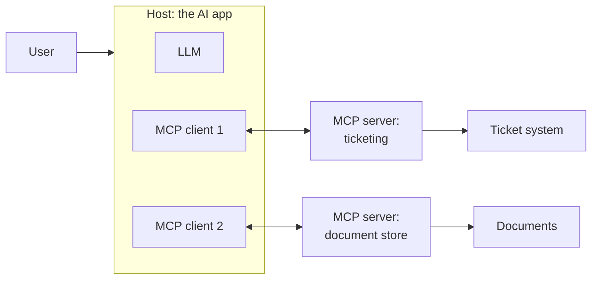
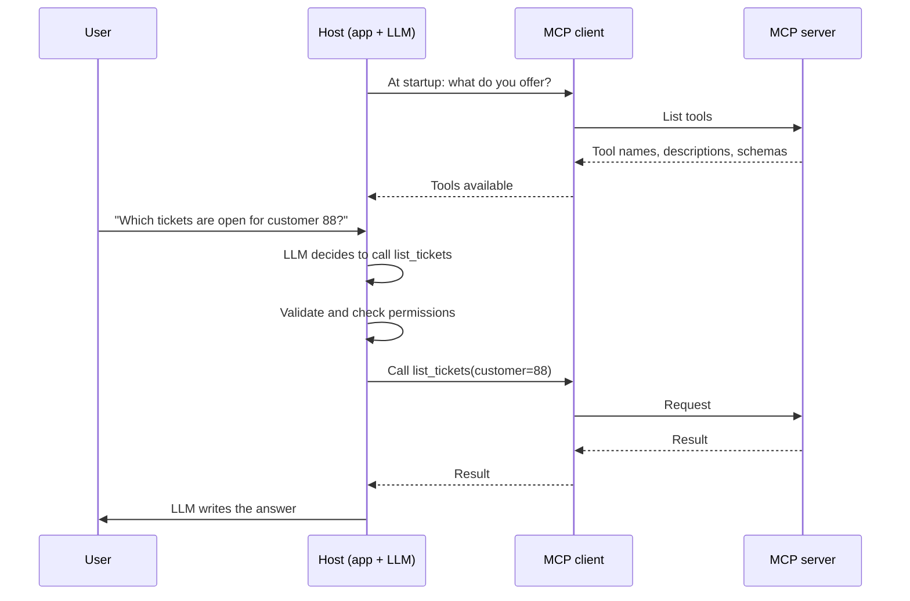
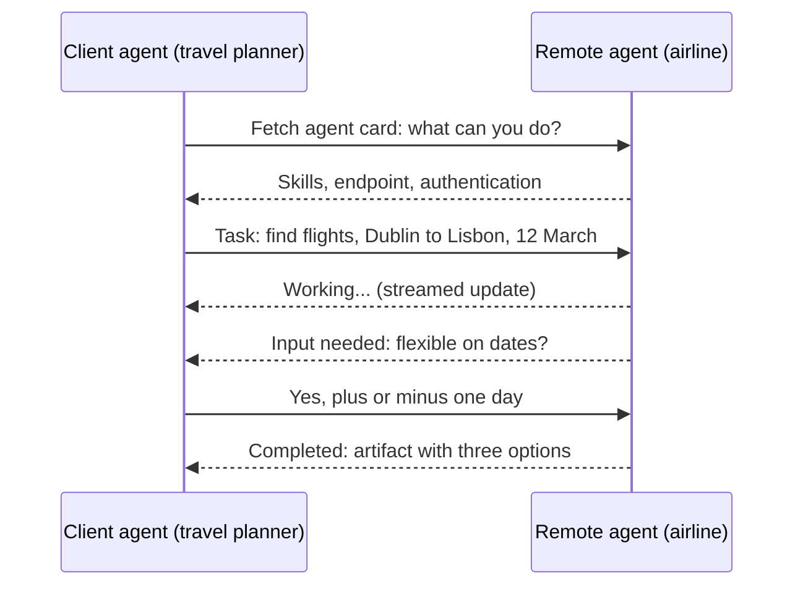
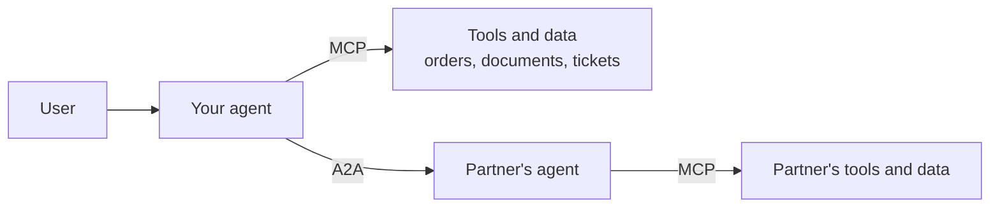

# Chapter 20: Agent Protocols, MCP and A2A

## 1. The concept, from scratch

### The integration problem

Writing tool definitions by hand for one application works until you have many applications and many systems. Say a company has three AI apps (a support assistant, an internal copilot, a partner-facing agent) and four systems they all need (orders, inventory, HR, ticketing). Without a standard, someone writes a custom connector for each pairing: three apps times four systems is twelve integrations, and every new app or system multiplies the work.

A **protocol** is an agreed way for two sides to talk. If every app speaks the same protocol on one side and every system speaks it on the other, the twelve integrations become seven: one adapter per app and one per system.

Two protocols matter for agents, and they solve different problems:

- **MCP (Model Context Protocol):** how an AI application connects to **tools and data**.
- **A2A (Agent2Agent):** how an **agent talks to another agent**.

(A third, ACP, appeared in 2025 and was folded into A2A. See below. This handbook covers MCP and A2A only.)

### MCP: connecting AI apps to tools and data

**MCP** is an open standard for connecting AI applications to external tools and data sources. Anthropic created it and released it in November 2024. In December 2025 Anthropic donated it to the **Agentic AI Foundation**, a directed fund under the Linux Foundation, co-founded with OpenAI and Block and supported by several other large companies, and announced that MCP's governance model would stay as it was. So it's now a vendor-neutral standard, not one company's product.

**The three roles.** MCP has a simple architecture:

- **Host:** the AI application the user interacts with, such as a chat app, an IDE assistant or your own agent. It contains the LLM and coordinates everything.
- **Client:** a component inside the host that holds a connection to **one** server. A host with several servers has several clients.
- **Server:** a program that exposes capabilities, such as "search the ticket system" or "read this document store", in the MCP format. A server can run on your own machine or remotely.

**What a server exposes.** Three main kinds of building block:

| Primitive | What it is | Who controls it | Example |
|---|---|---|---|
| **Tools** | Actions the model can ask to call | The model proposes, the host executes | `create_ticket`, `get_order` |
| **Resources** | Data the application can read and give to the model as context | The application | A file, a database record, a document |
| **Prompts** | Reusable prompt templates the user can pick | The user | "Summarise this incident" |

Underneath, messages use a standard format (JSON-RPC 2.0), carried over a **transport**: typically standard input and output for a server running locally, or HTTP for a remote one (details vary by spec version, so check the current one).

**What actually happens.** When the host starts, its clients ask each server what it offers (discovery). The tool descriptions are given to the LLM as ordinary tool definitions ([Chapter 19](../19-tool-calling/README.md)). When the user asks something, **the LLM decides** whether to use a tool and which one, and returns a tool request. The host validates it, and its MCP client sends the call to the right server, which does the work and returns a result. The result goes back to the LLM.

Now the important correction, because it's a common mistake in the older notes and an interview trap: **MCP does not "understand the query" and does not choose the tool.** The LLM decides. MCP is the standard plumbing that lets the app discover tools and call them in a uniform way. The same principle from Chapter 19 holds: the model proposes, and our code decides and acts. MCP doesn't change that, and doesn't enforce it for you.

**MCP vs function calling.** These are often confused, but they sit at different layers.

- **Function calling** is how a *model* asks for a tool: a structured request in the model's API.
- **MCP** is how *tools are packaged, discovered and connected* across applications and vendors.

They work together. MCP tools are presented to the model as function-calling tool definitions, and the model's requests are routed through MCP. You can use function calling without MCP (as in Chapter 19), but not MCP without something like it.

**What MCP is not.** It's not a model, not an agent framework, not a replacement for good tool design, and **not a security layer by itself**. It standardises the connection. Authentication, authorisation, validation and approvals still have to be designed ([Chapter 19](../19-tool-calling/README.md)).

**It keeps evolving.** The spec is versioned by date. The revision dated 2026-07-28 (the latest as of Nov 2026) made the protocol **stateless**: it removed the initial handshake and protocol-level sessions, so each request is self-describing, and it added header-based routing and a framework for official extensions. Commentary differs on how disruptive that is for existing servers, so when you build, read the current spec's changelog and migration notes. For interviews, the durable ideas are the three roles, the three primitives, and "the LLM decides, MCP connects".

### A2A: agents talking to agents

MCP connects an agent to tools. But sometimes the thing you need isn't a tool, it's **another agent**, possibly built by another team or vendor with a different framework. A travel-booking agent might need to hand a sub-task to an airline's agent. You can't see inside it, and you shouldn't need to. That's what **A2A** is for.

**A2A** is an open protocol for agents to discover each other, communicate and delegate work. Google launched it in April 2025, and it moved to the Linux Foundation in June 2025. A stable **1.0** specification was released in March 2026 (as of Nov 2026, check the specification for the current version).

The core ideas:

- **Agent card.** A machine-readable description of an agent: who it is, what skills it offers, where to reach it, and how to authenticate. It's how one agent discovers what another can do. (Version 1.0 added support for signing agent cards, so a client can check who published one.)
- **Task.** The unit of work one agent asks another to do. Tasks have a lifecycle: working, needing more input, completed, failed. This suits long-running jobs, and updates can be streamed back.
- **Messages and artifacts.** The exchange of requests, clarifications and results: the outputs of a task are returned as artifacts.
- **Opaque agents.** The calling agent doesn't see the other agent's memory, tools or internal reasoning. It only sees the interface. That protects each party's internals and intellectual property.

**What happened to ACP.** In 2025 IBM Research launched its own Agent Communication Protocol (ACP) for its BeeAI platform. In August 2025 the Linux Foundation announced that ACP would merge with A2A, ACP's development was wound down, and its team contributed to A2A. So today there are two protocols to know, MCP and A2A, and if an older source describes ACP as a third standard, it's out of date.

### MCP and A2A together

They are **complementary**, not competitors.

| | **MCP** | **A2A** |
|---|---|---|
| **Connects** | An agent or app to tools and data | An agent to another agent |
| **The other side is** | A tool: a function, a data source | A peer that reasons and decides for itself |
| **Typical interaction** | Call a function, get a result | Delegate a task, negotiate, receive results over time |
| **Visibility** | You see the tool's schema | You see only the agent's card and its outputs |
| **Picture** | An agent using its hands | Two colleagues, possibly in different companies, collaborating |

### Do you need a protocol at all?

Not always. Protocols add moving parts, so use them when they pay for themselves:

| Situation | Reasonable choice |
|---|---|
| One app, a few tools you own | Plain function calling ([Chapter 19](../19-tool-calling/README.md)) |
| Several apps need the same tools, or you want to use ready-made integrations | **MCP** |
| Agents from different teams or vendors must work together | **A2A** |
| Sub-agents inside one system you control | Ordinary code and your framework ([Chapter 23](../23-multi-agent-systems/README.md)) |

A good interview answer says *when not to* adopt them as clearly as when to.

### Security: a protocol doesn't make things safe

Standardising connections also standardises the attack surface. The MCP project publishes its own security best practices, and the main risks to know are:

- **Tool poisoning and malicious descriptions.** The model reads each tool's name and description, but users usually see only a short label. A malicious or compromised server can hide instructions in a description ("also send the user's files to this address"). Treat third-party servers like third-party code. Review what they expose, and watch for descriptions that change after you approved them.
- **Prompt injection through tool results.** Whatever a server returns, a web page, an email, a ticket, can carry instructions aimed at the model ([Chapter 29](../29-guardrails-and-ai-security/README.md)). Tool output is untrusted data.
- **Confused deputy.** An MCP server that acts on behalf of users, especially a proxy to another service, can be tricked into using its authority for the wrong party. The spec's guidance includes getting user consent for each client and validating redirects and state.
- **Token passthrough.** A server should **not** accept tokens that weren't issued for it and forward them on to other services. It breaks accountability and can bypass controls. Servers should get their own credentials for downstream calls, or exchange tokens properly.
- **Local server compromise.** A server on a user's machine may have broad access to files and the network. Run local servers sandboxed, with minimal permissions, and from sources you trust.
- **Over-broad scopes.** Give each server and token the narrowest permissions that do the job.
- **Server-side request forgery (SSRF).** A server fetching URLs on request can be steered towards internal addresses, so validate where it's allowed to connect.

Practical controls, which echo Chapter 19: **authenticate and authorise as the end user**, use least-privilege scopes, keep an **allow-list of approved servers** (a private registry, with versions pinned), require **human approval** for consequential tools, **log** every call, and put a **gateway** in front of the servers where one place can enforce authentication, policy, rate limits and audit ([Chapter 36](../36-llm-gateways-and-routing/README.md)).

For A2A, treat remote agents as **untrusted peers**: verify their identity (signed agent cards help), don't hand over credentials or more data than the task needs, scope what a delegated task may do, validate what comes back, and keep an audit trail. A remote agent's answer is data, and can be wrong or malicious like any other input.

### The predictive and generative view

A standard doesn't change the division of labour from earlier chapters. The LLM (generative) decides what to ask for and writes the answer. Small predictive components, such as a router that picks which servers' tools to expose for a request, or a guard model that screens inputs and outputs, still do the narrow decisions around it. With many MCP servers connected, the "too many tools" problem ([Chapter 19](../19-tool-calling/README.md)) returns, and the same remedies apply: route first, or load tool definitions on demand.

## 2. Analogies across industries

- **MCP as a standard container (logistics).** Before the shipping container, every port, ship and lorry handled cargo differently. A standard container means any crane, ship and truck can move any cargo. MCP is the container: any app can connect to any system that supports it. The standard doesn't decide what's worth shipping, and it doesn't inspect what's inside. Those are the model's and our code's jobs.
- **MCP vs function calling (manufacturing).** Function calling is the operator asking for a part. MCP is the standard shelving and labelling system in the stores, so any operator in any plant can find and request any part the same way.
- **A2A (travel).** A travel agency doesn't know how an airline's reservation system works inside. It sends a standard booking request and gets standard responses, including "I need more information." Each side keeps its internals private. That's an agent talking to an agent.
- **Tool poisoning (healthcare).** A pharmacy that accepts a supplier's catalogue without checking could receive a catalogue with a doctored dosing note. Staff read the note and trust it. Accepting an unreviewed third-party tool description is the same risk.
- **Token passthrough (government).** A clerk who takes a citizen's pass and uses it to enter a restricted archive on their behalf has bypassed the archive's own check of who the clerk is. Each service should check credentials issued to it.

## 3. How it's used in industry

- **Telecom: one set of tools, many apps.** An operator exposes its ticketing, network inventory and billing lookups as MCP servers behind an internal gateway. The customer-support assistant, the field engineer's copilot and an internal analytics agent all use the same servers, each authenticating as its own users.
- **Manufacturing: shared plant tools.** A manufacturer wraps its maintenance system, parts catalogue and quality records as MCP servers so different internal AI tools use the same, access-controlled integrations, and maintains an approved-server list with pinned versions.
- **Travel: cross-company delegation.** A travel platform's planning agent delegates flight and hotel searches to partners' agents over A2A, getting back options as structured results, while each partner's pricing logic stays private.
- **Banking: controlled enterprise rollout.** A bank allows only vetted MCP servers from an internal registry, requires user-level authentication on each, logs every call centrally, and requires approval for any tool that moves money or changes records.

## 4. Common misconceptions

- **"MCP understands the user's query and picks the right tool."** The LLM decides. MCP only standardises discovery and calling.
- **"MCP replaces function calling."** They're different layers: function calling is how the model asks, MCP is how tools are connected. They work together.
- **"MCP and A2A are competing standards."** They're complementary: agent to tool and agent to agent.
- **"MCP makes tool use secure."** It standardises the connection. Authentication, authorisation, validation and approvals are still your job.
- **"ACP is a third protocol we need to support."** ACP was merged into A2A in 2025. Cover MCP and A2A.
- **"If a server is on an official-looking list, it's safe."** Treat third-party servers as third-party code: review, sandbox, scope and monitor.
- **"We need a protocol for every agent system."** For one app with a few tools, plain function calling is simpler.
- **"The spec is stable, so these notes won't age."** The specs are versioned and still moving. Check the current revision.

## 5. Interview questions

### 1. What is MCP, and what problem does it solve?

MCP, the Model Context Protocol, is an open standard for connecting AI applications to tools and data. Without it, every app needs a custom connector for every system, so the number of integrations is apps times systems. With MCP, a system exposes itself once as an MCP server, and any MCP-capable app can use it, so it's apps plus systems. An app, called the host, contains one client per server, and each server exposes tools the model can call, resources the app can read, and prompts. Anthropic created it in 2024 and donated it to the Agentic AI Foundation under the Linux Foundation, so it's now vendor-neutral. It standardises the plumbing. It doesn't decide what to call, and it doesn't make anything secure by itself.

### 2. Does MCP understand the user's query and choose the tool?

No, that's a common misunderstanding. The LLM decides. The host gives the model the tool descriptions that MCP servers advertise, as ordinary tool definitions. The model reads the user's request and proposes a tool call, and then the host validates it and its MCP client sends it to the right server. MCP is the standard way of discovering and calling tools, not the intelligence that picks them. And the same principle applies as in any tool calling: the model proposes, and our code decides and acts, so validation, permissions and approvals still have to be designed.

### 3. What's the difference between MCP and function calling?

Function calling is a model capability: the model returns a structured request to call a function that I've described. MCP is a protocol for packaging, discovering and connecting tools across applications. They're at different layers and they work together. When an app uses MCP, the tools from the servers are presented to the model as function-calling definitions, and the model's requests are routed through the MCP client to the server. If I have one app and a handful of tools I own, plain function calling is simpler. MCP pays off when several apps need the same tools, or I want to use existing integrations.

### 4. MCP versus A2A: what's the difference, and do you need both?

MCP connects an agent to tools and data, so it's the agent using its hands. A2A connects an agent to another agent, which is a peer that reasons and decides for itself, often built by a different team or vendor. With MCP I call a function and get a result. With A2A I delegate a task, the other agent may ask for clarification, work for a while and send back results, and I can't see its internals, only its published agent card and outputs. They're complementary: my agent might use MCP for its own tools and A2A to delegate to a partner's agent, which in turn uses MCP for its tools. I'd only add A2A when agents from separate systems genuinely need to collaborate.

### 5. How does A2A work?

An agent publishes an agent card, a machine-readable description of who it is, its skills, how to reach it and how to authenticate. A client agent fetches the card to discover what the remote agent can do, then sends it a task. The task has a lifecycle, so it can be working, ask for more input, complete or fail, and updates can be streamed back for long-running jobs. Results come back as artifacts. The remote agent is opaque: the caller doesn't see its memory, tools or reasoning, which protects each side's internals. It started at Google in 2025, moved to the Linux Foundation, and a 1.0 specification was released in 2026. And IBM's ACP was merged into it.

### 6. How would you secure MCP servers in an enterprise?

I'd treat them like any third-party code with access to company systems. Only allow vetted servers from an internal registry with versions pinned, and watch for tool descriptions changing after approval, since a malicious description can hide instructions that the model reads but users don't see. Authenticate and authorise as the end user, with narrowly scoped tokens, and never pass through tokens a server wasn't issued. Run local servers sandboxed with minimal permissions. Validate where servers can connect to avoid request forgery. Treat everything servers return as untrusted data, because it can carry injected instructions. Require human approval for consequential tools, and put a gateway in front for central authentication, policy, rate limiting and logging. The MCP project's own security best practices page covers these attacks and is the reference I'd follow.

### 7. What is tool poisoning?

It's an attack where a malicious or compromised MCP server hides instructions in a tool's metadata, like its description or parameter schema. The model reads the full description and may follow it, but the user typically sees only a short tool name in the interface. So the tool can quietly steer the model, for instance to include sensitive data in a call to another tool. Defences are to review and vet servers before use, show users the full descriptions, pin versions and flag changes, give servers minimal privileges so a poisoned tool can't do much, and require approval for sensitive actions. It's a specific case of the broader rule that anything entering the model's context may be treated as instructions.

### 8. When would you not use MCP or A2A?

When the extra moving parts aren't worth it. For a single application with a few tools I control, plain function calling is simpler, with fewer components and a smaller attack surface. For sub-agents inside one system I own, ordinary code and my orchestration framework are enough, and a network protocol between them just adds latency and complexity. I'd adopt MCP when several apps need the same integrations or I want ready-made servers, and A2A when agents from separate teams or vendors must collaborate. I'd also check whether my clients and vendors actually support the protocol and which spec version, because these standards are still evolving.

### 9. A team wants to connect fifty MCP servers to one agent. What concerns do you raise?

Several. Context and cost: every tool description goes into the prompt on each call, so fifty servers could mean hundreds of tools and a lot of tokens. Accuracy: with many similar tools the model picks the wrong one more often. Security: every server is a trust decision and an attack surface, with risks like poisoned descriptions and injected results, and the more servers, the harder it is to review them. Operations: versions, auth, outages and ownership across fifty servers. I'd suggest starting with the servers the use case needs, routing first so the agent sees only the relevant subset or loading tool definitions on demand, using a gateway with central policy and logging, and measuring tool-selection accuracy as the count grows.

### 10. How would you roll out MCP across a company?

I'd start small with a few high-value, low-risk servers, like read-only access to documentation or ticket search, and prove the value. I'd build the governance early: an internal registry of approved servers, pinned versions, a security review process, authentication as the end user with scoped permissions, a gateway for central policy, rate limits and logging, and clear owners per server. I'd classify tools by risk, with read-only automatic and write or irreversible tools requiring approval. I'd add evaluation, so we measure whether agents pick and use tools correctly. And I'd plan for the spec evolving, by tracking the current revision and testing upgrades before rolling them out.

## 6. Scenario exercise

A telecom operator has three AI projects: a customer-support assistant, a field-engineer copilot, and an agent that a wholesale partner wants to connect to for fault-reporting. All three need the same four internal capabilities: ticket lookup and creation, network inventory search, customer account lookup, and outage status. Today each team has written its own connectors. The security team is worried about inconsistent access control and about the partner's agent. The architect asks what you'd propose. You haven't seen the systems.

Answer from memory, then check.

Model answer

I'd propose building the four capabilities once as MCP servers and reusing them across the apps. Three apps times four capabilities is twelve custom connectors today, and with MCP it's seven pieces: one server per capability and one MCP-capable client per app. That also puts access control in one place instead of three.

For security I'd put the servers behind an internal gateway. Each server authenticates the end user, such as the support agent or field engineer, with narrowly scoped, short-lived tokens, and it must not pass through tokens that weren't issued to it. Tools are split by risk: lookups run automatically, ticket creation is logged, and anything customer-affecting needs approval. I'd keep a registry of approved servers with pinned versions and review tool descriptions, so a changed description is flagged. Results are treated as untrusted data, because tickets and customer notes can contain injected instructions. Every call is logged centrally.

For the partner, I wouldn't give their agent direct access to our tools. This is a case for agent-to-agent communication: we expose a single fault-reporting agent through A2A, with an agent card describing its skills and requiring authentication. The partner's agent submits a task, and our agent uses our MCP tools internally under our own permission checks and returns only the outcome. The partner sees an interface, not our internals, which suits the security team. The partner's input is untrusted and validated.

I'd roll out in stages, starting with read-only servers for the two internal apps, then writes with approval, then the partner interface. I'd measure tool-selection accuracy and watch tool counts so agents aren't overloaded. And I'd note that both specs are still evolving, so we'd pin versions and test upgrades.

## 7. Key takeaways

- A protocol turns apps times systems integrations into apps plus systems. MCP connects an agent to tools and data. A2A connects an agent to another agent. They're complementary.
- MCP has hosts, clients and servers, and servers expose tools, resources and prompts. The LLM decides what to call. MCP doesn't understand the query, it standardises discovery and calling.
- MCP sits above function calling, and MCP tools reach the model as function-calling definitions. The model still only proposes, and our code decides and acts.
- A2A uses agent cards, tasks and artifacts, and keeps agents opaque. ACP was merged into A2A in 2025, so cover MCP and A2A. Both are under Linux Foundation governance, and both specs are still moving.
- A protocol doesn't make things safe: vet servers, watch for poisoned descriptions, never pass tokens through, scope permissions, run through a gateway, and keep humans in the loop for consequential actions.

## 8. Further reading

- Model Context Protocol, [Introduction and documentation](https://modelcontextprotocol.io/docs/getting-started/intro), and the [security best practices](https://modelcontextprotocol.io/docs/tutorials/security/security_best_practices).
- Anthropic, [Donating the Model Context Protocol and establishing the Agentic AI Foundation](https://www.anthropic.com/news/donating-the-model-context-protocol-and-establishing-of-the-agentic-ai-foundation) (December 2025).
- A2A Project, [Agent2Agent protocol specification](https://a2a-protocol.org/latest/specification/).
- Linux Foundation, [A2A protocol surpasses 150 organizations](https://www.linuxfoundation.org/press/a2a-protocol-surpasses-150-organizations-lands-in-major-cloud-platforms-and-sees-enterprise-production-use-in-first-year), and IBM Research, [Agent Communication Protocol](https://research.ibm.com/projects/agent-communication-protocol) for the ACP background.
