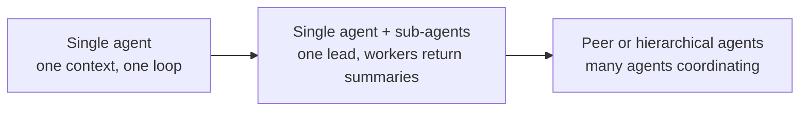
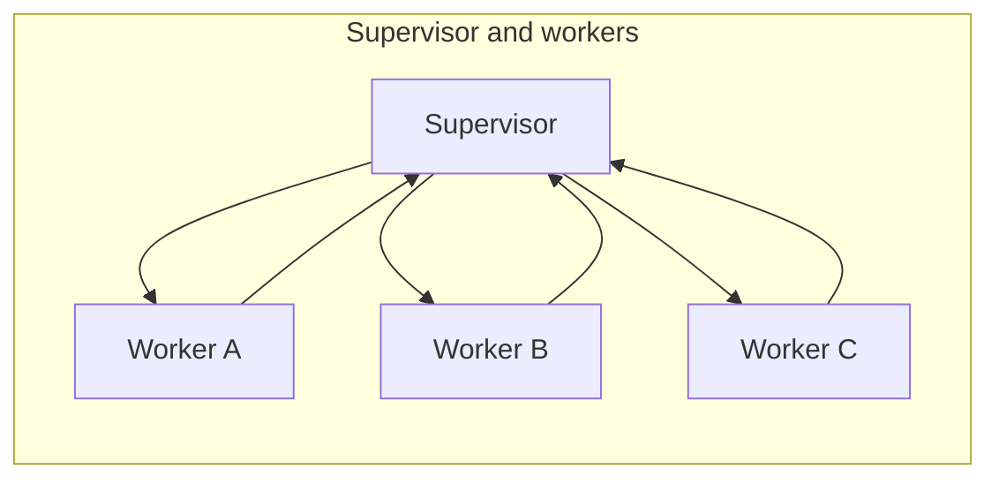
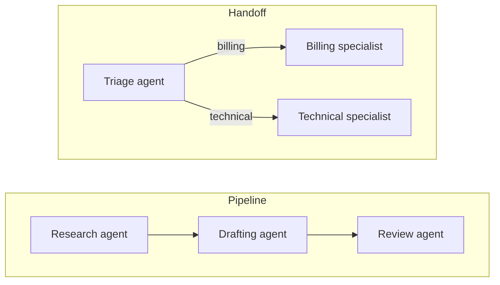
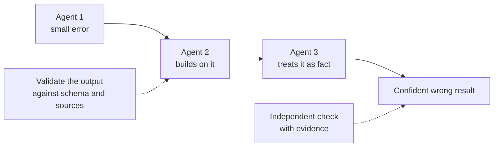
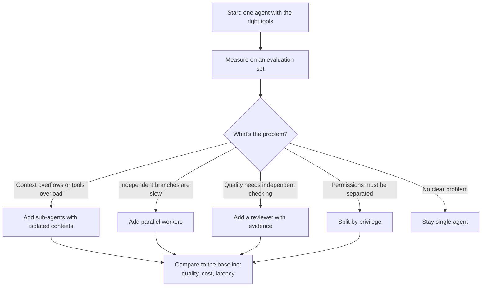
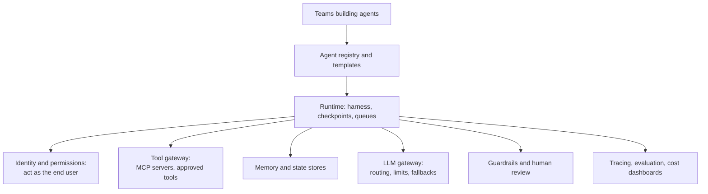

# Chapter 23: Multi-Agent Systems

## 1. The concept, from scratch

### One agent or many?

A **multi-agent system** is several agents, each with its own instructions, tools and context, working together on one goal. It's an appealing picture: a team of specialists instead of one generalist. Vendors love it and slide decks are full of it.

The honest starting point for an interview is the opposite: **start with a single agent, and add more only when you can say exactly what the extra agents buy you.** Every additional agent adds cost, delay, coordination and new ways to fail. This chapter covers when the trade is worth it, the patterns, and how to keep a multi-agent system from falling apart.

### Why split into several agents

There are only a handful of good reasons. If yours isn't on this list, probably don't.

| Reason | What it means | Example |
|---|---|---|
| **Parallel breadth** | Independent directions can be explored at the same time | Researching ten competitors at once |
| **Context isolation** | Each worker gets a clean context window for its sub-task and returns only a short result, so the lead's context stays small ([Chapter 7](../07-context-windows-and-context-engineering/README.md)) | A sub-agent reads fifty documents and returns a half-page summary |
| **Specialisation** | Different roles need different instructions, tools or even models, and a smaller toolbox per agent avoids "too many tools" ([Chapter 19](../19-tool-calling/README.md)) | A data-lookup agent and a drafting agent |
| **Independent checking** | A separate agent reviews the work with fresh eyes, like maker and checker | A reviewer that verifies a drafted decision against policy |
| **Permission separation** | Each agent holds only the credentials and tools it needs | The agent that reads untrusted web content has no payment tool |
| **Organisational boundaries** | Different teams or vendors own different agents | A partner's agent reached over A2A ([Chapter 20](../20-agent-protocols-mcp-and-a2a/README.md)) |

Anthropic described one concrete success: a research feature where a lead agent plans, then runs several sub-agents in parallel, each exploring a different angle, and the lead synthesises the results. They reported it worked best for **breadth-first tasks with independent directions**, and that it was poorly suited to tasks where all the agents need to share the same context.

### Why not

Now the other side, which interviewers like candidates to raise unprompted.

- **Cost.** Each agent runs its own loop and re-sends its own context. Anthropic's write-up of their research system reported that multi-agent runs used roughly fifteen times the tokens of a plain chat, compared with about four times for a single agent (as they reported on their own system, as of Nov 2026). So the task has to be valuable enough to justify that.
- **Latency.** More calls, more waiting, more handoffs.
- **Context doesn't travel well.** When work is split, each agent sees only part of the picture. Walden Yan of Cognition (the company behind the Devin coding agent) made a widely cited argument against multi-agent designs: when decisions are spread across agents that can't see each other's reasoning, they make conflicting assumptions, and the pieces don't fit together. His two principles: **share context fully**, and recognise that **every action carries implicit decisions**. A later follow-up from the same author says a narrower class of multi-agent setups now works, where several agents contribute *intelligence* (research, review) while **writing and acting stay single-threaded**. That's a good rule to carry: many readers and thinkers, one writer.
- **Errors spread.** One agent's mistake becomes the next agent's input.
- **Harder to debug and test.** More paths, more non-determinism, more logs to read.
- **More to secure.** Every agent is another thing holding tools and credentials.

### What the research says

Two studies are worth knowing, with the usual caution that they're specific to the models, tasks and setups they tested.

- **Google Research, Google DeepMind and MIT (late 2025)** tested 180 configurations across five architectures and three model families. They found multi-agent benefits are **highly task-dependent**. Coordination helped substantially on **parallelisable** tasks, and **degraded** performance on **sequential** ones (every multi-agent variant they tested got worse, by tens of percent). Agents working independently, without checking each other, **amplified errors** many times compared with a single agent (they reported about seventeen-fold), while a **centralised** design, with a coordinator, contained errors best. Don't over-read it as a verdict on all multi-agent systems, but it matches practical experience: parallel breadth helps, sequential reasoning doesn't, and structure matters.
- **UC Berkeley and collaborators, *Why Do Multi-Agent LLM Systems Fail?* (2025)** analysed execution traces from several multi-agent frameworks and built a taxonomy of failure modes (fourteen, in three groups, including problems of system design and of verifying task results). Their conclusion is that failures often come from **how the system is designed**, such as unclear roles, poor coordination and missing verification, and not only from limits of the underlying models. The fix is better structure, not a better model.

### The main patterns

| Pattern | How it works | Good for | Watch out for |
|---|---|---|---|
| **Supervisor and workers (orchestrator-workers)** | A lead agent plans, delegates sub-tasks, collects and combines results | Breadth-first research, tasks that decompose at runtime | The lead is a bottleneck and a single point of failure. Vague delegation leads to duplicated or missed work |
| **Pipeline** | Agents work in sequence, each handing over to the next | Staged processes with clear intermediate outputs | Errors flow downstream. A weak early stage poisons the rest |
| **Handoff (routing)** | One agent transfers the conversation to a specialist, who takes over | Customer service with distinct domains | Context lost in the handoff. Ping-pong between agents |
| **Review or debate** | One agent produces, another critiques, perhaps over several rounds | Quality-critical drafting, checking | Agents can agree with each other's mistakes. The reviewer needs real evidence, not just opinion |
| **Hierarchical** | Supervisors of supervisors | Very large tasks | Depth multiplies delay and cost, and loses context at every level |
| **Peer-to-peer or swarm** | Agents message each other freely | Open-ended exploration, research settings | Hardest to predict, control, debug and cost |

For business systems, the **centralised supervisor** pattern with a small number of well-defined workers is the usual safe choice, which agrees with the research finding about error containment above.

### How agents should share information

The quality of a multi-agent system is mostly the quality of its **handoffs**.

- **Give workers a complete brief.** A good delegation states the objective, the output format, the tools and sources to use, the boundaries, and what "done" looks like. Vague instructions ("research the supply chain") lead to agents duplicating each other's work or going off in different directions.
- **Use structured contracts.** Agree a schema for what each agent returns, validate it in code, and reject malformed outputs. Free-form text between agents is a game of telephone.
- **Pass summaries, with pointers.** Workers return a concise result plus references (a file, a record ID, a source), so the lead can fetch detail if needed without carrying everything in context.
- **Share state deliberately.** A shared store ("blackboard"), files or a task record can hold the working state, with clear rules about who may write.
- **One writer.** Follow the single-writer principle: many agents can read, research and review, but one agent makes the final changes or takes the final action. That avoids conflicting edits and conflicting decisions.

### Error propagation and containment

In a chain of agents, mistakes compound. If each agent is 90 percent reliable, a chain of six succeeds only about 53 percent of the time (0.9 to the sixth, [Chapter 18](../18-from-llm-calls-to-agents/README.md)), and that's before counting errors that get *amplified* when one agent trusts another's wrong output.

Containment techniques:

- **Validate between agents.** Schema checks, sanity checks and source checks on every handoff.
- **Independent verification.** A checker agent, or better a non-LLM check, that verifies claims against sources or systems, not just against the first agent's say-so.
- **Keep chains short and shallow.** Fewer hops, fewer places for errors to hide.
- **Centralise coordination,** so one component sees everything and can catch problems.
- **Budgets and limits at every level:** steps, tokens, time and cost per agent, plus a global cap ([Chapter 22](../22-orchestration-and-harnesses/README.md)).
- **Idempotent tools and one writer,** so retries and duplicates don't cause harm ([Chapter 19](../19-tool-calling/README.md)).
- **Human gates** for consequential actions, wherever they sit in the system.
- **Fail loudly.** An agent that can't complete its part should say so, not hand over a plausible guess.

### Cost, latency and model choice

- **Scale effort to the task.** Don't spin up a team for a simple question. Build rules into the lead agent for how many sub-agents a given complexity deserves.
- **Match model to role.** A stronger model for the lead that plans and judges, smaller and cheaper models for workers doing narrow jobs ([Chapter 8](../08-the-model-landscape/README.md), [Chapter 36](../36-llm-gateways-and-routing/README.md)). Anthropic's research system, for example, was described as pairing a lead agent with smaller sub-agent models.
- **Parallelise what's independent,** to cut wall-clock time.
- **Cache stable prefixes** and trim what each worker is given ([Chapter 31](../31-cost-latency-and-caching/README.md)).
- **Measure cost per completed task,** not per call, and compare against the single-agent baseline. If multi-agent isn't clearly better on quality, speed or cost, don't use it.

### Tracing and debugging

A multi-agent run is a tree of work. You need to see it as one.

- Give each run a **run ID**, and each agent call a span linked to its parent, so you can see which agent did what, in what order, at what cost.
- **Log inter-agent messages** (the briefs and the results). Most multi-agent bugs live there.
- **Replay** failed runs, and turn them into test cases ([Chapter 32](../32-observability-and-llmops/README.md)).
- **Evaluate** the final result and also the **trajectory**: did the lead delegate sensibly, did workers stay in scope, did the checker catch what it should ([Chapter 27](../27-evaluating-rag-and-agents/README.md)).

Standard application-monitoring tools often aren't enough for this, so teams building multi-agent systems commonly add their own agent-aware tracing.

### Security across agents

- **Least privilege per agent.** Give each only its own tools and credentials. A research agent that reads the open web should not hold the refund tool.
- **Separate readers from actors.** An agent that processes untrusted content (web pages, emails, uploaded documents) should be separated from agents that take sensitive actions, with validation in between ([Chapter 19](../19-tool-calling/README.md), [Chapter 29](../29-guardrails-and-ai-security/README.md)).
- **Injection can hop.** A malicious instruction in a web page can be summarised by one agent and passed on to another as if it were trusted. Treat inter-agent messages that originate from untrusted content as untrusted.
- **Cross-organisation agents are untrusted peers** ([Chapter 20](../20-agent-protocols-mcp-and-a2a/README.md)).

### A design process that works

Each split must beat the simpler design on a measured outcome. Remember too that a **workflow with several LLM steps** isn't a multi-agent system. A fixed chain of prompts is often all that's needed ([Chapter 18](../18-from-llm-calls-to-agents/README.md)).

### Designing an agent platform

A common mock-interview prompt is "design an agent platform for the enterprise". The question is really about the shared infrastructure that lets many teams build agents safely, not about any one agent.

The components, in the words you'd use:

- **A shared runtime** (the harness from [Chapter 22](../22-orchestration-and-harnesses/README.md)) with checkpointing and human gates, so every team doesn't rebuild it.
- **Identity and permissions:** agents act as the end user, with scoped, short-lived credentials ([Chapter 15](../15-enterprise-rag/README.md)).
- **A tool gateway** with an approved registry of tools and MCP servers, versioned and reviewed ([Chapter 20](../20-agent-protocols-mcp-and-a2a/README.md)).
- **An LLM gateway** for model access, routing, rate limits, cost attribution and fallbacks ([Chapter 36](../36-llm-gateways-and-routing/README.md)).
- **Memory and state services** with per-user and per-tenant isolation ([Chapter 21](../21-agent-memory-and-state/README.md), [Chapter 37](../37-cloud-reference-architectures-and-multi-tenancy/README.md)).
- **Guardrails and approval workflows** ([Chapter 29](../29-guardrails-and-ai-security/README.md)).
- **Observability and evaluation** shared across agents: traces, cost per task, evaluation sets, and release gates ([Chapter 26](../26-evaluation-fundamentals/README.md), [Chapter 32](../32-observability-and-llmops/README.md)).
- **Governance:** which agents exist, who owns them, what they may do, how they're versioned and retired ([Chapter 30](../30-privacy-governance-and-compliance/README.md)).

### Predictive and generative parts

Multi-agent systems are another place where small predictive components do the sorting: routers choose which specialist gets a request, classifiers decide whether a task needs the team or a single call, and guard models screen messages between agents. The generative agents do the open-ended reasoning, and the system works best when routing stays cheap and the expensive agents are used only when needed ([Chapter 1](../01-introduction-to-ai/README.md)).

## 2. Analogies across industries

- **Parallel workers, one writer (e-commerce).** In a warehouse, many pickers can walk different aisles at once, and that's the parallel breadth. But one packer assembles the final box, so the order isn't packed twice or with conflicting contents. Many readers, one writer.
- **Specialists and a coordinator (healthcare).** A multidisciplinary team meeting has a radiologist, a surgeon and an oncologist, each bringing a specialty, with a chair who pulls the opinions into one plan. It works because the chair sees everything and the patient record is shared. Without a chair, you'd get three conflicting treatment plans.
- **Handoffs (travel).** When an airline desk agent transfers you to the baggage team, the worst experience is repeating your story. A good handoff carries the case summary. A bad one drops context.
- **Error propagation (manufacturing).** An undetected defect on station two gets built into stations three to ten, and the final inspection finds a car that can't be sold. Quality checks at each station contain the damage.
- **Maker and checker (banking).** A second person independently reviews a large payment, with the actual supporting documents in front of them. A checker who only reads the maker's summary adds little.

## 3. How it's used in industry

- **Consulting and research services: parallel research.** A research assistant plans a question, runs several sub-agents in parallel on different angles, each with its own context, and a lead agent synthesises and cites. It's used for broad questions, not for quick lookups, because it costs many times a simple answer.
- **Healthcare: documentation with a reviewer.** A clinical-documentation tool drafts a summary with one agent, and a separate reviewing agent checks every claim against the source notes and flags unsupported statements for the clinician.
- **E-commerce: triage and specialists.** A support platform uses a router to send billing questions to one agent and delivery questions to another, each with its own small toolbox and policy documents, and only the specialists can touch their own systems.
- **Manufacturing: enterprise platform.** A manufacturer runs many team-built agents on a shared platform with a common runtime, tool gateway, identity layer and tracing, so each team inherits the same guardrails and audit.

## 4. Common misconceptions

- **"More agents means smarter."** More agents means more cost and more failure modes. They help for parallel breadth, context isolation, specialisation and independent checks, and not otherwise.
- **"Multi-agent is the next step after single agent."** It's a tool for specific problems. Many tasks are best served by one agent, or a workflow.
- **"A reviewer agent fixes reliability."** A reviewer that only reads the first agent's output may simply agree with it. Verification needs evidence from sources or systems.
- **"Agents can just talk to each other in natural language."** Free-form chatter loses information and compounds errors. Use structured contracts and validation.
- **"More agents work in parallel safely."** Parallel readers are fine. Parallel writers make conflicting decisions. Keep writing and acting single-threaded.
- **"A chain of prompts is a multi-agent system."** A fixed sequence of LLM steps is a workflow, and often the right answer.
- **"The model is the problem when it fails."** Studies of multi-agent failures point to system design: roles, coordination and verification.

## 5. Interview questions

### 1. When is a multi-agent system worth it?

When I can name a concrete benefit that a single agent can't give me. Good reasons are parallel breadth, where independent directions can be explored at once, like researching many competitors, context isolation, where each worker handles a big sub-task in its own window and returns a short summary, specialisation, where different roles need different tools or models, independent checking, where a separate reviewer verifies the work against sources, and permission separation, where the agent reading untrusted content has no sensitive tools. The costs are real: considerably more tokens, more latency, coordination overhead and more ways to fail. So I'd start with one agent, measure it, and only split where the evidence shows a specific problem, and I'd compare the multi-agent version against the single-agent baseline on quality, cost and speed.

### 2. How do errors propagate in a multi-agent system, and how do you contain them?

An error in one agent becomes input for the next, which may treat it as fact and build on it, so mistakes compound and can be amplified. Even a chain of six agents at ninety percent reliability each succeeds only about half the time. To contain it, I'd validate every handoff with schemas and sanity checks, add independent verification against sources or systems and not just another agent's opinion, keep chains short, centralise coordination so one component can see problems, set budgets and limits per agent and globally, make tools idempotent, keep writing and acting single-threaded, and put human approval on consequential actions. Research from Google found centralised coordination contained errors much better than independent agents working without checks.

### 3. Supervisor-worker versus peer-to-peer: which would you pick?

For most business systems I'd pick supervisor and workers. A central lead agent plans, delegates with clear briefs, collects structured results, and combines them, which gives one place to enforce budgets, validate outputs, trace the run and put a human gate. Peer-to-peer or swarm designs are more flexible for open-ended exploration, but they're much harder to predict, test, debug and cost, and errors spread without a central check. The supervisor is a bottleneck and a single point of failure, so I'd keep its job small, with workers returning compact, structured results. I'd choose peer-to-peer only if evaluation showed a clear gain that justified the lost control.

### 4. Why do some experts argue against multi-agent systems?

Because splitting work across agents that can't see each other's reasoning leads to conflicting assumptions, and the pieces don't fit together. The argument from Cognition is that context should be shared fully, and that every action carries implicit decisions, so spreading decisions across agents creates incoherent results. There's also the cost and complexity. I think it's a fair warning and I take a nuanced position: parallel readers, researchers and reviewers are fine, because they contribute information, but writing and acting should stay single-threaded. That's consistent with later experience reported by the same author, and with Anthropic's success using parallel sub-agents for breadth-first research, where the sub-tasks are independent.

### 5. How do you make agents hand work to each other reliably?

By treating handoffs as contracts. The delegating agent gives a complete brief: the objective, the expected output format, the tools and sources to use, the boundaries, and what done looks like, because vague instructions cause duplicated or missed work. The worker returns a structured result that matches an agreed schema, which my code validates and rejects if malformed. Results are concise, with pointers to detail like a record ID or a file, so the lead doesn't carry everything. Shared state lives in a store with clear rules about who may write, ideally one writer. And I log every brief and result, because most multi-agent bugs are in the handoffs.

### 6. How do you debug and monitor a multi-agent run?

I want to see it as one tree. Every run has an ID, and each agent call is a span linked to its parent, with the prompt, response, tools called, tokens, latency and cost. I log the messages between agents, since that's where misunderstandings show up. I can replay a failed run and turn it into a test case. I evaluate not only the final output but the trajectory: did the lead delegate sensibly, did workers stay in scope, did the checker catch what it should have. I'd monitor aggregate metrics too, like cost per task, steps per run, how often budgets are hit, and escalation rates. Standard application monitoring usually isn't enough, so I'd add agent-aware tracing.

### 7. How would you control the cost of a multi-agent system?

I'd first measure cost per completed task against a single-agent baseline, because if the multi-agent version isn't clearly better, I wouldn't use it. Then I'd scale effort to the task, with rules so simple questions don't get a team. I'd match models to roles, with a stronger model for the lead and smaller, cheaper models for narrow workers. I'd parallelise independent work to reduce time, trim what each worker receives, cache stable prefixes, and set budgets of steps, tokens, time and money per agent plus a global cap, with safe stops. Token use in multi-agent systems can be many times that of a single chat, so these controls matter.

### 8. Design an agent platform for an enterprise.

I'd think of it as shared infrastructure so teams build agents without reinventing safety. A common runtime, the harness, with checkpointing, resumption and human approval gates. Identity and permissions so agents act as the end user with scoped credentials. A tool gateway with an approved, versioned registry of tools and MCP servers. An LLM gateway for model routing, rate limits, cost attribution and fallbacks. Memory and state services with per-user and per-tenant isolation. Guardrails and approval workflows. Shared observability and evaluation: traces, cost per task, evaluation sets and release gates. And governance: a registry of which agents exist, who owns them, what they may do, and how they're versioned and retired. I'd start with a few high-value use cases, prove the platform on them, and add features as teams need them.

### 9. How do you secure a system with several agents?

I'd apply least privilege per agent, so each has only its own tools and credentials, and the agent that reads untrusted content, like web pages or emails, doesn't hold sensitive tools. I'd separate readers from actors, with validation between them, because an injected instruction can be summarised by one agent and passed to another as if it were trusted, so I'd treat inter-agent messages derived from untrusted content as untrusted. I'd authenticate as the end user, scope tokens narrowly, gate consequential actions with human approval, log every inter-agent message and tool call for audit, and treat agents from other organisations as untrusted peers. And I'd test with injected content across the agent boundaries.

### 10. A vendor proposes a seven-agent design. How do you evaluate it?

I'd ask what each agent gives us that one agent with good tools wouldn't. For each, I'd want a named benefit: parallel breadth, context isolation, a real specialisation, independent verification or a permission boundary. Then I'd ask how they share context and hand off, whether the handoffs are structured and validated, how errors are contained, what the cost and latency are compared with a simple baseline, and how it's traced and tested. I'd propose a pilot on a representative evaluation set, comparing the seven-agent design with a single agent plus a workflow, on quality, cost per task and speed. Unless the multi-agent design wins clearly, I'd choose the simpler one.

## 6. Scenario exercise

A vendor pitches an online retailer a "seven-agent system" to handle order problems: a planner, a researcher, a policy agent, a customer-history agent, a writer, a reviewer and a manager. The demo is impressive. The retailer's order problems are mostly late deliveries, damaged items and wrong items, and about 80 percent follow a clear policy. The CTO is worried about cost and about errors, and asks you to evaluate the proposal. You haven't seen the code.

Answer from memory, then check.

Model answer

I'd start by asking what each of the seven agents contributes that a simpler design can't. For most of these problems the steps are known: look up the order, check the policy, decide, and write the reply. That's a workflow or a single agent with a few tools (order lookup, policy retrieval, customer history, a refund tool with limits), not seven. The planner, manager and researcher mostly add coordination overhead. Each extra agent re-sends its own context, so cost multiplies, and every handoff is a place for context to be lost and errors to compound. The writer and the customer-history agent probably don't justify separate agents either, since they don't need isolated contexts or different permissions.

I'd keep the options where a split earns its place. An independent reviewer can be worth it for the exceptions, if it verifies the proposed resolution against the order record and the policy text and not only against the first agent's summary. If one step must read untrusted customer-uploaded content, I'd keep that agent away from the refund tool. And I'd keep writing and acting single-threaded: one component issues the refund, with idempotent, limit-checked tools and human approval above a threshold.

To decide with evidence, I'd run a pilot on an evaluation set of real past cases, including the awkward ones, and compare the seven-agent design with the simple design on correct resolutions, wrong payouts, cost per case, latency and how often a human had to step in. I'd ask the vendor for per-agent traces and to explain how handoffs are validated and how errors are contained. Based on the research, independent agents without checks amplify errors, while a central coordinator with validation contains them. If the simple design matches quality at a fraction of the cost, we choose it, and add a reviewer or a specialist only where the evaluation shows a gap.

## 7. Key takeaways

- Start with one agent. Add agents only for a named benefit: parallel breadth, context isolation, specialisation, independent checking, permission separation or organisational boundaries.
- Multi-agent systems cost many times the tokens of a single chat (as reported by Anthropic for its research system) and add latency, handoff loss and new failure modes.
- Research is task-dependent: parallelisable tasks benefit, sequential ones degrade, independent agents amplify errors, and a central coordinator contains them best. Failures often come from system design, not model weakness.
- Reliable handoffs are contracts: complete briefs, structured and validated outputs, summaries with pointers, and a single writer.
- Contain errors with validation and independent verification, trace the whole tree, scale effort and model size to the task, give each agent least privilege, and compare against a single-agent baseline.

## 8. Further reading

- Anthropic, [How we built our multi-agent research system](https://www.anthropic.com/engineering/multi-agent-research-system): an orchestrator-worker design, with lessons on cost, prompting and tooling.
- Cognition, [Don't Build Multi-Agents](https://cognition.ai/blog/dont-build-multi-agents) (2025) and the follow-up [Multi-Agents: What's Actually Working](https://cognition.com/blog/multi-agents-working).
- Cemri et al., [Why Do Multi-Agent LLM Systems Fail?](https://arxiv.org/abs/2503.13657) (2025): a taxonomy of failure modes.
- Kim et al., [Towards a Science of Scaling Agent Systems](https://arxiv.org/abs/2512.08296) (Google Research, Google DeepMind and MIT, 2025), and the [Google Research summary](https://research.google/blog/towards-a-science-of-scaling-agent-systems-when-and-why-agent-systems-work/).
