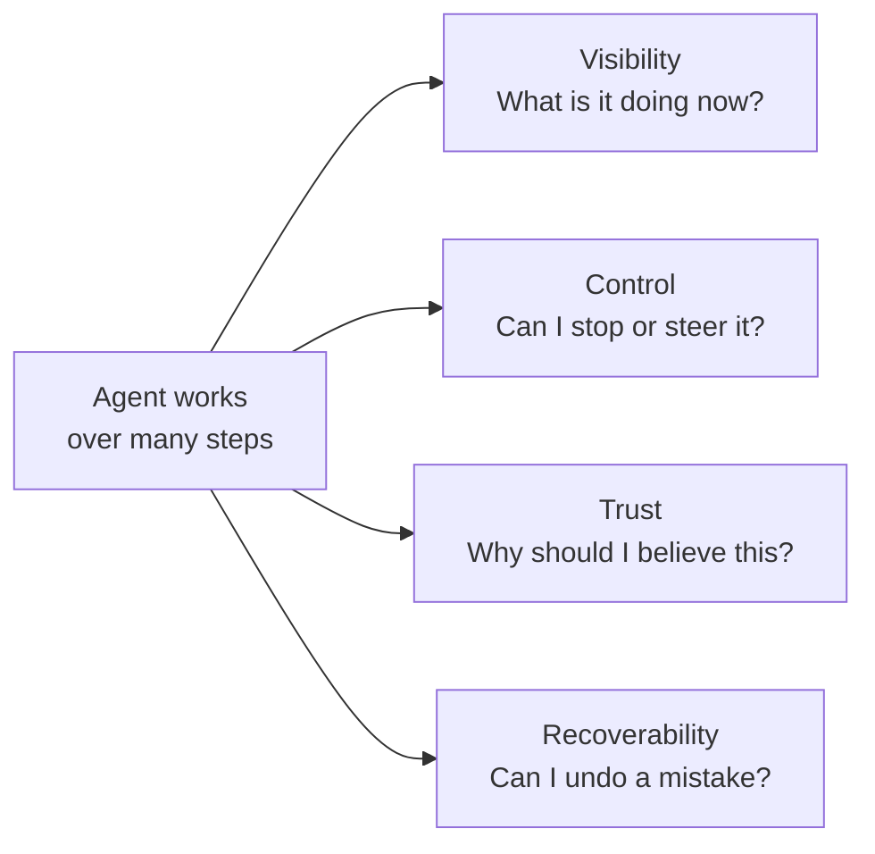
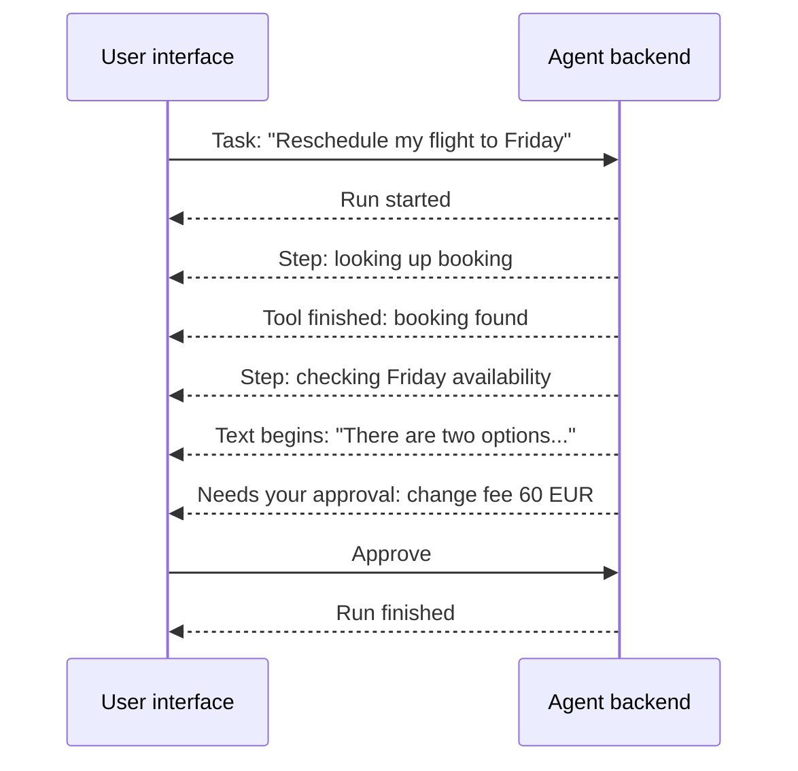
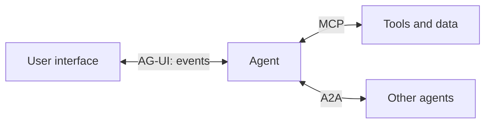
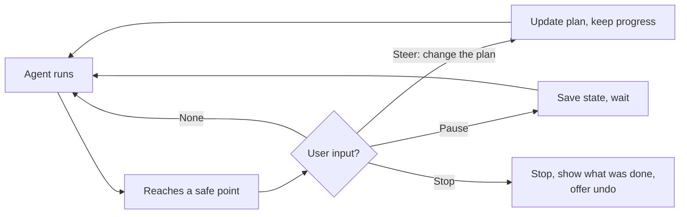
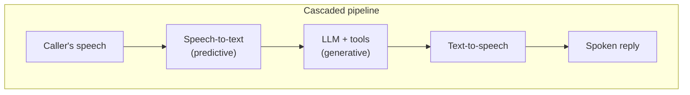
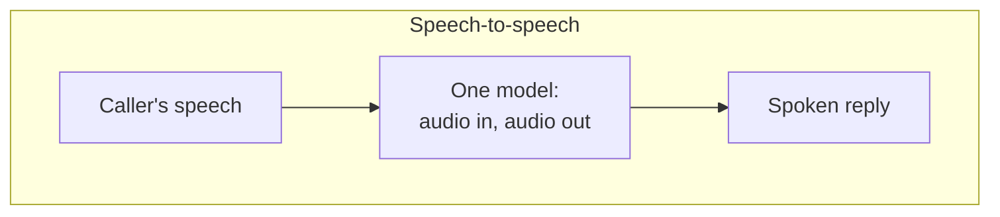
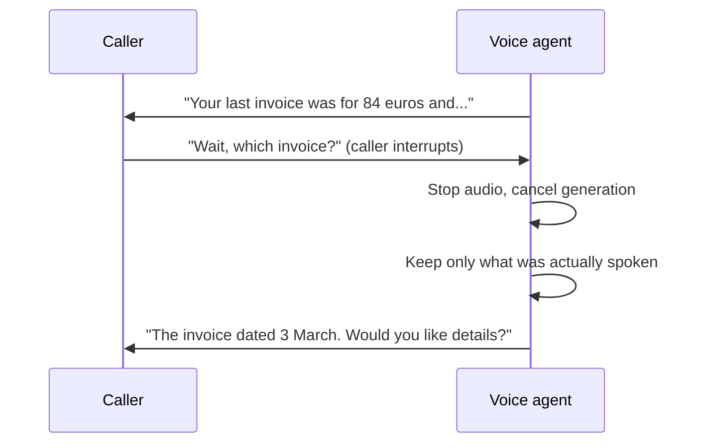

# Chapter 24: Agent-User Interaction

## 1. The concept, from scratch

### Why the interface matters more for agents

A chatbot answers in seconds, and the user reads the answer. An agent is different. It works for a while, takes several steps, calls tools, makes choices, sometimes changes things in the real world, and may need the user's input halfway through. The old "type a question, get an answer" screen doesn't cope with that.

Imagine handing a task to a colleague and then hearing nothing for ten minutes. You'd want to know: *What are you doing? Why? How long will it take? Can I stop you? Can I change your mind? Can I trust what you've done?* The interface has to answer those five questions for an agent.

This chapter covers how to build that: streaming progress, steerable agents, approvals, showing sources and uncertainty, the emerging **AG-UI** protocol, and **voice agents**, which add timing problems that text doesn't have.

### Streaming: more than tokens

Streaming sends the model's tokens as they're generated, so text appears while the model is still writing. Total time doesn't change, but the wait *feels* shorter, and **time to first feedback** is what users notice ([Chapter 35](../35-reliability-scaling-and-streaming/README.md) covers the engineering).

For agents, streaming text isn't enough. A ten-step task might spend a minute calling tools before producing any answer text, and a blank screen for a minute looks broken. So agents stream two things:

- **Text:** the answer as it's written.
- **Progress events:** structured updates about the work. "Searching the order system." "Found 3 matching orders." "Checking return policy." "Drafting reply."

Good progress display shows **meaningful steps**, not raw internals. Users want to know *what* the agent is doing and *what it found*, not every token of its working. Practitioner guidance generally favours structured lifecycle events (a step started, a tool was called, a step finished) over dumping the model's thinking onto the screen. Some providers can return a summary of the model's reasoning, which can be useful to show, but it's a design choice, and not always the right one.

### AG-UI: a standard for agent-to-interface events

Two protocols already exist ([Chapter 20](../20-agent-protocols-mcp-and-a2a/README.md)). **MCP** connects an agent to tools and data, and **A2A** connects an agent to other agents. There's a third connection nobody had standardised: **agent to user interface.** **AG-UI** (the Agent-User Interaction protocol) is an open protocol for that.

According to its documentation, AG-UI is an open, lightweight, event-based protocol that standardises how AI agents connect to user-facing applications. It began with the CopilotKit project in partnership with agent frameworks such as LangChain and CrewAI. The three protocols are complementary:

| Protocol | Connects | In one line |
|---|---|---|
| **MCP** | Agent to tools and data | Gives agents their hands |
| **A2A** | Agent to other agents | Lets agents delegate to each other |
| **AG-UI** | Agent to the user's interface | Brings agents into user-facing apps |

How it works, in plain terms:

- The backend sends a **stream of typed events** to the frontend. A run has a start and either a finish or an error event. Text arrives as a start, a series of content chunks, and an end. Tool calls are events too, so the UI can show "calling the booking system" and its result.
- **Shared state** is kept in sync with a **snapshot** (the whole state) followed by small **deltas** (just the changes, expressed as JSON Patch), so the interface can show a live view of what the agent is working on without resending everything.
- It supports **interrupts**, where the agent pauses and asks the user for input, and **generative UI**, where the agent can drive interface components and not just text.
- The common transport is HTTP with server-sent events, with other transports possible. A version 1.0 of the specification exists (as of Nov 2026; the number and names of event types vary across versions, so check the current spec).

What AG-UI isn't: it doesn't give agents tools (that's MCP) or delegate work (that's A2A). It only standardises how the agent and the interface talk. It's still an emerging, community-driven standard, so the practical question is whether your agent framework and frontend already support it, and what the alternatives are, such as the provider's own streaming formats.

### Steerable agents

Users should be able to guide an agent while it works, not only wait for the end.

- **Show the plan first, for long tasks.** Before a ten-step job, the agent states what it intends to do, and the user can approve, edit or reject the plan. Correcting a plan is much cheaper than correcting a finished mess.
- **Let users interrupt, and resume.** A stop button that discards all progress is a poor design. The better pattern is *interrupt and resume*: the agent pauses at a safe point, keeps its state, accepts new instructions ("actually, skip the hotel"), and continues. That depends on the checkpointing from [Chapter 22](../22-orchestration-and-harnesses/README.md).
- **Allow mid-run input.** Accept new messages while the agent works and apply them at the next safe step.
- **Offer redirect and refine.** "Do it again but only for last quarter" shouldn't require starting from scratch.
- **Make a pause point explicit.** At moments of choice, the agent shows what it would do next and lets the user approve, modify or redirect, instead of relying only on a panic button.

### Approvals and confirmations

Approval prompts are where agent UX most often goes wrong. Two failures are common: asking too rarely (the agent does something irreversible unseen) and asking too often (people click "approve" without reading, which is no safeguard at all).

**Scale the check to the consequence.** A simple tiering, in line with the risk tiers in [Chapter 19](../19-tool-calling/README.md):

| Consequence | UI behaviour |
|---|---|
| **Low** (reading, drafting) | Just do it, but keep it visible in the activity log |
| **Medium** (reversible changes) | State the intent as it happens, with an easy undo |
| **High** (money, deletion, messages to others) | Stop and wait for explicit approval |

**A good approval prompt** shows what the agent will do, **why** (the evidence it used), the **impact** (amount, who's affected), and the **options**: approve, edit and approve, reject, or ask a question. It should be specific ("Refund 84.50 EUR to the card ending 4417 for order 9921") and not vague ("Proceed with the action?"). Show differences as a before and after where possible.

**Design against rubber-stamping.** If a person approves a hundred items an hour, they've stopped checking. Gate only what matters, batch low-risk items, sample approved items for audit afterwards, and watch approval metrics: near-100 percent approvals in seconds is a warning sign.

**Asynchronous approvals** work too. If the person is away, the run pauses with its state saved ([Chapter 22](../22-orchestration-and-harnesses/README.md)), a notification goes to their phone or email with the full context, and the run resumes when they respond. Decide in advance what happens if nobody answers: expire, escalate, or take the safe default.

### Building trust (and not too much of it)

Trust has to be *earned and calibrated*. Too little and people redo the agent's work. Too much and they stop checking, which is called **automation bias**. Design for the right amount.

- **Show sources.** Link answers to the documents or records they came from, with the quoted passage, so people can verify ([Chapter 15](../15-enterprise-rag/README.md)). A citation that opens only if the user is permitted to see it.
- **Keep an activity log.** Show what the agent did, in order, in plain language: every tool call, change and decision. Even when no approval was needed, the record should be visible.
- **Be honest about uncertainty.** Say "I couldn't find this" and "I'm not sure about this part". Be careful with numeric confidence scores: a model's own stated confidence isn't reliably calibrated, so prefer signals you can ground, like whether supporting passages were found, whether validation checks passed, and whether sources agree ([Chapter 28](../28-hallucination-and-grounding/README.md)).
- **Make actions undoable,** or say clearly that they aren't.
- **Let users see and edit memory** ([Chapter 21](../21-agent-memory-and-state/README.md)): "here's what I remember about you", with edit and delete.
- **Say what it can't or won't do.** Clear boundaries prevent disappointment and misuse.
- **Hand off cleanly.** When the agent escalates to a human, pass the whole context so the customer doesn't repeat themselves.

### Asking questions and handling uncertainty

Agents face a choice at every ambiguity: guess or ask? A rule of thumb: **ask when a wrong guess is costly or hard to undo, and proceed with a stated assumption when it's cheap.** "I'll assume you mean the 14 March flight. Tell me if not" respects the user's time. A string of five clarifying questions at the start of a task doesn't. Limit questions, make them specific, and offer choices ("Option A or B?").

Show errors honestly too. If three of five steps worked, say so, show what failed, and offer to retry or hand over, instead of a generic "something went wrong."

### Asynchronous and multi-channel agents

Not every agent lives in a chat window. Some run in the background for minutes or hours and report back through email, a chat app or a notification. The same principles apply: acknowledge the task, give an honest estimate, notify when done or when blocked, and deliver a **summary** with links to the artifacts and the activity log. Long silences are the enemy, so send a short status update if a run takes longer than the user expects.

### Voice agents

A voice agent talks to people over the phone or through a speaker. It has all the problems above, plus one that text doesn't: **time.** In conversation, people expect replies within a fraction of a second, so delays that are fine in chat feel like a broken line on a call.

**Two architectures.**

- **Cascaded:** speech-to-text, then the LLM (with tools), then text-to-speech. You can pick and swap the best component at each stage, inspect the text in between, apply guardrails and logging, and use your usual tool-calling logic. The cost is latency that adds up across stages. This is still the most common production design for business use (as of Nov 2026, per vendor and practitioner write-ups).
- **Speech-to-speech:** a single model takes audio in and produces audio out, which cuts delay and can preserve tone and emotion. The trade-off is less visibility and control over the middle steps, which matters for compliance and debugging. Providers offer this through realtime voice interfaces.

Vendors quote very different latency numbers for each, so **measure on your own setup**. What matters is the principle: total delay is the sum of the stages unless you overlap them.

**The hard problems in voice:**

- **Latency.** Stream every stage and overlap them, so text-to-speech starts while the LLM is still writing, and transcription is finalising as the caller stops. Use fast models for simple turns ([Chapter 8](../08-the-model-landscape/README.md), [Chapter 36](../36-llm-gateways-and-routing/README.md)). When a tool call takes time, say something short ("let me check that") instead of leaving silence.
- **Turn-taking and end-of-turn detection.** The system must decide when the caller has *finished*. Voice activity detection hears silence, but people pause mid-sentence. Better systems add a model that judges whether the sentence is complete. Get it wrong and the agent either interrupts people or leaves awkward gaps.
- **Barge-in.** Callers interrupt. When they start speaking while the agent is talking, the system must **stop playing audio immediately, cancel the in-progress generation, and listen**. A subtle point: the agent should remember only what it actually *said* before being cut off, not the full reply it had planned.
- **Transcription errors.** Names, account numbers, addresses, accents, background noise and poor phone audio cause mistakes ([Chapter 3](../03-tokens-and-embeddings/README.md) reminds us how fragile numbers and rare words can be). **Read back and confirm** anything important: "That's account ending 4-4-1-7, correct?"
- **Spoken style.** Replies should be short, plain and conversational. No lists, markdown or long paragraphs. Numbers and dates need careful phrasing.
- **Identity and risky actions.** A voice is easy to imitate. Verify identity through proper channels before account actions, and apply the same approval and limit rules as in text ([Chapter 19](../19-tool-calling/README.md)). Never treat "the caller sounded confident" as authorisation.
- **Fallback to a human.** Provide an easy route, and hand over a summary of the call so far.
- **Consent and privacy.** Recording, transcripts and voice data have legal rules that vary by place ([Chapter 30](../30-privacy-governance-and-compliance/README.md)).

### Measuring whether the interface works

You can evaluate agent UX like anything else ([Chapter 26](../26-evaluation-fundamentals/README.md), [Chapter 32](../32-observability-and-llmops/README.md)). Useful measures: task completion rate, time to first feedback, how often users interrupt or override the agent, approval rates and time-to-approve (a rubber-stamping signal), how often users open sources, escalation rate, abandonment, and satisfaction. For voice: call completion, interruption handling failures, and mis-transcribed critical fields. Review real transcripts and recordings regularly, because they show where people struggle.

### Predictive and generative parts of the experience

Interaction design is full of both kinds of model working together ([Chapter 1](../01-introduction-to-ai/README.md)). In voice, speech recognition and turn detection are predictive, the LLM is generative, and speech synthesis is a generative audio model. In text, small classifiers can route a request or decide whether to ask a question or proceed, while the LLM writes the reply.

## 2. Analogies across industries

- **Progress events (logistics).** A parcel-tracking page doesn't show a blank screen until the delivery. It shows "collected", "at the depot", "out for delivery". Progress events tell the user the work is moving, which cuts anxiety and support calls.
- **Approvals scaled to consequence (healthcare).** A nurse records vital signs without asking anyone (low), tells a patient before giving a routine medication (medium), and gets a doctor's signed order and a patient's consent for surgery (high). The checks match the stakes.
- **Read-back (hospitality).** A good waiter repeats the order, including the allergy, before it goes to the kitchen. Voice agents should do the same for names, numbers and anything that's costly to get wrong.
- **Interrupt and resume (aviation).** A pilot can adjust a flight plan mid-flight, and the autopilot continues with the new plan. It doesn't land the plane and restart. A steerable agent should take new instructions without losing its progress.
- **Automation bias (manufacturing).** An inspector who sees a machine pass 999 items in a row may stop looking closely at the 1000th. Interfaces need to keep human attention meaningful, such as by random spot checks.

## 3. How it's used in industry

- **Travel: rebooking assistant.** An assistant shows each step as it works (checking the booking, searching alternatives), states fees before charging, and asks for approval on anything that costs money. Users can change the plan midway ("only morning flights"), and it keeps the progress.
- **Banking: voice servicing.** A bank's voice agent verifies identity through the proper channel, reads back account digits and amounts, handles interruptions cleanly, and transfers to a human with a call summary when the caller asks or when it fails to understand twice.
- **Telecom: contact-centre voice.** An operator uses a cascaded voice pipeline with streaming at each stage, a turn-detection model, short spoken replies, and filler phrases during lookups, and tracks interruption failures and mis-heard fields as quality metrics.
- **Enterprise software: embedded copilots.** A product team uses an event-based streaming protocol so its in-app agent can show live progress, shared state and approval prompts as part of the application's own interface, not only in a chat box.

## 4. Common misconceptions

- **"Streaming tokens is enough."** For agents, users also need structured progress: which step, which tool, what was found.
- **"Show everything the model thinks."** Raw reasoning is noisy and may not help. Show meaningful steps and results.
- **"More approvals means more safety."** Too many make people stop reading. Gate by consequence and watch for rubber-stamping.
- **"A confidence percentage builds trust."** Model-stated confidence isn't reliably calibrated. Ground trust in sources, validation and honest "I couldn't find it."
- **"A stop button is control."** If stopping discards progress, it's a blunt tool. Offer pause, steer and resume.
- **"A voice agent is a chatbot with a microphone."** Timing, interruptions, mishearing and identity make it a different design problem.
- **"AG-UI replaces MCP or A2A."** It's a different layer: agent to user interface. The three are complementary.
- **"If the agent can do it, it should do it silently."** Visibility and undo matter even for actions that don't need approval.

## 5. Interview questions

### 1. How would you stream an agent's progress to the user?

I'd stream two things: the answer text as it's written, and structured progress events about the work. Events like "run started", "searching the order system", "found three matches", "waiting for approval" and "finished" let the interface show a live activity view, so a minute of tool calls doesn't look like a hang. I'd show meaningful steps and results, not raw model internals. Technically I'd send typed events over a streaming connection, commonly server-sent events, and a standard like AG-UI defines exactly this: lifecycle, text, tool-call and state events. I'd also keep the activity visible afterwards as a log, and make sure time to first feedback is short.

### 2. How do you let users interrupt or steer an agent?

I'd design for pause, steer and resume, not just stop. The agent checkpoints its state, so when the user interrupts it pauses at a safe point, accepts new instructions like "skip the hotel" or "only last quarter", applies them to the plan, and continues with its progress intact. For long tasks I'd show the plan first and let the user approve or edit it before the work starts, because correcting a plan is cheaper than correcting a result. I'd allow mid-run messages, make the pause points explicit, and if the user does stop it, show what was done and offer undo. This depends on state persistence in the harness.

### 3. How do you design an approval prompt?

I'd make it specific and informative. It states what the agent will do, for example refund 84.50 euros to the card ending 4417 for order 9921, why, with the evidence it used, the impact, and clear options: approve, edit and approve, reject, or ask a question. I'd show before-and-after for changes. I'd scale approvals to consequence: low-risk actions just run and are logged, medium ones announce intent with undo, and high-risk ones, like money or deletion, wait for explicit approval. I'd watch for approval fatigue by gating only what matters, batching low-risk items, and monitoring approval rate and time-to-approve, because near-instant approvals suggest people aren't reading.

### 4. What is AG-UI, and how does it relate to MCP and A2A?

AG-UI is an open, event-based protocol that standardises how an agent backend talks to a user-facing application. The backend streams typed events, like run started and finished, text message chunks, tool calls, and state updates as a snapshot followed by small deltas, and the frontend renders them, including interrupts where the agent asks the user something and generative UI. It's complementary to the other two protocols: MCP connects agents to tools and data, A2A connects agents to other agents, and AG-UI connects agents to users. It doesn't give agents tools or delegate work. It's still an emerging standard, so I'd check whether my agent framework and frontend support it, and what the alternative streaming formats are.

### 5. What makes voice agents harder than text agents?

Time, mainly. People expect replies within a fraction of a second, so latency that's fine in chat feels broken on a call. A cascaded design adds delays across speech-to-text, the LLM and text-to-speech, so I'd stream and overlap the stages. Then turn-taking: the system has to decide when the caller has finished, since silence isn't enough, and barge-in, where it must stop talking immediately when interrupted and remember only what it actually said. Transcription errors with names, numbers and accents mean I confirm critical details by reading them back. Replies must be short and spoken in style, identity must be verified properly because voices are easy to imitate, there must be an easy fallback to a human, and recording and consent rules apply.

### 6. Cascaded versus speech-to-speech voice agents: how do you choose?

A cascaded pipeline chains speech-to-text, an LLM with tools, and text-to-speech. I can choose the best component at each stage, see the text in between, apply guardrails, logging and compliance checks, and reuse my normal tool-calling logic. The cost is accumulated latency. A speech-to-speech model takes audio in and gives audio out, which is faster and can keep tone, but it gives me less visibility and control over the middle, which matters in regulated settings. For a business voice agent that must be auditable and run tools, I'd usually start cascaded with streaming at every stage, and consider speech-to-speech where naturalness and speed matter most and I can accept less control. I'd benchmark latency on my own setup because vendor numbers vary a lot.

### 7. How do you build the right level of trust in an agent?

Calibrated trust, not maximum trust. I show sources with quoted passages so people can verify, keep a plain-language activity log, make actions undoable or say clearly that they aren't, and let users see and edit what the agent remembers. I'm honest about uncertainty: the agent says when it couldn't find something. I'd avoid fake precision like a confidence percentage, since a model's own stated confidence isn't reliably calibrated, and use signals I can ground, like whether supporting passages were found and validation passed. And I'd guard against over-trust, or automation bias, by keeping approvals meaningful and spot-checking outputs.

### 8. When should an agent ask a clarifying question and when should it proceed?

It depends on the cost of being wrong. If a wrong guess is expensive or hard to undo, like booking the wrong flight, it should ask. If it's cheap and reversible, it should proceed with a stated assumption, like "I'll assume the 14 March flight, tell me if not", which respects the user's time. I'd limit questions, make them specific, and offer choices instead of open-ended prompts. I'd avoid a string of questions up front, and I'd let the user correct the agent later. I'd test it on ambiguous requests, to check that it asks when it should and doesn't nag when it shouldn't.

### 9. How would you handle barge-in in a voice agent?

When the caller starts speaking while the agent is talking, the system needs to detect it quickly, stop the audio immediately, cancel the in-flight generation and any pending speech synthesis, and start listening. I'd make sure the conversation history records only what the agent actually said before being cut off, not the full planned reply, so the next turn is coherent. I'd tune sensitivity so background noise or a short "uh-huh" doesn't cause false interruptions, which usually involves an end-of-turn model and not just voice activity detection. Interruption handling is a common source of bugs, like stale audio playing after a cancel, so I'd test it thoroughly with real calls.

### 10. How would you measure whether an agent's interface is working?

I'd track outcome and interaction measures. Outcome: task completion rate and satisfaction. Interaction: time to first feedback, how often users interrupt or override the agent, whether they open the sources, approval rates and time-to-approve, which reveal rubber-stamping, escalation to humans, and abandonment. For voice: call completion, interruption-handling failures, mis-transcribed critical fields, and latency percentiles. I'd review real transcripts and recordings regularly, run usability tests on the approval and steering flows, and feed the problems found into the evaluation set.

## 6. Scenario exercise

A telecom operator launched a voice agent to handle billing calls. Callers complain: there are long silences before it answers; it talks over people and, when interrupted, carries on with its old sentence; it mishears account numbers and has twice acted on the wrong account; and customers can't tell when they're being transferred to a person. The head of customer service asks what to change. You haven't seen the system.

Answer from memory, then check.

Model answer

I'd treat these as four problems, and start with the most dangerous: acting on the wrong account.

The mis-heard account numbers are a safety issue. For any account action, the agent should verify identity through the proper channel, then **read back** the critical details ("account ending 4-4-1-7, is that right?") and require a clear confirmation before acting, and it should ask again if the transcription confidence is low. Anything with money or account changes follows the same approval and limit rules as in text, enforced in code. I'd also check the speech recognition on real telephone audio, and consider a specialised vocabulary or digit-capture mode for numbers.

The long silences are a latency problem. I'd measure each stage (speech-to-text, LLM, tools, text-to-speech) per turn and fix the biggest contributor. The main fix is streaming and overlapping the stages, so synthesis starts while the model is still writing, using a faster model for simple turns, trimming the prompt, and saying a short phrase like "let me check that" while a slow tool call runs. I'd compare a speech-to-speech option if control and audit requirements allow, but I'd benchmark first.

The talking-over-people and the failure to stop are turn-taking and barge-in problems. I'd add an end-of-turn model on top of voice activity detection so it waits through mid-sentence pauses, and implement barge-in properly: on caller speech, stop the audio immediately, cancel generation, keep only what was actually spoken in the history, and listen.

The unclear transfers are a handoff problem. The agent should say it is transferring, why, and what happens next, and pass a summary of the call and the verified details so the customer doesn't repeat themselves, with an easy "speak to a person" route at any time.

I'd keep replies short and spoken in style, check recording and consent rules with the privacy team, and measure improvement: latency percentiles, interruption failures, mis-transcribed critical fields, call completion, transfers and satisfaction, reviewing real recordings weekly. I'd roll the changes out gradually, with the account-confirmation fix first.

## 7. Key takeaways

- Agents work over many steps, so interfaces must show what's happening, allow steering, earn calibrated trust and support undo. Stream text and structured progress events.
- AG-UI is an emerging open protocol for agent-to-interface events (lifecycle, text, tool calls, state snapshots and deltas, interrupts). It complements MCP (tools) and A2A (other agents), and doesn't replace them.
- Make agents steerable: show the plan, pause and resume instead of cancel and restart, accept mid-run input.
- Scale approvals to consequence, make them specific (what, why, impact, options), and guard against rubber-stamping. Build trust with sources, an activity log, undo, editable memory and honest uncertainty.
- Voice agents add latency, turn-taking, barge-in, transcription errors and identity risk: stream and overlap stages, read back critical details, handle interruptions properly, and hand off to humans with context.

## 8. Further reading

- AG-UI, [Agent-User Interaction Protocol documentation](https://docs.ag-ui.com/introduction) and the [project repository](https://github.com/ag-ui-protocol/ag-ui).
- Amershi et al., [Guidelines for Human-AI Interaction](https://www.microsoft.com/en-us/research/publication/guidelines-for-human-ai-interaction/) (Microsoft Research, CHI 2019): eighteen guidelines that still hold for agents.
- OpenAI, [Realtime API guide](https://platform.openai.com/docs/guides/realtime): one provider's speech-to-speech interface.
- LiveKit, [Agents documentation](https://docs.livekit.io/agents/): an open-source voice-agent framework, including turn detection and interruptions.
- [On the Regulatory Potential of User Interfaces for AI Agent Governance](https://arxiv.org/abs/2512.00742) (2025): how interface design supports oversight.
