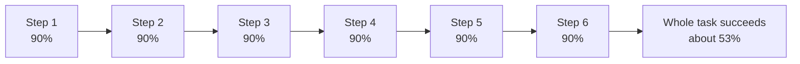
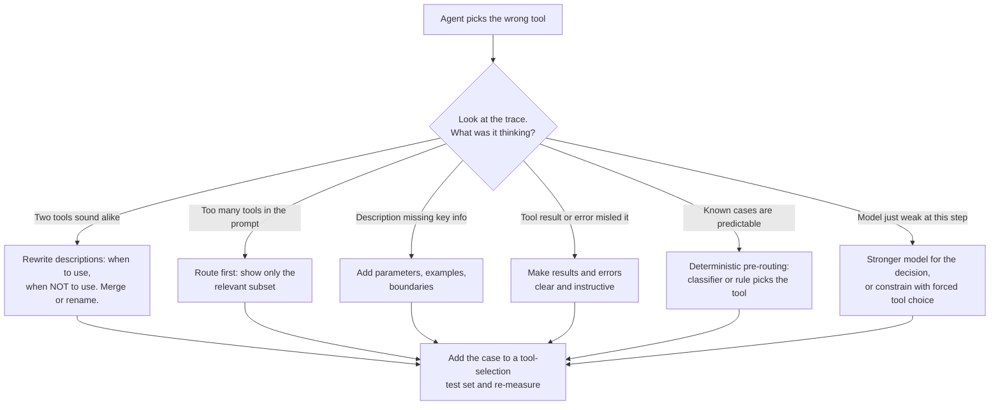
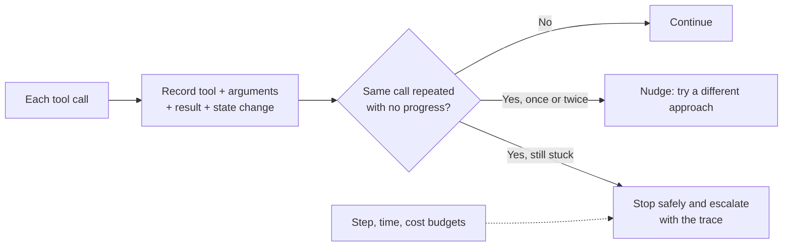
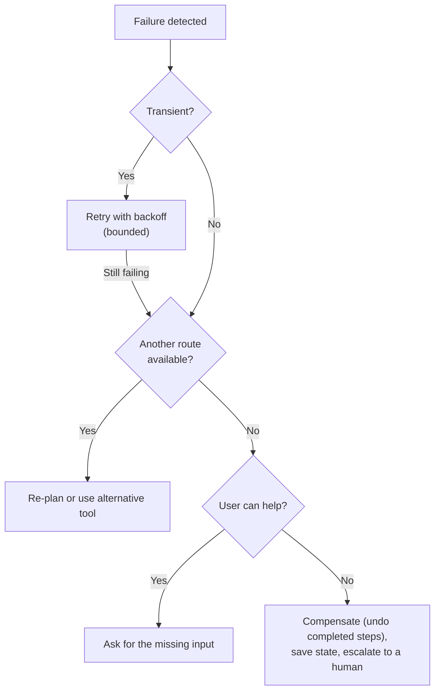
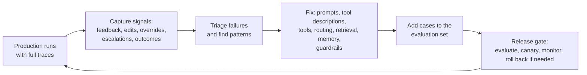

# Chapter 25: Agent Reliability and Learning

## 1. The concept, from scratch

### Demos work, production is harder

Almost every agent looks good in a demo. The task is chosen, the path is short, and someone has tried it ten times beforehand. In production, thousands of different people ask thousands of different things, and the agent has to be right **every time**, in the same way, without supervision. The gap between "worked in the demo" and "works reliably" is the main engineering challenge of agents, and this chapter is about closing it.

Research shows how real the gap is. The τ-bench benchmark from Sierra (2024) tested agents in simulated retail and airline customer-service conversations, where an agent had to use tools and follow policy, and judged success by whether the final state of the database matched the goal. The best models of the time succeeded on fewer than half of the tasks. More telling was a new measure the authors proposed, **pass^k**: the chance the agent succeeds on the *same task* k times in a row. It fell quickly as k grew, to below 25 percent at eight trials for the strongest model they tested. Models have improved since, so don't quote those numbers as current. But the lesson is permanent: **an agent that succeeds sometimes isn't a reliable agent**, and customers hit the same situations again and again.

### Compounding error

Every step is a chance to go wrong, and the chances multiply. If each step is 90 percent reliable, six steps in a row succeed only about 53 percent of the time (0.9 to the power of six). At 95 percent per step, ten steps give about 60 percent. Even at 99 percent per step, ten steps give about 90 percent.

Three ways to fight it:

1. **Fewer steps.** Fewer decisions means fewer chances to fail. This is why a workflow often beats an agent ([Chapter 18](../18-from-llm-calls-to-agents/README.md)).
2. **Higher reliability per step.** Better tools, clearer prompts, constrained choices, stronger models where it matters.
3. **Catch and correct errors.** Validation and checks between steps stop one mistake from becoming the input to the next, which turns a multiplication of failures into a series of small recoveries.

### How agents fail

Knowing the common failure modes lets you design against them and recognise them in traces.

| Failure | What it looks like | Main defence |
|---|---|---|
| **Wrong tool choice** | Picks a similar-looking tool, or a tool when none is needed | Better tool design, routing, evaluation |
| **Bad arguments** | Wrong ID, wrong format, invented value | Schema and value validation in code ([Chapter 19](../19-tool-calling/README.md)) |
| **Loops** | Repeats the same call or oscillates between two | Budgets, loop detection, strategy switch |
| **False success** | Says "refund issued" when the call failed or never happened | Verify state after acting |
| **Premature stop** | Declares done before the goal is met | Completion checks against the goal |
| **Goal drift** | Wanders off the task over a long run | Re-state the goal, plan and checkpoints |
| **Misread errors** | Treats a rate-limit error as "no results" | Clear, structured tool errors |
| **Context problems** | Forgets early instructions, drowns in tool output | Context management ([Chapter 7](../07-context-windows-and-context-engineering/README.md)) |
| **Policy violations** | Does something it's not allowed to | Enforce rules in code, not just the prompt |
| **Hijacking** | Follows instructions injected in tool results | Treat results as data ([Chapter 29](../29-guardrails-and-ai-security/README.md)) |
| **Bad memory** | Acts on stale or poisoned memories | Memory lifecycle ([Chapter 21](../21-agent-memory-and-state/README.md)) |
| **Cascades** | One agent's error spreads through several | Validation and containment ([Chapter 23](../23-multi-agent-systems/README.md)) |
| **Environment change** | An API or page changes under the agent | Monitoring, contract tests |

### The agent keeps calling the wrong tool

This is one of the most common questions, so here's the method. **Don't guess. Read the traces.** For each bad call, ask *why* the model thought that tool fit.

The fixes in order of how often they work: improve the tool descriptions and boundaries, reduce and merge overlapping tools, route to a relevant subset ([Chapter 19](../19-tool-calling/README.md)), return better tool results, add rule-based or classifier-based routing for predictable cases (a predictive model feeding a generative one, [Chapter 1](../01-introduction-to-ai/README.md)), and only then try a bigger model. Add policy checks in code, like "this tool isn't allowed for this intent". And build a **tool-selection test set** of realistic requests with the expected tool, so you can see whether each change helps.

### Loops

An agent that doesn't stop is a bill and a customer problem. Loops come in several shapes:

- **Identical repeats:** the same tool with the same arguments, again and again, getting the same result.
- **Oscillation:** A, then B, then A, then B.
- **Retry storms:** retrying a permanent failure forever.
- **Reasoning loops:** thinking in circles without calling any tool.
- **Circular handoffs:** in multi-agent systems, agents passing the task to each other ([Chapter 23](../23-multi-agent-systems/README.md)).

Defences, layered:

1. **Hard caps:** a step limit, a time limit and a cost or token limit ([Chapter 22](../22-orchestration-and-harnesses/README.md)). Necessary, but a cap only stops the run *after* the waste. It doesn't tell you why.
2. **Repeat detection:** track each tool call with its arguments, and flag repeats **where nothing changed**. Care is needed, because repeating a tool legitimately happens, for example when paging through results. The signal is repetition *without progress*.
3. **Progress checks:** is the state moving towards the goal? New information gathered, a sub-goal completed. Stagnation over several steps is a warning.
4. **Separate retry from non-progress.** Retry transient errors a limited number of times with backoff. Don't retry permanent ones.
5. **A response when a loop is detected:** tell the agent plainly ("you've made this call three times with the same result; try a different approach"), switch strategy, simplify the task, or **stop safely and escalate** to a person with the trace.

Watch cost and traces too: a loop shows up as repeated steps, rising token spend and a run that never reaches an end state, so alerts on cost per run catch loops that the code didn't.

### Verify, don't trust: false success

One of the most damaging failures is an agent that **believes it succeeded**. The tool returned an unclear result, or the agent misread it, and the final message says "Done, your refund has been issued." Nothing was refunded.

The fix is to **verify outcomes against the real system**, not the agent's account of them. After a write action, do a **read-after-write** check: query the system to confirm that the refund exists, the booking changed, the record was updated. Do this in code, as part of the tool or the harness. This is the same idea as banks reconciling transactions: the ledger, not the teller's memory, is the truth. Score agents the same way: compare the final state of the system with the goal state, as τ-bench does.

### Designing for reliability

Put these together into habits:

- **Validate at every step**: schema, values, policy limits, sanity checks ([Chapter 19](../19-tool-calling/README.md)).
- **Use code for deterministic work.** Don't ask the LLM to do arithmetic, date calculations or lookups that a function does exactly. Let the model decide *what* to do and code do it.
- **Constrain the action space.** Fewer tools, enumerated options and typed arguments leave fewer ways to go wrong.
- **Make tools idempotent** so retries and resumes are safe.
- **Bound retries, with backoff and jitter,** and retry only transient errors.
- **Set timeouts and circuit breakers** so a failing dependency doesn't stall or flood everything.
- **Plan fallbacks:** another tool, another model, a simpler path, a human.
- **Use structured outputs** and validate them ([Chapter 6](../06-inference-and-generation/README.md)).
- **Keep humans at the high-stakes points** ([Chapter 22](../22-orchestration-and-harnesses/README.md), [Chapter 24](../24-agent-user-interaction/README.md)).
- **Say when it doesn't know,** and stop, instead of guessing.

### Recovering from failure

"Design an agent that can recover from failures" is a classic question. The answer starts with **classifying the failure**, because each kind needs a different response.

| Kind of failure | Example | Response |
|---|---|---|
| **Transient** | Timeout, rate limit, brief outage | Retry with backoff, bounded |
| **Bad input from the agent** | Wrong argument, invalid format | Return a clear error so the agent fixes the call |
| **Permanent tool failure** | Permission denied, record doesn't exist | Don't retry. Try an alternative route or tell the user |
| **Missing information** | Order number unknown | Ask the user |
| **Plan no longer valid** | The path hit a dead end | Re-plan from the current state |
| **Policy or safety stop** | Action not allowed | Stop and explain, escalate if appropriate |
| **Agent confusion or stuck** | Loops, drift | Reset context, simplify, hand off to a human |

Three supporting mechanisms matter:

- **Checkpoints and resume**, so recovery restarts from the last good state instead of from scratch ([Chapter 22](../22-orchestration-and-harnesses/README.md)).
- **Compensating actions.** If step four of five fails and steps one to three had side effects (a hold on stock, a charge, a booking), the system needs a way to **undo** them, or to leave things in a safe, known state. This is the same idea as the saga pattern in distributed systems.
- **Honest partial-failure reporting.** Tell the user what succeeded, what didn't and what happens next. Don't claim success.

### Self-correction: what works and what doesn't

It's tempting to say "just have the agent check its own work." The evidence is mixed. A 2023 study (Huang et al.) found that when models try to **self-correct their reasoning without any outside feedback**, they often don't improve, and sometimes get worse, partly because they're poor at judging whether their own answer is right. Later work has explored better verification, so don't treat it as the last word, but the practical rule stands: **self-checking works best when there's an external signal**, such as a test result, a validator, a tool error, retrieved evidence or the real system state, not just the model's opinion of itself.

So make the feedback external. After running code, check the test output. After an action, read the state back. After drafting a claim, check it against the source. Then let the agent revise based on that signal.

A related research idea, **Reflexion** (Shinn et al., 2023), has an agent turn feedback from failed attempts into short written reflections ("I searched by customer name but the system indexes by order ID"), keep them in memory, and use them on the next attempt, improving without changing the model's weights. That connects directly to episodic memory ([Chapter 21](../21-agent-memory-and-state/README.md)): lessons from past episodes, stored and retrieved. The same cautions apply: only store reflections grounded in real feedback, and review them, because a wrong lesson is remembered as confidently as a right one.

### Evaluating agents

You can't improve what you can't measure ([Chapter 26](../26-evaluation-fundamentals/README.md), [Chapter 27](../27-evaluating-rag-and-agents/README.md) go deeper). For agents specifically:

- **Judge the trajectory, not just the answer.** An agent that reaches a polite, well-formatted final message after thirty wasted steps, or after a forbidden action, is not a success. Look at the steps, tool choices, arguments, errors and cost.
- **Check the end state.** For agents that act, compare the real final state of the system with the expected goal state. It's robust and objective.
- **Measure consistency.** Run each test case several times and report pass^k alongside average success, because variance is the production risk.
- **Use simulated users and realistic scenarios,** including ambiguous requests, missing information, failing tools and adversarial inputs.
- **Track operational metrics:** steps per task, tool-selection accuracy, invalid-argument rate, retries, loop-detector triggers, cost per task, latency, escalation rate, policy violations and recovery rate.
- **Turn every incident into a regression test.**

### "Learning" in production: what it really means

People often ask whether the agent "learns from experience". The model's weights don't change when it runs ([Chapter 6](../06-inference-and-generation/README.md)), and you generally shouldn't want them to change automatically. Learning in production is an **engineering loop around the agent**:

What gets improved, from cheapest and safest to costliest:

1. **Prompts and tool descriptions.**
2. **Tools and their errors,** and new validators or guardrails.
3. **Routing rules and classifiers.**
4. **Knowledge:** the documents the agent retrieves from, and reviewed memory ([Chapter 21](../21-agent-memory-and-state/README.md)).
5. **Fine-tuning on curated data,** only where a behaviour gap remains ([Chapter 10](../10-fine-tuning-and-distillation/README.md)).

**Do not** retrain or update memory automatically from raw production data. Bad or malicious inputs would be learned, private data could leak into the model, and you couldn't easily test or roll back. Capture feedback continuously, but change the system **deliberately**: review, evaluate against the fixed test set, release gradually (a small share of traffic first), watch the metrics, and keep the ability to roll back ([Chapter 32](../32-observability-and-llmops/README.md)).

### Operating agents safely

- **Monitor and alert** on steps per run, repeated calls, cost per run, error and timeout rates, escalation rate and success proxies.
- **Have a kill switch,** and a runbook for incidents.
- **Version** prompts, tools and policies, so you know what changed when behaviour shifts.
- **Release gradually** with canaries and comparisons against the previous version.
- **Set expectations** with users: what the agent can do, how it escalates, and that it can be wrong.

## 2. Analogies across industries

- **Compounding error (manufacturing).** A defect introduced at station two is built into every later station, and the finished product is scrap. Inspection at each station is far cheaper than a failed final audit. That's validation between agent steps.
- **Loop detection (logistics).** A parcel that keeps cycling between two hubs triggers an alert because it hasn't made progress towards the destination, though each individual scan looks normal. The signal is repetition without progress.
- **Verify, don't trust (banking).** The teller says the transfer is done, but reconciliation checks the ledger. Agents need the same read-after-write check, since a confident "done" isn't evidence.
- **Compensating actions (travel).** If a trip booking succeeds for the flight but fails for the hotel, the system has to cancel the flight hold or rebook. It can't leave the customer with half a trip.
- **Learning loop (insurance).** A claims department samples closed claims, finds recurring errors, updates the handler guide and checklists, trains staff, then samples again. It doesn't change how handlers think overnight and without review. Agent improvement follows the same cycle.

## 3. How it's used in industry

- **E-commerce: order-change agent.** An agent that edits orders reads back each order after every change and compares it with the intended state, caps retries, and detects repeated search calls with no new results. Every escalation includes the trace.
- **Insurance: claims assistant.** The team runs each evaluation case several times and tracks consistency as well as accuracy, scores final claim-file state against expected outcomes, and reviews a sample of production runs each week to find recurring failure patterns.
- **Logistics: exception handling.** An agent that books alternative routes uses compensating actions: if a later step fails, it releases earlier holds and records a clean state before handing the case to a planner.
- **Customer service platforms: tool-selection testing.** A support team keeps a test set of a few hundred real requests labelled with the correct tool and re-runs it whenever descriptions or tools change, so that regressions in tool choice show up before release.

## 4. Common misconceptions

- **"If it works in testing, it's reliable."** Testing covers a few paths. Production covers many, and consistency across repeated runs is what matters.
- **"A step limit solves loops."** It limits the damage. It doesn't detect or explain the loop. Add repeat and progress detection.
- **"The agent said it succeeded, so it did."** Verify against the real system.
- **"Have the agent check its own work and it will self-correct."** Without external feedback, self-correction is unreliable. Use tests, validators and system state.
- **"The agent learns from production by itself."** Its weights don't change. Improvement is a deliberate engineering loop of capture, triage, fix, evaluate and release.
- **"Use a bigger model to fix the wrong-tool problem."** Usually the cause is tool design or too many tools. Fix those first.
- **"Retries make things robust."** Retrying permanent failures causes loops, and retrying non-idempotent actions causes duplicates.
- **"Judge the final answer."** An agent can give a good-looking answer after a bad trajectory. Evaluate steps, end state, cost and policy compliance.

## 5. Interview questions

### 1. An AI agent keeps calling the wrong tool. How do you fix it?

I'd start with the traces, not with guesses, and look at why the model thought that tool fit. The usual causes are two tools with similar descriptions, so I'd rewrite them to say when to use each and when not to, and merge or rename overlapping ones. Or there are too many tools in the prompt, so I'd route first and show only a relevant subset. Or the description lacks a key detail, or a tool result or error misled it. For predictable cases I'd add deterministic routing, a rule or a small classifier that picks the tool, and for important decisions I could use a stronger model or force a specific tool. I'd add policy checks in code too. And I'd build a tool-selection test set from real requests, so I can measure whether each change actually helps, before reaching for a bigger model.

### 2. How do you stop an agent from looping forever?

In layers. First, hard budgets on steps, time and cost, which cap the damage. Second, loop detection: record each tool call with its arguments and result, and flag repeats where nothing changed, being careful to allow legitimate repetition like paging. Third, progress checks, so stagnation over several steps is a warning. Fourth, I separate retries from non-progress: transient errors get bounded retries with backoff, and permanent ones aren't retried. When a loop is detected, I nudge the agent to try a different approach, and if it's still stuck, stop safely, save state and escalate to a person with the trace. And I'd alert on cost per run and repeated steps, because those catch loops the code missed.

### 3. Design an agent that can recover from failures.

I'd start by classifying failures, since each needs a different response. Transient errors like timeouts get bounded retries with backoff. Bad arguments get a clear error returned so the agent can fix the call. Permanent failures aren't retried: the agent tries an alternative route or tells the user. Missing information means asking the user. A plan that hit a dead end gets re-planned from the current state. Policy stops end the run with an explanation. Underneath, I'd checkpoint state so recovery resumes from the last good point, make tools idempotent, and use compensating actions to undo completed side effects, such as releasing a hold, if a later step fails. I'd report partial failures honestly and escalate to a human with the full context when recovery isn't possible.

### 4. Why does an agent that works in testing fail in production?

Several reasons. Testing covers a few chosen paths, while production brings messy, varied and adversarial inputs. Errors compound over many steps, so a small per-step failure rate becomes a large task failure rate. Non-determinism means success on one run doesn't guarantee success on the next, so I'd measure consistency across repeated runs, not just average success. Real tools fail, rate-limit and change, and agents misread those errors. Context grows over long sessions. Real users do unexpected things. And testing often checks the final message and not the trajectory or the real end state. So I'd build an evaluation set from real traffic, test failure injection, run each case several times, and judge steps and outcomes, not just the final answer.

### 5. How does an agent "learn" from production?

Not by changing its own weights, which don't update at run time, and I wouldn't want them to change automatically. Learning is an engineering loop around the agent. I capture full traces and feedback signals like corrections, overrides, escalations and outcomes, triage the failures to find patterns, and fix the system: prompts, tool descriptions, tools, validators, routing, knowledge, reviewed memory, and occasionally fine-tuning on curated data. Each incident becomes an evaluation case. Changes go through a release gate: test against the fixed evaluation set, release to a small share of traffic, monitor, and keep the ability to roll back. I wouldn't automatically train or write memory from raw production data, because it could learn bad or malicious inputs and leak private data.

### 6. Why is compounding error a problem for agents and what do you do about it?

Because each step has some chance of failure and the chances multiply across a chain. With ninety percent reliability per step, six steps succeed only about fifty-three percent of the time, and ten steps at ninety-five percent give about sixty percent. So long chains need either very reliable steps or checks that stop errors spreading. I'd reduce the number of steps, using workflows where the path is known, raise per-step reliability with better tools, clearer prompts and constrained choices, and add validation and verification between steps, so one error doesn't feed the next. Checkpoints and recovery paths turn failures into small recoveries. I'd also measure end-to-end success and consistency, not per-step accuracy alone.

### 7. How do you evaluate an agent?

Beyond the final answer. I judge the trajectory: tool choices, argument validity, steps, retries, errors, cost and policy compliance, because an agent can give a good-looking answer after a bad process. For agents that act, I compare the real final state of the system with the expected goal state, which is objective. I run each case multiple times and measure consistency, such as pass^k, since variance is the production risk. I use realistic and adversarial scenarios, including ambiguous requests, missing information, failing tools and prompt injection, with simulated users where needed. I track operational metrics like cost per task, latency, loop triggers and escalation rate. And every production incident becomes a regression test.

### 8. Can an agent reliably correct its own mistakes?

Not reliably on its own opinion. Research, like a 2023 study on self-correction, found models often don't improve when they revise their reasoning without outside feedback, and can get worse, partly because they're poor judges of their own answers. Self-correction works much better when there's an external signal: test results, a validator, a tool error, retrieved evidence, or the real system state read back after an action. So I'd design the feedback loop around those signals, letting the agent revise in response to something checkable. Approaches like Reflexion store lessons from failed attempts as short reflections in memory and use them next time, which works when the reflections are grounded in real feedback, and I'd review them to avoid storing wrong lessons.

### 9. The agent reported that a refund was issued, but it wasn't. How do you prevent this?

By verifying outcomes against the real system, not trusting the agent's account. After any write action, the tool or harness performs a read-after-write check in code: query the payment system to confirm the refund exists with the right amount, and only then report success. If the check fails, the agent gets a clear failure result and the run follows the recovery path instead of claiming success. I'd also make tool results unambiguous, use idempotency keys, and include end-state checks in my evaluation, scoring the actual state of the system. It's the same principle as reconciliation in banking: the ledger is the truth, not the teller's statement.

## 6. Scenario exercise

An online retailer's order-change agent worked well in testing. In production, within two weeks: some runs spin for over an hour calling `search_orders` with slightly different queries; customers are told "your address has been updated" when the address in the system hasn't changed; a rate-limit error from the order system was read by the agent as "no orders found", and it told several customers they had no orders; and the team can't tell which of these problems is most common. The head of engineering asks what to do. You haven't seen the code.

Answer from memory, then check.

Model answer

I'd start by getting visibility, because the team can't tell which problem is most common. I'd make sure every run has a full trace of model calls, tool calls with arguments and results, errors, tokens and cost, and then triage a sample of real runs into failure categories. I'd also set alerts on steps per run, repeated calls and cost per run.

For the hour-long spinning runs, I'd add layered loop protection: step, time and cost budgets as a backstop, detection of repeated or near-repeated `search_orders` calls with no new information, and a nudge followed by a safe stop and escalation with the trace if it's still stuck. I'd also check why it searches repeatedly: perhaps results are paginated, or errors come back looking like empty results, or the tool needs a better description of what identifies an order.

The false "address updated" messages are a false-success problem. I'd add a read-after-write check inside the tool or harness: after the update, read the order back and confirm the address matches, and only then let the agent say it's done. If it doesn't match, the agent gets a clear failure and follows the recovery path. I'd evaluate against the end state of the order record.

The rate-limit error read as "no orders" is a tool-design problem. Errors and empty results must be distinct and explicit: a structured error such as "rate limited, retry in 5 seconds" is handled by bounded retries with backoff, and a true empty result says "no orders match" with the criteria used. The agent should never convert a failure into a claim about the customer.

Then I'd harden the whole loop: validate arguments, make update tools idempotent, classify failures with a recovery plan for each, and escalate to a human with context when recovery isn't possible. I'd build an evaluation set from these incidents, including failure injection like rate limits and timeouts, run each case several times to check consistency, and score the final state of the system, not just the final message. Releases go out gradually with monitoring and rollback, in order of customer harm: the false confirmations and wrong "no orders" statements first, then the loops.

## 7. Key takeaways

- An agent that succeeds sometimes isn't reliable. Errors compound over steps (0.9 to the sixth is about 53 percent), so cut steps, raise per-step reliability and catch errors between steps.
- Fix wrong tool choices by reading traces: clearer descriptions, fewer and non-overlapping tools, routing, better results and errors, rule-based pre-routing, then a stronger model. Measure with a tool-selection test set.
- Stop loops in layers: budgets, repeat-without-progress detection, a nudge, then a safe stop and escalation. Verify outcomes against the real system, not the agent's claim.
- Recovery means classifying the failure, then retry, alternative route, ask, re-plan, compensate or escalate, with checkpoints and idempotent tools underneath. Self-correction needs external feedback.
- Production "learning" is a deliberate loop: capture traces and feedback, triage, fix prompts, tools, routing and knowledge, add evaluation cases, release gradually and roll back if needed. It isn't the model rewriting itself.

## 8. Further reading

- Yao et al., [τ-bench: A Benchmark for Tool-Agent-User Interaction in Real-World Domains](https://arxiv.org/abs/2406.12045) (Sierra, 2024): end-state evaluation and the pass^k reliability measure.
- Huang et al., [Large Language Models Cannot Self-Correct Reasoning Yet](https://arxiv.org/abs/2310.01798) (2023).
- Shinn et al., [Reflexion: Language Agents with Verbal Reinforcement Learning](https://arxiv.org/abs/2303.11366) (2023).
- Google, [Site Reliability Engineering: Addressing Cascading Failures](https://sre.google/sre-book/addressing-cascading-failures/): classic guidance on retries, load and failure containment that applies directly to agent systems.
- Anthropic, [Building effective agents](https://www.anthropic.com/engineering/building-effective-agents): keeping agent systems simple and testable.
