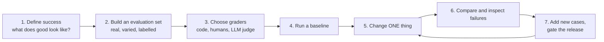
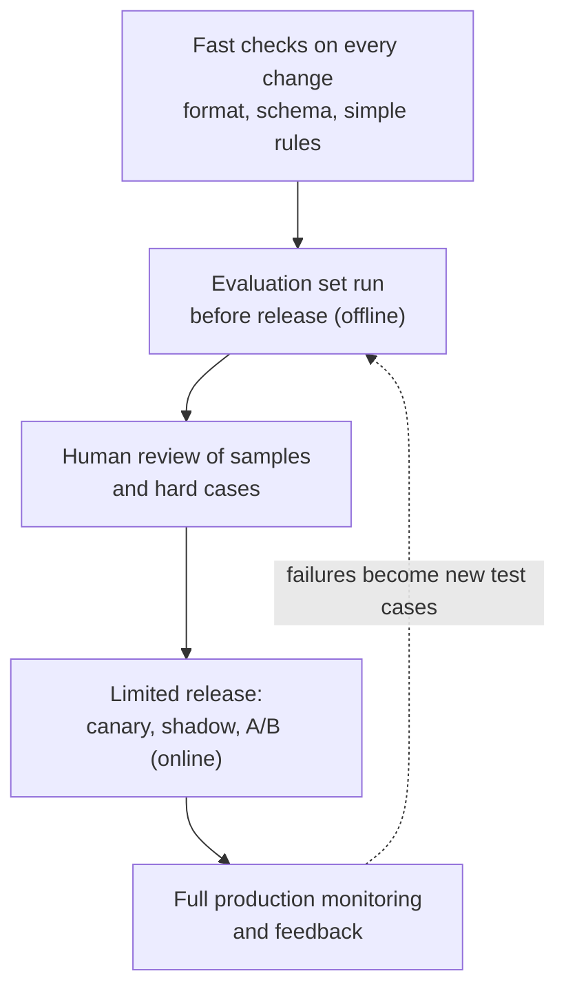
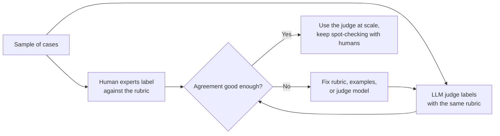
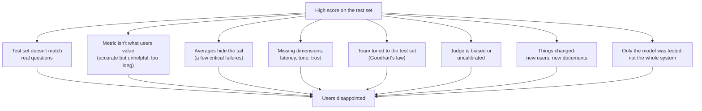

# Chapter 26: Evaluation Fundamentals

## 1. The concept, from scratch

### Why evaluation is the hard part

Traditional software is deterministic: the same input gives the same output, so a test either passes or fails. Generative AI is probabilistic ([Chapter 1](../01-introduction-to-ai/README.md), [Chapter 6](../06-inference-and-generation/README.md)). The same question can get differently worded answers, there are often many acceptable answers, and "good" has several dimensions at once: correct, grounded in sources, the right tone, the right format, safe, fast and affordable.

So you can't just write a unit test that says `answer == "expected"`. You need an **evaluation** (often shortened to **eval**): a repeatable way to measure how well your system does on the things that matter, across many examples, so you can make changes with evidence instead of impressions.

This matters more than any single technique in this handbook. Every earlier chapter ended with "measure it on an evaluation set": chunking, reranking, prompts, fine-tuning, model choice, agent changes. This chapter explains what that means and how to do it properly.

### The evaluation loop

A good habit is to **build the evaluation before you build the feature**. Teams that start with "let's see if the demo looks good" tend to ship what looked good in the demo.

### Define success first

"Works well" isn't measurable. Write down specific, checkable criteria, and rank them by how bad a failure is.

| Dimension | Example criterion |
|---|---|
| **Task success** | The refund request is resolved correctly |
| **Correctness** | Facts and numbers are right |
| **Groundedness** | Claims are supported by the retrieved sources ([Chapter 28](../28-hallucination-and-grounding/README.md)) |
| **Format** | Valid JSON matching the schema |
| **Tone and policy** | Follows brand voice and doesn't promise what policy forbids |
| **Safety** | Doesn't leak data or follow injected instructions ([Chapter 29](../29-guardrails-and-ai-security/README.md)) |
| **Latency and cost** | Time to first token, cost per task ([Chapter 31](../31-cost-latency-and-caching/README.md)) |

Add **severity**. A slightly awkward phrase is a minor flaw. Inventing a refund policy, or leaking another customer's data, is critical. A single "92 percent" score that treats those the same hides the thing you actually care about.

### Offline and online evaluation

There are two settings, and you need both.

- **Offline evaluation** runs on a prepared set of examples, before release. It's cheap, repeatable and fast, so you can try ten prompt variants in an afternoon. Its weakness: the test set may not match real use.
- **Online evaluation** measures real behaviour in production: user feedback, corrections, escalations, task completion, A/B tests, shadow runs, and sampled human review. It's the truth about real use, but it's slower, noisier and riskier.

The loop between the bottom and the top matters most: **production failures become new offline test cases**, so the evaluation set improves over time.

### The evaluation set (golden dataset)

The **evaluation set**, often called the **golden dataset**, is the collection of test cases you measure against. It's the most valuable asset in the whole process, and building it well is mostly unglamorous work.

**Where cases come from:**
- **Real traffic**, sampled and anonymised. The best source, because it reflects what people actually ask.
- **Domain experts** who write realistic and tricky cases.
- **Known failures**, from support tickets, bug reports and past incidents.
- **Synthetic cases** generated by a model, then reviewed by humans, useful to widen coverage, but never trust them unreviewed.
- **Adversarial cases**: attempts to break the system, including injection ([Chapter 29](../29-guardrails-and-ai-security/README.md)).

**What to include.** OpenAI's evaluation guidance, for example, says test data should cover typical cases, edge cases and adversarial cases. In practice that means:
- the **common** requests (they're most of your traffic),
- **hard and ambiguous** ones,
- **out-of-scope** questions where the right behaviour is to decline or say "I don't know",
- **multi-turn** conversations, if you have them,
- **cases by category**, so you can see where you're weak.

**How many?** There's no magic number. Start small, a few dozen carefully chosen cases are more useful than hundreds of near-duplicates (this is practitioner advice, not a standard), and grow it as you find failures. Remember the statistics, though: a small set gives noisy scores (see below).

**What a case contains:** the input (and context, such as the retrieved documents or conversation), and an **expected outcome**. That can be a reference answer, a list of facts that must appear, a **rubric** (criteria for judging), or properties ("must refuse", "must cite a source", "must call this tool").

**Keep it clean:**
- **Hold out a test portion.** As in [Chapter 2](../02-how-machines-learn/README.md) (train, validation, test), don't tune your prompt on the same cases you report results on, or you'll fool yourself.
- **Check label quality.** Have more than one person label a sample and see whether they agree. If experts disagree, your criteria are unclear.
- **Version it** and record what changed.
- **Keep it fresh.** User behaviour, products and documents change. A stale set measures the past.
- **Protect privacy.** Redact personal data before it goes into a dataset ([Chapter 30](../30-privacy-governance-and-compliance/README.md)).

### Ways to grade: from cheap to expensive

You need a **grader** for each case: something that decides pass, fail or a score. There are four kinds.

| Grader | How it works | Strengths | Weaknesses | Use for |
|---|---|---|---|---|
| **Code and rules** | Programmatic checks: valid JSON, matches regex, right tool called, tests pass, database end-state matches | Objective, cheap, fast, repeatable | Only for what can be checked mechanically | Format, structure, tool use, code, end states ([Chapter 25](../25-agent-reliability-and-learning/README.md)) |
| **Reference-based text metrics** | Compare against a reference answer by word overlap (for example BLEU or ROUGE) or embedding similarity | Cheap | Weak for open-ended text: a good answer with different words scores badly | Narrow tasks like translation, with caution |
| **Human review** | Experts rate outputs against a rubric | The gold standard for nuanced quality | Slow, expensive, inconsistent without clear rubrics | Calibration, hard cases, final sign-off |
| **LLM-as-judge** | A model rates outputs against criteria you give it | Scales to thousands of cases, handles open-ended text | Biased and imperfect, must be calibrated | Quality dimensions that code can't check |

The rule of thumb: **use code wherever you can, a judge model for what code can't check, and humans to calibrate the judge and to review the hard stuff.** Don't use an LLM judge to check something a simple rule can verify, like whether JSON is valid.

### LLM-as-judge in depth

An **LLM-as-judge** is a model asked to evaluate another model's output. It comes in a few forms:

- **Pairwise:** given two answers, which is better? (Often more reliable than absolute scores.)
- **Single-answer scoring:** rate this answer from 1 to 5 against these criteria.
- **Reference-guided:** compare the answer to a reference or to source documents, and say whether it's correct or supported.

The research that popularised the idea (Zheng et al., 2023, with the MT-Bench and Chatbot Arena work) found that a strong judge model agreed with human preferences more than 80 percent of the time, about as often as humans agreed with each other. That's why the approach took off. But it also documented **biases**, and those matter in practice:

- **Position bias:** the judge tends to favour an answer because of whether it appears first or second.
- **Verbosity bias:** it tends to favour longer answers, even when they aren't better.
- **Self-enhancement bias:** it may favour outputs written by models like itself.
- **Limited reasoning:** it can be unreliable on tasks like maths, where it has to solve the problem to check the answer.

How to use judges responsibly:

1. **Write a clear rubric** with explicit criteria and a defined scale, not "rate the quality". Ask for the reasoning first and then a verdict, in a structured format.
2. **Counter the biases.** For pairwise comparisons, run both orders and average. Control for length. Prefer a judge from a different model family than the system being judged. Give it a reference answer or the source documents when correctness matters.
3. **Calibrate against humans.** Have people label a sample, run the judge on the same sample, and measure how often they agree. If agreement is poor, fix the rubric or the judge before trusting it. The 80-percent result was for general chat preferences. Your domain may behave differently.
4. **Spot-check continuously,** because judge behaviour can change when the judge model is updated.
5. **Version the judge prompt** like any other prompt ([Chapter 9](../09-prompt-engineering/README.md)).

### Benchmarks

A **benchmark** is a public, standard test, such as multiple-choice knowledge exams, coding problem sets, maths word problems, or crowd-sourced head-to-head preference voting. Benchmarks are useful for one purpose: **shortlisting models** ([Chapter 8](../08-the-model-landscape/README.md)). They aren't a substitute for your own evaluation, for several reasons:

- **Task mismatch.** They measure general ability on someone else's tasks, not your documents, tools and policies.
- **Contamination.** If a benchmark's questions or answers leaked into a model's training data, the score is inflated. Research surveys document this problem and the methods for detecting it, and responses include new, dynamic or refreshed benchmarks.
- **Saturation.** When top models all score near the ceiling, the benchmark can't tell them apart.
- **Sensitivity.** Scores can change with prompt wording and settings, and different reports may use different setups.
- **Gaming.** Once a leaderboard matters, systems get tuned for it.
- **Preference isn't correctness.** A crowd voting for the answer it likes best measures general preference, which isn't the same as being right for your use case.

So when someone quotes a leaderboard in an interview, the good response is "useful for narrowing candidates, then I test on our own data."

### Why high scores can still disappoint users

This is a favourite question, and you should be able to give several causes:

- **The set isn't representative.** It was written by the team, covers easy cases, or is out of date. Real users are messier.
- **The metric isn't the value.** An answer can be faithful to the sources and still useless, too long, or in the wrong tone.
- **Averages hide the tail.** Ninety-two percent overall can include a cluster of severe failures on one important category.
- **Missing dimensions.** Latency, tone, trust, and how a failure is handled don't show up in an accuracy score.
- **Goodhart's law.** "When a measure becomes a target, it stops being a good measure." Tune hard against a fixed set and you improve the score without improving the product.
- **Biased judges** that reward long, confident answers.
- **Drift.** New products, new documents and new user behaviour move away from the test set.
- **Component vs system.** Each part tests well, but the whole system, with retrieval, tools, latency and handoffs, hasn't been tested end to end.

The fix is to close the loop with reality: **sample and read real failures, collect user feedback, segment the results by category and severity, and keep feeding production cases into the evaluation set.** Look at actual conversations regularly. No metric replaces that.

### Statistical care

LLM evaluations are noisy, so treat numbers with care.

- **Variance.** Because outputs vary, run important cases several times, and look at consistency, not just the average ([Chapter 25](../25-agent-reliability-and-learning/README.md)).
- **Sample size.** With 100 test cases, a measured 90 percent success rate has a 95 percent margin of error of roughly plus or minus 6 points (the standard error is the square root of 0.9 times 0.1 divided by 100, which is 0.03, and a 95 percent margin is about twice that). So 90 versus 93 percent on a hundred cases is not a real difference. Don't celebrate small gains on small sets.
- **Compare like with like.** Use the same cases for both versions (a paired comparison), and look at which cases changed, not only the totals.
- **Report by slice.** Break results down by category, difficulty and severity.
- **Don't overfit to the set,** and keep a held-out portion.

### Regression testing and release gates

Once you have an evaluation set, run it **automatically on every change** (prompt, model, retrieval settings, tools), compare with the current version, and **block the release** if key metrics fall or critical cases regress. That's a regression suite, and it's the only way to change prompts and models without breaking things silently. [Chapter 32](../32-observability-and-llmops/README.md) covers the operational side.

### Evaluating the predictive parts too

Not everything in an AI system is generative. Classifiers, routers, rerankers and embedding models are predictive, and they have classic metrics: **accuracy, precision, recall and F1**, a **confusion matrix**, and for ranking, measures like recall at k and nDCG ([Chapter 2](../02-how-machines-learn/README.md), [Chapter 13](../13-vector-search-and-databases/README.md)). Evaluate them separately: if the router sends a request to the wrong model, no amount of prompt polish downstream will fix it. [Chapter 27](../27-evaluating-rag-and-agents/README.md) applies all this to RAG and agents specifically.

### Tooling

Evaluation tools exist from model providers, observability platforms and open-source projects. They change quickly, and some products have been retired or reshaped, so pick on fit, avoid lock-in by keeping your datasets and rubrics in portable formats, and remember that the tool is the easy part. The dataset, the rubric and the habit are what make an evaluation work.

## 2. Analogies across industries

- **Offline vs online (healthcare).** A new treatment is first tested in a controlled trial on a selected group (offline), then monitored in the real population after approval (online), where patients are messier and outcomes differ. Both are needed, and surprises from the second feed back into the first.
- **Held-out test set (insurance).** An insurer tests a fraud model on claims it never trained on. Testing on the training claims would look brilliant and mean nothing.
- **Benchmarks vs your own evaluation (manufacturing).** A supplier's brochure quotes a machine's performance on standard test pieces. You still run it on your own parts before buying, because your parts, materials and tolerances are different.
- **Averages hide the tail (retail).** An online shop with a 95 percent happy-customer rate can still have a serious problem if the unhappy 5 percent are all high-value customers with failed deliveries. Segment and weight by severity.
- **LLM judge bias (insurance claims review).** A reviewer who always rates long, detailed claim narratives higher, regardless of substance, is biased towards verbosity. Compare their ratings against an independent expert panel to find out, which is what judge calibration does.

## 3. How it's used in industry

- **Retail: support assistant releases.** A retailer keeps an evaluation set sampled from real, anonymised conversations, tagged by topic and severity. Every prompt or model change runs against it automatically, and any regression in the severe-case slice blocks the release.
- **Insurance: claims summarisation.** An insurer grades summaries with code checks for required fields, an LLM judge calibrated against adjuster ratings for completeness and faithfulness, and a weekly human review of a random sample plus all flagged cases.
- **Healthcare: documentation tools.** A hospital evaluates a note-drafting tool offline against clinician-written references and a rubric, then runs it in shadow mode, with drafts compared to what clinicians actually wrote, before any clinician sees the output.
- **Software and manufacturing: model selection.** A team shortlists models using public benchmarks, then compares three on its own labelled set measuring quality, latency and cost per task, and picks the cheapest that clears the quality bar ([Chapter 8](../08-the-model-landscape/README.md)).

## 4. Common misconceptions

- **"We tried it on a few examples and it looked good."** A handful of hand-picked examples is a demo, not an evaluation.
- **"One accuracy number is enough."** Quality is multi-dimensional, and averages hide severe failures. Slice by category and severity.
- **"An LLM judge is objective."** It has measurable biases (position, verbosity, self-preference) and must be calibrated against human labels.
- **"A top benchmark score means it's right for us."** Benchmarks help shortlist. Contamination, saturation and task mismatch limit what they tell you.
- **"More test cases always means better."** Quality and coverage matter more than quantity. A few dozen diverse, well-labelled cases beat hundreds of duplicates.
- **"If the score goes up, the product got better."** If you tuned to the test set, the score rose and the product may not have (Goodhart's law).
- **"Evaluation is a one-time gate before launch."** It's continuous: regression suite on every change, plus production monitoring that feeds new cases back.
- **"Evaluation is a tooling question."** Tools help, but the dataset, rubric and review habit are what matter.

## 5. Interview questions

### 1. Our evaluation scores are high, but users are still complaining. What's going on?

I'd assume the evaluation isn't measuring what users experience, and look for the gap. Is the test set representative, or is it written by the team and full of easy cases? Is the metric the thing users value, since an answer can be accurate and still too long or unhelpful? Are averages hiding a cluster of severe failures in one category? Are we missing dimensions like latency, tone or how failures are handled? Have we tuned to the test set so the score rose without the product improving? Is the judge biased towards long answers? Has user behaviour or content drifted since the set was built? And did we test the whole system end to end or just components? I'd read real complaints, sample production conversations, add them to the evaluation set, and slice results by category and severity. Then I'd calibrate any judge against human ratings.

### 2. How do you build a golden dataset?

I'd start from real traffic, sampled and anonymised, because it reflects what people actually ask. I'd add cases written by domain experts, known failures from tickets and incidents, adversarial cases, and out-of-scope questions where the right behaviour is to decline. I could widen coverage with synthetic cases generated by a model, but I'd have humans review them. Each case has the input and context, and an expected outcome, whether a reference answer, required facts, a rubric, or properties like must cite a source. I'd tag cases by category and severity, check label quality by having more than one person label a sample, hold out part of the set so I don't tune on it, version it, and keep adding production failures so it stays fresh. And I'd start small and grow it, instead of waiting for a perfect big set.

### 3. What are the pitfalls of LLM-as-judge, and how do you mitigate them?

The research that popularised it found strong judges agreed with human preferences over eighty percent of the time, but also documented biases. Position bias, where the order of answers affects the verdict. Verbosity bias, favouring longer answers. Self-enhancement, favouring outputs from similar models. And weak reasoning on tasks like maths. To mitigate, I write a clear rubric with a defined scale, ask for reasoning before the verdict, run pairwise comparisons in both orders, control for length, prefer a judge from a different model family, and give it reference answers or sources when correctness matters. Most important, I calibrate it: have humans label a sample, measure agreement with the judge, and fix things until it's good enough, then spot-check over time. And I don't use a judge for anything code can check.

### 4. How do you evaluate a system when you have no labelled data?

I'd start by creating some, in a small way. Sample real or realistic inputs and have a domain expert review the outputs against a simple rubric, which gives me both labels and a sense of what "good" means. In the meantime I can use reference-free checks: code checks for format and rules, groundedness checks that compare answers with the retrieved sources, and an LLM judge with a clear rubric, calibrated against the expert labels. I can also use pairwise comparison between versions, since it's easier to say which of two answers is better than to define a perfect one. Then I'd turn the reviewed cases into a golden dataset, and add production feedback and failures over time.

### 5. What's the difference between offline and online evaluation, and why do you need both?

Offline evaluation runs a prepared set of cases before release. It's fast, cheap and repeatable, so I can compare versions quickly and catch regressions, but it only covers what's in the set. Online evaluation looks at real production behaviour: user feedback, corrections, escalations, task completion, A/B tests, shadow runs and sampled human review. It shows what actually happens, but it's slower and noisier, and mistakes reach users. I need both. Offline is my safety net and my iteration speed, and online is the truth about real use. The loop between them is key: production failures become new offline test cases.

### 6. Can you rely on public benchmarks to choose a model?

Only to shortlist. Benchmarks measure general ability on someone else's tasks, not my data, tools and policies. They can be contaminated if the test material leaked into training data, saturated when top models all score near the ceiling, sensitive to prompt wording, and subject to tuning once a leaderboard matters. Crowd preference scores measure what people like, which isn't the same as being right for my use case. So I'd use benchmarks to narrow candidates, then compare the shortlist on my own labelled set, measuring quality, latency and cost per task, and choose the cheapest model that clears my quality bar.

### 7. How many test cases do you need?

It depends on the task and the differences I need to detect, so there's no fixed number. I'd start with a few dozen well-chosen, diverse cases, covering typical, hard, out-of-scope and adversarial inputs, because that already finds big problems, and grow it from real failures. But I'd respect the statistics: with a hundred cases, a ninety percent score has a margin of error of roughly six points, so small differences between versions on small sets are noise. If I need to detect small improvements, I need more cases, paired comparisons on the same cases, repeated runs for non-determinism, and per-slice breakdowns. Quality and coverage matter more than raw count.

### 8. How do you evaluate a prompt change or a model upgrade safely?

I'd run the new version against the same evaluation set as the current one, with the same settings, and compare overall and by slice, with attention to the critical cases. I'd run important cases several times to account for variation. I'd look at which cases changed, not just the totals, and read a sample of the differences by hand. I'd compare latency and cost too. If it passes the release gate, I'd roll it out gradually, for example to a small share of traffic or in shadow mode, watch the production metrics and feedback, and keep the ability to roll back. And I'd add any new failures I find to the evaluation set.

### 9. What metrics would you use for a customer-support assistant?

A mix. For outcome: task resolution rate and escalation rate. For answer quality, evaluated with a calibrated judge and human sampling: correctness, groundedness in the sources, completeness and tone. For policy and safety: the rate of policy violations, unsupported claims, and leaks, tracked by severity because one critical failure matters more than many small ones. For behaviour: whether it declines or escalates properly on out-of-scope questions. For experience: time to first token, response time and user satisfaction or thumbs-down rate. And for cost: cost per resolved conversation. I'd report them by category and severity, not as a single average, and I'd review real conversations regularly.

## 6. Scenario exercise

A retailer's support assistant scores 92 percent on the team's evaluation set. The set has 150 questions written by the team, graded by an LLM judge. After launch, customer ratings are poor, and support managers say the assistant gives long, confident answers that are sometimes wrong about returns for sale items, and it's slow in the evening peak. The product owner asks why the evaluation didn't warn them and what to change. You haven't seen the data.

Answer from memory, then check.

Model answer

I'd say the evaluation measured something different from what customers experience, and I'd look for the specific gaps.

The set was written by the team, so it likely covers questions they can think of, with plenty of easy ones, and probably few of the awkward real cases like returns for sale items. I'd rebuild it from sampled, anonymised real conversations, add the failures managers describe, and tag cases by topic and severity. I'd keep a held-out portion so we don't tune on the cases we report.

The judge is a suspect, since it's graded by an LLM and the complaints are about long, confident answers. That's exactly what a judge with verbosity bias would reward. I'd write a clear rubric, run pairwise comparisons in both orders, control for length, give the judge the policy documents so it can check facts, and calibrate it against a sample labelled by experienced support staff, measuring agreement. Where a rule can check something, like whether the answer matches the return policy for sale items, I'd use code or reference answers instead of the judge.

The 92 percent is also a single average. I'd slice by category and severity, because a cluster of wrong return-policy answers is a critical failure that an average hides. And the evaluation says nothing about latency, so I'd add time to first token and latency percentiles at peak load, which would have flagged the evening slowdown.

With 150 cases, the margin of error on a 92 percent score is roughly plus or minus four points, so small gains were noise. I'd add more cases where needed, run repeated trials, and use paired comparisons.

Then I'd close the loop with production: sample and read real conversations weekly, track thumbs-down and escalations by category, and feed failures into the set. Releases would be gated on the regression suite, with a gradual rollout and monitoring. I'd also check whether retrieval is returning the right return-policy passages, since the problem could be upstream of the model. Chapter 27 covers that.

## 7. Key takeaways

- Generative AI is probabilistic, so you evaluate on a set of examples, with defined success criteria and severity, not by trying a few cases. Build the evaluation before the feature.
- A good golden dataset comes from real traffic, experts, known failures and reviewed synthetic cases, covers typical, hard, out-of-scope and adversarial inputs, and keeps a held-out part.
- Use code where you can, an LLM judge where you can't, and humans to calibrate. Judges have position, verbosity and self-preference biases and must be calibrated against human labels.
- Benchmarks shortlist models, but contamination, saturation and task mismatch mean you decide on your own data.
- High scores can still disappoint users when the set isn't representative, averages hide severe failures, the team tuned to the set, or dimensions like latency are missing. Close the loop with production, use regression suites, and respect statistical noise.

## 8. Further reading

- Zheng et al., [Judging LLM-as-a-Judge with MT-Bench and Chatbot Arena](https://arxiv.org/abs/2306.05685) (2023): the case for judge models and their biases.
- Xu et al., [Benchmark Data Contamination of Large Language Models: A Survey](https://arxiv.org/abs/2406.04244) (2024).
- OpenAI, [Evaluation best practices](https://developers.openai.com/api/docs/guides/evaluation-best-practices): test-case coverage and the evaluation loop.
- Hamel Husain, [Your AI Product Needs Evals](https://hamel.dev/blog/posts/evals/): a practitioner's view of error analysis and evaluation habits.
