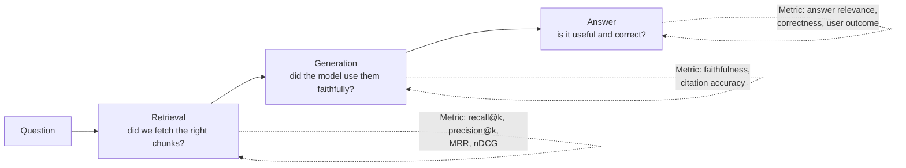
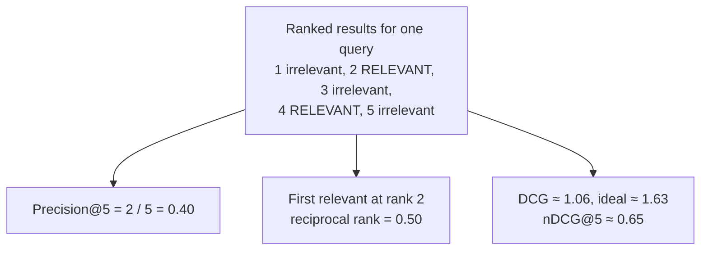
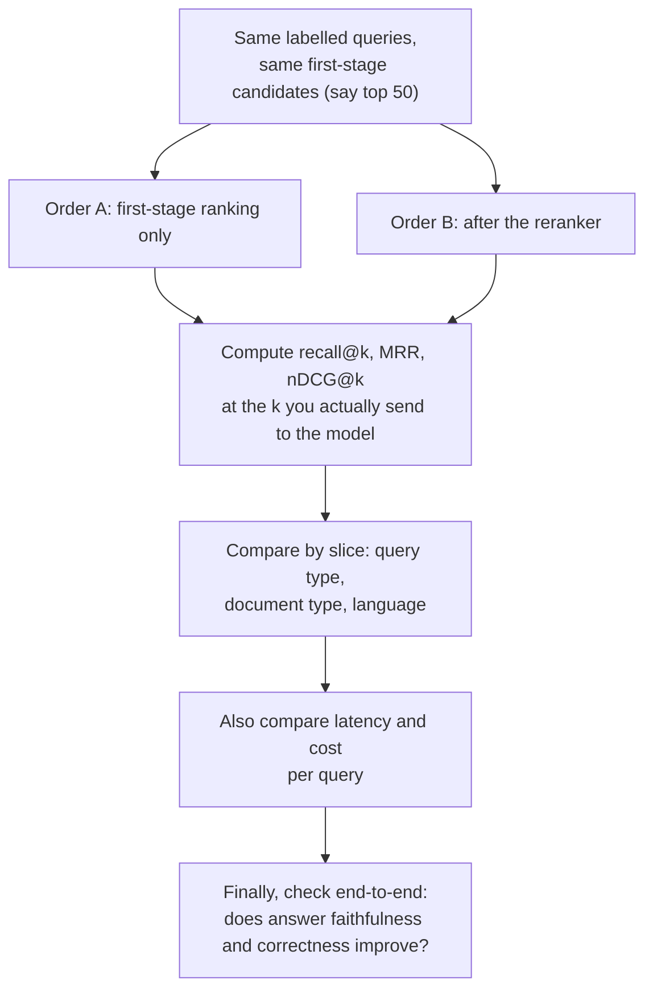
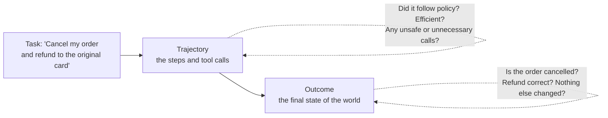
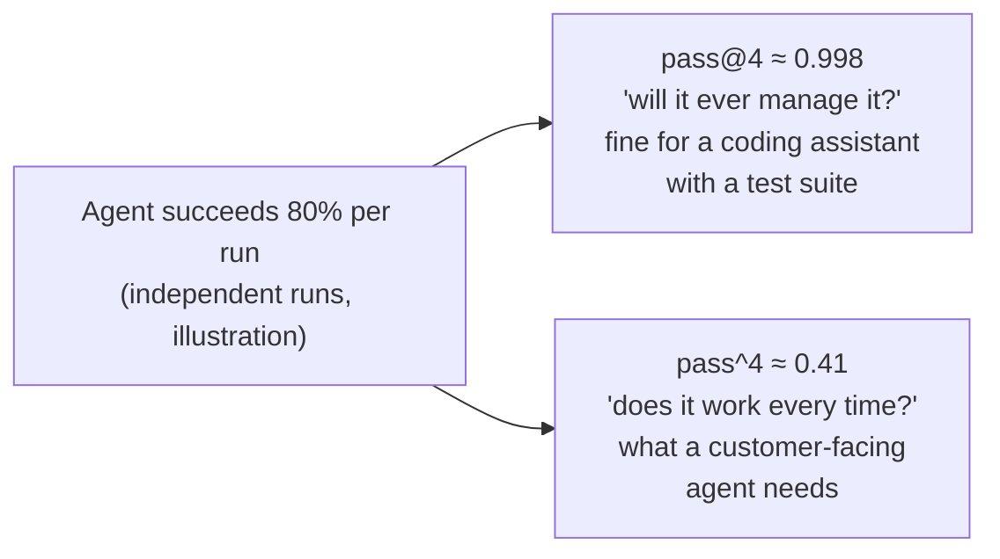
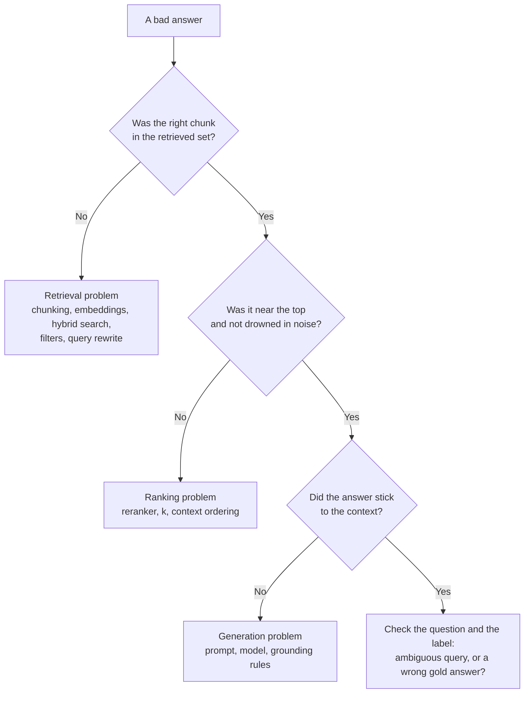

# Chapter 27: Evaluating RAG and Agents

## 1. The concept, from scratch

This chapter applies the general evaluation machinery (evaluation sets, graders, judges, offline and online) to the two systems you will be asked about most: **RAG** and **agents**.

Both are **pipelines of several steps**, and that's the key idea. If you only score the final answer, you know the system is bad but not *where*. So the rule for both is the same: **evaluate each stage on its own, then evaluate end to end.**

### RAG: three questions, three places to look

When a RAG answer is wrong, one of three things went wrong.

- **Retrieval failure:** the right chunk never reached the model. No prompt will fix that.
- **Generation failure:** the right chunk was there, but the model ignored it, misread it or added claims of its own. That's a hallucination ([Chapter 28](../28-hallucination-and-grounding/README.md)).
- **End-to-end failure:** both stages were fine in isolation, but the answer still isn't what the user needed: wrong level of detail, missing a step, or the question was ambiguous.

Splitting the evaluation this way turns "the bot is bad" into "recall@10 dropped on billing questions", which is something you can act on.

### Retrieval metrics

To measure retrieval you need **relevance labels**: for each test question, which chunks (or documents) actually contain the answer. Then you run the retriever and see where those chunks landed. Everything below is computed on the top **k** results, where k is how many chunks you pass on.

| Metric | What it asks | Good for |
|---|---|---|
| **Recall@k** | Of the chunks that are relevant, how many are in the top k? | "Did we find it at all?" The most important number for the first stage ([Chapter 14](../14-improving-retrieval/README.md)). |
| **Precision@k** | Of the k chunks returned, how many are relevant? | "How much noise are we feeding the model?" |
| **MRR** (mean reciprocal rank) | On average, how high is the *first* relevant chunk? Score is 1/rank, averaged over queries. | Cases where one good chunk is enough. |
| **nDCG@k** (normalised discounted cumulative gain) | Are relevant chunks ranked near the top, with more credit for highly relevant ones? | Ranking quality, especially with graded relevance. The headline metric in the BEIR benchmark. |

One warning: **recall@k has two common definitions.** Some tools define it as the share of relevant chunks found in the top k. Others define it as the share of *queries* that have at least one relevant chunk in the top k. They give different numbers, so always check which one a paper, library or colleague means.

#### A worked example

Three test queries, top 5 results each. The first relevant chunk is at rank 1 for query A, rank 3 for query B, and missing from the top 5 for query C.

- **MRR@5** = (1 + 1/3 + 0) / 3 ≈ **0.44**.
- **Recall@5** (using the "at least one relevant chunk found" definition) = 2 of 3 queries = **0.67**.

Now nDCG for one query with two relevant chunks, found at ranks 2 and 4. DCG adds 1/log₂(rank + 1) for each relevant hit: 1/log₂3 + 1/log₂5 ≈ 0.631 + 0.431 = 1.062. The ideal ranking would put both at ranks 1 and 2: 1 + 0.631 = 1.631. So **nDCG ≈ 1.062 / 1.631 ≈ 0.65**. Finding both chunks isn't enough; finding them *lower* costs you.

#### Which metric matters when

- **Recall is the ceiling.** If the right chunk isn't retrieved, generation can't recover. For a first-stage retriever, optimise recall at a generous k (say 50 to 100) and let the reranker sort it out.
- **Precision and rank matter after reranking**, because the model only sees a handful of chunks and long contexts get noisy ([Chapter 7](../07-context-windows-and-context-engineering/README.md)).
- **Where do the labels come from?** Experts mark relevant chunks for a set of questions; or you start from a known source passage and have a model write questions for it (synthetic, then reviewed). Labels are expensive, which is why the set is small and carefully built ([Chapter 26](../26-evaluation-fundamentals/README.md)).

### Generation metrics: faithfulness and friends

Once you have the retrieved context, grade what the model did with it. The vocabulary here was popularised by the **Ragas** framework (a research paper from 2023, now also an open-source library). Four ideas, which you'll see under similar names in most evaluation tools:

| Metric | Question | How it's usually computed |
|---|---|---|
| **Faithfulness (groundedness)** | Is every claim in the answer supported by the retrieved context? | Break the answer into individual claims, check each against the context (usually with an LLM judge). Score = supported claims / total claims. |
| **Answer relevance** | Does the answer actually address the question? | A judge, or a similarity check, on whether the answer responds to what was asked. |
| **Context precision** | Are the retrieved chunks relevant, and ranked well? | Judge each retrieved chunk against the question (and often a reference answer). |
| **Context recall** | Did the retrieved context contain what was needed to answer? | Compare the reference answer's statements against the retrieved context. |

Notice that the first two grade the *answer*, and the last two grade the *retrieval*. A classic pattern: **high context recall but low faithfulness** means retrieval is fine and the model is making things up. **Low context recall** means look at retrieval first.

A very useful property: faithfulness and answer relevance don't need a reference answer, only the question, the context and the answer. That means you can run them on **live production traffic**, which has no labels. The catch is that they're still judged by an LLM, so everything about judge bias and calibration from [Chapter 26](../26-evaluation-fundamentals/README.md) applies. Metric names and exact definitions differ between libraries and versions, so read the definition before trusting a number.

#### Citation accuracy

If your system shows citations, grade them separately. Two checks:

- **Does the cited source exist** in what was retrieved? (Catches invented citations. A code check.)
- **Does the cited passage actually support the claim?** (A judge check, or human review for high-stakes use.)

A citation that points at a real document that doesn't say what the answer claims is arguably worse than no citation, because it looks trustworthy.

### Measuring a reranker

A **reranker** ([Chapter 14](../14-improving-retrieval/README.md)) re-orders the first-stage candidates. You measure it *against the first stage on the same data*, so that the only thing that changed is the reranker.

Points that matter:
- **Recall@50 can't improve** from a reranker, because it only reorders those 50. What it should improve is precision, MRR and nDCG at the small k you pass to the model. If recall@50 is low, fix the first stage.
- **Check the end-to-end result.** A reranker that lifts nDCG but doesn't change answer quality may not earn its extra latency and cost.
- **Slice the results.** A reranker can help on long natural-language questions and hurt on short keyword or ID lookups.
- **Judge the cost.** A cross-encoder scoring 50 candidates adds a measurable delay ([Chapter 31](../31-cost-latency-and-caching/README.md)), so report the improvement per millisecond, not just the improvement.

### End-to-end answer quality

Finally, grade the whole answer against what the user needed: correct, complete, right tone, follows policy. Use the graders from [Chapter 26](../26-evaluation-fundamentals/README.md): rules for format, a calibrated judge for quality, and humans for hard cases. And **include out-of-scope questions**, where the right behaviour is "I don't know" or "that's not covered". A RAG system that always answers has a hidden failure mode.

### Evaluating agents

An agent ([Chapter 18](../18-from-llm-calls-to-agents/README.md)) is an LLM in a loop that calls tools to pursue a goal, so there are two things to look at: **where it ended up**, and **how it got there**.

#### Outcome (end-state) vs trajectory

- **Outcome grading** checks the final state: is the order cancelled, is the refund right, was nothing else modified? It's usually a **code check** against a database or system state. It's objective, and it doesn't punish an agent for finding a valid route you didn't anticipate.
- **Trajectory grading** checks the path: did it verify identity before acting, call the right tools, avoid dangerous ones, stay within a step budget, ask for confirmation where policy requires it ([Chapter 24](../24-agent-user-interaction/README.md))? Use it for **policy and safety** and for diagnosing *why* a run failed.

The sensible default is to **grade outcomes first** and add trajectory checks only for rules that genuinely matter (required confirmations, forbidden actions), rather than demanding one exact sequence of steps. Over-specifying the path makes your evaluation fail agents that work perfectly well by another route. And **read the transcripts**: if the grader says "fail" and the transcript looks fine, the grader is wrong. Anthropic's engineering team makes the same point in its guidance on agent evaluations.

You can also evaluate **individual components**, which are cheaper and more diagnostic:
- **Tool selection and arguments:** given a situation, did it pick the right tool and fill the parameters correctly? ([Chapter 19](../19-tool-calling/README.md))
- **Planning and routing:** did the router choose the right specialist? (A predictive classification, [Chapter 1](../01-introduction-to-ai/README.md), which you can score with ordinary accuracy.)
- **Recovery:** after a tool error, did it retry sensibly or loop?

#### Reliability: pass@k vs pass^k

Because agents are probabilistic, the same task can succeed on one run and fail on the next. So running each task once isn't enough. Two metrics, and the difference between them is a favourite interview point.

- **pass@k:** the chance that **at least one** of k attempts succeeds. It answers "can it do this at all?" It suits settings where retries are cheap, such as code generation checked by tests.
- **pass^k:** the chance that **all k** attempts succeed. It answers "can I rely on it?" It comes from the **τ-bench** paper (Sierra, 2024), built for customer-service-style agents.

If an agent succeeds 80 percent of the time on a task and the runs are independent, then pass@1 and pass^1 are both 0.80. But pass^4 is 0.8⁴ ≈ **0.41** and pass^8 ≈ **0.17**, while pass@4 is 1 − 0.2⁴ ≈ **0.998**. Same agent, opposite stories. (Real runs aren't perfectly independent, and the metric is averaged per task, so treat the arithmetic as an illustration.)

The τ-bench paper reported that even strong function-calling agents of the time succeeded on a minority of tasks in some domains and became much less consistent as k grew. That was a 2024 result on a particular benchmark, so use it as evidence of the *pattern*, not as a current ranking.

#### Simulated users and failure injection

Multi-turn agents can't be tested with a fixed list of questions, because the conversation depends on what the agent says. Two techniques fill the gap.

- **Simulated users.** Another LLM plays the customer, with a goal and a script of facts ("you want to return the blue jacket; you don't remember your order number"). The agent talks to it, and you grade the outcome. τ-bench uses exactly this design. Simulated users are imperfect (they're more cooperative and more articulate than real people), so they supplement real conversations rather than replace them.
- **Failure injection.** Deliberately break things: a tool times out, an API returns an error or bad data, a document contains a malicious instruction ([Chapter 29](../29-guardrails-and-ai-security/README.md)), the user changes their mind. Then check that the agent recovers, escalates or stops safely ([Chapter 25](../25-agent-reliability-and-learning/README.md)). Real systems fail all the time, and a clean-conditions evaluation says little about behaviour under stress.

Also **measure cost and latency per task**: steps taken, tokens, tool calls, time. An agent that succeeds in 40 steps may be unusable in production.

### Online evaluation

Offline sets get you to a release. After that, production tells you the truth ([Chapter 26](../26-evaluation-fundamentals/README.md)). For RAG and agents the usual signals are:

| Signal | Example | Caveat |
|---|---|---|
| **Explicit feedback** | Thumbs up/down, ratings | Sparse and biased toward strong reactions |
| **Implicit feedback** | Users rephrase the question, copy the answer, abandon, escalate to a human | Noisy, but plentiful |
| **Task outcomes** | Ticket resolved without reopening, refund processed correctly | The closest thing to ground truth |
| **Sampled review** | Humans or a judge grade a random sample plus all flagged cases | Costs money, so sample smartly |
| **Reference-free judge metrics** | Faithfulness and relevance scored on live traffic | Judge bias applies; calibrate |

Two rollout techniques come up in interviews:
- **Shadow mode:** the new version runs on real traffic, but users only see the old one's answers. You compare quietly, at no user risk.
- **A/B test:** a fraction of users get the new version, and you compare a business metric such as resolution rate. You need enough traffic to see a real difference, and for agents you must watch for harm, not just average gains.

Everything feeds the loop from [Chapter 26](../26-evaluation-fundamentals/README.md): **production failures become new offline test cases**, with sensitive data redacted first ([Chapter 30](../30-privacy-governance-and-compliance/README.md)).

### Debugging with the pipeline view

Here's how the stage-by-stage evaluation helps in practice.

---

## 2. Analogies across industries

**Telecom: network fault diagnosis.** When a customer's call quality is bad, a network engineer doesn't just note "bad experience". They check each hop: handset, tower, backhaul, core network. Evaluating RAG is the same. Recall tells you whether the signal reached the model, faithfulness tells you whether the model kept it intact, and the answer score is the customer's experience at the end of the line.

**Logistics: parcel tracking.** A parcel company measures more than "was it delivered?" It measures **on-time delivery** across *every* shipment, not just the best day. That's pass^k. A carrier that delivers on time 80 percent of days sounds fine, until you promise a customer that all of their next eight deliveries will be on time.

**Manufacturing: end-of-line test versus in-process checks.** A factory checks the finished product (outcome) and also inspects the process at each station (trajectory). Checking only the final product tells you something is wrong but not which machine to fix. Checking only the process misses a product that passed every station and still doesn't work.

---

## 3. How it's used in industry

**Telecom support assistant.** An operator's RAG assistant answers questions about plans, roaming charges and outage procedures. The team keeps labelled questions per product line and watches recall@k and faithfulness separately, with fresh cases added whenever a plan changes. After one embedding-model change they compare recall on the old and new versions by product line before switching, rather than relying on a single average. (See the scenario below.)

**Bank servicing agent.** An agent handles card disputes by calling internal tools. The evaluation uses a simulated customer for each scenario, grades the final state in a test database (dispute filed, no unintended changes), and adds trajectory rules for the non-negotiables: it must verify identity before touching an account and must ask for confirmation before submitting. Each scenario runs several times, and reliability is reported as pass^k, not a single pass rate.

**Logistics exceptions agent.** A shipping company's agent handles delayed-shipment cases: look up the shipment, check customs status, propose rerouting, and draft a customer message. Failure injection is central: the tracking API times out, returns stale data, or the customs system is unreachable. The team checks that the agent says it can't confirm the status rather than guessing, and escalates to a human.

---

## 4. Common misconceptions

- **"Score the final answer and you're done."** You'd know it's bad but not why. Evaluate retrieval, generation and the end result separately.
- **"High faithfulness means the answer is correct."** It only means the answer matches the *retrieved context*. If retrieval fetched an outdated or wrong document, the answer can be faithful and wrong.
- **"A reranker should raise recall."** It reorders a fixed candidate set. It can improve precision, MRR and nDCG at small k, but it can't recover chunks the first stage missed.
- **"Recall@k means one thing."** Definitions differ across tools. Check before comparing.
- **"An agent that passed once is reliable."** One run proves little. Run each task several times and look at pass^k.
- **"Grade the exact sequence of tool calls."** Over-specified trajectories punish valid alternative paths. Grade outcomes, and enforce trajectory rules only where policy demands it.
- **"Simulated users replace real ones."** They're cheaper and more repeatable, but also more polite and predictable. Keep real conversations in the mix.
- **"Judge-based metrics are objective numbers."** They're estimates from a model with biases ([Chapter 26](../26-evaluation-fundamentals/README.md)). Calibrate them against humans and read the failures.

---

## 5. Interview questions

### 1. How do you evaluate a RAG system?

I evaluate it in stages, because a RAG system is a pipeline and I need to know which stage failed. First retrieval: for a set of labelled questions I measure recall@k, precision@k, MRR and nDCG to see whether the right chunks come back and how high they rank. Second, generation: given the retrieved context, is every claim in the answer supported by it? That's faithfulness, and I'd measure it with claim-level checks, usually using a calibrated LLM judge. I add answer relevance, so the answer actually addresses the question, and citation accuracy if I show sources. Third, end to end: is the answer correct and useful for the user, including cases where the right answer is "I don't know". Then online, I watch feedback, escalations and task outcomes, and feed failures back into the test set. The staged view is what makes the numbers actionable.

### 2. What's the difference between precision@k and recall@k, and which matters more?

Recall@k asks how much of what's relevant I managed to retrieve in the top k. Precision@k asks how much of what I retrieved is relevant. For the first-stage retriever, recall matters most, because if the right chunk isn't in the candidate set, nothing downstream can bring it back. So I'd retrieve generously, maybe the top 50 or 100, and optimise recall there. After reranking, I only pass a handful of chunks to the model, and noise hurts, so precision and ranking quality matter more at that point. I'd also mention that recall@k is defined differently by different tools, sometimes as the share of relevant chunks found and sometimes as the share of queries with at least one hit, so I always state which one I mean.

### 3. Explain MRR and nDCG, and when you'd use each.

MRR is the mean reciprocal rank: for each query, take one over the rank of the first relevant result, then average across queries. So rank 1 scores 1, rank 3 scores a third, and a miss scores zero. It's good when one good result is enough, like a question answered by a single passage. nDCG, normalised discounted cumulative gain, handles multiple relevant results and graded relevance. It gives each relevant result credit that shrinks with its position, then divides by the score of the ideal ordering, so it runs from zero to one. I use it when ranking quality across several results matters, for example judging a reranker. Both only look at ranking, so I'd always pair them with recall, which tells me whether the relevant chunk was retrieved at all.

### 4. How do you measure whether a reranker is actually helping?

I compare the retrieval with and without the reranker on the same labelled queries and the same first-stage candidates, so the reranker is the only thing that changes. I look at MRR and nDCG at the small k that I actually send to the model, and precision at that k. Recall over the full candidate set can't go up, because the reranker only reorders it, so if that's low the fix is in the first stage. I slice the results by query type, because a reranker can help natural-language questions and hurt short keyword or ID lookups. I measure the added latency and cost per query. And finally I check end to end: does answer faithfulness and correctness improve? If nDCG goes up but answers don't get better, the reranker may not justify its cost.

### 5. What is faithfulness, and how is it different from correctness?

Faithfulness, sometimes called groundedness, asks whether the claims in the answer are supported by the retrieved context. Correctness asks whether the answer is actually true or matches the reference. They're different, because a system can be faithful and wrong: if retrieval brought back an outdated policy, the model can summarise it perfectly and the answer is still wrong. And it can be unfaithful but accidentally right, if the model used its own knowledge. I measure faithfulness by breaking the answer into claims and checking each against the context, usually with a calibrated judge, and it needs no reference answer, so I can run it on live traffic. I measure correctness against labelled references. I want both, because together they tell me whether a failure is in retrieval or in generation.

### 6. How do you evaluate an agent, as opposed to a single model call?

Two views: where it ended up and how it got there. The primary one is the outcome: did the agent leave the system in the right state, checked with code against a database or test environment where I can? That's objective, and it doesn't penalise valid routes I didn't anticipate. Then I add trajectory checks only for rules that genuinely matter, like verifying identity before acting, asking for confirmation before irreversible steps, not calling forbidden tools, and staying within a step and cost budget. I also test components in isolation, like tool selection and argument filling. And because multi-turn agents can't be tested with fixed prompts, I use simulated users to drive conversations, and I inject failures such as tool timeouts. I read transcripts regularly, because that's how I catch a grader that's unfair.

### 7. What's the difference between pass@k and pass^k, and why does it matter for agents?

Pass@k is the probability that at least one of k attempts succeeds. Pass^k is the probability that all k attempts succeed. They're identical at k equals one and then diverge sharply. If an agent succeeds 80 percent of the time per run, pass@4 is close to 100 percent, but pass^4 is about 41 percent, and pass^8 is around 17 percent, assuming independent runs. Pass@k answers "can it ever do this?", which suits a coding tool where I can run tests and retry. Pass^k answers "can I rely on it every time?", which is what a customer-facing agent needs, because users don't get to pick the best of several attempts. Pass^k comes from the τ-bench paper. So for agents I run each task multiple times and report pass^k, not a single pass rate.

### 8. How would you test an agent that has a multi-turn conversation with a customer?

I'd use a simulated user: another model given a goal and a set of facts, such as "you want to change your delivery address, and you've forgotten your order number". The agent talks to it, and I grade the outcome in a test environment, for example whether the address was changed correctly and nothing else was touched. I'd run each scenario several times and report pass^k. I'd vary the simulated user's personality, including impatient, vague and adversarial ones. I'd inject failures like a tool timing out. I'd add trajectory rules for policy, such as identity verification. I'd be honest that simulated users are more cooperative than real ones, so I'd keep a set of real, anonymised conversations alongside them and use production feedback to find what the simulator misses.

### 9. How do you evaluate a RAG or agent system in production, where you have no labels?

I use reference-free signals. For RAG, faithfulness and answer relevance can be scored on live traffic with a calibrated judge, because they only need the question, the context and the answer. I track implicit signals: users rephrasing, abandoning, copying the answer, or escalating to a human, plus explicit thumbs up and down, with the caveat that feedback is sparse and biased. For agents, task outcomes like a ticket staying resolved are the closest to ground truth. I sample traffic, plus all flagged cases, for human review. For releases, I'd use shadow mode first, running the new version on real traffic without showing users, and then an A/B test on a business metric. Anything that fails goes back into the offline set, with personal data redacted.

---

## 6. Scenario exercise

**The situation.** A telecom operator has a RAG assistant that answers customer-service agents' questions about plans, roaming and billing. Last week the team switched to a newer embedding model, because it scored better on a public benchmark. Since then, agents say the answers are worse, especially for billing questions and questions that contain plan codes. Nobody changed the prompt or the generation model. The team has a 120-question evaluation set with expert-labelled relevant chunks, built before the change.

**Your task.** Without running anything yet, explain how you'd find out what went wrong, what you'd measure, and what you'd do about it.

Model answer

I'd start by treating this as a retrieval regression until proven otherwise, because the only thing that changed is the embedding model, and I'd use the stage-by-stage view to confirm it.

First, I'd rerun the existing 120-question set against the old and new retrievers, using the same chunks and the same k, and compare recall@k, MRR and nDCG. If recall@k fell, the right chunks aren't being found, which explains worse answers without any change in the generator. Then I'd **slice by category**: billing, roaming, plan-code lookups, long natural-language questions. The complaints suggest the drop is concentrated in billing and plan codes. A plausible explanation is that the new model captures general meaning better but handles exact identifiers worse, since plan codes are rare tokens that meaning-based embeddings often blur ([Chapter 13](../13-vector-search-and-databases/README.md)). But that's a hypothesis, and the slices will confirm or reject it.

Second, I'd check generation separately. For the questions where the right chunk *was* retrieved, I'd check faithfulness on old and new outputs. If that's unchanged, the problem is retrieval only, and I shouldn't touch the prompt.

Third, I'd look at what the test set can't tell me. 120 questions is small, and the set was built before the change, so it may under-represent plan-code queries. I'd read the real failing queries the agents reported and add them as new cases, redacting any customer data.

Then the fix. If identifier queries are the problem, the usual remedy is **hybrid search**: keep the new embeddings for meaning and add keyword search such as BM25 for exact codes, merged with reciprocal rank fusion ([Chapter 14](../14-improving-retrieval/README.md)). I'd test that against the same set, including the new cases, and check the reranker's effect separately. Re-embedding the whole corpus with a new model is a big change, so I'd also run the new version in shadow mode on real traffic before switching again, and keep the old index available so we can roll back.

For the long term: this was a model chosen on a public benchmark and never validated on our own data. So I'd make the evaluation set a release gate for any retrieval change, with per-category thresholds, not just one overall score. And I'd keep the lesson in mind that a public benchmark ranks models on someone else's data ([Chapter 26](../26-evaluation-fundamentals/README.md)).

---

## 7. Key takeaways

- **Evaluate RAG in stages**: retrieval (recall@k, precision@k, MRR, nDCG), then generation (faithfulness, relevance, citations), then end to end. The stage view tells you what to fix.
- **Recall is the ceiling for retrieval.** A reranker reorders candidates; it improves precision and ranking, not recall of the candidate set.
- **Faithfulness is not correctness**: it checks the answer against the retrieved context, so a system can be faithful and wrong.
- **For agents, grade outcomes first**, add trajectory rules only for policy and safety, and use simulated users and failure injection for multi-turn behaviour.
- **Run agent tasks several times**: pass@k says "can it ever", pass^k says "can I rely on it", and customer-facing agents need the second.

---

## 8. Further reading

- Es et al., [Ragas: Automated Evaluation of Retrieval Augmented Generation](https://arxiv.org/abs/2309.15217) (2023): the paper behind reference-free metrics such as faithfulness and answer relevance.
- Yao et al., [τ-bench: A Benchmark for Tool-Agent-User Interaction in Real-World Domains](https://arxiv.org/abs/2406.12045) (2024): simulated users, end-state grading and the pass^k metric.
- Anthropic Engineering, [Demystifying evals for AI agents](https://www.anthropic.com/engineering/demystifying-evals-for-ai-agents) (January 2026): graders, outcomes versus transcripts, capability versus regression evals.
- Thakur et al., [BEIR: A Heterogeneous Benchmark for Zero-shot Evaluation of Information Retrieval Models](https://arxiv.org/abs/2104.08663) (2021): the standard retrieval benchmark that reports nDCG@10 and related metrics.
