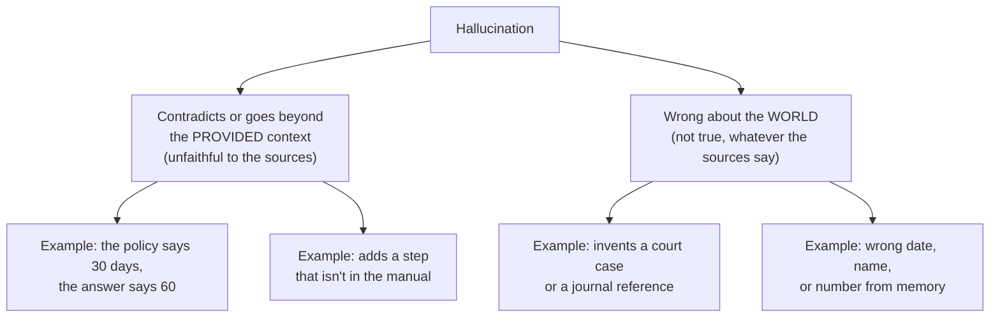
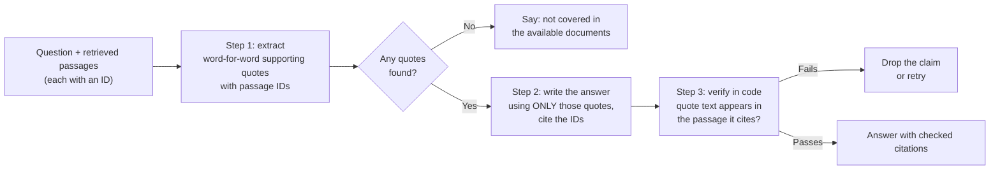
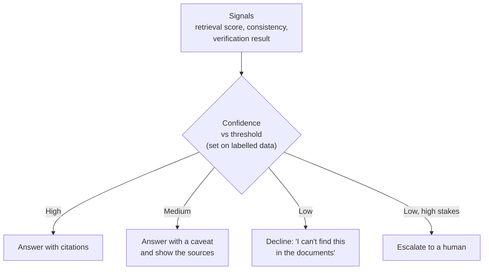

# Chapter 28: Hallucination and Grounding

## 1. The concept, from scratch

A **hallucination** is output that sounds confident and fluent but isn't supported by reality or by the sources you gave the model. It might be an invented fact, a made-up citation, a wrong number, or a claim that quietly contradicts the document it was supposed to summarise.

The reason is built into how these models work ([Chapter 4](../04-transformers-and-attention/README.md), [Chapter 6](../06-inference-and-generation/README.md)). An LLM predicts the next token, and it's trained to produce **plausible** text, not **verified** text. It has no built-in fact-checker and no lookup table of truths. The model's value is in reasoning, not in serving as a knowledge store. When it doesn't know something, the easiest thing for it to produce is a fluent guess.

**Grounding** is the fix in principle: make the model answer from **evidence you provide** (retrieved documents, database rows, tool results) and make it possible to **check** the answer against that evidence. That's what RAG ([Chapter 11](../11-rag-fundamentals/README.md)) is for. But grounding is a design goal, not a switch. RAG reduces hallucination; it doesn't eliminate it. This chapter is about the layers that get you from "reduced" to "acceptable for this use case".

### Two kinds of hallucination

The distinction matters because the fixes differ. For the first kind, you check the answer against the context ([Chapter 27](../27-evaluating-rag-and-agents/README.md) called this **faithfulness**). For the second, a model that answers from memory has nothing to check against, so you need either retrieval, a tool that looks the fact up, or a decision not to answer.

A third case is easy to forget: **faithful but wrong**. If retrieval pulled an outdated or incorrect document, the model can summarise it perfectly. That's a retrieval and data problem ([Chapter 14](../14-improving-retrieval/README.md), [Chapter 15](../15-enterprise-rag/README.md)), not a generation one.

### Why do models hallucinate?

There isn't one cause. The ones worth knowing:

- **The training objective rewards plausible text.** Predicting the next token doesn't distinguish "true" from "sounds right".
- **Rare facts have no pattern to learn.** OpenAI's 2025 paper "Why Language Models Hallucinate" argues that arbitrary, low-frequency facts (its example is a specific person's birthday) can't be predicted from patterns, so a model guesses. Spelling and grammar follow consistent patterns, so errors there fade with scale; one-off facts don't.
- **Training and evaluation reward guessing.** The same paper argues that most benchmarks score accuracy only, so a model that guesses beats one that says "I don't know", the way a multiple-choice test rewards a blind guess over a blank. Models tuned to climb those scoreboards learn to guess. The authors' suggestion: penalise confident errors more than abstentions, and give credit for appropriate uncertainty. (This is the paper's argument, not settled consensus.)
- **Missing or bad context.** If retrieval didn't fetch the answer, the model may fill the gap from memory.
- **Too much or conflicting context.** Long, noisy contexts make it easier to miss or mix up facts ([Chapter 7](../07-context-windows-and-context-engineering/README.md)).
- **Pressure in the prompt.** Instructions like "always answer" or "never say you don't know" push toward invention.

Note that lowering the temperature ([Chapter 6](../06-inference-and-generation/README.md)) is not a fix. It makes output more consistent, but a consistent wrong answer is still wrong.

### A layered defence

No single technique removes hallucination. You stack several, so that what slips past one is caught by the next.

```mermaid
flowchart LR
    subgraph L1["1. Before generation"]
        A1["Good retrieval and clean data"]
        A2["Clear scope: what the<br/>system should and should not answer"]
        A3["Prompt that permits 'I don't know'"]
    end
    subgraph L2["2. During generation"]
        B1["Quote first, then answer"]
        B2["Structured output with source IDs"]
        B3["Facts and numbers from tools,<br/>not from memory"]
    end
    subgraph L3["3. After generation"]
        C1["Check citations exist"]
        C2["Check claims against sources"]
        C3["Validate against systems of record"]
    end
    subgraph L4["4. At the edge"]
        D1["Abstain or escalate when unsure"]
        D2["Human review for high stakes"]
        D3["Monitor and feed failures back"]
    end
    L1 --> L2 --> L3 --> L4
```

Let's take the layers in order.

#### Layer 1: before generation

- **Get the evidence right.** Everything in [Part 4](../11-rag-fundamentals/README.md) (chunking, hybrid search, reranking, metadata filters, keeping documents fresh) is a hallucination defence, because a model with the right passage in front of it guesses far less.
- **Narrow the scope.** A system that answers "anything about our products" hallucinates more than one that answers "questions about these 40 policy documents". Define what's out of scope and make declining the correct behaviour.
- **Give permission to not know.** Anthropic's documentation on reducing hallucinations lists this as a basic technique: explicitly tell the model it may say it doesn't have enough information. Without that, many models treat every question as one that must be answered.

#### Layer 2: during generation

**Quote first, then answer.** For long source documents, ask the model to first extract the exact quotes that are relevant, then write the answer using only those quotes. If it can't find a supporting quote, it must say so or withdraw the claim. This is also in Anthropic's guidance. It works because it forces the model to commit to evidence *before* it composes prose.

Step 3 is the part people forget, and it's cheap. If the model says "quote X from passage 12", a few lines of string matching can confirm that passage 12 actually contains X. That's a **deterministic** check, so it doesn't rely on another model's judgement.

**Structured output with source IDs.** Ask for JSON where each claim carries the ID of the passage that supports it ([Chapter 6](../06-inference-and-generation/README.md), [Chapter 9](../09-prompt-engineering/README.md)). Then citations are data you can validate, not prose you have to trust.

**Facts from tools, not memory.** Numbers, dates, balances, prices and statuses should come from a tool call ([Chapter 19](../19-tool-calling/README.md)) or a calculation, not from the model's recollection. The model proposes the call; the system of record supplies the fact.

#### Layer 3: after generation

You now have an answer. Before showing it, verify it.

| Check | How | Catches |
|---|---|---|
| **Citation existence** | Code: does the cited ID or document exist in what was retrieved (or in the real database)? | Invented citations |
| **Quote match** | Code: does the quoted text appear in the cited passage? | Fabricated or altered quotes |
| **Claim support** | A judge or entailment model: is each claim supported by the cited passage? ([Chapter 26](../26-evaluation-fundamentals/README.md)) | Subtle unsupported claims |
| **Systems of record** | Look the entity up: does this case, policy number or drug exist? | Wrong-about-the-world errors |
| **Rules** | Numbers are in range, dates are valid, required fields are present | Obvious nonsense |

Use code wherever you can, and a judge for the rest, as in [Chapter 26](../26-evaluation-fundamentals/README.md). Judges can be wrong too, so for high-stakes answers a judge check reduces risk but doesn't remove it.

#### Layer 4: at the edge

The last layer is deciding what to do when you're not sure. Which brings us to confidence.

### Confidence and uncertainty

You'd love the model to say how sure it is, and then act on that: answer when confident, abstain or escalate when not. The trouble is that **a model's own stated confidence is unreliable**. It can say "I'm 95 percent sure" about a fabricated citation. Fluent wording isn't evidence of knowledge. Some research suggests models carry useful internal signals about whether they know something, but a confidence number in the output text shouldn't be treated as a calibrated probability unless you've measured it.

Better signals, roughly from cheapest to strongest:

- **Retrieval signals.** Did anything relevant come back? A low top similarity score, or an empty result set, is a strong hint to abstain before the model even writes.
- **Self-consistency.** Ask the same question several times and compare. If the model knows the fact, the answers agree; invented details tend to vary between samples. This is the idea behind **SelfCheckGPT** (2023), a method for detecting hallucination without external data. It costs several extra calls.
- **Token probabilities**, where the provider exposes them. Low probability on key tokens (a name, a number) can flag a guess. Availability varies by provider and model.
- **Verification results.** The strongest signal is the layer-3 checks above: did the citation exist and did the quote match?
- **A trained or prompted classifier** that predicts "is this question answerable from the documents?" This is a predictive model deciding, then the generative model answering ([Chapter 1](../01-introduction-to-ai/README.md)), the same pattern as a router.

Whatever signal you use, **calibrate it against labelled data**: pick a threshold, measure how many wrong answers get through and how many good ones get blocked, and revisit it as the system changes.

### Refusal and "I don't know"

Teaching a system to say "I don't know" sounds easy, and it has a cost. Push too far and the assistant refuses questions it could have answered, which is a failure too, and users stop trusting it as useless. Push too little and it guesses.

So treat abstention as a trade-off you **measure on both sides**:
- **Wrong-answer rate** on questions that *were* answerable.
- **Wrongly-answered rate** on questions that were *not* answerable (should have declined).
- **Over-refusal rate**: answerable questions it declined.

Your evaluation set ([Chapter 26](../26-evaluation-fundamentals/README.md)) needs both kinds of questions, answerable and unanswerable. The OpenAI paper makes the same point from the benchmark side: if you only report accuracy, you reward guessing, so report errors and abstentions together.

A good "I don't know" is useful. It says what it couldn't find, and what the user can do next: "I couldn't find that in the policy documents. Here's who to contact." That turns a refusal into a next step.

### Measuring hallucination

"Hallucination rate" is meaningless until you define it. Pick a unit and a denominator.

- **Response-level:** the share of answers containing at least one unsupported claim. Easy to explain; harsh on long answers.
- **Claim-level:** unsupported claims divided by total claims. More precise; needs a claim-splitting step.
- **By type:** unfaithful to the context, wrong about the world, bad citation. Each points to a different fix.
- **By severity:** an invented courtesy phrase is minor; an invented legal citation or drug dose is critical. Weight or report them separately ([Chapter 26](../26-evaluation-fundamentals/README.md)).

Measure it with the tools from the last two chapters: code checks for citations and quotes, a **calibrated** judge for claim support, and human review of a sample and of everything flagged. Slice by topic, because hallucination is rarely uniform. Report it alongside **abstention rate**, so a falling hallucination rate that's really "it now refuses everything" doesn't look like a win. And watch it online: sample production traffic, track user corrections and escalations, and turn each confirmed hallucination into a new test case.

### Designing so the wrong thing is hard

A few design principles pull this together.

- **Make claims checkable.** Anything the system asserts should point to something a human or a program can verify.
- **Put facts in systems, not in the model.** Look up, compute, retrieve.
- **Match rigour to stakes.** A brainstorming assistant can tolerate occasional errors; a system drafting court filings or clinical summaries can't, and needs verification plus human sign-off.
- **Keep a human accountable for high-stakes output.** The system drafts, a person approves ([Chapter 24](../24-agent-user-interaction/README.md)).
- **Say what it can't do.** Interfaces that signal uncertainty and show sources help users calibrate their trust.

---

## 2. Analogies across industries

**Law: the junior associate and the citation check.** A careful firm doesn't let a draft brief go out until someone has "cite-checked" it: pulled every case and confirmed it exists and says what the brief claims. Layer 3 is an automated cite-check. A model without it is an associate who writes fluent briefs and never checks the reporter.

**Healthcare: the pharmacist and the prescription.** A pharmacist doesn't dispense because the prescription *looks* right. They check the drug, dose and the patient's record against the system of record, and they phone the doctor when something is unclear. That's verification against a source plus escalation when unsure, which is exactly the "abstain or escalate" edge.

**Insurance: the claims adjuster's file.** An adjuster's decision has to be backed by documents in the file: the policy, the photos, the report. A decision that says "denied" with no document behind it gets challenged. Grounding means every statement the assistant makes can point to its page in the file.

---

## 3. How it's used in industry

**Legal research and drafting.** Firms and legal-tech vendors use RAG over case law and statutes. The risk is invented or misdescribed authorities, and it is not hypothetical. In *Mata v. Avianca* (US District Court, New York, 2023), lawyers were sanctioned after filing a brief that cited cases a chatbot had made up. A Stanford study of commercial legal-research tools that use retrieval found they still hallucinated at a meaningful rate (the paper reports roughly 17 to 33 percent depending on the tool and test; check the paper for current figures). Good deployments check every cited authority against the real database and require lawyer review.

**Clinical documentation.** Health systems use models to draft visit summaries from a clinician's notes or transcripts. Because an invented symptom or medication in a record is serious, the draft is presented for the clinician to review and edit, with the summary tied back to the source transcript so each statement can be traced.

**Insurance claims assistants.** An assistant helps adjusters answer "does the policy cover this?" by retrieving the policy wording and quoting the clause. If no clause is found, it says so and routes the case to a person, rather than guessing at coverage.

**Government services.** A public-sector assistant answering questions about benefits or permits has to be right and has to show where it got the answer, so people can check it. Citing the official page and declining out-of-scope questions are both part of the design.

---

## 4. Common misconceptions

- **"RAG eliminates hallucination."** It reduces it. Retrieval can miss, fetch the wrong or outdated document, or the model can ignore or misread what it fetched. Studies of commercial RAG-based legal tools found they still hallucinate.
- **"Temperature 0 stops hallucination."** It makes output more repeatable. A repeatable wrong answer is still wrong.
- **"Ask the model how confident it is."** Stated confidence is unreliable and not calibrated by default. Use retrieval signals, consistency, verification and measured thresholds.
- **"A citation means it's true."** Models can invent citations, or cite a real source that doesn't support the claim. Check that the source exists *and* supports the statement.
- **"Faithful means correct."** Faithful means consistent with the retrieved context. If the context is wrong or stale, a faithful answer is wrong.
- **"A bigger model solves it."** Larger models usually hallucinate less on common knowledge, but rare facts remain unpredictable and the problem hasn't gone away. Design for it.
- **"Make it refuse more and the problem's solved."** Over-refusal is a failure too. Measure wrong answers and wrongful refusals together.

---

## 5. Interview questions

### 1. What is a hallucination, and why do LLMs hallucinate?

A hallucination is output that's fluent and confident but not supported by the sources I gave the model or by reality: an invented fact, a fake citation, a wrong number. It happens because an LLM is trained to predict plausible next tokens, not to verify truth, and it has no built-in fact-checker or reliable knowledge store. Rare, one-off facts have no pattern to learn, so it guesses. Benchmarks that only score accuracy reward guessing over saying "I don't know", which tunes models toward confident answers. And in RAG, missing, wrong or noisy context makes it worse. So I treat the model as a reasoning engine that needs evidence, not as a database of facts.

### 2. Does RAG eliminate hallucinations?

No, it reduces them, and I wouldn't promise otherwise to a client. Retrieval can miss the right chunk, so the model fills the gap from memory. It can fetch an outdated or wrong document, and the model then answers faithfully from bad evidence. The model can also ignore, misread or mix up what it retrieved. There's published evidence that commercial legal-research tools built on retrieval still hallucinate at a meaningful rate. So I'd evaluate retrieval and generation separately and add verification on top: citation and quote checks, claim-level checking, and an abstain path.

### 3. How would you reduce hallucinations in a production RAG system?

I'd layer it. Before generation, I'd improve retrieval and data quality, narrow the scope of what the system answers, and tell the model it's allowed to say it doesn't know. During generation, I'd have it extract supporting quotes first and answer only from them, use structured output where each claim carries a source ID, and take facts and numbers from tools rather than memory. After generation, I'd verify in code that cited sources exist and quotes match, use a calibrated judge to check claim support, and validate entities against systems of record. At the edge, I'd abstain or escalate when signals are weak, put humans on high-stakes output, and monitor production to turn each failure into a test case. No single layer is enough, so the stack matters.

### 4. What does "grounding" mean?

Grounding means the model's answer is based on evidence I supply, such as retrieved documents, database results or tool outputs, rather than on its memory, and that the answer can be checked against that evidence. It has two parts: giving the model the evidence, and making the link checkable, usually through citations tied to specific passages. Grounding is a design goal rather than a switch. A system can retrieve documents and still not be well grounded if it ignores them or can't show where a claim came from.

### 5. How do you handle citations so they're trustworthy?

I'd make citations data, not decoration. Each retrieved passage gets an ID, and I ask for structured output where every claim lists the IDs it relies on, ideally with the supporting quote. Then I verify in code: does each ID exist, and does the quoted text actually appear in that passage? Both are simple deterministic checks that catch invented sources and altered quotes. A harder problem is a real source that doesn't support the claim, so for that I'd use a judge or entailment check, and human review for high-stakes answers. I'd also test citation accuracy separately in my evaluation, because a citation that looks authoritative but is wrong is worse than none.

### 6. Can you trust a model's own statement of confidence?

Not by default. Models can say they're highly confident about something they've invented, because fluency isn't evidence of knowledge, and their stated numbers aren't calibrated unless I've measured that. I'd rather use external signals: retrieval quality, such as whether anything relevant came back; consistency across several samples, which is the idea behind methods like SelfCheckGPT; token probabilities where the provider exposes them; and the results of verification checks. Then I'd calibrate a threshold on labelled data and route accordingly: answer, answer with caveats, decline, or escalate to a human. It's a measured decision, not the model's say-so.

### 7. How do you make an assistant say "I don't know" without refusing everything?

By treating it as a trade-off I measure from both sides. I design the prompt to permit uncertainty, but I don't rely on that alone. I use signals like retrieval score and verification results to decide when to decline, with a threshold set on labelled data. And my evaluation includes both answerable and unanswerable questions, so I can measure the wrong-answer rate on answerable ones, the wrongly-answered rate on unanswerable ones, and the over-refusal rate. If I only watched hallucinations I'd drift toward refusing everything, and if I only watched helpfulness I'd drift toward guessing. I'd also make the refusal useful, saying what couldn't be found and where to go next.

### 8. How do you measure hallucination rate?

First I define it, because the number means nothing otherwise. I'd choose a unit, such as the share of responses with at least one unsupported claim, or unsupported claims over total claims, and I'd split by type: unfaithful to context, wrong about the world, bad citation. And I'd weight by severity, because an invented citation in a legal brief isn't the same as an awkward phrase. I'd measure with code checks for citations and quotes, a judge calibrated against human labels for claim support, and human review of a sample. I'd slice by topic, report abstention rate beside it, so a drop doesn't just mean refusing more, and monitor it online, feeding confirmed failures back into the test set.

### 9. Does lowering the temperature fix hallucination?

No. Temperature controls how much randomness goes into token selection, so lowering it makes the output more consistent and repeatable, though even temperature zero isn't perfectly repeatable. But hallucination comes from the model lacking or misusing knowledge, and a consistent wrong answer is still wrong. Low temperature may reduce some random slips, and it's reasonable for factual tasks, but it's not a mitigation strategy by itself. The real levers are better evidence, grounding, verification and the option to abstain.

---

## 6. Scenario exercise

**The situation.** A law firm has built a legal-research assistant. Lawyers ask a question, the system retrieves from a licensed case-law database and a set of internal memos, and the model drafts a summary with case citations. A partner discovers that a draft cited two cases that don't exist, and a third that exists but doesn't say what the summary claims. The draft was caught before filing, but trust in the tool has collapsed. The firm wants it back in use within a quarter.

**Your task.** Explain how you'd diagnose the problem, what you'd change in the design, and how you'd show the firm the tool can be trusted again.

Model answer

I'd begin by working out which failure each case is, because they have different causes.

The two non-existent cases are "wrong about the world" fabrications: the model produced a plausible citation from memory instead of from retrieved material. I'd check whether those citations appear in the retrieved passages at all. If they don't, the system is letting the model cite things that weren't in its evidence, and I'd look at why: retrieval returned nothing relevant and the prompt pushed the model to answer anyway, or citations were generated as free text with no link to a source.

The third case, a real case that doesn't support the claim, is a faithfulness failure. The model had real material, misread or overstated it. I'd check retrieval for that question too: was the right passage there, and did the model quote it or paraphrase loosely?

Then the design changes, in layers.

**Make citations checkable data.** Every retrieved authority gets an ID, and the model has to output structured claims, each linked to an ID and a supporting quote. Nothing can be cited that isn't in the retrieved set.

**Verify in code.** For every citation, confirm it exists in the licensed database by its identifier, and confirm the quoted text appears in the cited opinion. That deterministic check alone would have caught the two fake cases.

**Check support.** For the harder problem, a real case that doesn't support the claim, add a claim-level check with a judge calibrated against lawyers' labels, and flag anything unsupported for review rather than letting it through.

**Allow "I don't know".** If retrieval returns nothing relevant, the system says it couldn't find authority, and doesn't write an answer from memory. Retrieval score and verification results set that threshold, tuned on labelled data.

**Keep a lawyer accountable.** The output is a draft with every citation linked to the source opinion, so the reviewing lawyer can click through. The tool speeds research; it doesn't replace cite-checking by a person, and the interface should make that clear.

To rebuild trust, I'd evidence it. I'd build an evaluation set from the firm's real research questions, including questions with no good authority and a set of deliberate traps, and I'd report fabricated-citation rate, unsupported-claim rate, and wrongful-refusal rate, with severity weighting since an invented authority is a critical failure. Target for fabricated citations: zero reaching a reviewer, because the code check blocks them, with the check itself tested. Then a limited pilot with a few lawyers in shadow or assisted mode, sampling outputs for human audit, and logging every confirmed failure as a new test case. I'd be candid with the partners that the system reduces risk and doesn't remove it, which is why the review step stays. (The fact that retrieval-based legal tools have still been shown to hallucinate in published studies is a good reason to say that plainly.)

---

## 7. Key takeaways

- **LLMs predict plausible text, not verified text**, so hallucination is a design problem to manage, not a bug to wait out.
- **RAG reduces hallucination but doesn't eliminate it**: retrieval can miss, fetch stale data, or be misread, and "faithful" isn't the same as "correct".
- **Use layers**: good evidence and scope, quote-first and structured citations, code and judge verification, then abstain or escalate.
- **Don't trust stated confidence.** Use retrieval signals, consistency and verification, with thresholds calibrated on labelled data.
- **Measure wrong answers and wrongful refusals together**, define hallucination rate precisely, and weight by severity.

---

## 8. Further reading

- OpenAI, [Why language models hallucinate](https://openai.com/index/why-language-models-hallucinate/) (September 2025): why training and evaluation reward guessing, and the case for scoring uncertainty.
- Anthropic, [Reduce hallucinations](https://platform.claude.com/docs/en/test-and-evaluate/strengthen-guardrails/reduce-hallucinations): practical techniques such as allowing "I don't know", quote extraction and verification.
- Manakul et al., [SelfCheckGPT: Zero-Resource Black-Box Hallucination Detection for Generative Large Language Models](https://arxiv.org/abs/2303.08896) (2023): detecting hallucination through consistency across samples.
- Magesh et al., [Hallucination-Free? Assessing the Reliability of Leading AI Legal Research Tools](https://arxiv.org/abs/2405.20362) (Stanford, 2024; published 2025): evidence that retrieval-based commercial tools still hallucinate.
