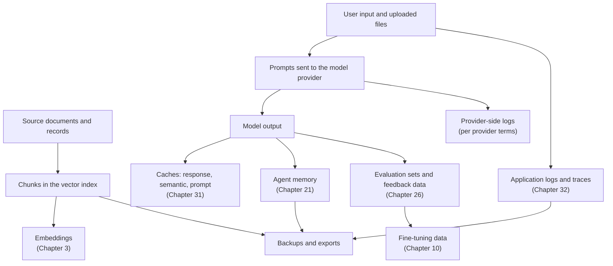
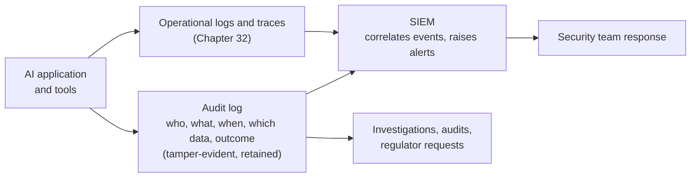
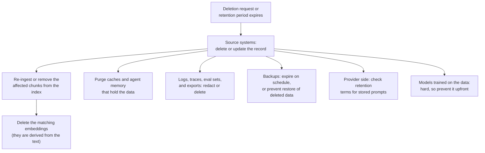
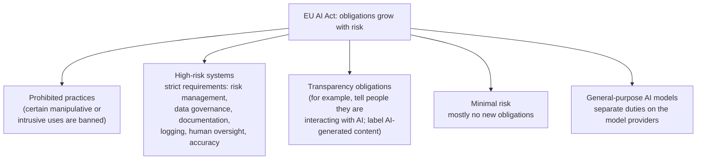
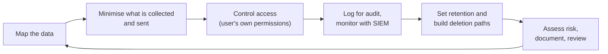

# Chapter 30: Privacy, Governance and Compliance

> **Not legal advice.** This chapter explains what privacy and regulation mean *for engineers*, so you can ask the right questions and design sensibly. The rules differ by country, sector and situation, and they change. For real decisions, involve your legal and privacy teams. Regulatory facts below are marked "(as of Nov 2026)" and come from public summaries and the sources linked, so check the primary sources before relying on them.

## 1. The concept, from scratch

Trustworthy AI has two halves. One is stopping attackers. This chapter is about the other half: handling data **properly even when nobody is attacking**, and being able to **prove** you did.

Three words, kept apart:

- **Privacy** is about *personal data*: collecting only what you need, using it only for the stated purpose, protecting it, and respecting people's rights over it.
- **Governance** is about *who decides and who is accountable*: policies, approvals, ownership, documentation, and review of AI systems throughout their life.
- **Compliance** is about *meeting specific rules*: laws such as the GDPR and the EU AI Act, sector rules such as those for health or insurance, and contractual or internal standards.

The engineering challenge is that an AI system **copies data into many places** that a traditional app doesn't, so privacy, deletion and audit are harder than they look.

### Step one: the data map

You can't protect or delete data you can't find. Start by drawing where personal data flows and rests. In an LLM application there are far more places than people expect.

Every box that can hold personal data needs an owner, a retention rule, an access rule and a deletion path. If a customer asks you to delete their data, **each of those boxes is a place to check**. Teams that skip the map find out about the forgotten ones during an audit.

### Privacy principles, as engineering requirements

Privacy law varies, but many regimes share a set of ideas. The EU's **GDPR** (General Data Protection Regulation) states them in its Article 5. In plain terms, with what each means for you:

| Principle | In plain words | What it means for an AI system |
|---|---|---|
| **Lawfulness, fairness, transparency** | Have a valid reason to process the data and be open about it | Know your legal basis; tell users that AI is involved and what happens to their data |
| **Purpose limitation** | Use data only for the purpose you collected it for | Don't quietly reuse support chats to fine-tune a model without checking this is allowed |
| **Data minimisation** | Collect and send only what's needed | Don't put the whole customer record in the prompt; redact before sending ([Chapter 29](../29-guardrails-and-ai-security/README.md)) |
| **Accuracy** | Keep data correct | Stale or wrong source documents become wrong answers ([Chapter 28](../28-hallucination-and-grounding/README.md)) |
| **Storage limitation** | Don't keep data longer than needed | Retention periods for logs, memory, caches and eval data, and a way to delete |
| **Integrity and confidentiality** | Keep it secure | Access control, encryption, injection and leakage defences |
| **Accountability** | Be able to demonstrate compliance | Documentation, audit logs, impact assessments |

Other GDPR ideas that matter here (as summaries, not legal analysis):
- **Data subject rights:** people can ask to see, correct or delete their data (the right to erasure is Article 17, subject to conditions and exceptions).
- **Automated decisions:** Article 22 gives people protection against decisions based *solely* on automated processing that have legal or similarly significant effects on them. If an AI makes or strongly drives a decision such as refusing a claim or a loan, ask whether this applies, and whether meaningful human involvement is required.
- **Impact assessments:** a Data Protection Impact Assessment (DPIA, Article 35) is required before processing likely to be high-risk, which can include using new technologies on sensitive data at scale.
- **Processors and contracts:** when a vendor processes personal data for you, you generally need a data processing agreement and need to know where the data goes, including across borders.

Other regions have their own regimes (for example, state privacy laws in the US, and sector rules such as HIPAA for US health data). The shared engineering response is the same: know your data, minimise it, control access, support deletion, and keep evidence.

### Model providers and your data

When you call a hosted model, your prompts leave your systems. Questions to ask, and read the **current** terms for answers, because they change and published summaries differ on some details:

- **Is my data used to train the provider's models?** Many providers say API and enterprise data is **not** used for training by default, while consumer products can differ. Confirm it for your plan, in the contract.
- **How long is data retained, and why?** Providers often keep inputs and outputs for a period for abuse monitoring. The length varies by provider and has changed over time. **Zero data retention** options exist at some providers, usually by agreement, and may restrict some features.
- **Where is data processed and stored** (region, sub-processors)? This matters for data-residency rules.
- **Who can see it?** Which provider staff, under what conditions, and is there a signed data processing agreement?
- **What certifications and controls** (such as SOC 2, ISO 27001) and what options (private networking, customer-managed keys) are offered?
- **Cloud versus direct:** using a model through your cloud provider often brings your existing contract, region controls and network setup with it ([Chapter 37](../37-cloud-reference-architectures-and-multi-tenancy/README.md)).

If the answers aren't acceptable for the data involved, the options are redaction before sending, a different provider or region, or self-hosting an open-weight model ([Chapter 34](../34-self-hosting-open-weight-models/README.md)).

### Identity, access and "who can see what"

Privacy depends on access control. For AI systems that means:

- **Authenticate the user and carry their identity through** to retrieval and tools, so the system acts with *their* permissions, not a powerful shared account ([Chapter 15](../15-enterprise-rag/README.md), [Chapter 20](../20-agent-protocols-mcp-and-a2a/README.md)).
- **Enforce permissions at retrieval**, so a user can't be shown a chunk they couldn't open in the source system.
- **Least privilege for the engineers and tools too**: who can read production prompts and logs? Those hold customer data.
- **Separate environments and tenants** ([Chapter 37](../37-cloud-reference-architectures-and-multi-tenancy/README.md)).

### Audit logs and SIEM: two different things

These get confused in interviews, so be precise.

- An **audit log** is the authoritative **record of who did what, when, to which data, and what the outcome was.** It exists for accountability and compliance: to answer "who looked at this claim file, and what did the assistant tell them?" months later. It should be complete, tamper-evident and retained for the required period.
- A **SIEM** (Security Information and Event Management) is a **monitoring and detection tool.** It collects logs from many systems (including audit logs), correlates them, and raises alerts: "this account made 500 record lookups in ten minutes". Its purpose is to *spot problems as they happen*.

Think of an insurer. The **claims system's audit trail** says that adjuster A opened claim 1234 at 10:02, viewed the medical report, and approved a payment. The **SIEM** is the security operations team's console that notices adjuster A opened 400 files they have never touched and raises an alert. The audit log is the evidence; the SIEM is the alarm. You need both, and the SIEM often *consumes* the audit log.

**What an AI audit record should capture:** who (user and service identity), when, what was asked or which action was proposed and taken, which tools and data sources were used (document IDs, not necessarily full content), which model and prompt version, the outcome, and any human approval. **And be careful what you put in it**: an audit log that stores full prompts and answers becomes a copy of all the personal data. Store identifiers and references where you can, redact where you can't, protect the log with strict access, and give it its own retention rule.

### Retention and deletion across an AI system

"Delete this customer's data" sounds simple. In an AI system, the data may sit in many places, and some are awkward.

Points to know:
- **Embeddings count.** They're derived from the text and, depending on the data and context, may still be considered personal data, so they need a deletion path. Store chunk IDs that link every chunk and embedding back to its source document and owner, so deletion is a lookup, not an investigation ([Chapter 12](../12-ingestion-and-chunking/README.md), [Chapter 13](../13-vector-search-and-databases/README.md)).
- **Caches and memory** ([Chapter 31](../31-cost-latency-and-caching/README.md), [Chapter 21](../21-agent-memory-and-state/README.md)) are easy to forget. A semantic cache that returns one user's answer to another is both a privacy bug and a leak.
- **Backups** are often handled by letting them expire on a schedule, with controls so deleted data isn't restored. Ask your privacy team what's acceptable.
- **Trained models are the hard case.** You generally can't remove one person's data from a fine-tuned model's weights on request. So keep personal data **out of fine-tuning data** unless you've decided that's acceptable ([Chapter 10](../10-fine-tuning-and-distillation/README.md)), and prefer RAG for knowledge that must be correctable and deletable ([Chapter 17](../17-rag-vs-fine-tuning-vs-long-context/README.md)). In the EU, the European Data Protection Board's 2024 opinion on AI models said a model trained on personal data can't automatically be treated as anonymous; that has to be assessed case by case (secondary summary, as of Nov 2026).
- **Retention periods are a decision, not a technical default.** I'm deliberately not giving "typical" numbers. They depend on the data type, the law and your policy. Write them down per data store.

### Governance: who is accountable

Governance turns principles into routine. For an AI system, that looks like:

- **An inventory** of AI systems: what each does, who owns it, what data it touches, which model it uses.
- **A risk classification** and an approval process proportionate to it, with a review before launch and after significant changes.
- **Documentation:** purpose, data sources, known limitations, evaluation results ([Chapter 26](../26-evaluation-fundamentals/README.md)), and the controls in place.
- **Model documentation.** A **model card** is a short document describing a model's intended use, training data at a high level, evaluation results, limits and risks. You'll read providers' cards, and for models you build or adapt you should write your own. A related idea is a **system card** or documentation for the whole application.
- **Change control:** prompts, models, tools and data are all versioned and reviewed, so you can say what was running when something went wrong ([Chapter 9](../09-prompt-engineering/README.md), [Chapter 32](../32-observability-and-llmops/README.md)).
- **Human oversight:** clear rules on which decisions need a person, and that person must have the information and authority to change the outcome ([Chapter 24](../24-agent-user-interaction/README.md)).
- **Incident response:** what happens when the system leaks data, discriminates, or does something harmful, including who is notified and when.

### The EU AI Act in outline

The **EU AI Act** is the European Union's regulation of AI systems. It sorts systems by **risk** and attaches obligations to each level. Here's the shape, as an outline (as of Nov 2026, from secondary sources; check the official text and the Commission's guidance):

What interviewers want you to know:

- **It's risk-based.** What you must do depends on what the system is used for, not on which model it uses.
- **High-risk uses** include areas such as employment decisions, access to essential services and credit, and some safety-critical products. Annex III of the Act lists them. Insurance is a case to check: summaries say that risk assessment and pricing for life and health insurance are listed as high-risk uses. A claims *chatbot* that only answers policy questions is a different thing from a system that decides claims, so classification needs careful, case-by-case analysis with legal input.
- **Both providers and deployers have duties.** If you build a system on a third-party model and use it in a high-risk setting, you can't point at the model vendor and walk away.
- **General-purpose AI model providers** (those who build large foundation models) have their own obligations, which began applying on 2 August 2025 (as of Nov 2026).
- **Timelines are moving.** The Act applies in stages. Reports indicate that a 2026 "Digital Omnibus" amendment postponed the high-risk obligations, to December 2027 for stand-alone high-risk systems and August 2028 for those embedded in regulated products, while transparency duties and general-purpose AI rules kept their schedules (as of Nov 2026). Because these dates have changed once already, **verify them against the Official Journal and the Commission's pages before stating them in a client meeting.**

What the high-risk requirements mean in engineering terms is, usefully, a list you've already built: a risk management process, documented data governance, technical documentation, automatic **logging** (the audit log above), transparency to users, **human oversight**, and testing for accuracy, robustness and security ([Chapter 26](../26-evaluation-fundamentals/README.md), [Chapter 29](../29-guardrails-and-ai-security/README.md)). Good engineering practice and compliance point the same way.

### Putting it together: privacy by design

Build these in at the start. Retro-fitting deletion into a system where chunks, embeddings, caches and logs have no link to the source is expensive and sometimes impossible.

---

## 2. Analogies across industries

**Healthcare: the medical record room.** A hospital's records department knows exactly where each patient's paper and digital records are, who has signed them out, and when they must be destroyed. A request to remove a patient's data triggers a checklist across departments, not a guess. That's the data map plus deletion paths.

**Insurance: the claims file and the fraud desk.** The claims system keeps an audit trail of every touch on a claim: that's the audit log. A separate fraud and security team watches patterns across all adjusters and raises flags: that's the SIEM. One is the record, the other is the alarm.

**Government: the records retention schedule.** A public agency has a formal schedule saying how long each class of record must be kept and when it must be destroyed. AI data stores need the same discipline: each store has a documented retention rule and an owner.

---

## 3. How it's used in industry

**European insurer claims assistant.** An insurer uses RAG to help claims handlers find policy clauses and past similar cases. Personal data in claim files is redacted before leaving the insurer's environment, the model runs through a cloud region inside the EU under a data processing agreement, and every query and document retrieved is written to an audit log with identifiers rather than full text. Handlers see only claims they're assigned. The assistant suggests; a human decides, which matters for the automated-decision rules. (See the scenario below.)

**Hospital documentation tool.** A health system drafts discharge summaries from clinical notes. Records stay within an approved environment, access follows the clinician's role, and an audit trail records who generated and who approved each summary. Drafts and prompts are retained for a defined period and then deleted, and logs are masked to avoid copying patient identifiers.

**Public-sector benefits assistant.** An agency's chatbot answers questions about eligibility. It tells users they're talking to an AI, cites the official pages it used, hands complex or high-stakes cases to a caseworker, and keeps a record of interactions under the agency's retention schedule.

---

## 4. Common misconceptions

- **"We use an API, so the provider is responsible for privacy."** You are still responsible for what you send, the legal basis, the contract and your users' rights. The provider's terms are one input.
- **"Embeddings are anonymous because they're just numbers."** They're derived from the text and can still be linked to people or, in some cases, partially reconstructed. Treat them as potentially personal data and give them a deletion path.
- **"Deleting the source file deletes the data."** Not if copies live on in chunks, embeddings, caches, memory, logs, evaluation sets, exports and backups.
- **"We can delete someone's data from a fine-tuned model."** Generally not on request. Keep personal data out of fine-tuning, or decide knowingly.
- **"An audit log and a SIEM are the same thing."** The audit log is the authoritative record; the SIEM monitors and alerts, usually reading logs including the audit log.
- **"The EU AI Act only affects model builders."** Deployers have duties too, and obligations depend on the use case, not the model.
- **"Logging everything is safest."** Full prompt and response logs duplicate your sensitive data. Log what you need, redact the rest, and protect the logs.
- **"Compliance is a document you write at the end."** It's design decisions made at the start: data flows, access, retention, logging and oversight.

---

## 5. Interview questions

### 1. How do you approach privacy in an LLM application?

I start with a data map, because I can't protect what I haven't located. I trace where personal data enters, goes to the model provider, and ends up: prompts, logs, chunks, embeddings, caches, memory, evaluation sets and backups. Then I apply the usual principles as engineering rules: minimise what's collected and sent, redact before the prompt and before logging, use the user's own permissions for retrieval, set a retention period for each store, and build deletion paths. I read the provider's terms on training use, retention and location, and I set up audit logging. I also document the design and run a risk assessment where the data is sensitive. And I'd involve legal and privacy specialists, since the rules vary by region and sector.

### 2. What should you check before sending data to a model provider?

Whether my data is used for training, how long inputs and outputs are retained and why, where they're processed and stored, which provider staff or sub-processors can access them, whether there's a signed data processing agreement, what certifications and controls exist, and whether zero-retention or regional options are available. I'd read the current terms for my specific plan rather than rely on general claims, because they differ between consumer and enterprise products and they change. If the answers don't fit the sensitivity of the data, I'd redact before sending, choose another provider or region, or consider self-hosting an open-weight model.

### 3. How do you handle a customer's right-to-be-forgotten request in a RAG system?

I'd treat it as a pipeline, not a single delete. The source record is deleted or updated first. Then I need to remove the chunks derived from it from the index and the matching embeddings, which is why I store a document and owner ID on every chunk so I can find them. Then caches and agent memory that might hold the data, then logs, traces and evaluation sets, with redaction or deletion according to policy. Backups are usually handled by expiry plus controls against restoring deleted data. I'd also check what the model provider retained. The hard case is a model fine-tuned on the data, which is why I'd keep personal data out of fine-tuning in the first place and use retrieval for knowledge that has to be deletable. And I'd note there are legal exceptions to erasure, so legal decides what applies.

### 4. What's the difference between an audit log and a SIEM?

An audit log is the authoritative record of who did what, when, to which data, and with what outcome. It's for accountability and compliance, so it has to be complete, tamper-evident and retained long enough. A SIEM, Security Information and Event Management, is a monitoring tool: it collects logs from many systems, including the audit log, correlates them and raises alerts when something looks wrong, like an account looking up hundreds of records in minutes. So the audit log is the evidence and the SIEM is the alarm, and I'd want both. For an AI system, I'd also be careful about what goes into the audit log, storing identifiers and references rather than full prompts where I can, so the log doesn't become another copy of the personal data.

### 5. Are embeddings personal data?

I wouldn't assume they're not. An embedding is derived from the text it represents, so if the text is personal data, the embedding is linked to it, and depending on context, it may be linkable to a person or partly reconstructable. The safe engineering position is to treat embeddings like the source: same access controls, same retention rules and a deletion path tied to the source document. The legal classification can depend on the case, so I'd take that to the privacy team, but I wouldn't design as if embeddings were exempt.

### 6. Why is it hard to comply with deletion requests for fine-tuned models?

Because fine-tuning bakes patterns from the training data into the model's weights, and you can't generally point to one person's contribution and remove it, short of retraining without that data. That's expensive, so it isn't a routine response to individual requests. The design answer is to avoid putting personal data into fine-tuning data unless I've decided that's acceptable, and to prefer RAG for knowledge that has to be correctable or deletable, since removing a document from an index is straightforward. Regulators have said a model trained on personal data isn't automatically anonymous, so I'd treat it as something to assess, not assume.

### 7. What should an audit log for an AI assistant contain?

Who made the request, which user and service identity; when; what was asked or which action was proposed and what was executed; which tools and data sources were used, ideally as document IDs; which model and prompt version produced the response; the outcome; and any human approval. That lets me reconstruct what happened. I'd be careful about storing full prompts and responses, since that duplicates sensitive data, so I'd prefer references, redact where I need content, restrict access tightly, and give the log its own retention rule. And I'd make it tamper-evident, since its value depends on being trusted.

### 8. Explain the EU AI Act at a high level.

It's a risk-based regulation. Some practices are prohibited. High-risk systems, such as certain uses in employment, essential services, credit and safety-critical products, face strict requirements: risk management, data governance, documentation, logging, human oversight, and accuracy and robustness testing. Some systems have transparency obligations, like telling people they're talking to an AI. Most uses are minimal risk. Providers of large general-purpose models have separate duties. The key point is that obligations depend on the use case, not the technology, and that deployers have responsibilities as well as providers. The timelines have moved: as I understand it, a 2026 amendment postponed high-risk obligations to late 2027 and 2028, but I'd verify the current dates and get legal input before advising a client.

### 9. How would you build governance for AI systems in a large company?

I'd start with an inventory of every AI system, with an owner, purpose, data used, and model. Then a risk classification with approvals proportionate to risk: a low-risk internal summariser needs less than a system that influences decisions about customers. Each system gets documentation, covering its purpose, data, evaluation results and known limits, and change control, so prompts, models and tools are versioned and reviewed. I'd define which decisions require human oversight and make sure those reviewers have the information and authority to change the outcome. And I'd set up monitoring and incident response, including who is notified when something goes wrong. The aim is for governance to be a lightweight routine tied to engineering practice, not a document produced for auditors at the end.

---

## 6. Scenario exercise

**The situation.** A European insurer wants an AI claims assistant for its handlers. It would read claim files (including medical reports and photos), retrieve relevant policy wording and past similar cases, and draft a recommendation: approve, reject or request more information. The company is considering a US-based model provider's API and a vector index of five years of past claims. The head of claims wants to launch in three months, and the data protection officer is worried.

**Your task.** Without legal expertise, explain what you'd raise, how you'd design the system, and what you'd put in place for audit and deletion.

Model answer

I'd start by separating two uses, because they carry very different risk. Helping a handler *find* policy clauses and similar cases is one thing. Drafting a recommendation to approve or reject a claim is closer to a decision that significantly affects a person, which raises the automated-decision rules and could put the system in a regulated or high-risk category. I'm not the lawyer, so I'd flag it and ask legal and the DPO to classify the use case, and I'd design for the stricter reading: a human handler makes the decision, sees the evidence, and has real authority to disagree, not just a rubber stamp. I'd also say plainly that, as I understand it, the EU AI Act timelines have shifted recently, so we should confirm which obligations apply and when.

**Data map and minimisation.** Claim files contain special-category health data and images, so I'd map every place it flows. I'd ask whether the model needs the medical details at all: for drafting a coverage analysis it may need only the relevant facts. Redact identifiers (names, policy and national ID numbers, addresses) before anything leaves the insurer's environment, and use reversible tokens so the handler sees real values in the final output.

**Provider and location.** I'd go through the provider checklist: not used for training, retention and access terms, a data processing agreement, sub-processors, and where data is processed. A US-based provider raises transfer questions, so I'd ask whether the model is available in an EU region, perhaps through the insurer's existing cloud contract, with zero or minimal retention. If the terms or location can't satisfy the DPO for this data, the fallback is stronger redaction or a self-hosted open-weight model inside the insurer's own environment.

**Access control.** Retrieval must respect the handler's permissions: they see only claims they're assigned, and past-case retrieval should be anonymised or restricted, since five years of other customers' claims is a lot of personal data to make searchable. I'd question whether the historical index needs identifiable data at all, or whether anonymised case summaries serve.

**Audit and monitoring.** An audit log records who opened which claim, which documents the assistant retrieved (as IDs), the model and prompt version, the draft, the handler's decision and any override. It's tamper-evident and retained according to the insurer's rules. Logs feed the security team's SIEM, which can flag unusual access patterns, such as one handler pulling hundreds of files. I'd keep full text out of the audit log where possible.

**Retention and deletion.** Every chunk and embedding carries a claim and customer ID, so a deletion request or a retention expiry can find and remove them. Caches and memory are scoped per user and expire. No personal data goes into fine-tuning. Backups expire on schedule. I'd write the retention period for each store into a document with the DPO rather than invent numbers myself.

**Governance and testing.** Document purpose, data, limits and evaluation results. Run a data protection impact assessment, since this is sensitive data processed with new technology. Evaluate for accuracy and also fairness across customer groups, grounded citations to the policy wording ([Chapter 28](../28-hallucination-and-grounding/README.md)), and injection resistance, since claim documents come from outside ([Chapter 29](../29-guardrails-and-ai-security/README.md)). Start with a pilot in assist-only mode.

On the timeline, I'd tell the head of claims that three months is possible for a limited, assist-only pilot with redaction, EU processing and audit logging, but that automated decision recommendations are a bigger step that needs legal sign-off. Splitting the launch that way gets value early and keeps the high-risk part honest.

---

## 7. Key takeaways

- **Start with a data map.** An AI system copies personal data into prompts, logs, chunks, embeddings, caches, memory, eval sets and backups, and each needs an owner, retention rule and deletion path.
- **Read the provider's current terms** on training use, retention, location and access, and redact before sending when the answers aren't good enough.
- **Audit log is the record; SIEM is the alarm.** Keep identifiers, not full personal data, in the log.
- **Deletion is a pipeline**, and fine-tuned models are the hard case, so keep personal data out of training and use RAG for deletable knowledge.
- **The EU AI Act is risk-based and depends on use case**, its dates have moved, and this is not legal advice: verify the facts and involve legal early.

---

## 8. Further reading

- European Commission, [AI Act: regulatory framework for AI](https://digital-strategy.ec.europa.eu/en/policies/regulatory-framework-ai): the official overview and current implementation timeline.
- European Data Protection Board, [Opinion 28/2024 on certain data protection aspects related to the processing of personal data in the context of AI models](https://www.edpb.europa.eu/our-work-tools/our-documents/opinion-board-art-64/opinion-282024-certain-data-protection-aspects_en) (December 2024).
- Mitchell et al., [Model Cards for Model Reporting](https://arxiv.org/abs/1810.03993) (2019): the paper that introduced model cards.
