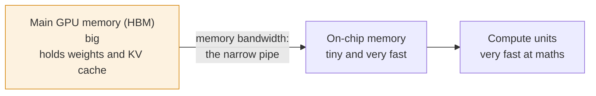
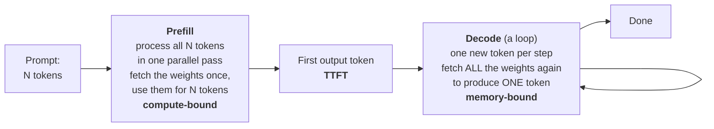
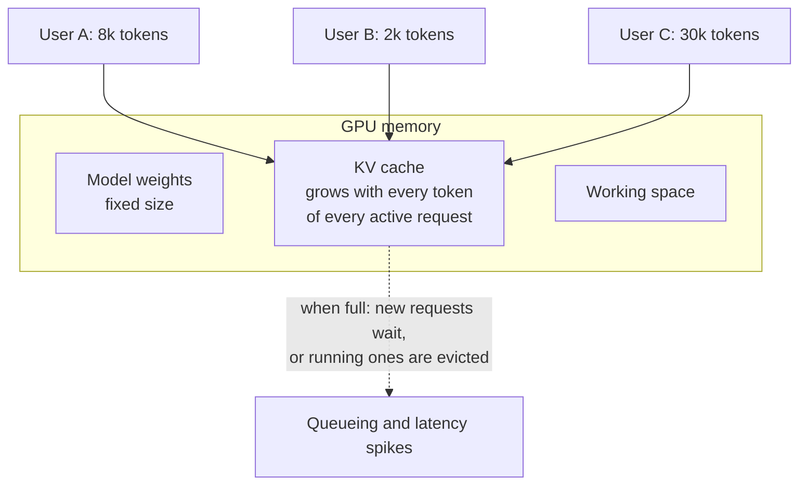
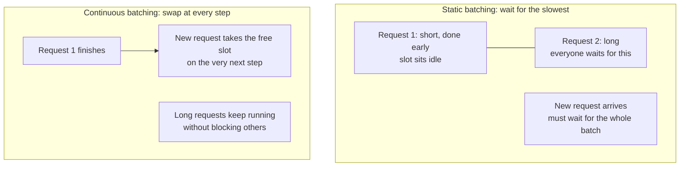
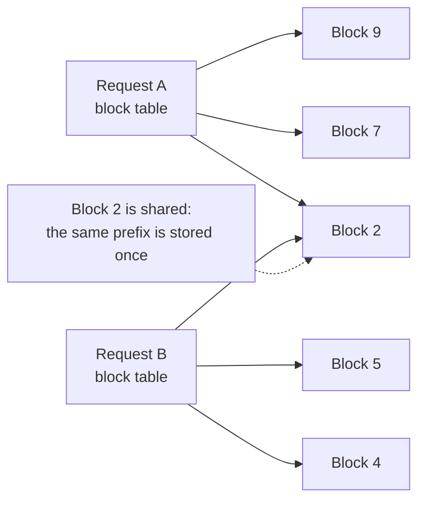
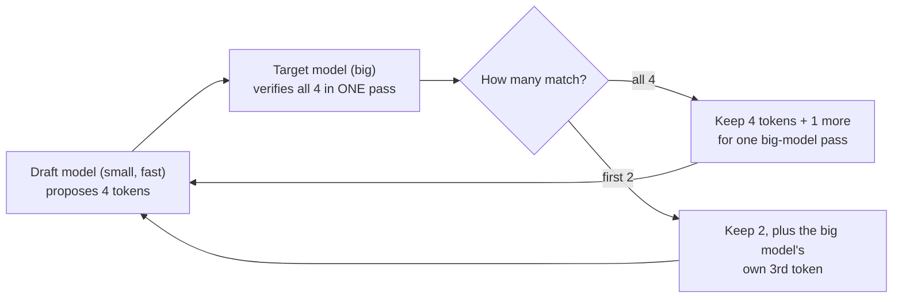
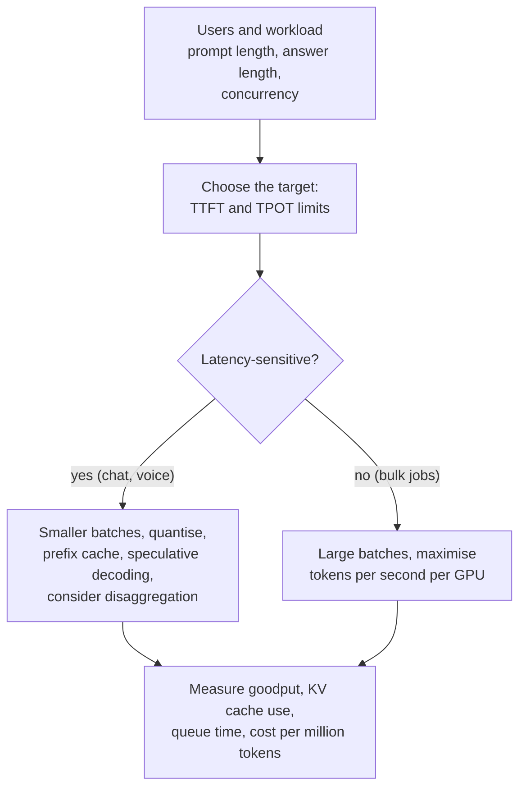

# Chapter 33: Inference Engineering

> **The numbers in the worked examples are illustrative.** I use round, made-up hardware and model sizes so you can follow the arithmetic and reuse the method. Real GPUs, models and serving software differ and change quickly, so check current specifications before you size anything for a client. [Chapter 34](../34-self-hosting-open-weight-models/README.md) turns this chapter's ideas into a practical sizing and self-hosting guide.

## 1. The concept, from scratch

This chapter opens the box on model serving. **Inference engineering** is the craft of serving a trained model quickly and cheaply: getting more answers per GPU, with a short wait for each user.

You don't need to write GPU kernels to be good at this. You need a clear mental model of **what limits speed**, so you can explain why a long prompt delays the first token, why a long answer is slow, why batching helps, why memory is the real constraint, and which tricks exist. If you use a hosted API, the provider does all of this for you, but the mechanics explain the prices and the behaviour you see. If you self-host, it is your job.

### The hardware in one picture

A GPU (graphics processing unit) is a chip built to do huge amounts of arithmetic in parallel. For LLMs there are two numbers that matter:

- **Compute:** how many calculations per second it can do.
- **Memory bandwidth:** how fast it can move data from its main memory (called **HBM**, high-bandwidth memory) to the compute units.

The model's **weights** (all the learned numbers) live in that main memory. To use a weight, the chip has to *fetch* it first.

Compute has grown faster than memory bandwidth over the years, so for many LLM workloads **the math units sit waiting for data**. A task is **compute-bound** when the math is the limit, and **memory-bound** when fetching data is the limit. Almost everything in this chapter is about which one you are, and what to do about it.

Think of a warehouse with very fast forklifts but a single narrow loading dock. It doesn't matter how fast the forklifts are if everything has to pass through the dock. The dock is the memory bandwidth.

### Prefill and decode: two very different jobs

Inference has two phases ([Chapter 6](../06-inference-and-generation/README.md)). Here is why they behave so differently.

- In **prefill**, the model processes the whole prompt at once. It fetches the weights once and uses them for many tokens, so there is lots of math per byte moved. The math units are busy. This phase determines **time to first token (TTFT)**.
- In **decode**, the model produces **one token per step**, and each step needs the previous token. Each step fetches *all the weights again* to produce a single token, so there is very little math per byte moved. The math units mostly wait. This phase determines **time per output token (TPOT)**, also called inter-token latency.

That is the real reason decoding is slow and why output tokens cost more than input tokens ([Chapter 31](../31-cost-latency-and-caching/README.md)). It isn't that decoding is "harder". It is that it uses the hardware badly.

**A worked example of the limit.** Imagine a 70-billion-parameter model stored at 16 bits (2 bytes) per weight. The weights take about 140 GB. Suppose the GPUs holding it can together stream 3 TB per second from memory (a made-up round number). Each decode step must read all 140 GB, so one step takes at least:

> 140 GB ÷ 3,000 GB/s ≈ **0.047 seconds** → at best about **21 tokens per second** for one user.

That's an upper bound set by memory, before any other overhead. No amount of extra compute fixes it. Only three things can: **read fewer bytes** (quantisation), **share each read across more requests** (batching), or **generate more tokens per read** (speculative decoding). Those are the main tricks, and we'll meet each one.

### The KV cache

Attention gives each token a query, a key and a value ([Chapter 4](../04-transformers-and-attention/README.md)), and each new token compares its query against the **keys** of all earlier tokens. The keys and values of earlier tokens never change as the answer grows. So instead of recomputing them at every step, the server **stores them**. That store is the **KV cache** (key-value cache).

Without it, generating token 500 would mean reprocessing all 499 earlier tokens. With it, each step only computes the new token's key and value, adds them to the cache, and reads the cache for attention. The KV cache turns an impractical process into a practical one, and it's why the model can keep state *within* one generation, even though it keeps nothing *between* requests.

The cost is memory. For each token, the cache stores a key and a value for every layer. The size per token is:

> 2 (key and value) × number of layers × number of KV heads × size of each head × bytes per number

**A worked example** for an imaginary model: 32 layers, 8 KV heads, head size 128, stored at 16 bits (2 bytes):

> 2 × 32 × 8 × 128 × 2 bytes = 131,072 bytes ≈ **128 KB per token**

- A request with an 8,000-token context holds about **1 GB** of KV cache.
- **100** such requests in flight hold about **100 GB**. That is more than the weights of a 70-billion-parameter model stored at 8 bits (about 70 GB).

So the KV cache, not the weights, often limits **how many users you can serve at once**. It grows with every token of context and with every concurrent user. That is the hard reason long contexts are expensive ([Chapter 7](../07-context-windows-and-context-engineering/README.md)) and why providers limit concurrency.

Two design choices reduce the KV cache:

- **Fewer KV heads.** Models using **multi-query attention** or **grouped-query attention** share key-value heads across several query heads, which shrinks the cache a lot while keeping quality close to full multi-head attention ([Ainslie et al., GQA](https://arxiv.org/abs/2305.13245)). In my example, 8 KV heads instead of 32 makes the cache four times smaller: 128 KB per token instead of 512 KB.
- **Quantising the cache** itself, storing it at lower precision. Some serving systems support this.

### Batching: sharing one read across many users

Go back to the decode limit. Each step reads all the weights to make *one* token. But if **32 users** are being served together, one read of the weights can produce **32 tokens**, one per user. In the worked example, a step still takes about 0.047 seconds, so each user still sees about 21 tokens per second, while the server now produces about **680 tokens per second** in total. Batching raises throughput enormously, almost for free, until the math units become busy or the KV cache fills up.

This is why serving is an economics problem: **a GPU serving one user is wasteful, and a GPU serving many is efficient.**

But *how* you batch matters.

- **Static batching** groups requests and runs the batch until the *longest* one finishes. Short requests finish early, but their slots sit idle, and new requests wait for the next batch. Wasteful, because LLM answers vary wildly in length.
- **Continuous batching** (also called iteration-level scheduling) rebuilds the batch at **every generation step**: finished requests leave at once and waiting ones join. The idea was introduced in the **Orca** system ([Yu et al., OSDI 2022](https://www.usenix.org/conference/osdi22/presentation/yu)) and is now standard in modern serving engines.

**The trade-off.** A bigger batch raises total throughput and lowers cost per token, but at some point each step gets slower (more KV cache to read, more math to do), so *each user's* tokens arrive slower, and memory for the KV cache runs out. Latency-sensitive products (a voice assistant) run smaller batches. Offline jobs (bulk summarisation) run very large ones. The metric that captures this is **goodput**: the throughput you achieve *while still meeting your latency targets* (for example, TTFT under one second and TPOT under a set limit).

### PagedAttention: not wasting KV cache memory

A naive server reserves one large, contiguous block of memory per request, big enough for the *maximum* possible length. Most requests use far less. The unused space is wasted, and the leftover gaps between blocks can't be reused (fragmentation). Since the KV cache limits how many requests fit, waste directly reduces throughput.

**PagedAttention**, the idea behind the open-source **vLLM** engine, borrows from how operating systems manage memory. It splits each request's KV cache into small fixed-size **blocks** that can sit anywhere in memory, and keeps a table that maps a request's tokens to its blocks, like a page table. Memory is allocated as the answer grows, and freed the moment a request ends.

Two benefits: **near-zero wasted memory**, so more requests fit in the batch, and **sharing**: requests with the same prefix, such as the same system prompt, can point to the same blocks. The vLLM paper reports 2 to 4 times higher throughput than earlier serving systems at similar latency, on its benchmarks ([Kwon et al., PagedAttention](https://arxiv.org/abs/2309.06180)). Treat that as the authors' result on their workloads, not a guarantee for yours.

### Prefix caching: the same idea, seen from the API

That sharing is the engine-level version of **prompt caching** ([Chapter 31](../31-cost-latency-and-caching/README.md)). If a new request starts with tokens whose KV entries are already computed, the server can **reuse them instead of recomputing** the prefill for that part. That's why a stable prefix cuts both cost and TTFT, and why a single changed token near the start of a prompt breaks the match for everything after it: the KV entries for later tokens depended on the earlier ones. Self-hosted engines such as vLLM offer automatic prefix caching, and OpenAI's documentation describes its prompt caching as possibly storing encrypted key-value tensors in GPU-local storage (as of Nov 2026), which is the same idea.

### When prefill and decode get in each other's way

Prefill is a big, compute-heavy job, and decode is a small, frequent, memory-bound one. If both run on the same GPU, a **long prompt arriving can stall everyone else's decoding**: other users' answers freeze for a moment, so TPOT spikes. Two answers exist:

- **Chunked prefill:** split a long prompt into chunks and interleave them with decode steps, so the long prompt doesn't monopolise the GPU ([Agrawal et al., SARATHI](https://arxiv.org/abs/2308.16369)).
- **Disaggregation:** run prefill and decode on **separate groups of GPUs**, each tuned for its job, and pass the KV cache between them ([Zhong et al., DistServe](https://arxiv.org/abs/2401.09670)). More complex, but it lets you meet TTFT and TPOT targets independently.

### Making attention itself faster

Standard attention reads and writes large intermediate results to the slow main memory. **FlashAttention** restructures the calculation to work in small tiles that fit in the fast on-chip memory, cutting the traffic to main memory. It computes the **exact** same result, only faster and with less memory, which is why it is used almost everywhere ([Dao et al., FlashAttention](https://arxiv.org/abs/2205.14135)). It's another example of the theme: **the bottleneck is moving data, not doing maths.**

### Speculative decoding: more than one token per read

Decode is limited by reading the weights once per token. **Speculative decoding** gets several tokens per read of the big model:

1. A **small, fast draft model** quickly guesses the next few tokens.
2. The **big target model** checks all of those guesses **in one parallel pass**, much as it processes a prompt.
3. It accepts the guesses that match what it would have produced, and the first wrong one is replaced by the big model's own token. Then repeat.

Because verification uses a sampling method that preserves the target model's output distribution, **the answers are statistically the same as without it**, just faster ([Leviathan et al.](https://arxiv.org/abs/2211.17192); [Chen et al.](https://arxiv.org/abs/2302.01318)). The speed-up depends on how often the draft is right, so it is large for predictable text such as code or boilerplate, and small when the draft is often wrong. Chen et al. report a 2 to 2.5 times decoding speed-up for a 70-billion-parameter model in their setup. As of Nov 2026, vLLM lists several speculative decoding variants among its features.

An analogy: a junior claims adjuster drafts the next few steps of a claim decision, and a senior adjuster reads them all at once and signs off on those that are right. Reading is quicker than writing, and any step the senior disagrees with gets corrected. The final decisions are the senior's.

### Quantisation: fewer bytes to read

**Quantisation** ([Chapter 10](../10-fine-tuning-and-distillation/README.md)) stores the same model's numbers at lower precision, commonly 8-bit or 4-bit instead of 16-bit. Now we can see why it matters for serving. Decode is memory-bound, so **half the bytes means roughly half the time per step**, and it also halves the memory needed to hold the weights. In the worked example:

| Precision | Weights | Memory-bound limit (one user) |
|---|---|---|
| 16-bit | about 140 GB | about 21 tokens per second |
| 8-bit | about 70 GB | about 43 tokens per second |
| 4-bit | about 35 GB | about 86 tokens per second |

These are upper bounds from the arithmetic, not predictions. Real gains are smaller because of other overheads and the KV cache.

The cost is some loss in quality, and it varies by method, model and task. Well-known weight-quantisation methods include [GPTQ](https://arxiv.org/abs/2210.17323) and [AWQ](https://arxiv.org/abs/2306.00978). [SmoothQuant](https://arxiv.org/abs/2211.10438) targets 8-bit for both weights and activations. Newer low-precision formats depend on hardware support. I won't quote a general "quality loss" figure, because there isn't a trustworthy one: **evaluate the quantised model on your own tasks** ([Chapter 26](../26-evaluation-fundamentals/README.md)) before you adopt it. Quantisation is also not the same as distillation (a different, smaller model) or fine-tuning.

### Parallelism: when one GPU is not enough

A big model may not fit on one GPU, or one GPU's bandwidth may be too slow. There are a few ways to spread the work:

| Technique | What it does | Main cost |
|---|---|---|
| **Tensor parallelism** | Splits each layer's big matrices across GPUs; they work on the same token together | Needs very fast links between GPUs, because they exchange data at every layer |
| **Pipeline parallelism** | Puts different layers on different GPUs, passing results along | "Bubbles" when a stage waits; adds latency |
| **Data parallelism (replicas)** | Runs several full copies of the model and spreads requests across them | More memory in total; the usual way to scale throughput |
| **Expert parallelism** | For mixture-of-experts models, puts different experts on different GPUs | Routing and communication overhead |

A note on **mixture-of-experts** models ([Chapter 8](../08-the-model-landscape/README.md)): only a few experts are active for each token, which saves compute, but **all** the experts' weights still have to be held in memory. So these models are cheaper to run per token than their total size suggests, but not smaller to store.

More GPUs does not mean proportionally more speed. Communication between them is often what limits you.

### Putting it together: the metrics that matter

The numbers to track on a serving system:

- **TTFT** and **TPOT** (and their p95/p99, not just averages).
- **Throughput** in tokens per second, per GPU and in total.
- **Goodput:** the share of throughput that meets your latency targets.
- **KV cache usage** and **queue length**. A full cache or long queue is the early warning.
- **Cost per million tokens**, which comes from GPU cost divided by tokens served.
- **GPU utilisation**, with care. A GPU can be "busy" while running inefficiently, such as small batches that are memory-bound. Utilisation alone does not tell you whether the work is efficient.

One more point worth knowing for the interview. Even at temperature 0, outputs are not guaranteed to be identical across runs ([Chapter 6](../06-inference-and-generation/README.md)). A commonly cited cause is that floating-point arithmetic can give slightly different results depending on how requests are batched together and which kernels run, so the same prompt can take a slightly different path. Don't rely on exact repeatability from a shared serving system.

## 2. Analogies across industries

- **Memory bandwidth is the loading dock (logistics).** A warehouse can have the fastest forklifts in the world, but if every pallet must pass through one narrow dock, the dock sets the pace. Decode is like that: the maths is quick, but every step has to bring all the weights through the dock.
- **Batching is a delivery truck with many stops (logistics).** A truck driving to one address per trip is wasteful. One trip serving thirty addresses shares the cost of the journey. **Continuous batching** is a truck that lets parcels be dropped off and new ones picked up at every stop, instead of waiting for the last parcel on the route.
- **The KV cache is a patient's bedside chart (healthcare).** Each patient's chart grows through the stay, and the ward's capacity is limited less by the number of nurses than by how many charts you can keep at the bedside. **PagedAttention** is like filing chart pages in any free slot, with an index, instead of reserving a whole shelf per patient "just in case". Waste goes down and more patients fit.
- **Quantisation is a lower bit-rate voice codec (telecom).** A phone call compressed to a lower bit rate uses less bandwidth and is cheaper to carry, with a small loss of fidelity that is usually acceptable and sometimes not. You'd test it on real calls before rolling it out.
- **Speculative decoding is junior-then-senior review (insurance).** The junior drafts, the senior checks in one go and corrects where needed. The final decisions are always the senior's, so quality is protected, and the time saved depends on how often the junior is right.

## 3. How it's used in industry

- **Telecom customer-service chat (self-hosted).** A carrier serves an open-weight model to its support agents. It uses continuous batching and streaming to keep the time per token steady at peak hours, quantises to 8-bit after checking quality on its own test set, and caches the long shared policy prefix so each new chat starts faster.
- **Insurance bulk document processing.** An insurer processes a backlog of claims documents overnight. Nobody is waiting, so it runs very large batches to maximise tokens per second per GPU and minimise cost per document, and tolerates slower individual responses.
- **Healthcare voice and dictation assistants.** A hospital's voice assistant needs a very short TTFT and steady TPOT, so it uses a smaller model, a small batch size and a fast serving setup, and keeps long document processing on a separate pool so the two never compete.
- **E-commerce RAG assistant.** A retailer's assistant has a long, stable prefix of policies and tool definitions, so prefix caching removes most of the prefill work. It then measures goodput against a TTFT target, not just raw GPU utilisation.

## 4. Common misconceptions

- **"Decoding is slow because it needs a lot of compute."** It's slow because it is **memory-bound**: it reads all the weights to produce one token. Compute sits idle.
- **"A bigger batch is always better."** It raises total throughput, but each user can get slower, and the KV cache can run out. The goal is **goodput**: the best throughput that still meets your latency targets.
- **"The KV cache is just an optimisation."** It's what makes generation feasible, and it is often the biggest memory consumer after the weights. It sets how many users you can serve at once.
- **"Long context is free once the model supports it."** Long contexts cost prefill time and a lot of KV cache memory per request ([Chapter 7](../07-context-windows-and-context-engineering/README.md)).
- **"Quantisation just makes it smaller."** It also speeds up memory-bound decode, but it can lower quality in ways that depend on the task. Evaluate it.
- **"Speculative decoding approximates the answer."** Done correctly, it is designed to preserve the target model's output distribution. It trades extra compute for speed, not quality.
- **"High GPU utilisation means we're efficient."** A GPU can be busy doing small, memory-bound work. Look at throughput, goodput and queue time.
- **"Twice the GPUs means twice the speed."** Communication between GPUs and the shape of the workload usually give you less.

## 5. Interview questions

### 1. What's the difference between prefill and decode?

Prefill is the phase where the model reads the whole prompt in one parallel pass and produces the first token. Decode is the loop that comes after, where it generates one token at a time, each depending on the previous. They behave very differently on a GPU. Prefill fetches the weights once and uses them across all the prompt tokens, so it does a lot of maths per byte and is compute-bound. Decode fetches all the weights again for each single token, so it does very little maths per byte and is memory-bound. In practice, prefill drives time to first token, and it grows with prompt length. Decode drives the time per output token, and it grows with the length of the answer.

### 2. Why is LLM decoding memory-bound, and what can you do about it?

Each decode step produces one token but has to read every weight in the model from GPU memory to do it. The GPU can do the maths far faster than it can fetch the weights, so the compute units wait, and speed is set by memory bandwidth. For example, a model with 140 GB of weights on hardware that streams 3 TB per second can't do a step in less than about 47 milliseconds, however much compute it has. There are three levers. I can read fewer bytes by quantising the weights. I can share each read across more requests by batching. And I can get more than one token per read by using speculative decoding. They stack, and which I choose depends on whether the product is latency-sensitive or throughput-driven.

### 3. What is the KV cache, and why does it matter?

During attention, every new token looks at the keys and values of all earlier tokens, and those never change as the answer grows. So the server stores them instead of recomputing them, and that store is the KV cache. It makes generation fast enough to be practical, because each step only computes the new token. The cost is memory: it grows with every token of context and for every concurrent request. In a typical setup the weights are a fixed cost, but the KV cache is what limits how many users I can serve at once and how long their contexts can be. When it fills up, requests queue or get evicted, and latency spikes.

### 4. How would you estimate the KV cache memory for a request?

Per token, it's two for key and value, times the number of layers, times the number of key-value heads, times the head size, times the bytes per number. For an imaginary model with 32 layers, 8 KV heads, head size 128 and 16-bit values, that's about 128 kilobytes per token. An 8,000-token request therefore holds around one gigabyte, and a hundred concurrent requests hold about a hundred, which can be more than the weights themselves. The same model with 32 KV heads instead of 8 would need four times as much, which is why grouped-query attention matters. I'd use that arithmetic to size memory and to decide limits on context length and concurrency.

### 5. What does batching buy you, and what does it cost?

Because decode is memory-bound, one read of the weights can serve many requests at once, so batching multiplies throughput and cuts the cost per token with very little penalty, until the maths or the KV cache becomes the limit. With the earlier numbers, batching thirty-two users gives about thirty-two times the tokens per second in total while each user still sees roughly the same speed. The cost comes at the extremes. Larger batches mean each step takes longer, so individual users slow down, the KV cache fills up, and new requests wait. So for chat and voice I keep batches smaller to protect latency, and for offline jobs I make them large. I judge it by goodput, the throughput that still meets my latency targets.

### 6. What is continuous batching, and why is it better than static batching?

In static batching, I group requests and run the batch until the longest one finishes. Since answer lengths vary a lot, short requests finish early and their slots sit idle, and new requests have to wait for the next batch. Continuous batching, also called iteration-level scheduling, rebuilds the batch at every generation step. A finished request leaves immediately and a waiting one takes its place on the next step. That keeps the GPU full, raises throughput, and cuts queueing time for new arrivals. It came from the Orca research system and is standard in modern serving engines such as vLLM.

### 7. What is PagedAttention, and why does it improve throughput?

It's a way of managing the KV cache. A naive server reserves one big contiguous block per request, sized for the maximum length, so most of it goes unused and the gaps between blocks are wasted. PagedAttention borrows from virtual memory in operating systems: it splits the cache into small fixed-size blocks that can be anywhere in memory, tracks them with a block table per request, allocates them as the answer grows and frees them when the request ends. That leaves almost no wasted memory, so more requests fit in the batch, which raises throughput. Blocks can also be shared between requests with the same prefix, which is the basis of prefix caching. The vLLM authors reported two to four times better throughput than earlier systems on their benchmarks.

### 8. What is speculative decoding, and does it change the output?

It's a way to get more than one token from each read of the large model. A small, fast draft model proposes a few tokens, then the large model checks them all in one parallel pass, accepts the ones that agree with what it would have produced, and corrects the first one that doesn't. Because verification is done with a sampling method that preserves the large model's output distribution, the answers are statistically the same as without it, so it's a speed-up and not a quality trade. How much it helps depends on how often the draft is right, so it works well on predictable text such as code, and less well on creative text. It also costs a bit more compute and memory for the draft model.

### 9. How does quantisation speed up inference, and what are the trade-offs?

Decode is limited by how many bytes I read per step, so if I store the weights at 8 bits instead of 16, I read half as many bytes, which roughly halves the time per step in the best case and halves the memory the weights need. At 4 bits it's a quarter. That can let a model fit on fewer GPUs, which cuts cost. The trade-off is potential quality loss, which depends on the method, the model and the task, and some hardware supports some formats better than others. There's no single trustworthy number for the loss, so I'd quantise, run my own evaluation set on the result, check the specific tasks that matter, and compare cost per useful answer. It's different from distillation, which creates a different smaller model, and from fine-tuning.

### 10. How would you evaluate and tune a serving setup for a chat product?

I'd start from the user experience and set targets: for example, a first token within a second and a steady, comfortable streaming speed at the 95th percentile. Then I'd measure TTFT and time per output token, throughput per GPU, KV cache usage, queue length and cost per million tokens under a realistic mix of prompt and answer lengths, and at realistic concurrency. The metric I optimise is goodput, not raw throughput or GPU utilisation. If TTFT is the problem I'd look at prompt length, prefix caching and whether long prompts are stalling others, in which case chunked prefill or separate pools help. If time per token is the problem, I'd look at batch size, quantisation and speculative decoding. Then I'd re-measure under load, because the numbers at low traffic are misleading.

## 6. Scenario exercise

A logistics company self-hosts an open-weight model on a small group of GPUs for an internal assistant that helps dispatchers and customer-service staff. In the morning it works well. In the afternoon, when staff start pasting in very long shipment manifests and customs documents, other users report that answers "freeze" for a few seconds in the middle of streaming, and the first words take much longer to appear. The ops team says: "The GPUs show about 90% utilisation all day, so we're using them fully. Throughput is fine on average. We're thinking of buying more GPUs."

**Your task:** What do you think is happening, what do you check, and what would you recommend before buying hardware? Answer from memory, then compare.

Model answer

I'd push back gently on two things in that statement: that high utilisation means the GPUs are used well, and that the average throughput is the right number to look at. Utilisation only tells me the GPU is busy. It doesn't tell me whether it's busy doing efficient work. And the complaints are about tail latency, first-token time and mid-stream freezes, which an average hides.

My hypothesis is prefill interference. The long manifests create very large prefill jobs, and on a setup that mixes prefill and decode on the same GPUs, a big prefill can take over the GPU for a moment, so everyone else's decode steps stall. That fits the symptoms: streams freezing in the middle, and a longer wait for first tokens because new requests queue behind the big job. There may also be memory pressure, because very long contexts take up a lot of KV cache, which reduces how many requests can run together and can force queueing or evictions at exactly those times.

To check, I'd look at the metrics split by time and by request size: p95 and p99 time to first token and time per output token against the arrival of long prompts, queue length, KV cache usage and any preemption or eviction counts, and the batch size over time. If the freezes line up with long-prompt arrivals and the KV cache is close to full, the hypothesis holds.

Before buying hardware, I'd try cheaper fixes. Turn on chunked prefill, if the serving engine supports it, so long prompts are interleaved with decode steps instead of blocking them. Put a limit on prompt length or concurrency for very large inputs, or route long-document jobs to a separate pool of GPUs, or into a queue with its own service level, so interactive users aren't affected. Make sure prefix caching is on, as the system prompt and common instructions should be cached. Check whether a quantised model or a quantised KV cache would free memory for a larger batch, after testing quality on real tasks. And look at the product itself: for a very long manifest, the right answer may be to extract and summarise the relevant fields first, not to push the entire document into the prompt every turn, which also cuts cost.

If after that the interactive pool is still short of capacity, then more GPUs, or disaggregated prefill and decode, become reasonable, and I'd have data to size them. I'd also change the dashboards to track goodput against TTFT and TPOT targets instead of utilisation. I'd tell the client that I can't be sure of the cause until I see the per-request metrics, but that this pattern is a classic one and the first fixes are configuration, not capital spend.

## 7. Key takeaways

- **Prefill is compute-bound and sets TTFT; decode is memory-bound and sets time per token.** Decode reads all the weights to make one token, so memory bandwidth, not compute, is its limit.
- **The KV cache stores keys and values so each step only computes the new token,** but it grows with context and concurrency and often limits how many users you can serve.
- **Batching shares each weight read across many users;** continuous batching and PagedAttention keep the GPU full and memory unwasted. Judge setups by goodput against latency targets, not by utilisation.
- **Three ways to beat the memory limit:** read fewer bytes (quantisation), share reads (batching), or get several tokens per read (speculative decoding, which preserves the output distribution).
- **Prefix caching is the same idea as API prompt caching,** which is why stable prompt prefixes cut both cost and time to first token.

## 8. Further reading

- Kwon et al., [Efficient Memory Management for Large Language Model Serving with PagedAttention](https://arxiv.org/abs/2309.06180): the vLLM paper on KV cache memory management and sharing.
- Yu et al., [Orca: A Distributed Serving System for Transformer-Based Generative Models](https://www.usenix.org/conference/osdi22/presentation/yu): the origin of iteration-level (continuous) batching.
- Leviathan et al., [Fast Inference from Transformers via Speculative Decoding](https://arxiv.org/abs/2211.17192): the speculative decoding algorithm and why it keeps the output distribution.
- Dao et al., [FlashAttention: Fast and Memory-Efficient Exact Attention with IO-Awareness](https://arxiv.org/abs/2205.14135): why moving data, not maths, is the bottleneck, and how to avoid it.
- Zhong et al., [DistServe: Disaggregating Prefill and Decoding for Goodput-optimized LLM Serving](https://arxiv.org/abs/2401.09670): why separating prefill from decode helps meet both TTFT and TPOT targets.
