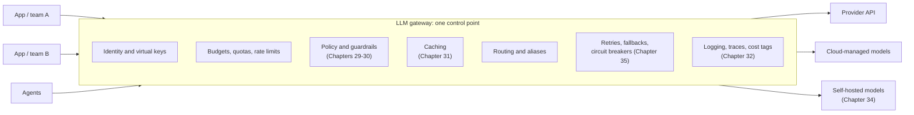
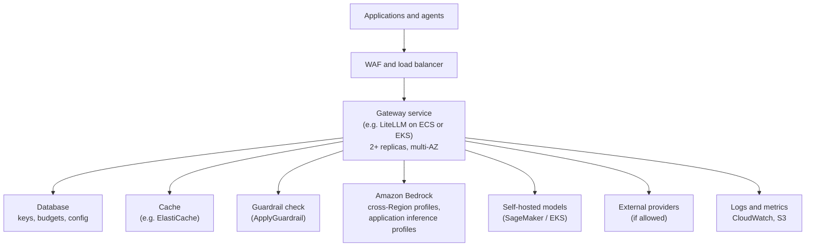
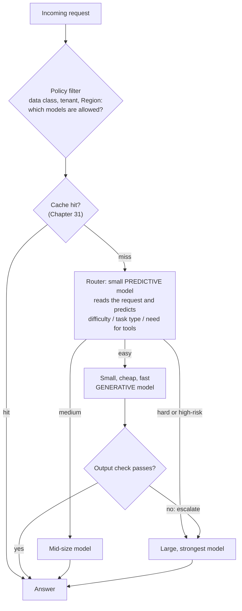

# Chapter 36: LLM Gateways and Routing

> **Prices, percentages and product features here are illustrative or vendor-reported.** The cost examples use made-up round numbers. Gateway products and cloud routing features change quickly, so product facts are marked "(as of Nov 2026)" and link to the docs. Savings figures from papers and vendors come from their own benchmarks and are not guarantees for your traffic.

## 1. The concept, from scratch

Imagine a company a year into its AI journey. Twenty teams have built assistants. They use five different model providers. API keys sit in code repositories and spreadsheets. Each team wrote its own retry loop, its own logging (or none), and its own guess at what is safe to send to a model. Finance asks "who spent this?" and nobody can answer. Security asks "which data went to which provider?" and nobody can answer that either.

The standard fix is an **LLM gateway**: one controlled front door that all model traffic goes through. A second idea, **routing**, then lets that front door choose the right model for each request. This chapter covers both.

### What a gateway is

An **LLM gateway** (also called an AI gateway or model gateway) is a service that sits between your applications and the model providers. To the application it looks like a single model API. Behind it, the gateway authenticates the caller, applies limits and policy, picks a model, calls the provider, and records what happened.

It's the same idea as an API gateway in conventional architecture, specialised for how LLM traffic behaves: it counts **tokens**, not just requests, it handles long **streaming** responses, and it knows about **models**.

### What a gateway centralises

| Concern | What the gateway does | What it does for you |
|---|---|---|
| **Identity and keys** | Teams get **virtual keys** issued by the gateway. The real provider keys live only in the gateway | No provider keys in code. You can revoke one team's access without touching others |
| **Budgets and limits** | Spend caps and rate limits per team, key, tenant or user | Stops one team's runaway agent from consuming everyone's quota or the month's budget ([Chapter 35](../35-reliability-scaling-and-streaming/README.md)) |
| **Model aliases and routing** | Apps ask for `support-chat` and the gateway decides which model serves it | Swap or upgrade the model without changing application code |
| **Reliability** | Retries, fallbacks, load-balancing across keys, deployments and Regions, circuit breakers | Done once, done well, instead of twenty slightly different ways |
| **Caching** | Provider-prefix-friendly prompts, exact and guarded semantic caches | One place to apply the safety rules from [Chapter 31](../31-cost-latency-and-caching/README.md) |
| **Policy and guardrails** | Input and output checks, PII redaction, and **which models may see which class of data** | A central enforcement point for [Chapter 29](../29-guardrails-and-ai-security/README.md) and [Chapter 30](../30-privacy-governance-and-compliance/README.md) |
| **Observability and cost attribution** | Every call logged with team, tenant, model, tokens, cost and latency | The answer to "who spent this?" ([Chapter 32](../32-observability-and-llmops/README.md)) |
| **A uniform API** | One OpenAI-compatible interface to many providers | Teams write to one API. Switching providers is configuration |

By Nov 2026, gateways are also extending to **tools and agents**: some offer an MCP gateway for governed access to tools and an agent gateway for agent-to-agent traffic ([Chapter 20](../20-agent-protocols-mcp-and-a2a/README.md); for example [LiteLLM](https://docs.litellm.ai/docs/simple_proxy)). The principle is the same: one controlled front door.

### The costs of a gateway

A gateway isn't free, and interviewers like to hear the downsides:

- **Single point of failure.** If it's down, every AI feature is down. It must be highly available, with multiple replicas across zones ([Chapter 35](../35-reliability-scaling-and-streaming/README.md)).
- **Added latency.** Small, but real, and streaming must pass through without buffering.
- **A leaky abstraction.** "One API for all models" hides real differences: tool-calling formats, structured-output support, prompt-caching controls, thinking or reasoning settings, citation features. A lowest-common-denominator gateway can block you from using what makes a model good.
- **A crown-jewel target.** It holds the real provider keys and sees every prompt and answer. Treat it as sensitive infrastructure: strict access, encryption, careful logging ([Chapter 30](../30-privacy-governance-and-compliance/README.md)).
- **Organisational drag.** If the gateway team becomes a bottleneck for every change, teams will route around it.

So the honest advice is: **a single team with a single provider doesn't need one yet.** A thin shared library is enough. Add a gateway when you have several teams, several providers, or a real governance need.

### Build, buy or assemble?

As of Nov 2026, the landscape falls into a few groups. These are examples, not recommendations, and each changes fast, so evaluate on your own needs.

| Group | Examples | Notes |
|---|---|---|
| **Open-source, self-hosted proxies** | LiteLLM | One OpenAI-compatible endpoint for 100+ providers, with virtual keys, budgets, fallbacks and load balancing, plus MCP and agent gateways, per its docs. You run it, so prompts stay in your environment |
| **Hosted or edge gateways** | Cloudflare AI Gateway, OpenRouter, Portkey | Quick to start. Caching, rate limiting and spend limits are listed in Cloudflare's docs. Prompts pass through a third party, which may be a problem for sensitive data |
| **API-management vendors adding AI features** | Kong, Azure API Management | A good fit if you already run that platform ([Kong AI Gateway](https://docs.konghq.com/gateway/latest/ai-gateway/), [Azure AI gateway](https://learn.microsoft.com/en-us/azure/api-management/genai-gateway-capabilities)) |
| **Cloud-native building blocks** | Amazon Bedrock features (below) | Often enough for a team already committed to one cloud |
| **Build your own** | A thin service on your platform | Full control, but you'll be rebuilding retries, budgets and streaming correctly |

Questions to decide with: How many providers and teams? Do prompts contain data that can't pass through a third-party SaaS gateway? Do you need self-hosting? Does it support streaming, tool calls and structured output properly? What's the latency overhead? How good are budgets and cost attribution? Who will operate it?

### The AWS angle

On AWS you can get much of a gateway from **Amazon Bedrock itself**, and add a proxy when you outgrow it:

- **A consistent API.** Bedrock's Converse API gives a single interface across many Bedrock models.
- **Access control.** IAM policies decide which roles can call which models, so "this team may only use these models" is enforceable without a separate product.
- **Cost attribution.** **Application inference profiles** let you create a profile per application, team or tenant and attach **cost allocation tags**, which flow into AWS Cost Explorer and Cost and Usage Reports. The tags must be activated in billing and aren't retroactive ([AWS: application inference profiles](https://docs.aws.amazon.com/bedrock/latest/userguide/cost-mgmt-application-inference-profiles.html)).
- **Capacity and resilience.** Cross-Region inference profiles spread requests across Regions ([Chapter 35](../35-reliability-scaling-and-streaming/README.md)).
- **Policy as a service.** The **ApplyGuardrail** API lets you evaluate any text against a configured Bedrock guardrail *without calling a model*, so a gateway can use it on traffic to *any* provider ([AWS: ApplyGuardrail](https://docs.aws.amazon.com/bedrock/latest/userguide/guardrails-use-independent-api.html)).
- **Built-in routing.** **Intelligent Prompt Routing** (below).
- **Logging.** Model invocation logging and CloudWatch ([Chapter 32](../32-observability-and-llmops/README.md)).

When you need more (several non-Bedrock providers, per-team virtual keys, budgets enforced centrally), AWS publishes a reference implementation, the **Guidance for Multi-Provider Generative AI Gateway on AWS**, which deploys the open-source LiteLLM proxy on Amazon ECS or EKS behind a load balancer and web application firewall ([AWS: multi-provider gateway guidance](https://docs.aws.amazon.com/solutions/multi-provider-generative-ai-gateway-on-aws/)). AWS describes it as a starting point and advises security testing before production.

### Routing: picking the right model for each request

A **router** decides which model (or provider, or deployment) handles a request. "Always use the biggest model" is expensive and slow, and "always use the smallest" fails on hard questions. Routing is how you get **the cheapest model that is good enough, per request**. It comes in several flavours:

| Kind | Question it answers | Example |
|---|---|---|
| **Quality and cost routing** | Which model is good enough for this request at the lowest cost? | Easy FAQ to a small model, complex dispute to a large one |
| **Policy routing** | Which models are *allowed* for this data? | Requests containing patient data only to in-region, approved models ([Chapter 30](../30-privacy-governance-and-compliance/README.md)) |
| **Reliability routing** | Which model is *up*? | Fallback when the primary is throttled ([Chapter 35](../35-reliability-scaling-and-streaming/README.md)) |
| **Load balancing** | Which deployment, key or Region has spare capacity? | Spread across accounts or Regions |
| **Latency routing** | Which is fastest right now? | Voice requests to the lowest-latency model |

Order matters: **policy first** (it's a hard constraint), then reliability and capacity, then quality and cost among what remains.

### Routing strategies

1. **Static rules.** Route by endpoint, feature, tenant, language or data class: "the order-status endpoint always uses the small model". Simple, predictable, easy to audit. Start here.
2. **A classifier router.** A small, fast **predictive** model reads the request and predicts which model should handle it (task type, difficulty, whether tools are needed). Then the chosen **generative** model answers. This is the predictive-plus-generative pattern you'll meet everywhere in production AI: a cheap classifier decides, an expensive generator acts.
3. **A learned router.** Train the router on data about which model succeeds on which prompts. Research examples include RouteLLM, which trains routers on human preference data to choose between a strong and weak model, and reports cost reductions of over two times in some cases without hurting quality on its benchmarks ([Ong et al., RouteLLM](https://arxiv.org/abs/2406.18665)). Hybrid LLM routes by predicted query difficulty with an adjustable quality level, and reports up to 40% fewer calls to the large model with no drop in quality on its tests ([Ding et al.](https://arxiv.org/abs/2404.14618)). Treat such figures as results on the authors' data and models.
4. **A cascade.** Don't predict. **Try the cheap model first,** check the answer (with a verifier, confidence signal or rule), and **escalate** to a stronger model if it looks unreliable. FrugalGPT studied this idea and reported matching the best single model at much lower cost on its benchmarks ([Chen et al., FrugalGPT](https://arxiv.org/abs/2305.05176)), and AutoMix combines a small model's self-check with a router to decide when to escalate ([Aggarwal et al.](https://arxiv.org/abs/2310.12963)).
5. **Provider-managed routers.** Amazon Bedrock **Intelligent Prompt Routing** provides one endpoint that routes between models in the **same family** by predicting the response quality of each, with default routers and configurable ones ([AWS: prompt routing](https://docs.aws.amazon.com/bedrock/latest/userguide/prompt-routing.html)). AWS has published cost-saving figures from its own tests, so validate on your own traffic. Cloudflare's gateway also documents routing features, such as dynamic routes and an auto router in beta.

The diagram combines a router with a cascade, which is common: the router sends most traffic where it should go, and a cheap check catches mistakes.

### Router versus cascade

| | **Router (predict first)** | **Cascade (try, check, escalate)** |
|---|---|---|
| **Calls per request** | One model call (plus a small router call) | One, or two when escalating |
| **Latency** | Lowest | Higher for escalated requests (two calls in sequence) |
| **Needs** | A good prediction of difficulty | A good verifier or confidence signal |
| **Failure mode** | Misroutes a hard request to a weak model, and nobody notices | Verifier passes a bad answer, or escalates too often |
| **Cost shape** | Router cost + one model | Cheap model + verifier + (escalation fraction × large model) |

**A worked example** with made-up prices. The large model costs $0.020 per request and the small model $0.004. With **no routing** you pay $0.020 each.

- **Router:** a tiny classifier costs $0.0002 per request and sends **70%** of traffic to the small model. Cost = 0.7 × 0.004 + 0.3 × 0.020 + 0.0002 = $0.0028 + $0.0060 + $0.0002 = **$0.009**, about **55% lower**.
- **Cascade:** every request goes to the small model first ($0.004), a verifier costs $0.001, and **30%** escalate to the large one. Cost = 0.004 + 0.001 + 0.3 × 0.020 = **$0.011**, about **45% lower**, but escalated requests wait for two calls.

Those savings hold **only if quality holds.** If the router sends hard requests to the small model, you pay in wrong answers, retries and human fixes, which cost more than the tokens you saved ([Chapter 31](../31-cost-latency-and-caching/README.md)). Everything depends on how well the routing decision is made.

### How to build and trust a router

**Build it from your evaluation data,** not from a leaderboard:

1. Take a representative set of real requests ([Chapter 26](../26-evaluation-fundamentals/README.md)).
2. Run each candidate model on them and **grade the answers** (human labels or a calibrated judge).
3. Label each request by whether the small model was **good enough**.
4. Train or tune a router to predict that from cheap features: request length, task type, language, whether tools are needed, user tier, topic, embedding of the text, past failures.
5. Pick a **threshold** that trades cost against quality. The strictest setting sends everything to the large model, and the loosest sends everything to the small one.

**Validate it before and after launch:**

- **Offline:** compare quality against the "always large model" baseline on held-out data, **broken down by segment** (language, topic, customer type). A good average can hide a bad segment.
- **Check the dangerous cases explicitly.** Safety-critical, regulated or high-value requests should have conservative rules that always go to the strongest model, and the router should be tested against them.
- **Shadow and A/B** it on live traffic ([Chapter 32](../32-observability-and-llmops/README.md)).
- **Monitor per route.** Track quality, cost, latency, escalation and refusal rates for each route separately, and log which route was chosen and why on every trace.
- **Measure regret.** Periodically send a small sample of requests that the router sent to the cheap model to the large model as well, and compare. This tells you how often you're losing quality, and keeps the router honest as traffic drifts.
- **Retrain or retune** when traffic, models or prices change. A router is a model, and it drifts like any other.

### Routing pitfalls

- **Prompts don't port.** A prompt tuned for one model can behave differently on another, and structured-output, tool-calling and formatting behaviour differ ([Chapter 9](../09-prompt-engineering/README.md)). Each model on a route needs its own prompt version and tests.
- **Consistency within a conversation.** Switching models mid-chat can change tone and style. Consider **sticky routing** so one conversation stays on one model unless it must escalate.
- **A fallback or alias is a release.** Changing what an alias points to changes behaviour, so version the gateway configuration like any other release artefact and roll it out gradually ([Chapter 32](../32-observability-and-llmops/README.md)).
- **Router overhead.** An LLM used as the router adds cost and latency, so prefer a small classifier unless you need the flexibility.
- **Hidden data flows.** A route to a different provider or Region may break your residency or contract rules, so policy routing must come first.

### Using the gateway to roll out a new model

Because applications call an alias, the gateway is the natural place to change models safely ([Chapter 32](../32-observability-and-llmops/README.md)):

1. Run the evaluation set on the candidate model and prompt.
2. Configure the alias to send **shadow** traffic to the candidate (responses compared, not shown).
3. Move to a **canary**, a small share of real traffic, watching quality, cost, latency and refusal metrics.
4. Ramp up in steps, with automatic rollback to the previous mapping if a guardrail metric trips.
5. Keep the previous model available until the deprecation of the old one is safely past.

## 2. Analogies across industries

- **A gateway is central procurement in a government department (government).** Every unit buys through one office that holds the approved suppliers, issues purchase orders against budgets, enforces policy, and keeps the audit trail. Units don't hold supplier credit cards. Drawbacks are the same too: if procurement is slow, units find ways around it.
- **A router is a hospital triage nurse (healthcare).** The nurse briefly assesses each arrival and sends minor cases to a fast clinic, standard cases to a general doctor, and critical cases straight to the specialist team. The nurse is a cheap, quick *predictor*, and the specialists are the expensive *generators*. A bad triage decision is costly, so there are conservative rules for anything that looks serious.
- **A cascade is fast-track versus adjuster in insurance (insurance).** Simple, low-value claims go through straight-through processing. If a check flags something unusual, the claim is escalated to a human adjuster. You pay for the expensive expert only when the cheap path isn't confident.
- **Policy routing is a customs lane (travel).** Some goods and people can only go through certain channels, whatever is fastest. Policy decides the allowed lanes first, and speed and cost are optimised within them.

## 3. How it's used in industry

- **Telecom platform team.** A carrier's central AI platform gives each product team a virtual key with a monthly budget and an allowlist of models. Finance gets a per-team cost report, and security can revoke a key in seconds. Teams call aliases, so the platform team can upgrade models without breaking applications.
- **E-commerce support.** A retailer routes order-status and FAQ questions to a small model, and complex returns disputes and complaints to a large one, using a small classifier. A cheap check escalates anything that looks uncertain, and tracking regret shows the small route is failing on one language, which gets fixed.
- **Healthcare group.** A hospital group's gateway applies policy routing: any request flagged as containing patient data can only go to models deployed in the approved Region, while non-clinical requests may use a cheaper external provider. Every call is logged with the route and reason.
- **Insurance claims.** An insurer sends routine claim summaries to a small model and flags complex or high-value claims for a larger model plus human review, with all calls passing through the gateway's guardrails and audit log ([Chapter 30](../30-privacy-governance-and-compliance/README.md)).

## 4. Common misconceptions

- **"A gateway is just a load balancer."** A load balancer routes connections. A gateway understands tokens, models, budgets, policies and provider differences.
- **"An OpenAI-compatible API means models are interchangeable."** The *interface* is the same. The *behaviour*, prompts, tool-calling and features are not.
- **"Routing always saves money."** It saves money only when the router is accurate. Misrouted hard requests, router overhead and the cost of evaluating several models can erase the savings.
- **"The router should itself be a big LLM."** That adds latency and cost. A small classifier or simple rules often work as well.
- **"A router and a cascade are the same thing."** A router predicts before calling. A cascade calls, checks, and escalates.
- **"The gateway handles guardrails, so the app doesn't need to."** Use defence in depth. The gateway is one layer ([Chapter 29](../29-guardrails-and-ai-security/README.md)).
- **"We should start with a gateway and routing."** Start with visibility and control (keys, budgets, logs). Add routing once you have evaluation data to justify it.
- **"The leaderboard tells us which model to route to."** Your tasks and data do.

## 5. Interview questions

### 1. What is an LLM gateway, and why would you use one?

It's a service that sits between my applications and the model providers, so that all model traffic goes through one controlled front door. To the application it looks like a single model API. Behind it, the gateway handles authentication with virtual keys, budgets and rate limits, routing and fallbacks, caching, guardrails, and logging with cost attribution. I'd use one when several teams or several providers are involved, because otherwise every team re-implements retries and logging, keys end up scattered in code, nobody can say who spent what, and security can't say which data went where. With a gateway I get one place to enforce policy and one place to see everything.

### 2. What are the downsides or risks of a gateway?

It becomes a single point of failure, so it needs multiple replicas across zones and good monitoring. It adds some latency, and it must stream responses without buffering. It's also a leaky abstraction: a uniform API hides real differences in tool calling, structured output, caching controls and reasoning settings, so if I only expose the lowest common denominator, teams can't use what makes a given model good. It holds the real provider keys and sees every prompt, so it's a high-value security target and needs careful logging. And organisationally, if it becomes a bottleneck, teams work around it. So I wouldn't introduce one for a single team on a single provider.

### 3. How would you standardise LLM access across twenty teams?

I'd start by finding out what exists: inventory the teams, providers, keys and spending, and fix the urgent problems like keys in repositories. Then I'd introduce a gateway, first in a pass-through mode so teams just change a base URL, with no behaviour change, so adoption is easy. Once traffic flows through it I'd add the controls in order of value: virtual keys per team, budgets and rate limits, logging with cost tags, an allowlist of models by data class, and central retries and fallbacks. Teams would call aliases, not model names. Later I'd add caching, guardrails and routing, once I have the data to justify them. I'd run it as an internal product with a clear service level, high availability and good documentation, so teams want to use it rather than work around it.

### 4. Would you build or buy a gateway, and what's available on AWS?

I'd start from requirements: how many providers and teams, whether prompts may pass through a third party, and who will operate it. For a team that's all in on AWS, Bedrock already gives a lot: a consistent API, IAM to control who can call which models, application inference profiles with cost allocation tags for attribution, cross-Region profiles for capacity, the ApplyGuardrail API for policy checks on any text, and Intelligent Prompt Routing. If I need several non-Bedrock providers, per-team virtual keys and budgets, AWS publishes a reference implementation that runs the open-source LiteLLM proxy on ECS or EKS behind a load balancer and WAF. Hosted gateways are quick to start, but sensitive prompts would pass through a third party. I'd avoid building from scratch unless I have a specific need, because retries, budgets and streaming are easy to get subtly wrong.

### 5. What is model routing, and why do it?

Routing means deciding, per request, which model handles it. The motivation is that "always use the biggest model" is expensive and slow, and "always use the smallest" fails on hard requests, so I want the cheapest model that's good enough for each request. There are also other kinds of routing: policy routing, which restricts models by data class or Region, reliability routing for fallbacks, and load balancing across capacity. I apply policy first because it's a hard constraint, then reliability, then quality and cost among what's left. Done well, routing can cut cost substantially, but it only pays off if the routing decision is accurate and I've measured quality by route.

### 6. What's the difference between a router and a cascade?

A router predicts before calling: a small, fast model looks at the request and decides which model should answer, so there's one model call and low latency, but the quality depends on how good the prediction is. A cascade doesn't predict. It tries the cheap model first, checks the answer with a verifier, a confidence signal or rules, and escalates to a stronger model if it doesn't pass. That avoids needing a difficulty predictor, but escalated requests cost two calls and wait longer, and it depends on a trustworthy check. In practice I often combine them: a router sends most traffic to the right place and a cheap check catches the misroutes.

### 7. How would you design a model router?

I'd start with the policy layer, so only allowed models are candidates for a given data class and tenant. Then for quality and cost, I'd begin with simple rules, like routing by endpoint or task type, because they're predictable and auditable. If the data justifies it, I'd train a small classifier, which is a predictive model, on my own evaluation set: run candidate models on representative requests, grade the answers, label whether the small model sufficed, and learn to predict that from cheap features like task type, length, language and an embedding of the text. The classifier chooses the model, and then the chosen generative model answers. I'd set a threshold to trade cost against quality, add conservative rules so high-risk requests always go to the strongest model, and put a cheap output check behind it for escalation. Everything gets logged with the route and reason.

### 8. How do you know your router is making good decisions?

I measure it against the "always use the strongest model" baseline, on held-out data and broken down by segment, because an average can hide a failing segment like one language or one topic. I run it in shadow and then as an A/B or canary on live traffic. I monitor quality, cost, latency and escalation rate per route, using sampled grading with a calibrated judge and human review. To catch silent errors, I measure regret: I send a small sample of cheap-routed requests to the large model as well and compare. And I retune when traffic, prices or models change, because the router is a model and drifts like any other. If the average cost drops but the quality on any important segment falls, I treat that as a failure.

### 9. What problems come from routing between different models, and how do you handle them?

Prompts don't port cleanly between models, and tool-calling, structured-output and formatting behaviour differ, so each model on a route needs its own prompt version and its own tests, not just an alias swap. Mid-conversation switching can change the tone, so I'd use sticky routing so one conversation stays on one model unless it escalates. Provider-specific features such as caching controls or reasoning settings may not map across the gateway, so I'd allow provider-specific options where they matter. Alias changes are releases, so I'd version the gateway configuration, canary changes and keep a quick rollback. And I'd make sure a fallback route doesn't violate data residency or contract terms.

### 10. How would you route requests to respect privacy and compliance rules?

I'd make policy the first step in the routing decision, and enforce it in the gateway, not leave it to each team. Requests get a data classification, from the caller's context or from a detector, such as whether they contain personal or health data. A policy table says which models, providers and Regions are allowed for each class and tenant, so patient data can only go to approved in-region models, and the router only chooses among those. The same rule applies to fallbacks, so a failure can't cause data to leave the allowed set. Every decision is logged with the class and route in the audit log. And I'd test it, including negative tests that try to push restricted data to a disallowed model.

### 11. How would you roll out a new model through a gateway?

I'd use the alias as the control point. First I run the candidate through the evaluation set, with its own tuned prompt. Then I configure the alias to send shadow traffic to the candidate, where its answers are compared with the current model but not shown to users. If that looks good, I canary a small percentage of real traffic and watch quality, cost, latency and refusal metrics, with automatic rollback to the previous mapping if a guardrail metric trips. I ramp up in steps, record the new configuration as a versioned release on every trace, and keep the old model available until I'm sure I don't need to go back and until its deprecation date is safely far away.

## 6. Scenario exercise

A large telecom group has about twenty product teams building AI features. They use five model providers directly. A security review has just found API keys committed to two repositories. Last month's AI bill was far above plan and nobody can say which team caused it. One team's new agent hit a provider's rate limit and slowed down three other products that share the same account. Legal now asks which customer data goes to which provider. The CTO says: "Put a gateway in front of everything and use a router to cut costs by half."

**Your task:** What would you do, in what order, and what would you say about the router? Answer from memory, then compare.

Model answer

I'd agree with the gateway and be careful about the router. The pain here is control and visibility: keys in repositories, no cost attribution, shared quota, and unknown data flows. A gateway fixes all four. A router addresses cost, but I'd earn the right to add it with data, not start with it, because cutting cost by half is a target I can't promise yet. If the router sends hard requests to a weak model, the savings turn into quality problems.

Right away, before any gateway, I'd handle the emergency: rotate the exposed keys, scan other repositories, and get a quick inventory of who uses which provider, which keys, and which accounts. That also tells me the real spend by provider.

Then the gateway, rolled out in phases so that adoption is easy. Phase one is a pass-through: stand up a highly available gateway, with multiple replicas across zones, on the platform the group already runs, and let teams switch by changing a base URL, since most providers and engines support an OpenAI-compatible interface. The gateway holds the real provider keys, and each team gets a virtual key. From day one I'd log every call with team, model, tokens, cost and latency, which finally answers the cost question and gives legal a record of which data goes where. I'd keep prompt content logging minimal and protected, because the gateway now sees everything.

Phase two adds controls: per-team budgets and alerts, per-team rate limits so one agent can't starve others, an allowlist of models by data class, and central retries, fallbacks and circuit breakers instead of twenty variants. I'd also fix the shared-quota problem by separating accounts or capacity pools for heavy users and putting limits at the gateway. For legal, I'd set up policy routing: customer data classes can only go to approved providers and Regions, enforced in one place and tested.

Phase three: caching and guardrails at the gateway, where the safety rules for caching can be applied once, and policy checks applied consistently, while leaving each team responsible for its own application-level guardrails.

Only then routing. With a few weeks of gateway logs I'd see where the money goes, probably a few large, high-volume use cases using an expensive model for easy work. For those I'd build evaluation sets with the owning teams, test cheaper models, and add routing or a cascade, starting with static rules by endpoint and moving to a classifier only where the data supports it. I'd measure quality by route and by segment, run shadow and canary, and track regret. Then I can tell the CTO what saving is real, probably meaningful but not a promise of fifty percent across the board.

I'd also run the gateway as a product: a service level, clear documentation and a support channel, so teams want to use it, and I'd be open about the risks: it's a single point of failure and a high-value target, so it needs high availability, tight access control and careful logging. And I'd keep teams able to use provider-specific features where they matter, to avoid the lowest-common-denominator trap.

## 7. Key takeaways

- **A gateway is one controlled front door for model traffic:** virtual keys, budgets, policy, reliability, caching and logging in one place, so you can answer "who spent this, and which data went where?"
- **It has real costs:** single point of failure, latency, a leaky abstraction over provider differences, and a high-value target. A single team on a single provider doesn't need one yet.
- **On AWS, start with what Bedrock offers** (Converse API, IAM, application inference profiles, ApplyGuardrail, cross-Region profiles, prompt routing), and add a proxy such as LiteLLM on ECS or EKS when you need multi-provider control.
- **Routing picks the cheapest model that is good enough:** policy first, then reliability, then cost and quality. Use rules, a small predictive classifier that picks the model before the generative model answers, or a cascade that tries cheap and escalates.
- **A router is only as good as its evaluation:** build it from your own graded data, test by segment, monitor per route, measure regret, and treat alias changes as releases.

## 8. Further reading

- Ong et al., [RouteLLM: Learning to Route LLMs with Preference Data](https://arxiv.org/abs/2406.18665): trained routers choosing between a strong and a weak model.
- Chen et al., [FrugalGPT](https://arxiv.org/abs/2305.05176): prompt adaptation, model approximation and LLM cascades for lower cost.
- AWS, [Intelligent prompt routing in Amazon Bedrock](https://docs.aws.amazon.com/bedrock/latest/userguide/prompt-routing.html): how a provider-managed router works and its limits.
- AWS, [Guidance for Multi-Provider Generative AI Gateway](https://docs.aws.amazon.com/solutions/multi-provider-generative-ai-gateway-on-aws/): a reference architecture for a multi-provider gateway on ECS or EKS.
- LiteLLM, [AI Gateway documentation](https://docs.litellm.ai/docs/simple_proxy): an open-source gateway's virtual keys, routing, fallbacks and MCP gateway.
