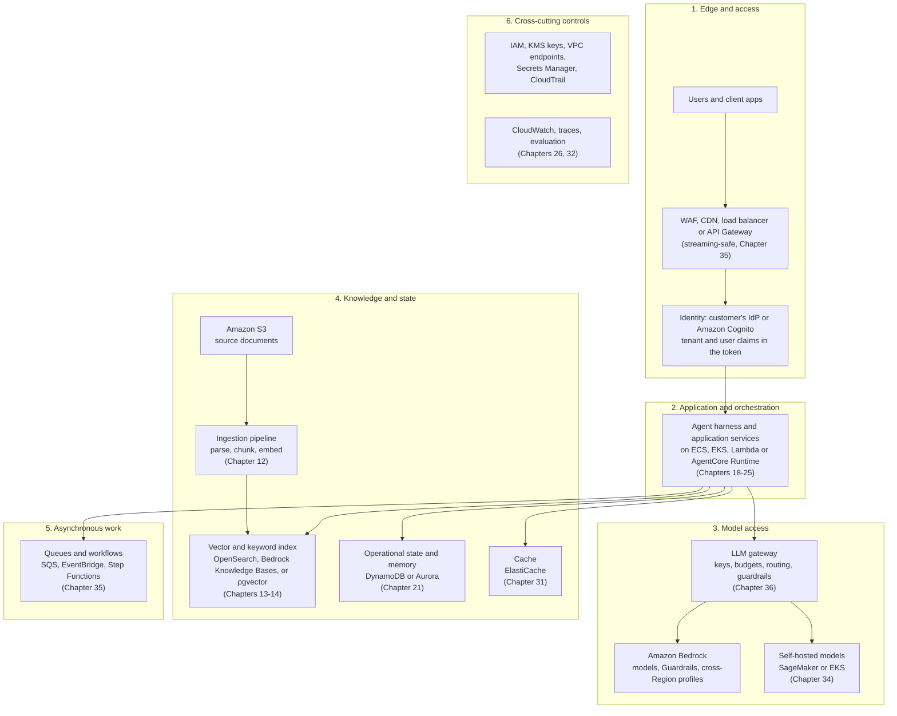
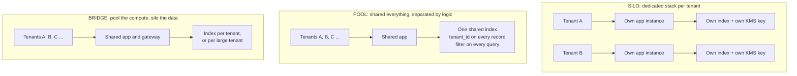
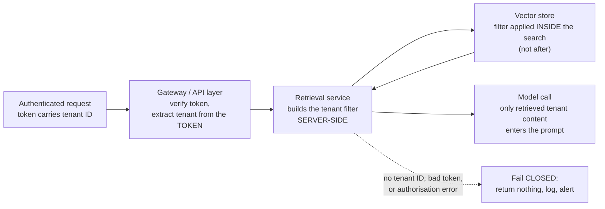
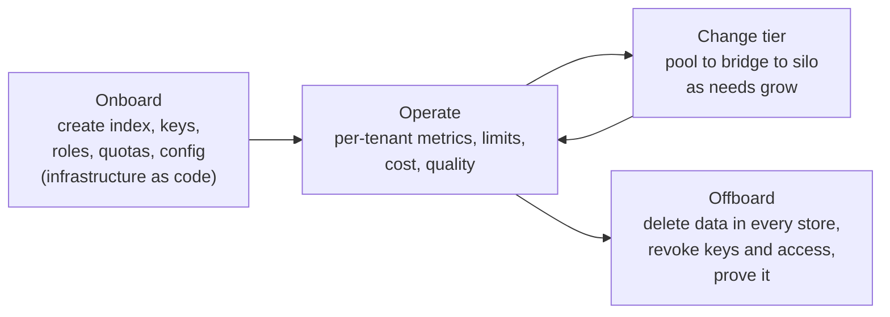

# Chapter 37: Cloud Reference Architectures and Multi-Tenancy

> **Service names, limits and quotas change often, and cloud vendors rename products.** Facts here are marked "(as of Nov 2026)" and link to the docs. This chapter goes deep on **AWS**, because it is widely used in industry. Azure and Google Cloud appear as a short mapping, and dedicated Azure and Google Cloud chapters may be added later. Numbers in examples are illustrative.

## 1. The concept, from scratch

Two questions come up in nearly every architecture interview:

1. **What does a complete AI system look like on a cloud?** (A reference architecture.)
2. **How do you serve many customers from one system without ever mixing their data?** (Multi-tenancy.)

A **reference architecture** is a proven blueprint: the standard layers, the standard services in each layer, and how they connect. You don't copy it blindly. You use it as the starting point and adjust it for the client's constraints. **Multi-tenancy** is the design problem that appears the moment your system serves more than one customer, and for AI systems it has extra traps, because customer data now hides in places a traditional application never put it.

### Part A: A reference architecture on AWS

Here's an enterprise assistant (RAG plus tools plus agents) laid out in layers. Each layer maps to earlier chapters.

How to talk about each layer:

1. **Edge and access.** Terminate TLS, apply a web application firewall, and authenticate. The token should carry the **tenant** and **user** identity, because every later layer needs it ([Chapter 30](../30-privacy-governance-and-compliance/README.md), [Chapter 15](../15-enterprise-rag/README.md)). Make sure every hop supports streaming ([Chapter 35](../35-reliability-scaling-and-streaming/README.md)).
2. **Application and orchestration.** Stateless services that run the agent loop, call tools and talk to the gateway. They scale horizontally. Amazon Bedrock AgentCore is AWS's managed option for hosting agents, with each session running in its own isolated microVM that is torn down and sanitised at the end (as of Nov 2026; [AWS: AgentCore sessions](https://docs.aws.amazon.com/bedrock-agentcore/latest/devguide/runtime-sessions.html)).
3. **Model access.** The gateway in front of Bedrock, any self-hosted models, and any external providers ([Chapter 36](../36-llm-gateways-and-routing/README.md)). Connect to Bedrock privately through **interface VPC endpoints (AWS PrivateLink)** so traffic doesn't cross the public internet ([AWS: Bedrock VPC endpoints](https://docs.aws.amazon.com/bedrock/latest/userguide/vpc-interface-endpoints.html)).
4. **Knowledge and state.** Documents in S3, an ingestion pipeline, an index, and stores for conversation state and memory. **Amazon Bedrock Knowledge Bases** offers a managed route for RAG, and you can instead build the pipeline yourself ([Chapter 11](../11-rag-fundamentals/README.md), [Chapter 16](../16-production-rag-architecture-and-scale/README.md)).
5. **Asynchronous work.** Queues and workflows for ingestion, batch jobs and long-running agent tasks, with retries and dead-letter queues.
6. **Cross-cutting controls.** Least-privilege IAM roles, encryption keys you control (KMS), secrets management, an audit trail (CloudTrail), and the observability stack from [Chapter 32](../32-observability-and-llmops/README.md).

**Shared responsibility.** On AWS, as on every cloud, AWS secures the infrastructure and you are responsible for your content and your configuration: IAM, network settings, encryption choices, logging and guardrails ([AWS: Bedrock data protection](https://docs.aws.amazon.com/bedrock/latest/userguide/data-protection.html)). A managed service doesn't remove your duty to configure it safely. For the exact terms on how a provider treats your prompts and outputs, read the current data privacy documentation, as in [Chapter 30](../30-privacy-governance-and-compliance/README.md).

**A review checklist: the Well-Architected Generative AI Lens.** AWS publishes a Generative AI Lens for its Well-Architected Framework. It evaluates a system across the generative AI lifecycle (from scoping and model selection to deployment and continuous improvement) against the framework's pillars: operational excellence, security, reliability, performance efficiency, cost optimisation and sustainability, with responsible-AI considerations throughout ([AWS: Generative AI Lens](https://docs.aws.amazon.com/wellarchitected/latest/generative-ai-lens/generative-ai-lens.html), revised Nov 2025). It is a useful way to structure a design review in an interview: "let me walk the pillars".

### The same design on Azure and Google Cloud

The architecture is the same on every cloud. Only the product names change, and they change often. As of Nov 2026, the platform names in the official docs are: **Microsoft Foundry** (the documentation notes you can upgrade an Azure OpenAI resource to a Foundry resource) and Google Cloud's **Gemini Enterprise Agent Platform** (the name on Google's docs, which older material calls Vertex AI). Treat the table as a thinking aid, and check each name in the vendor docs.

| Layer | AWS | Azure | Google Cloud |
|---|---|---|---|
| **Model platform** | Amazon Bedrock | Microsoft Foundry | Gemini Enterprise Agent Platform (formerly Vertex AI) |
| **Identity** | IAM, Cognito | Microsoft Entra ID | Cloud IAM |
| **Encryption keys** | AWS KMS | Azure Key Vault | Cloud KMS |
| **Private connectivity** | AWS PrivateLink | Azure Private Link | Private Service Connect |
| **Audit and logging** | CloudTrail, CloudWatch | Azure Monitor | Cloud Logging |
| **Search or vector index** | OpenSearch, Bedrock Knowledge Bases, Aurora pgvector | Azure AI Search | Google's managed vector search options |

The interview point is **portability**: keep the model access behind a gateway, keep your embeddings, prompts and evaluation sets under your control, and use open interfaces where you can. The real lock-in is rarely the model API. It is the data, indexes, pipelines and identity wiring built around it.

### Part B: Multi-tenancy

A **tenant** is one customer organisation (or one business unit, or one agency) that uses your system. **Multi-tenancy** means many tenants share the same system and infrastructure, which is efficient but requires strict **isolation** so that one tenant can never see, affect or be billed for another's data and usage. **Single-tenant** means each customer gets a dedicated deployment, which is simpler to reason about and far more expensive to run.

Four things must be isolated, and AI systems add new hiding places for each:

| What to isolate | Traditional app | Extra places in an AI system |
|---|---|---|
| **Data** | Database rows | Prompts, retrieved chunks, **vector indexes**, **embeddings**, **caches** (response and semantic), **agent memory**, evaluation sets, fine-tuning data and adapters, **logs and traces** |
| **Performance** | CPU and database load | **Token quotas** at the provider, GPU capacity, shared queues |
| **Cost** | Per-tenant usage | Tokens per tenant, retrieval and storage per tenant, evaluation runs |
| **Configuration and policy** | Settings | Prompts, guardrail rules, allowed models, Region and retention rules per tenant |

### Silo, pool and bridge

AWS's SaaS guidance names three isolation models, and they're the vocabulary to use in an interview ([AWS: SaaS Lens, tenant isolation](https://docs.aws.amazon.com/wellarchitected/latest/saas-lens/tenant-isolation.html)):

- **Silo:** each tenant gets its own dedicated resources. Strongest isolation, highest cost.
- **Pool:** tenants share the same resources, separated by logic (tenant IDs, filters, policies). Lowest cost, and the isolation depends entirely on that logic being correct.
- **Bridge:** a mix, applying silo to some layers and pool to others.

**Mapped to an AI stack** (an example, so you can reason about each layer):

| Layer | Pool | Bridge | Silo |
|---|---|---|---|
| App and gateway | Shared | Shared | Dedicated per tenant |
| Model access | Shared quota, per-tenant limits at the gateway | Shared, with reserved capacity for big tenants | Dedicated endpoint or provisioned capacity |
| Vector index | One index, tenant filter on every query | Index per tenant (or per tier) | Separate index and collection per tenant |
| Cache | Shared, **keys scoped by tenant** | Per-tenant cache namespace | Dedicated cache |
| Encryption | Shared key | Key per tenant | Customer-managed key per tenant |
| Logs | Shared store, tenant-tagged, access-controlled | Per-tenant prefix and key | Separate store |

Most real platforms use **tiered tenancy**: small tenants are pooled, standard tenants get bridge-style data separation, and large or regulated tenants get a silo. The key is to design the system so that moving a tenant between tiers is a configuration and provisioning task, not a rewrite.

### Multi-tenant RAG on AWS

AWS has published guidance with three patterns for multi-tenant RAG on Amazon Bedrock Knowledge Bases, built on silo, pool and bridge ([AWS: multi-tenant RAG with Bedrock Knowledge Bases](https://aws.amazon.com/blogs/machine-learning/multi-tenant-rag-with-amazon-bedrock-knowledge-bases/), as of Nov 2026):

- **Silo:** a separate data source, knowledge base and index per tenant, giving the highest isolation. The blog notes a limit of **100 knowledge bases per AWS account**, which makes silo most suitable for your largest tenants with specific requirements, and it points out that per-tenant KMS keys add cost.
- **Pool:** one data source and one knowledge base for all tenants, where every document carries a tenant identifier as **metadata** and every query includes a **metadata filter** for the caller's tenant. Tenants share the chunking strategy, embedding model and encryption key. Particularly suitable for many small tenants.
- **Bridge:** in between, such as a shared knowledge base with separation by prefix or by tier.

The blog also notes that Amazon OpenSearch Serverless now supports scale-to-zero, which can remove idle compute cost for dormant tenants.

**The crucial point: a metadata filter is logical isolation, not a hard boundary.** AWS's own architecture guidance on pairing Bedrock with Amazon Verified Permissions says this plainly: the pattern gives filter-level (logical) isolation, not IAM-enforced infrastructure isolation, and if the middleware that builds the filter fails open, other groups' documents would be exposed ([AWS: secure multi-tenant RAG with Verified Permissions](https://aws.amazon.com/blogs/architecture/secure-multi-tenant-rag-with-amazon-bedrock-and-verified-permissions/)). For a hard compliance boundary between separate customers, use a dedicated knowledge base or index per tenant with resource boundaries enforced by IAM.

If you pool, follow these rules without exception:

1. **The tenant comes from the verified token, never from the request body.** A user must not be able to type another tenant's ID.
2. **Build the filter on the server,** from the authenticated identity, in one place that every query goes through.
3. **Apply the filter inside the search,** not after retrieving results. Filtering after the fact can return too few results and risks leaking through other paths.
4. **Fail closed.** If the tenant ID is missing or authorisation can't be determined, return nothing and alert. Never fall back to "search everything".
5. **Never rely on the prompt** ("only answer from tenant A's data") as the control. The model isn't a security boundary ([Chapter 29](../29-guardrails-and-ai-security/README.md)).
6. **Use real authorisation, not just tenant filters.** Within a tenant, users also have different document permissions ([Chapter 15](../15-enterprise-rag/README.md)). A policy engine such as Amazon Verified Permissions can turn an authorisation decision into the filter.
7. **Scope every derived store by tenant:** caches ([Chapter 31](../31-cost-latency-and-caching/README.md)), memory ([Chapter 21](../21-agent-memory-and-state/README.md)), and logs.

### Multi-tenant agents

Agents add risks, because they hold state and act. AWS Prescriptive Guidance covers [multi-tenant architectures for agentic AI on AWS](https://docs.aws.amazon.com/prescriptive-guidance/latest/agentic-ai-multitenant/introduction.html). The recurring points:

- **Isolate sessions.** AgentCore gives each session its own microVM, but AWS's documentation notes that AgentCore does not enforce which user owns a session ID, so your backend must check that a session belongs to the authenticated user and tenant before resuming it.
- **Per-tenant tool credentials.** Each tenant's tools and data sources need their own credentials and scopes, ideally acting **on behalf of the user** ([Chapter 20](../20-agent-protocols-mcp-and-a2a/README.md)), never one powerful shared service account.
- **Namespace memory by tenant** and user, and never let one tenant's retrieved or remembered content flow into another's context.
- **Contain injection.** One tenant's malicious document must not influence agents serving anyone else, which is another reason to avoid shared memory and shared writable stores ([Chapter 29](../29-guardrails-and-ai-security/README.md)).

### Noisy neighbours: protecting performance and quota

In a pooled system, one tenant's burst can starve the rest, because provider quotas and GPUs are shared ([Chapter 35](../35-reliability-scaling-and-streaming/README.md)). The defences:

- **Per-tenant rate limits and token budgets** at the gateway ([Chapter 36](../36-llm-gateways-and-routing/README.md)), so one tenant can't consume the whole account quota.
- **Fair queuing and priorities** for background work, so a large batch job from one tenant doesn't delay everyone's interactive requests.
- **Tiered capacity.** Reserve dedicated throughput or a dedicated model endpoint for premium tenants ([Chapter 34](../34-self-hosting-open-weight-models/README.md), [Chapter 35](../35-reliability-scaling-and-streaming/README.md)).
- **Cells.** A cell-based design splits tenants across several independent copies of the stack, so a failure or a runaway tenant affects only one cell instead of everyone. It limits the blast radius.

### Cost attribution and metering

You can't price a product, or find an unprofitable tenant, without knowing **cost per tenant**. The building blocks:

- Put the tenant ID on **every gateway log line and trace** along with tokens, model and cost ([Chapter 32](../32-observability-and-llmops/README.md)).
- On AWS, **application inference profiles** with cost allocation tags let you attribute Bedrock usage in Cost Explorer, for example one profile per tenant or per tier. Tags must be activated and aren't retroactive ([AWS: application inference profiles](https://docs.aws.amazon.com/bedrock/latest/userguide/cost-mgmt-application-inference-profiles.html)). Check the account's limits before creating one per tenant at large scale.
- Allocate shared costs (indexes, GPU nodes, engineers) using a sensible driver such as tokens, storage or requests, and agree it with finance.
- Report **unit economics**: cost per tenant, cost per task, margin by tier. Use them to set plan limits and prices.

### Per-tenant configuration, quality and compliance

- **Configuration:** a tenant configuration store holds each tenant's prompts, guardrail policy, allowed models, language, Region and retention rules, all versioned like any release artefact ([Chapter 32](../32-observability-and-llmops/README.md)).
- **Residency:** some tenants need their data and inference kept in a particular Region or country, which affects routing, fallbacks and cross-Region profiles ([Chapter 30](../30-privacy-governance-and-compliance/README.md), [Chapter 36](../36-llm-gateways-and-routing/README.md)).
- **Quality monitoring per tenant.** A global average hides a tenant whose documents or language make the system perform badly. Break evaluation and feedback metrics down by tenant ([Chapter 26](../26-evaluation-fundamentals/README.md), [Chapter 27](../27-evaluating-rag-and-agents/README.md)).
- **Onboarding and offboarding as automation.** Provisioning a tenant (index, keys, roles, quotas, config, dashboards) should be infrastructure-as-code, not a ticket. Offboarding must find tenant data in **every** place: source store, index and embeddings, caches, memory, logs, evaluation sets, adapters and backups. A per-tenant encryption key makes this easier, because destroying the key can make the encrypted data unreadable ("crypto-shredding"), though you must still handle backups and derived copies ([Chapter 30](../30-privacy-governance-and-compliance/README.md)).

### Test the boundary

Isolation that has not been tested is a hope. Build tests that **try to break it**:

- **Cross-tenant tests in CI:** tenant A asks for tenant B's documents by name, by ID and by clever paraphrase. The answer must contain none of it.
- **Canary documents:** plant a unique, harmless marker string in each tenant's data and alarm if it ever appears in another tenant's output, logs or cache.
- **Negative tests on every layer:** the index, the cache, the memory store, the log store, and the tool credentials.
- **Red-team and penetration testing,** including prompt injection aimed at crossing a tenant boundary ([Chapter 29](../29-guardrails-and-ai-security/README.md)).
- **Monitor denied-access events** and treat any cross-tenant hit as a security incident.

## 2. Analogies across industries

- **Silo, pool and bridge are the models of a third-party logistics warehouse (logistics).** A 3PL stores many clients' goods. In the *pool* model, everything sits on shared shelves with labelled bins and a strict pick list. In a *bridge* model, each client gets a caged area inside the shared building. In a *silo*, a large client has a dedicated building. Pooling is cheapest, and it only works while the labels and pick lists are never wrong.
- **Noisy neighbours are shared bandwidth on a telecom network (telecom).** A carrier caps each customer's rate so one heavy user can't slow everyone, and gives premium plans guaranteed capacity. Per-tenant token limits and reserved throughput are the same idea.
- **Metadata filtering is a records room with badge access (healthcare).** A hospital's records office lets staff pull charts only for patients they're authorised to see. If the badge check is skipped once, anyone can read any chart. Isolation tests are like audits that try to pull a chart they shouldn't.
- **A cell-based design is a set of separate branch offices (retail).** A retailer with regional stores can lose one store's power without closing the rest. Splitting tenants across cells means one failure affects a slice of customers, not all of them.

## 3. How it's used in industry

- **B2B software for insurers.** A vendor offers a claims-assistant product to hundreds of mid-size insurers. Most share a pooled stack with per-tenant filters and token budgets, and the largest insurers get dedicated indexes, their own encryption keys and reserved model capacity.
- **Government shared platform.** A national digital agency runs one AI platform for many ministries. Each ministry has its own keys, its own index and its own audit trail, while the application and gateway layers are shared. Data stays in an in-country Region ([Chapter 30](../30-privacy-governance-and-compliance/README.md)).
- **Retail marketplace seller assistant.** A marketplace offers an assistant to thousands of small sellers. A pooled design with strong tenant filters, per-seller token limits and cached answers for common policy questions keeps the cost per seller low.
- **Healthcare software.** A vendor serves many hospitals and treats each hospital as a silo for patient data, with separate encryption keys and strict Region rules, while sharing the non-patient components such as the user interface and the shared documentation assistant.

## 4. Common misconceptions

- **"Multi-tenancy just means adding a tenant ID column."** The tenant ID must be enforced at every layer, including the index, caches, memory, logs and tool credentials, and enforced in a way that fails closed.
- **"A metadata filter is as strong as separate infrastructure."** AWS's own guidance says it is logical isolation. If the filter code fails open, data leaks. Hard boundaries need separate indexes with IAM-enforced access.
- **"The prompt can keep tenants apart."** The model is not a security boundary. Isolation must happen before content reaches the prompt.
- **"A shared cache is harmless."** A cache keyed only by question text can return one tenant's answer to another.
- **"One quality number covers everyone."** An average can hide one tenant with poor results. Measure per tenant.
- **"The cloud provider handles isolation for us."** Under shared responsibility, the provider isolates its infrastructure and you configure and isolate your own tenants.
- **"Silo for everyone is the safe choice."** It is also the costliest and slowest to operate, and hits service limits. Use tiers.
- **"Offboarding is deleting a database row."** Tenant data lives in many stores, including embeddings, caches, memory, logs and backups.

## 5. Interview questions

### 1. What is multi-tenancy, and why is it harder for AI systems?

Multi-tenancy means serving many customers from the same system and infrastructure while keeping each one's data, performance, cost and configuration separate. It's efficient, but isolation is critical. It's harder with AI systems because customer data ends up in more places than in a traditional app. As well as database rows, it's in prompts, retrieved chunks, vector indexes and embeddings, response and semantic caches, agent memory, logs and traces, evaluation sets, and fine-tuned adapters. There are also shared scarce resources, like provider token quotas and GPUs, which create noisy-neighbour problems. And the model itself can't be trusted to keep tenants apart, so isolation has to be enforced in code and infrastructure before content reaches the prompt.

### 2. Explain the silo, pool and bridge models.

Those are the three standard isolation models in AWS's SaaS guidance. In a silo, each tenant gets dedicated resources, so isolation is strongest and cost is highest. In a pool, tenants share resources and are separated by logic such as tenant IDs and filters, so it's cheapest, but the isolation is only as good as that logic. A bridge mixes them, for example sharing the application and gateway but giving each tenant its own index or encryption key. In practice most platforms use tiers: small tenants are pooled, standard ones get bridge-style data separation, and large or regulated tenants get a silo. I'd design so that moving a tenant between tiers is provisioning, not a rewrite.

### 3. How would you isolate tenant data in a multi-tenant RAG system on AWS?

I'd choose the model by tenant tier. For many small tenants I'd pool: one knowledge base or index where every chunk carries a tenant identifier as metadata and every query is filtered by the caller's tenant. For big or regulated tenants I'd use a dedicated knowledge base or index, with IAM-enforced boundaries and their own KMS key. For the pooled case, the rules are strict: the tenant ID comes from the verified token and not the request, the filter is built server-side in one place, it's applied inside the search, and the system fails closed if the tenant is missing. I'd scope caches, memory and logs by tenant too, and test isolation continuously. I'd also be aware of limits, such as the cap on knowledge bases per account, which makes silo practical only for the largest tenants.

### 4. Is metadata filtering enough for tenant isolation?

It's enough for some cases and not for others, and I'd be explicit about which. AWS's own guidance describes metadata filtering as logical, filter-level isolation, not IAM-enforced infrastructure isolation: the knowledge base is still a shared resource, and if the code that builds the filter fails open, one tenant's documents can be exposed to another. That can be acceptable for many small tenants or for departments inside one organisation, if the filter is built correctly and tested. But where contracts or regulation demand a hard boundary between separate customers, I'd use a dedicated index or knowledge base per tenant, with IAM-enforced access and a separate encryption key, so a bug in application logic can't cross the boundary.

### 5. How do you propagate tenant identity safely through an AI system?

I authenticate at the edge and put the tenant and user identity in a verified token. Every later component takes the tenant from that token, never from the request body or from anything the model produced. The gateway verifies it and passes it on. The retrieval service builds the filter from it on the server side, tools are called with credentials scoped to that tenant and ideally acting on behalf of the user, and caches, memory and logs are keyed by it. If any component can't establish the tenant, it denies the request and raises an alert, instead of defaulting to a broad scope. And I log the tenant on every trace so I can audit and attribute cost.

### 6. How do you stop one tenant from consuming everyone's model quota?

I'd put limits at the gateway: per-tenant rate limits and token budgets, so one tenant can't use up the whole account quota at the provider. For background work I'd use queues with fair scheduling and priorities, so one tenant's large batch job doesn't delay everyone's interactive requests. For premium tenants I could reserve dedicated capacity, such as provisioned throughput or a dedicated endpoint. And I'd consider a cell-based design, where tenants are split across independent copies of the stack, so a runaway tenant or a failure only affects its own cell. I'd monitor per-tenant usage against limits and alert early.

### 7. How would you attribute AI costs to each tenant?

I'd start by tagging every request with the tenant ID at the gateway, and logging tokens, model and cost on every trace, so I can compute cost per tenant from the logs. On AWS I could also create application inference profiles per tenant or tier with cost allocation tags, so Bedrock usage shows up in Cost Explorer and the cost reports, remembering that tags need to be activated and aren't retroactive. Shared costs, such as the vector database and GPU nodes, I'd allocate using an agreed driver like tokens, storage or requests. Then I'd report unit economics: cost per tenant, cost per task and margin by plan, and use them to set limits and pricing and to find tenants who cost more than they pay.

### 8. How would you handle a tenant leaving, or a deletion request for tenant data?

I'd treat it as a pipeline with a checklist of every place data can live: source documents, the vector index and embeddings, response and semantic caches, agent memory, logs and traces, evaluation sets, fine-tuning data and adapters, exports, and backups. Provisioning and deprovisioning should be automated and tested, not a manual ticket. A per-tenant encryption key helps a lot, because destroying the key can make the encrypted data unreadable, which is crypto-shredding, though I'd still have to deal with backups and derived copies according to retention rules. I'd record what was deleted and when, as evidence, and I'd check deletion by running tests that confirm the tenant's data can no longer be retrieved.

### 9. How do you test that tenants are really isolated?

I'd treat it as a security property and test it adversarially. In CI I'd run cross-tenant tests where one tenant asks for another's documents by name, ID and paraphrase, and the answer must contain none of it, and I'd run those against every layer: index, cache, memory, logs and tool credentials. I'd plant unique canary strings in each tenant's data and alert if one ever appears in another tenant's output, logs or cache. I'd red-team with prompt injection aimed at crossing a boundary, run periodic penetration tests, and monitor denied-access events. Any cross-tenant hit in production is a security incident, not a bug ticket.

### 10. Describe a reference architecture for an enterprise generative AI application on AWS.

I'd describe it in layers. At the edge: a WAF, load balancer or API Gateway configured for streaming, and identity with tenant and user claims. Then the application layer, stateless services on ECS, EKS, Lambda or AgentCore Runtime that run the agent loop. Then an LLM gateway in front of Amazon Bedrock, with guardrails and cross-Region profiles, and any self-hosted models on SageMaker or EKS. The knowledge layer is S3 for documents, an ingestion pipeline, a vector and keyword index such as OpenSearch or Bedrock Knowledge Bases, a store for state and memory, and a cache. Asynchronous work goes through SQS and Step Functions. Cross-cutting: least-privilege IAM, KMS keys, PrivateLink endpoints so traffic stays private, CloudTrail for audit, and CloudWatch with traces and evaluation for observability. I'd then walk the Well-Architected Generative AI Lens pillars to review it, and adjust for the client's residency, cost and scale.

### 11. How would the design change on Azure or Google Cloud, and how do you limit lock-in?

The layers stay the same and the product names change: a managed model platform, an identity service, a key service, private networking, a search or vector service, and logging. I'd map by capability and check current names, because they change often: Azure's platform is now called Microsoft Foundry, and Google's is documented as the Gemini Enterprise Agent Platform. To limit lock-in, I'd keep model access behind a gateway with aliases, keep embeddings, prompts and evaluation sets under my control in portable formats, prefer open interfaces and standard protocols, and treat the index and identity integration as the real switching cost, because they're harder to move than the model API. I'd also be honest that some portability has a price, since using a cloud's native features can be faster and cheaper.

## 6. Scenario exercise

A software company sells an AI claims assistant to about three hundred mid-size insurers, all served from one pooled deployment on AWS: a shared application, a shared gateway, one knowledge base with a tenant filter on every query, and a shared cache. A very large insurer, one of the company's most important prospects, says it will sign only if its data is "completely separate": a dedicated environment, its own encryption keys under its control, processing in a specific Region, no shared cache, and guaranteed model capacity in its contract. The sales team has promised an answer in two weeks.

**Your task:** What do you propose, what do you ask first, and what risks do you flag? Answer from memory, then compare.

Model answer

I'd start by asking what "completely separate" means to them, because it can mean several different things, and each one costs something different. Is the requirement about data isolation, about control of keys, about residency, about performance guarantees, or about audit evidence? Often a customer asks for a dedicated environment when what it needs is proof and control: separate data, keys it can revoke, a named Region, and a contractual service level. I'd also ask about volume and users, what documents will be loaded, which regulations apply, and whether they accept any shared components, such as the application code, if the data layer is separate.

My proposal would be to treat this as a tier, not a one-off. The platform should already have the idea of moving a tenant from pool to bridge to silo, and this customer becomes the first silo tenant, built from the same code and the same release train, not a special fork. Concretely: a dedicated stack for the tenant, deployed from infrastructure-as-code into the Region they require, with its own knowledge base or index, and its own storage. Their documents are encrypted with a customer-managed KMS key that they control, so revoking it makes their data unreadable. Their own cache namespace or dedicated cache, so nothing is shared. Dedicated gateway keys and quotas, and, if the contract guarantees capacity, reserved model throughput or a dedicated endpoint, priced into the deal. Private connectivity, separate logging with their own retention rule, and per-tenant dashboards, cost tags and quality metrics. I'd keep the application and release process common, using feature flags and configuration for tenant differences, so we don't create a snowflake that we can't upgrade.

On the model side, I'd check that the models and fallbacks we use are available in their Region and allowed by their rules, since cross-Region profiles or fallbacks could move data elsewhere.

For risks, I'd flag several. Operational cost: a silo has its own idle costs and its own operations, so the price has to cover it. Service limits: for instance, a cap on knowledge bases per account means we can't do this for everyone, so I'd decide the criteria for who gets a silo. Drift: the dedicated stack must stay on the same version path as the pooled one, or upgrades become painful. Evidence: they'll want proof, so I'd offer an isolation test report, an architecture description, audit logs and a deletion procedure. And precedent: other large customers will ask for the same, so the offer should be a documented enterprise tier with a price, not a favour.

Within the two weeks, I'd give sales a clear answer: yes, via our enterprise tier, with a clear list of what is dedicated and what is shared, a timeline for provisioning, and a price that includes the capacity and operations. I'd also be honest about what I'd confirm before committing: Region availability, the capacity guarantee, and what they'll accept as proof of isolation.

## 7. Key takeaways

- **A cloud reference architecture is layers:** edge and identity, orchestration, an LLM gateway, models, knowledge and state, async work, and cross-cutting security and observability. Use the Well-Architected Generative AI Lens to review it.
- **Multi-tenancy is isolation of data, performance, cost and configuration,** and in AI the data hides in indexes, embeddings, caches, memory, logs and adapters, not just database rows.
- **Silo, pool and bridge are the vocabulary:** silo is strongest and costliest, pool is cheapest and relies on correct logic, bridge mixes them. Real platforms use tiers.
- **A metadata filter is logical isolation, not a hard boundary:** take the tenant from the verified token, build the filter server-side, apply it inside the search, fail closed, and use dedicated indexes with IAM-enforced boundaries where contracts require it.
- **Operate per tenant:** limits against noisy neighbours, cost attribution, per-tenant quality metrics, automated onboarding and offboarding, and adversarial isolation tests.

## 8. Further reading

- AWS, [Multi-tenant RAG with Amazon Bedrock Knowledge Bases](https://aws.amazon.com/blogs/machine-learning/multi-tenant-rag-with-amazon-bedrock-knowledge-bases/): silo, pool and bridge patterns for RAG, with their trade-offs and limits.
- AWS, [Secure multi-tenant RAG with Amazon Bedrock and Verified Permissions](https://aws.amazon.com/blogs/architecture/secure-multi-tenant-rag-with-amazon-bedrock-and-verified-permissions/): authorisation-driven filtering, and why it is logical isolation.
- AWS Prescriptive Guidance, [Building multi-tenant architectures for agentic AI on AWS](https://docs.aws.amazon.com/prescriptive-guidance/latest/agentic-ai-multitenant/introduction.html): isolation patterns for agents.
- AWS Well-Architected, [Generative AI Lens](https://docs.aws.amazon.com/wellarchitected/latest/generative-ai-lens/generative-ai-lens.html) and [SaaS Lens: tenant isolation](https://docs.aws.amazon.com/wellarchitected/latest/saas-lens/tenant-isolation.html): review frameworks for AI workloads and multi-tenant systems.
- AWS, [Amazon Bedrock AgentCore: isolated sessions](https://docs.aws.amazon.com/bedrock-agentcore/latest/devguide/runtime-sessions.html): per-session microVM isolation for agents, and what remains your responsibility.
