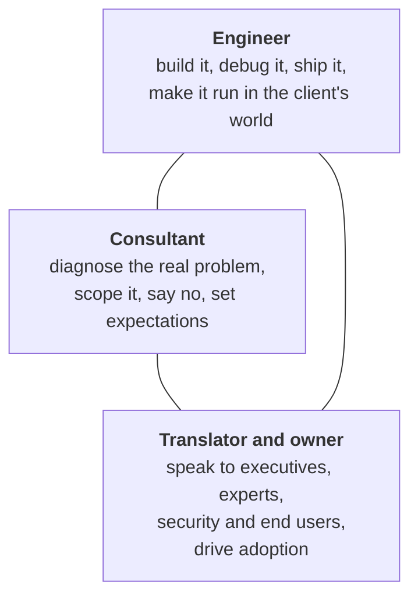
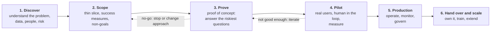
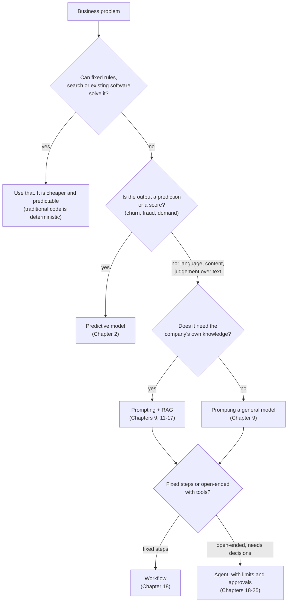
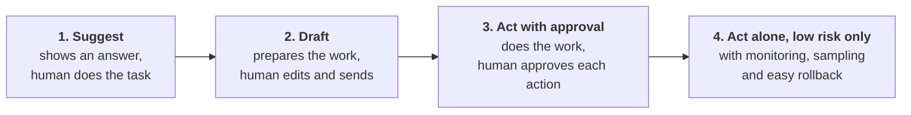

# Chapter 38: Forward Deployed Engineering

> **A note on the role.** "Forward deployed engineer" (FDE) and its cousins (applied AI engineer, AI solutions architect, solutions engineer) mean slightly different things at different companies, and the titles keep shifting. This chapter describes the **work** that sits behind those titles. Check each job description for how a given employer splits it. Facts that can change are marked "(as of Nov 2026)".

## 1. The concept, from scratch

Knowing how AI systems work and how to run them is only part of the job. This chapter is about the part nobody can look up: **getting a client from "we should use AI" to a system people actually trust and use.**

A **forward deployed engineer** works close to the customer, often embedded with their team, and turns a messy business problem into working, production-grade software, using the employer's product or platform plus whatever else is needed. The role was popularised at Palantir, and AI companies and consultancies now hire for it heavily (as of Nov 2026). The usual contrast is: a product engineer builds one capability that many customers use, while an FDE makes many capabilities work for one customer's real situation.

An **AI solution architect** is the nearby role. It leans more toward design, advice and review, and less toward building the last mile. In interviews for any of these roles, expect the same mix: technical depth, judgement, and communication.

You wear three hats at once:

Most failed AI projects don't fail on engineering. They fail because the problem was unclear, the success measure didn't exist, the data wasn't available, the owner was missing, or expectations were wrong. The FDE's real job is to prevent those.

### The engagement lifecycle

Each step ends with a **gate**, a decision the client signs off on: continue, change course, or stop. Stopping early with a clear reason is a good outcome. It costs far less than a failed launch.

The AWS Well-Architected Generative AI Lens describes a similar lifecycle, which is useful with AWS-centred clients: scoping, model selection, model customisation, development and integration, deployment, and continuous improvement, with each phase checked against the framework's pillars ([AWS: Generative AI lifecycle](https://docs.aws.amazon.com/wellarchitected/latest/generative-ai-lens/generative-ai-lifecycle.html), as of Nov 2026).

### Step 1: Discovery

Discovery is where you find out what the client actually needs, which is often different from what they asked for. A request like "we want a chatbot" is a **solution**, not a problem. Your job is to get back to the problem. Think of a doctor: a good one takes the history, asks about symptoms and runs tests before prescribing anything.

The questions, grouped:

| Area | What to find out |
|---|---|
| **The job to be done** | What is the task? Who does it today, how often, how long does it take, and what does it cost? What goes wrong? Ask: "walk me through the last time this happened" |
| **Value** | What changes if this works? Time, money, risk, customer experience? Who benefits, and how would we know? |
| **Users and workflow** | Who will use it, in which tool, at which moment? What would make them trust it, or ignore it? |
| **Data and knowledge** | Where does the information live? Is it clean, current, permissioned? Can we get access this month? Sample it early |
| **Risk and rules** | What happens if it is wrong? Which regulations, privacy rules and approvals apply? Is a human required in the loop? ([Chapter 29](../29-guardrails-and-ai-security/README.md), [Chapter 30](../30-privacy-governance-and-compliance/README.md)) |
| **Technology** | Which systems must it connect to? Which cloud, identity and security standards? Any existing AI or vendors? |
| **People and constraints** | Who is the sponsor, who owns it after launch, who is the domain expert? Budget, deadline, politics |
| **Success** | How is success measured today? What number would make the sponsor say "this worked"? |

Two habits make discovery much better. **Look at real data and real work early,** because the gap between what people say and what the documents contain is where projects get surprised. And **watch someone do the task** instead of only asking about it, because the real workflow is often different from the official one.

The output of discovery is a **one-page problem statement** that the client agrees is correct.

### Is AI the right tool, and which pattern?

Part of discovery is being willing to say "you don't need AI for this" or "you don't need an agent for this". The honest question sequence:

Remember the phrase to say out loud: **traditional code is deterministic, generative AI is probabilistic.** Use generative AI where flexibility with language is the value, and don't use it where a rule would be exact. Many real systems combine both, with predictive models scoring or classifying and generative models explaining or drafting. Anthropic's guidance on building agents makes the same point: start with the simplest solution, measure it, and add complexity such as agents only when the simpler approach falls short ([Anthropic: Building effective agents](https://www.anthropic.com/engineering/building-effective-agents), as of Nov 2026). Start with prompts and evaluation ([Chapter 26](../26-evaluation-fundamentals/README.md)), and fine-tune only when you have evidence you need to ([Chapter 17](../17-rag-vs-fine-tuning-vs-long-context/README.md)).

### Step 2: Scoping

Scoping turns the problem statement into something you can finish. The principles:

- **A thin vertical slice.** One user group, one workflow, end to end, rather than a wide, shallow demo. A narrow thing that works is more convincing, and more useful, than a broad thing that sort of works.
- **Write down non-goals.** What you will not do in this phase. It protects the project from scope creep, and it is easy to say "yes, in phase two".
- **List assumptions.** "Documents are available as text by week 2", "a domain expert has two hours a week". Assumptions that fail become risks you flagged early.
- **Define success before building.** Agree the **baseline** (how well does the current process do?), the **metrics** (accuracy on an agreed test set, time saved per case, adoption, cost per task), and the **acceptance criteria** for moving to the next gate. Build the evaluation set **with the domain experts,** from real cases ([Chapter 26](../26-evaluation-fundamentals/README.md)). If the client can't define good, start by building a small set of examples together. That exercise is often the most valuable thing you do in the first two weeks.
- **Estimate cost.** Per task, using the method in [Chapter 31](../31-cost-latency-and-caching/README.md), and compare it to the cost of the current process. Present a range and the assumptions behind it.

A proposal can be one page:

> **Problem** · **Users** · **Scope (this phase)** · **Non-goals** · **Success measures and baseline** · **Approach** · **Risks and how we'll handle them** · **Timeline and gates** · **What we need from you** (data, people, access, decisions)

### Step 3: The proof of concept

A **proof of concept (PoC)** exists to answer the **riskiest questions** quickly, not to impress people. Typical questions: Is the data good enough? Can the model reach the quality we need on *our* cases? Can we connect to the systems? Is the cost and latency acceptable?

- **Time-box it,** and write the **exit criteria** up front: what result means go, what means stop, what means change approach.
- **Use real data and real users' cases,** including the hard and ugly ones, not five happy-path examples. A demo built on cherry-picked inputs proves nothing.
- **Measure, don't just show:** quality on the evaluation set, cost per task, latency, and what fraction needed a human fix.
- **Be honest about what's faked.** If part of the demo involved manual work or hard-coded answers, say so. Discovering it later destroys trust.

### Why PoCs don't become products

A PoC that works proves the idea is possible. It says very little about whether it is **ready**. The gap is everything a demo skips:

| A demo skips | Production needs | Chapter |
|---|---|---|
| Quality on hard cases | An evaluation set, regression tests, online monitoring | [26](../26-evaluation-fundamentals/README.md), [32](../32-observability-and-llmops/README.md) |
| Security and privacy | Access control, redaction, injection defences, compliance review | [29](../29-guardrails-and-ai-security/README.md), [30](../30-privacy-governance-and-compliance/README.md) |
| Real permissions | Per-user and per-tenant access to data | [15](../15-enterprise-rag/README.md), [37](../37-cloud-reference-architectures-and-multi-tenancy/README.md) |
| Cost at scale | Budgets, caching, routing, alerts | [31](../31-cost-latency-and-caching/README.md), [36](../36-llm-gateways-and-routing/README.md) |
| Failure handling | Retries, fallbacks, rate limits, streaming | [35](../35-reliability-scaling-and-streaming/README.md) |
| Integration | Real systems, real identity, real workflows | [19](../19-tool-calling/README.md), [20](../20-agent-protocols-mcp-and-a2a/README.md) |
| People | An owner, training, support, change management | this chapter |

Industry forecasts echo this. Gartner predicted in July 2024 that at least 30% of generative AI projects would be abandoned after the proof-of-concept stage by the end of 2025, citing poor data quality, inadequate risk controls, escalating costs or unclear business value ([Gartner press release](https://www.gartner.com/en/newsroom/press-releases/2024-07-29-gartner-predicts-30-percent-of-generative-ai-projects-will-be-abandoned-after-proof-of-concept-by-end-of-2025)). That's a forecast, not a measured outcome. Other, more dramatic figures circulate on how many pilots fail, defined in different ways, and they should be treated with caution, not quoted as facts. The causes, though, ring true to anyone who has worked on these projects: **no owner, no data access, no evaluation, no integration path, and security and legal arriving late.** The classic machine-learning paper on hidden technical debt makes a related point: the model is a small part of a real system, and most of the cost and risk is in everything around it ([Sculley et al., NeurIPS 2015](https://papers.nips.cc/paper_files/paper/2015/hash/86df7dcfd896fcaf2674f757a2463eba-Abstract.html)).

### Step 4: The pilot, and earning autonomy

A **pilot** puts the system in front of a limited group of real users, doing real work, with measurement. It is where you learn what the PoC couldn't tell you: whether people use it, trust it, and whether the economics hold.

The safest way to run a pilot is to **earn autonomy in steps** ([Chapter 24](../24-agent-user-interaction/README.md), [Chapter 25](../25-agent-reliability-and-learning/README.md)):

Move to the next level only when the measured quality and the user's trust justify it, and keep the highest-risk actions at human approval permanently. During the pilot, track adoption (are people using it?), quality (sampled and reviewed), cost per task, time saved, and the cases where users overrode or ignored it. Set up the feedback loop from [Chapter 32](../32-observability-and-llmops/README.md), so every failure becomes a test case. Make sure there is an obvious route to a human and an obvious way to roll back.

### Step 5: Production and handover

Going live isn't the end. It is the start of someone owning it. Before you leave, make sure:

- **Operations:** service level objectives, alerts, dashboards, runbooks, an on-call owner ([Chapter 32](../32-observability-and-llmops/README.md), [Chapter 35](../35-reliability-scaling-and-streaming/README.md)).
- **Cost control:** budgets and alerts per team or tenant ([Chapter 31](../31-cost-latency-and-caching/README.md), [Chapter 36](../36-llm-gateways-and-routing/README.md)).
- **Governance:** model and data inventory, audit logs, a change process for prompts and models ([Chapter 30](../30-privacy-governance-and-compliance/README.md)).
- **People:** documentation, training for users and operators, a named business owner, and a backlog of what comes next.
- **Value tracking:** measure the benefits you promised, at 30, 60 and 90 days, and report them honestly.

Handing over code is not handing over a system. **The system is handed over when someone else can run it, change it and defend it.**

### Communicating with the client

Technical skill gets you in the room. Communication decides whether the project survives. A few habits:

**Explain probabilistic behaviour plainly.** Say something like: "Traditional software does exactly what it was told, every time. This system generates its answers, so it can be wrong, and the same question might not produce word-for-word the same answer. We manage that with measurement, safeguards, and a human in the loop where mistakes are costly."

**Reset the accuracy conversation.** If a stakeholder wants 100%, ask: What's the accuracy of the current process? What does a wrong answer cost, and what does a missed answer cost? Where can a human check? Usually the right target is "as good as or better than today, with errors caught before they matter", and for high-risk cases, "the system suggests and a person decides". Show real failure examples early. It builds trust faster than polished demos ([Chapter 28](../28-hallucination-and-grounding/README.md)).

**Speak the audience's language:**

| Audience | What they care about | What to bring |
|---|---|---|
| **Executive sponsor** | Value, risk, timeline, decisions needed | Outcomes in their terms, a range for cost, the next gate |
| **Domain expert** | Does it get *my* cases right? | Examples from their work, a place to correct the system |
| **IT and security** | Data flows, access, compliance | Architecture, data-flow diagram, controls, audit |
| **End users** | What changes for me? Can I trust it? | Training, a feedback button, an easy human fallback |
| **Finance** | Cost and return | Unit economics: cost per task before and after, with assumptions |

**Report early and in writing.** A short weekly update (done, next, risks, decisions needed) prevents surprises. Bad news travels better early, with a proposed way forward.

**Talk about cost and value honestly.** Compare cost per task with and without the system, including review time. Be careful with "hours saved" unless those hours are redeployed to something valuable. Where you can, compare against a control group, not against hope. Don't promise a number you can't yet measure.

### Hard situations, and what to do

- **Scope creep:** acknowledge the idea, write it in the next-phase list, and ask what could come out to make room.
- **Unrealistic expectations:** show evidence from their own data, set measurable targets, agree on the human-in-the-loop design.
- **Data isn't available:** make it an explicit blocker with an owner and a date. Do what you can with a smaller sample, and say what's at risk.
- **Security or legal arrives late:** bring them in during discovery next time. For now, ask for their requirements in writing and adapt.
- **The sponsor leaves, or the champion loses interest:** keep a second sponsor, and keep tying the work to a measured outcome.
- **The approach doesn't work:** say so early, show the evidence, and propose alternatives. A well-argued "no" is valuable.
- **"Just fine-tune it" or "just use an agent":** go back to the problem and the evidence for the pattern ([Chapter 17](../17-rag-vs-fine-tuning-vs-long-context/README.md), [Chapter 18](../18-from-llm-calls-to-agents/README.md)).

### Behavioural stories: what to prepare

FDE and solutions interviews usually include behavioural questions, because the job is mostly judgement. Prepare **five or six real stories** from your own experience and practise telling each in about two minutes. A common structure is **STAR**: Situation, Task, Action, Result, plus a line on what you learned. Good stories share a few traits: they're specific, told in the first person ("I", not "we" for everything), include honest numbers where you have them, show your reasoning at the decision point, and admit what you'd do differently.

The story types worth having ready:

1. **Ambiguity:** a vague request you turned into a clear plan.
2. **Disagreement:** you disagreed with a client, boss or colleague and what you did.
3. **Failure or cut project:** something that didn't work, what you learned, what changed.
4. **Trade-offs under pressure:** a time or budget constraint and what you chose to drop.
5. **Technical depth:** a hard production problem, how you diagnosed it, and how you proved the fix.
6. **Influence without authority:** getting a team or stakeholder to change direction.
7. **Customer impact:** a time you made a real difference for a user or client.

These must be your own, because an interviewer can tell when a story isn't lived. A handbook can only give you a skeleton to fill in, and the model answers below show the *shape*, clearly marked as examples.

## 2. Analogies across industries

- **Discovery is a clinical consultation (healthcare).** A good doctor takes a history, asks about symptoms, orders tests, and only then proposes treatment. A doctor who prescribes after one sentence is guessing. A client's "we want a chatbot" is a self-prescribed treatment, and discovery is the diagnosis.
- **A PoC versus production is a prototype car versus a production line (manufacturing).** A prototype that passes a test track proves the design can work. Production needs a supply chain, quality control on every unit, safety certification, and a service network. A demo is the prototype, and everything in the "demo skips" table is the production line.
- **A pilot is opening a trial store before a national rollout (retail).** A retailer tests a new format in one store, measures sales, staff load and customer feedback, fixes what's wrong, and only then opens more. Earning autonomy in steps is the same discipline.
- **Handover is a contractor delivering a public building (government).** A contractor doesn't just hand over keys. The authority gets drawings, a maintenance manual, training for the facilities team, a warranty period and a named owner. A system handed over without those is a problem on a delay.

## 3. How it's used in industry

- **Insurance claims triage.** An FDE spends the first weeks with claims handlers, reading real claims and watching the process. The assistant starts in suggest-only mode, summarising claim files for the handler, with every summary checked against sampled cases. Only after the measured error rate is acceptable does it start drafting messages, with a person approving each one ([Chapter 30](../30-privacy-governance-and-compliance/README.md)).
- **Manufacturing maintenance copilot.** The team finds that the real problem isn't search, it's that the manuals are scanned, inconsistent and out of date. The first deliverable is a cleaned, versioned knowledge base and an evaluation set built with senior technicians, and the copilot comes second.
- **Government benefits assistant.** An agency wants fewer calls to its helpline. The FDE insists on accessibility, multiple languages, clear escalation to a human, no automated eligibility decisions, and an audit trail, and starts with answering policy questions from approved documents only.
- **Healthcare documentation.** Clinicians' time is the scarce resource, so the pilot is designed around their workflow: the draft appears in the tool they already use, edits are one click, and the clinician's corrections feed the evaluation set.

## 4. Common misconceptions

- **"An FDE is a consultant who demos."** The job includes writing and running production software in the client's environment, as well as the advisory work.
- **"Start by choosing the model."** Start with the problem, the data and the success measure. Models change every few months. Problems don't.
- **"A successful PoC means we're nearly done."** It means the idea is feasible. Most of the work, and most of the risk, comes after.
- **"Clients want an accuracy number."** They want an outcome they trust: fewer errors reaching customers, time saved, a risk they can defend. Accuracy is one input.
- **"Say yes to everything to build trust."** Trust comes from clear scope and honest limits. A well-explained "not in this phase" earns more.
- **"We need an agent."** Often a prompt, retrieval or a fixed workflow is enough. Add autonomy when evidence says you need it.
- **"Handover is giving them the code."** It's giving them the ability to run, change and defend the system.
- **"If we build it, they will use it."** Adoption is work: training, workflow fit, trust, and visible improvements from their feedback.

## 5. Interview questions

### 1. What does a forward deployed engineer do, and how is it different from a software engineer or a solutions architect?

A forward deployed engineer works close to the customer, often embedded with their team, and takes a messy business problem to a working production system, using the company's product or platform plus whatever else is needed. A product software engineer builds one capability that many customers use. An FDE makes many capabilities work for one customer's real situation, so the job is part engineer, part consultant and part translator. A solutions architect usually leans more toward design, advice and review, while an FDE is expected to build and run the last mile. In practice the titles overlap, so I'd check the job description. The common thread is that technical depth alone isn't enough: you need judgement and clear communication, because most of what goes wrong is about the problem, the data or the expectations, not the code.

### 2. A client says, "We want a chatbot." What do you do first?

I'd treat that as a proposed solution, not a problem, and go back to the problem. I'd ask what task people struggle with today, who does it, how often, how long it takes and what it costs, and ask them to walk me through the last time it happened. Then I'd look at the data and knowledge it would rely on, check what happens if the answer is wrong, find out who the users are and what tool they work in, and ask how success would be measured. I'd also ask who will own it after launch. After that I might still recommend a chat interface, but I might also find that search, a workflow or a small prediction model is a better fit. I'd write the result as a one-page problem statement and get the client to agree it before I build anything.

### 3. What do you ask in a discovery conversation?

I group the questions. The job to be done: what's the task, who does it, how often and at what cost. Value: what changes if this works and how will we know. Users and workflow: who uses it, in which tool, and what would earn their trust. Data: where the knowledge lives, how clean and current it is, who controls access, and whether we can get it this month. Risk and rules: what a wrong answer costs, which regulations apply, and whether a human must be in the loop. Technology: which systems it must connect to, and the security and identity standards. People: who sponsors it, who owns it afterwards, who is the domain expert. And success: how it's measured now and what number would satisfy the sponsor. I also try to sample real data and watch real work early, because that's where surprises hide.

### 4. How do you decide whether AI is the right solution, and which pattern to use?

I start by asking if fixed rules, search or existing software could solve it, because traditional code is deterministic and cheaper and more predictable. If the output is a score or a prediction, like churn or fraud, I'd use a predictive model. If it's about language or judgement over text, then generative AI fits, and if it needs the company's own knowledge I'd use retrieval-augmented generation, with fine-tuning only if evidence shows prompting and retrieval fall short. Then I ask whether the steps are fixed, in which case a workflow is enough, or open-ended with tool use, in which case an agent with limits and approvals. I follow the principle of starting with the simplest thing that could work, measuring it, and adding complexity only when it earns its place. Many real systems combine predictive and generative parts.

### 5. What makes a good proof of concept, and how do you scope one?

A good PoC answers the riskiest questions quickly, not impress people. I'd identify those questions, such as whether the data is good enough, whether the model can reach the needed quality on the client's own cases, whether we can integrate with their systems, and whether cost and latency are acceptable. I'd time-box it and write the exit criteria up front: what result means go, change approach, or stop. I'd use real data including the hard and ugly cases, build an evaluation set with the domain experts, and measure quality, cost and latency instead of just showing a demo. And I'd be honest about anything faked or manual. The outcome should be a decision at a gate, not a surprise.

### 6. How do you define success with a client who can't say what good looks like?

I'd help them find it by working with examples. I'd sit with the domain experts and collect a set of real cases, and for each one ask what a good answer looks like and what a bad one would cost. That becomes the first version of an evaluation set, and it's often the most useful thing in the first two weeks, because it forces agreement on what "good" means. I'd also establish a baseline: how well the current process performs, on speed, quality and cost. Then we agree metrics, such as accuracy on that set, time saved per case, adoption and cost per task, and acceptance criteria for each gate. If we can't measure it, we shouldn't promise it.

### 7. A stakeholder expects 100% accuracy from the AI system. How do you handle that?

I'd take it seriously and reframe it with questions. What is the accuracy of the current process, which is rarely 100%? What does a wrong answer cost, and what does a missed answer cost? Where could a human check? I'd explain in plain terms that traditional software is deterministic and generative AI is probabilistic, so it can be wrong, and that we manage that with measurement, safeguards and review, not by promising perfection. Then I'd propose a target they can defend, usually as good as or better than today with errors caught before they matter, and for high-risk decisions a design where the system suggests and a person decides. I'd show real failure examples early and share the measured results from their own data, because evidence moves people more than argument.

### 8. Why do pilots fail to reach production, and how do you prevent it?

The usual causes are organisational and practical, not the model. There's no clear owner after launch, data access isn't resolved, there's no evaluation to prove the quality, the integration path is unclear, security and legal come in late, the value isn't measured, or expectations are unrealistic. Gartner forecast in 2024 that at least a third of generative AI projects would be abandoned after proof of concept, citing data quality, risk controls, cost and unclear value, though I'd treat dramatic failure-rate headlines with caution. To prevent it, I'd settle ownership and success measures in scoping, get the data and security conversations going in discovery, build the evaluation set early, design the pilot with human oversight, and plan the move to production from the start, including operations, cost control and handover.

### 9. How do you take a proof of concept to production?

I'd start by listing what the demo skipped, then close each gap. Quality: an evaluation set, regression tests and online monitoring. Security and privacy: access control, redaction, injection defences and a compliance review. Real permissions, so users only see what they're allowed to. Cost: budgets, caching and routing. Reliability: retries, fallbacks, rate-limit handling and streaming. Integration with the actual systems and identity. And the human side: an owner, training, support and change management. I'd roll out in stages: a pilot with a limited group, starting in suggest-only mode and earning autonomy as the measurements justify it, with a rollback path. Then production with service objectives, runbooks, alerts and a named owner. The system is handed over when someone else can run it, change it and defend it.

### 10. How would you present cost, value and risk to a CFO or executive sponsor?

In their terms, with honest ranges. For value, I'd compare the cost per task today, including the people and the review time, with the cost per task with the system, and state the assumptions. I'd be careful with hours saved, unless those hours are redeployed to something valuable, and where possible I'd measure against a control group in the pilot. For cost, I'd show the range with the main drivers, like volume and how much traffic needs the larger model, and the controls: budgets, alerts and caps. For risk, I'd name the main ones, such as wrong answers, data exposure and over-reliance, with the safeguards and what stays under human control. And I'd show the plan in gates, so they can see where they can stop. I wouldn't promise a number I haven't measured yet.

### 11. Tell me about a time you handled an ambiguous request from a client or stakeholder.

*(Illustrative shape only. Replace it with your own real story.)* A senior stakeholder asked me for "something to speed up our reviews" with no detail. I started by asking to sit in on the process for two days, and found the real delay wasn't the review itself but people hunting for the right documents. I wrote a one-page problem statement and checked it with the stakeholder and two reviewers, who confirmed that was the pain. We scoped a narrow first version that only addressed finding and summarising documents for one team, agreed a measure, time to first decision on a sample of cases, and a baseline, and explicitly left automated decisions out of scope. After a six-week pilot, the sample showed a clear improvement in time to first decision, and the stakeholder asked to extend it. What I took from it is that the first deliverable on an ambiguous request is clarity, and that observing the work beats asking about it.

### 12. Tell me about a time you disagreed with a client or senior stakeholder.

*(Illustrative shape only. Replace it with your own real story.)* A sponsor wanted to launch an assistant to all staff at once because of a deadline. I thought that was too risky, since we had only tested on a small set of cases. I didn't just object. I wrote down what I was worried about, the specific kinds of errors we'd seen and what they could cost, and proposed an alternative: launch to one department in suggest-only mode, with a clear rule for widening it based on measured error rates, and a date by which we'd decide. I made sure they understood I was trying to hit their deadline in a safer way. They agreed to the staged launch. We caught two classes of errors in the first department that would have embarrassed the sponsor in front of everyone. I learned to bring a concrete alternative with the concern, and to frame it around their goal.

## 6. Scenario exercise

A senior director at a government benefits agency calls you. The agency's helpline is overwhelmed, and citizens wait a long time. The director says: "I want an AI assistant so citizens stop calling us. Our minister wants something announced next quarter. We have lots of policy documents, a case-management system, and a small IT team. I don't know what's possible."

**Your task:** What do you ask, what do you propose for the first two weeks and for the first release, and what do you warn the director about? Answer from memory, then compare.

Model answer

I'd start by saying that "an assistant so citizens stop calling" is a goal, and I'd want to understand the problem behind it before agreeing to the solution. In the first conversation I'd ask: why do people call? If we could see a breakdown of the reasons for the last few thousand calls, I'd expect a mix, such as simple questions about eligibility or documents, status checks on an existing case, and complex personal situations. Each would need a different solution. I'd ask what each call costs and how long people wait, what the agency measures today, what the helpline staff say about the most common calls, what channels exist, who the citizens are, including language, accessibility and digital skills, and what legal and privacy rules apply, particularly around giving advice or making eligibility decisions. I'd also ask who owns this in the agency, who from legal, privacy and security will be involved, and what the minister means by "announced".

For the first two weeks I'd do discovery, not building. I'd listen to calls or review call logs and sit with helpline staff, and look at the policy documents to see their state, since many agencies have outdated, duplicated or conflicting versions. I'd categorise the calls and estimate which categories an assistant could help with, which need case data, and which must stay with people. I'd check data access and how the case-management system could be queried, and bring security and legal in right away so that their requirements shape the design. By the end I'd deliver a short problem statement and a proposal.

For the first release, I'd propose a thin, safe slice that can be defended in public: an assistant that answers common policy and process questions from approved, current documents only, with citations, in the main languages, with a clear handoff to a person and an obvious "this is not a decision about your eligibility" boundary. Status checks on personal cases would be a phase two item, because they need authentication and access to personal data, and any eligibility decisions stay with staff. Before launch, I'd build an evaluation set from real call questions with helpline staff, measure accuracy and abstention, red-team it for prompt injection and sensitive topics, and run an internal pilot with the helpline staff using it as a suggestion tool first, then a limited public release, with logging, an audit trail, human review of samples, and a feedback button.

For success, I'd agree measures with the director: for example, the share of the targeted call categories that are resolved without a call, citizen satisfaction, staff time saved, and the error rate on sampled answers, compared against the baseline. I'd put cost and operations in the plan: budgets, monitoring, an owner in the agency, and a runbook for the small IT team.

The warnings: the timeline to announce something is tight, so I'd recommend announcing a pilot with a defined scope, not a transformation. An AI assistant will sometimes be wrong, so accuracy targets, citations, human escalation and sampled review are essential for a public service. It won't remove calls for complex or personal cases, so "citizens stop calling" is not a realistic outcome, but reducing the repetitive ones may be. And the quality of the answers will depend on the quality of the documents, so part of the work is getting the documents current. I'd end by proposing gates: after discovery, after the internal pilot, and before public launch, so the director and the minister can decide with evidence.

## 7. Key takeaways

- **The FDE job is to get a client from a vague idea to a trusted system,** wearing the engineer, consultant and translator hats. Most failures are about the problem, data, ownership and expectations, not code.
- **Discover before you design:** a request like "we want a chatbot" is a proposed solution. Find the real problem, look at real data and real work, and choose the simplest pattern that works.
- **Scope a thin slice and define success first:** baseline, metrics, acceptance criteria and an evaluation set built with the domain experts.
- **A PoC proves feasibility, not readiness:** close the gap (evaluation, security, permissions, cost, reliability, integration, people), and run a pilot where autonomy is earned in steps.
- **Communication decides whether it survives:** explain probabilistic behaviour plainly, reset "100% accuracy" with evidence, report early, and prepare your own behavioural stories.

## 8. Further reading

- Anthropic, [Building effective agents](https://www.anthropic.com/engineering/building-effective-agents): start simple, measure, and add complexity only when it earns its place.
- AWS, [Generative AI lifecycle (Well-Architected Generative AI Lens)](https://docs.aws.amazon.com/wellarchitected/latest/generative-ai-lens/generative-ai-lifecycle.html): a lifecycle from scoping to continuous improvement.
- Gartner, [Predicts 30% of generative AI projects will be abandoned after proof of concept by end of 2025](https://www.gartner.com/en/newsroom/press-releases/2024-07-29-gartner-predicts-30-percent-of-generative-ai-projects-will-be-abandoned-after-proof-of-concept-by-end-of-2025): the forecast and the reasons given.
- Sculley et al., [Hidden Technical Debt in Machine Learning Systems](https://papers.nips.cc/paper_files/paper/2015/hash/86df7dcfd896fcaf2674f757a2463eba-Abstract.html): why the model is a small part of a real system.
- Google PAIR, [People + AI Guidebook](https://pair.withgoogle.com/guidebook/): practical guidance on designing AI products around users and trust.
