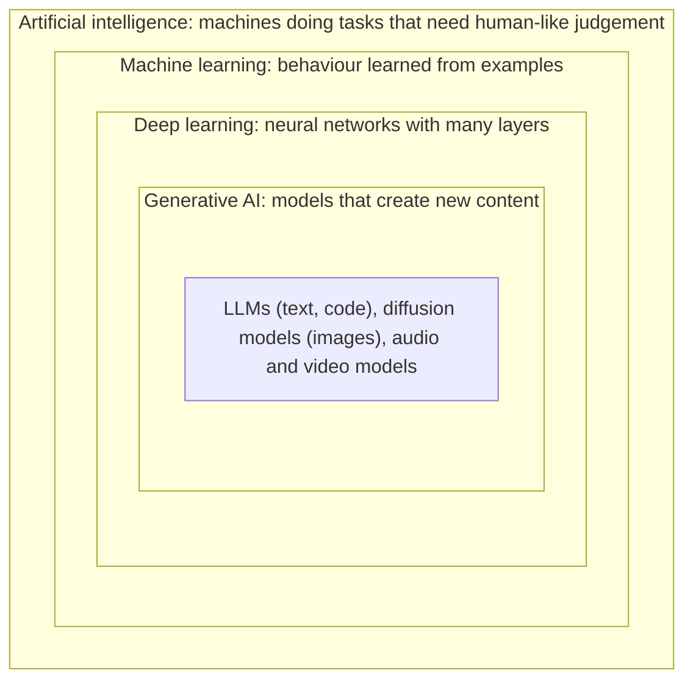
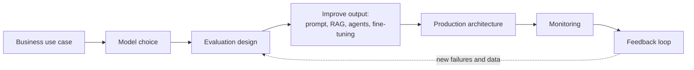

# Chapter 1: Introduction to AI

## 1. Why it matters

Every later chapter in this handbook assumes you can place a technology on the AI map: what is machine learning, what is a language model, and what is just software with a model call in it. In client conversations and interviews, people mix these terms constantly. Being the person who uses them precisely is the first sign of seniority.

This chapter also defines the job. AI engineering is a different discipline from classic machine learning (ML) engineering, and most roles you are preparing for sit on the AI engineering side.

## 2. The concept, from scratch

### 2.1 Plain English first

Traditional software is a set of instructions. A developer thinks through every situation, writes the rules, and the computer follows them exactly. Give it the same input and you get the same output. This works well when the rules are known and stable: calculating tax, moving money between accounts, routing a parcel by postcode.

It works badly when the rules are too many or too fuzzy to write down. Nobody can write the rules for "is this photo a cat", "is this email a phishing attempt" or "what will demand for umbrellas be next week". But there are plenty of examples of each. **Artificial intelligence (AI)** is the broad name for getting machines to do tasks that normally need human judgement. **Machine learning** is the most successful way of doing it: instead of writing the rules, you show the machine examples and let it find the rules itself.

**Generative AI** goes one step further. Most machine learning models are built to *decide* something (spam or not spam). Generative models are built to *produce* something new: a paragraph, an image, a block of code, a summary of a meeting. The best-known generative models for text are **large language models (LLMs)**: systems trained on very large amounts of text to continue a piece of text sensibly.

### 2.2 The precise version

The terms nest inside each other:

| Term | Definition | Example |
|---|---|---|
| **Artificial intelligence** | Any technique that lets machines perform tasks that normally require human intelligence. Includes approaches that do not learn, such as hand-written expert-system rules. | A chess engine, a claims rules engine, a chatbot |
| **Machine learning (ML)** | The subset of AI where a model's behaviour is learned from data instead of being programmed explicitly. | A model that predicts which claims are fraudulent |
| **Deep learning (DL)** | The subset of ML that uses neural networks with many layers. Strong on images, audio and text. | Image classifiers, speech recognition, the networks inside LLMs |
| **Generative AI** | The subset of deep learning whose models generate new content (text, images, audio, video, code). | An LLM drafting an email, an image model creating a product photo |

Two clarifications that interviewers like:

- AI is wider than ML. A rules engine that gives a decision can be called AI in the historical sense even though it learns nothing. When someone says "AI" today they almost always mean ML or generative AI, but it is worth knowing the difference.
- Agents are not a model type. An **AI agent** is a *system* built around an LLM: the model decides what to do, calls tools, looks at results and repeats until a goal is met. It sits on top of generative AI. [Chapter 17](../17-from-llm-calls-to-agents/README.md) covers it properly.

### 2.3 Three ways a machine can learn (preview)

Machine learning has three main styles, covered in [Chapter 2](../02-how-machines-learn/README.md):

- **Supervised learning:** learn from labelled examples (input and the right answer).
- **Unsupervised learning:** find structure in data that has no labels.
- **Reinforcement learning:** learn by trial and error, guided by rewards.

For now, hold on to one idea: in ML, **the model's rules are stored as numbers learned from data**, not as `if` statements written by a developer.

### 2.4 Discriminative vs generative models

Deep learning models fall into two families.

- **Discriminative models** answer "which one?" or "how much?" They classify, predict or score: this loan applicant is high risk, this scan shows a fracture, next month's sales will be 4,200 units. They are usually trained on labelled data.
- **Generative models** learn the pattern of the data itself and can then produce new samples that look like it. LLMs generate text one small piece at a time. Diffusion models generate images by starting from random noise and removing it step by step. Both are generative, but they work differently (Chapters [4](../04-transformers-and-attention/README.md) and [8](../08-the-model-landscape/README.md)).

An LLM is, at its core, a model trained to predict the next piece of text, called a **token** ([Chapter 3](../03-tokens-and-embeddings/README.md)). Doing that billions of times over huge amounts of text produces abilities nobody wrote by hand: summarising, translating, writing code, following instructions. That is why one model can serve so many tasks.

### 2.5 AI vs AGI

**Artificial general intelligence (AGI)** usually means AI that can match human ability across most cognitive tasks, rather than excelling at one narrow thing. Everything in production today, including the most capable LLMs, is narrow or "general-purpose within limits". There is no agreed, testable definition of AGI, and experts disagree on how close or far it is. In an interview, say exactly that: define it, say it is not what you are building with, and avoid predictions.

### 2.6 What AI engineering is

Training a large model from scratch needs huge datasets, specialised hardware and very large budgets, so almost no company does it. Instead, a small number of providers build **foundation models**: general-purpose models, often multimodal (they handle text, images, audio and more), that can be adapted to many tasks. Everyone else builds products on top.

**AI engineering** is the discipline of turning foundation models into reliable products. It covers choosing a model, shaping its behaviour (prompts, retrieval, fine-tuning, agents), measuring quality, and running the result safely and affordably.

This differs from ML engineering, which centres on training models from data:

| | ML engineering | AI engineering |
|---|---|---|
| Starting point | Your data | A pretrained foundation model |
| Main work | Feature engineering, training, tuning a model | Prompting, retrieval, tool use, evaluation, guardrails |
| Typical output | A model you trained | A product that calls a model you did not train |
| Hard part | Getting a good model | Getting a *reliable, safe, affordable system* around a capable but unpredictable model |

A good one-sentence version: **creating a model is machine learning; making it work reliably in the real world is AI engineering.**

### 2.7 What "production-ready" means

A demo that works on three hand-picked questions is not a product. AI products are judged on five things, and they pull against each other:

- **Quality:** outputs are accurate and useful.
- **Safety:** harmful or risky behaviour is reduced.
- **Latency:** responses arrive within the time your users or SLA allow.
- **Cost:** token and infrastructure spend stays inside the budget.
- **Feedback:** the system learns from real use and keeps improving.

Making one better usually costs another. A larger model raises quality and raises cost and latency. Tight guardrails raise safety and may lower usefulness. Most of your design decisions in later chapters are trade-offs between these five.

### 2.8 The AI engineering lifecycle

The rest of the handbook follows this loop:

1. **Business use case:** what problem are we solving, and is AI the right tool?
2. **Model choice:** which base model, within what constraints?
3. **Evaluation:** how will we measure success? Decide this *before* building.
4. **Improve the output:** prompts first, then retrieval (RAG), agents or fine-tuning if needed.
5. **Production architecture:** make it reliable.
6. **Monitoring:** track failures and cost.
7. **Feedback loop:** keep improving.

Notice evaluation comes early. Teams that skip it end up guessing whether each change helped.

## 3. Analogies across industries

- **Rules vs learning (insurance).** A traditional claims system is like a rulebook written by senior underwriters: "refer any claim over 10,000". An ML system is like a new adjuster who has reviewed ten thousand past claims and has absorbed which ones the seniors referred. The rulebook is exact but only as good as what its authors thought of. The adjuster picks up patterns nobody wrote down, but occasionally gets one confidently wrong.
- **Discriminative vs generative (healthcare).** A discriminative model is the radiologist who reads a scan and says "fracture: yes or no". A generative model is the same radiologist dictating the full written report. Different task, different risk: a wrong yes/no is one error, while a fluent report can contain a sentence that sounds right and is invented.
- **AI engineering vs ML engineering (retail).** ML engineering is like a manufacturer designing and producing a new kind of engine. AI engineering is like a retailer who buys proven engines and builds reliable vehicles around them: choosing the right one, adding brakes (guardrails), a dashboard (monitoring) and a service schedule (evaluation and updates). Most businesses are in the second group.

## 4. Diagram

How the terms nest:



The AI engineering lifecycle:



## 5. How it's used in industry

- **Insurance: claims triage.** A discriminative ML model scores incoming claims for fraud risk and routes high scores to a human investigator. A generative model then drafts the summary of the case for that investigator. Two kinds of AI in one workflow, each doing what it is good at.
- **Healthcare: clinical documentation.** An LLM turns a recorded consultation into a draft note for the doctor to review and sign. The human stays accountable, because the draft can contain plausible mistakes.
- **E-commerce: product search and support.** An LLM answers questions about orders and returns using the retailer's own policies, supplied at question time. Conventional ML ranks search results. Generative AI handles language, ML handles scoring.
- **Logistics: exception handling.** A forecasting model predicts delays. When a shipment is at risk, a workflow uses an LLM to read the carrier's free-text emails and extract the new delivery date into structured fields.

## 6. Common misconceptions

- **"AI, ML and deep learning are the same thing."** They are nested. AI is the widest; generative AI is the narrowest of the four terms in this chapter.
- **"Generative AI replaced traditional ML."** No. Forecasting, fraud scoring, ranking and recommendations are still mostly classical ML, often cheaper and more predictable than an LLM. Choosing the simpler tool is a mark of a good engineer.
- **"An LLM is a database of facts."** It stores patterns in numbers learned from training data, not retrievable records. It can state something false with total confidence, which is why Part 4 (RAG) and Part 6 (quality and safety) exist.
- **"AI engineering means training models."** Mostly it does not. It means building reliable systems around models you did not train.
- **"Agents are a type of model."** They are systems built around a model.
- **"More AI is always better."** If the sequence of steps is known and fixed, plain code or a fixed workflow is usually more reliable, cheaper and easier to audit than an autonomous agent.
- **Interview trap:** answering "what is AI?" with a definition of an LLM. Give the nested picture first, then place LLMs inside it.

## 7. Python example

This tiny example shows the central difference between programming and machine learning: a human writes a rule versus the machine finds the rule from past examples. It uses plain Python with no libraries.

```python
# Past claims: (claim amount in thousands, did an adjuster send it for review?)
history = [(1.2, False), (2.5, False), (3.1, False), (4.8, False), (6.0, False),
           (7.5, True), (8.2, True), (9.9, True), (12.0, True), (15.5, True)]


def rule_based(amount):
    """Traditional programming: a human writes the rule."""
    return amount > 10


def learn_threshold(examples):
    """Machine learning in miniature: pick the cut-off that best fits past decisions."""
    best_cutoff, best_correct = None, -1
    for cutoff, _ in examples:  # try every amount we have seen as a cut-off
        correct = sum((amount > cutoff) == reviewed for amount, reviewed in examples)
        if correct > best_correct:
            best_cutoff, best_correct = cutoff, correct
    return best_cutoff


def accuracy(predict, examples):
    return sum(predict(amount) == reviewed for amount, reviewed in examples) / len(examples)


learned_cutoff = learn_threshold(history)
learned = lambda amount: amount > learned_cutoff

print(f"Hand-written rule accuracy: {accuracy(rule_based, history):.0%}")
print(f"Learned cut-off: {learned_cutoff}  accuracy: {accuracy(learned, history):.0%}")
print("New claim of 7.0 ->", "review" if learned(7.0) else "auto-approve", "(learned)")
```

Output:

```text
Hand-written rule accuracy: 70%
Learned cut-off: 6.0  accuracy: 100%
New claim of 7.0 -> review (learned)
```

Line by line:

- `history` is the training data: inputs (claim amount) with the right answer (reviewed or not). This is **labelled data**.
- `rule_based` is a developer's guess. It only catches claims above 10, so it misses the three claims between 7.5 and 9.9 that adjusters did review.
- `learn_threshold` tries each amount as a cut-off and keeps the one that agrees most often with past decisions. The "rule" (the number 6.0) came from the data, not from a person.
- `accuracy` measures how often a rule agrees with history.
- The last line applies the learned rule to a new claim. This is **prediction on unseen data**.

Real models learn millions or billions of such numbers (called parameters) instead of one cut-off, but the idea is the same. One warning: 100% accuracy on ten examples proves nothing. Chapter 2 explains why models must be tested on data they have not seen.

## 8. Interview questions

### Q1. What is the difference between AI, machine learning, deep learning and generative AI?

- **Say first:** They are nested. AI is the broad goal of machines doing tasks that need human judgement. Machine learning is the subset that learns rules from data. Deep learning is ML using many-layer neural networks. Generative AI is deep learning that creates new content, and LLMs are the best-known example for text.
- **Then cover:** Give one example at each level. Mention that AI also includes non-learning approaches such as rules engines. Say that agents are systems built on top of LLMs, not a further subset of models.
- **Architect angle:** Choosing the right layer for the problem is the real skill. Fraud scoring and forecasting are usually better served by classical ML. Use generative AI where language or content creation is central.
- **Trap:** Describing everything as "AI" with no hierarchy, or saying generative AI has replaced ML.

### Q2. How does machine learning differ from traditional programming?

- **Say first:** In traditional programming a developer writes the rules and the program applies them to data. In machine learning you supply data and the right answers, and the machine finds the rules.
- **Then cover:** Traditional code is deterministic and easy to audit. ML models are statistical: they are right most of the time and need evaluation, not just testing. ML shines where the rules are too many or too fuzzy to write.
- **Architect angle:** If the rules are known and stable, code is cheaper, faster and fully explainable to a regulator. Reach for ML only when rules cannot be written.
- **Trap:** Implying ML is always better. The likely follow-up is "when would you not use ML?"

### Q3. What is the difference between discriminative and generative models?

- **Say first:** Discriminative models classify or predict, such as "fraud or not". Generative models create new content, such as a summary or an image.
- **Then cover:** Discriminative models are usually trained on labelled data and produce a label or score. Generative models learn the pattern of the data itself and sample from it. LLMs generate text token by token; diffusion models generate images by removing noise.
- **Architect angle:** Risk differs. A wrong classification is a bounded error. A fluent generated answer can contain an invented fact that looks right, so generative output usually needs grounding, review or guardrails.
- **Trap:** Treating LLMs and image generators as the same architecture. Both are generative but built differently.

### Q4. What is AI engineering, and how is it different from ML engineering?

- **Say first:** ML engineering builds and trains models. AI engineering builds reliable products on top of foundation models that someone else trained.
- **Then cover:** AI engineers choose a model, shape it with prompts, retrieval, tools or fine-tuning, design evaluations, add guardrails, and run the system with monitoring and cost control. Summarise it as: creating a model is ML, making it work in the real world is AI engineering.
- **Architect angle:** The deliverable is a system that meets targets for quality, safety, latency and cost, not a model. Name those four plus feedback.
- **Trap:** Saying AI engineers "train LLMs". Training from scratch is rare because of the data, hardware and cost involved.

### Q5. What does "production-ready" mean for an AI system?

- **Say first:** It means the system is dependable under real use, not just impressive in a demo: measured quality, safety controls, acceptable latency, controlled cost, and a feedback loop.
- **Then cover:** Walk the lifecycle: use case, model choice, evaluation, improvement (prompt, RAG, agents, fine-tuning), architecture, monitoring, feedback. Stress that evaluation is designed early, and re-run after any change to the model, prompt, data or tools.
- **Architect angle:** The five goals trade off against each other. A client conversation should make those trade-offs explicit, for example "faster and cheaper means a smaller model, which we measure against your quality bar."
- **Trap:** Listing only the model and the prompt. Interviewers want evaluation, monitoring and guardrails named.

### Q6. What is AGI, and how does it differ from the AI you build with today?

- **Say first:** AGI usually means AI that matches human ability across most cognitive tasks. Today's systems, even very capable LLMs, are not agreed to be AGI, and there is no accepted test for it.
- **Then cover:** Current systems are strong but uneven: they can fail at simple tasks and state falsehoods confidently. Capabilities and definitions are debated, so avoid dates and predictions.
- **Architect angle:** Design for the system you have. Evaluation, guardrails and human oversight exist because the models are fallible, whatever the long-term trajectory.
- **Trap:** Predicting when AGI will arrive or claiming a current model is AGI. Both are unsupported.

## 9. Scenario exercise

**The brief.** A regional insurer's head of claims says: "We want AI for claims. Our adjusters spend half their day reading documents and typing up case notes, and some fraud slips through. Can you make that go away?" You have ten minutes with them and little else is known.

**Your task, from memory, before opening the answer:**

1. Which parts of this are classical ML, which are generative AI, and which might just be plain software?
2. What are the first five questions you would ask?
3. How would you define "success" so you can evaluate it?
4. What is your biggest risk and how would you contain it?

<details>
<summary>Model answer</summary>

**Split the problem.** "AI for claims" is at least three problems:

- *Reading documents and drafting case notes:* generative AI (an LLM), with an adjuster reviewing every draft because the model can introduce plausible mistakes.
- *Fraud slipping through:* a discriminative ML problem (score claims for risk), likely classical ML on historical claims data. An LLM is not the natural fit and may be worse and more expensive.
- *Routing and fixed checks* (is the policy active, is the claim inside the limit): plain code or a fixed workflow. No model needed, and a rules engine is easier to audit.

**First questions to ask:**

1. What does "half their day" consist of exactly? Can we sample a day of real work?
2. What data exists: past claims, labels for confirmed fraud, document formats, volumes?
3. What are the regulatory and privacy constraints (personal and health data, where it may be processed, audit requirements)?
4. Who is accountable for a wrong decision, and what must always stay with a human?
5. What does failure cost: a missed fraud case, a wrongly delayed honest claim?

**Success measures** (decide before building): time saved per claim on the drafting task, and adjuster edit rate of drafts; for fraud, precision and recall against confirmed outcomes, with agreed cost for false positives; plus latency, cost per claim, and safety (no leaked personal data). Build a small golden set of real cases reviewed by senior adjusters.

**Biggest risk:** a fluent but wrong draft or a wrongly flagged customer being trusted without review. Contain it with human sign-off, citations back to the source documents, restricting the model to supplied documents, and logging every output for audit.

**Staging:** start with the drafting assistant (lowest risk, fastest value), measure, then address fraud scoring as a separate ML workstream.

</details>

## 10. Key takeaways

- AI ⊃ machine learning ⊃ deep learning ⊃ generative AI; LLMs are generative models for text, and agents are systems built around them.
- Machine learning finds the rules from examples; traditional programming has a human write them. Use code when the rules are known.
- AI engineering builds reliable products on foundation models; ML engineering trains the models.
- Production-ready means quality, safety, latency, cost and feedback, and these trade off against each other.
- Define evaluation early. There is no agreed definition or test for AGI, so do not build around it.

## 11. Further reading

- Russell and Norvig, [*Artificial Intelligence: A Modern Approach*](https://aima.cs.berkeley.edu/): the standard textbook for the AI, agent and learning vocabulary used here.
- Google, [Machine Learning Crash Course](https://developers.google.com/machine-learning/crash-course): a free, practical introduction to ML concepts that Chapter 2 builds on.
- Vaswani et al., [*Attention Is All You Need*](https://arxiv.org/abs/1706.03762) (2017): the paper that introduced the transformer architecture behind modern LLMs (Chapter 4).
- Anthropic, [Building effective agents](https://www.anthropic.com/engineering/building-effective-agents): a vendor engineering guide on workflows vs agents, useful context for Part 5.
