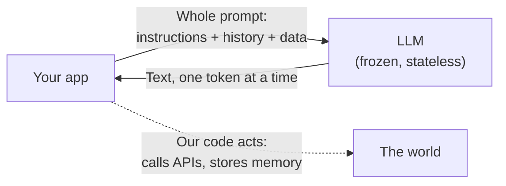
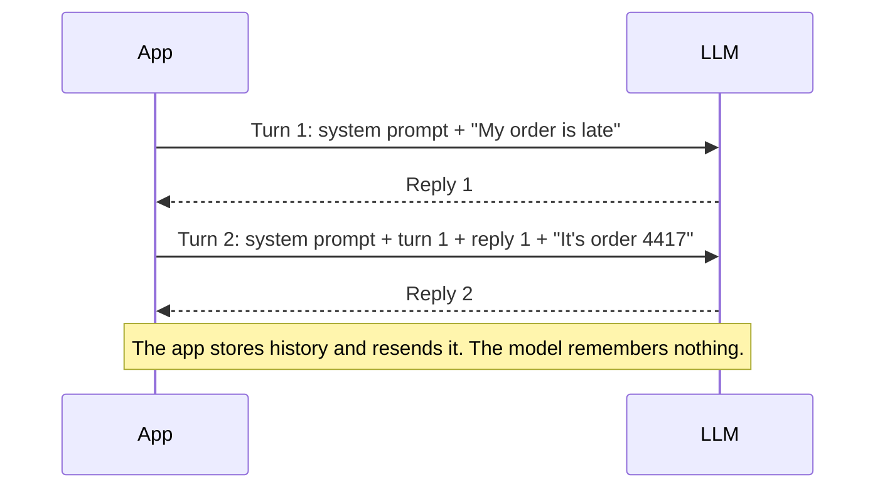
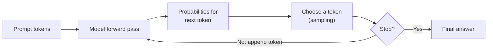
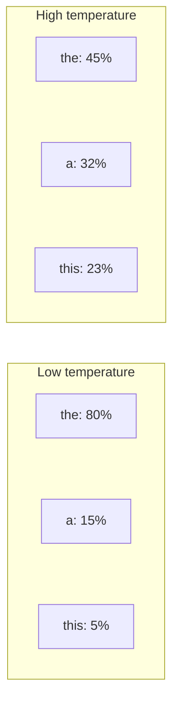
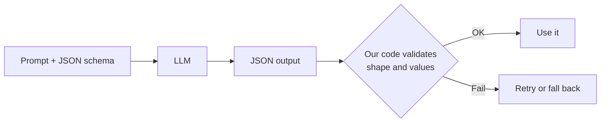

# Chapter 6: Inference and Generation

## 1. The concept, from scratch

### What inference is

**Training** builds the model ([Chapter 5](../05-training-llms/README.md)). **Inference** is using it: you send text in, and it sends text out. Every API call to GPT, Claude, Gemini or Llama is an inference call. The parameters are frozen. Nothing the model sees in your prompt changes them.

### What an LLM is, and what it isn't

Say these four things straight in an interview, because they shape every design decision later:

- **An LLM is stateless.** It remembers nothing between calls. Each request starts from a blank slate.
- **It has no persistent memory.** Anything it "knows" about your conversation is only what you put in the prompt this time.
- **It cannot act on the world.** It produces text. It can't send an email, query a database or click a button. Our code does that.
- **It terminates after each generation.** It produces an answer and stops. It doesn't keep working in the background.

So **the model's value is in reasoning, not in serving as a knowledge store.** It's good at understanding, transforming and reasoning over text you give it. It's a poor database: what it half-remembers from training can be stale or wrong ([Chapter 5](../05-training-llms/README.md)). Give it the facts, and let it reason.

### Chat is an illusion built by your app

If the model is stateless, how does a chat remember what you said two messages ago? **It doesn't. The application sends the whole conversation again on every turn.** The chat history you see is stored by the app, and each new request contains the system instructions, all earlier messages, and the new question.

Two consequences. First, the prompt grows every turn, so cost and latency grow too ([Chapter 7](../07-context-windows-and-context-engineering/README.md) and [Chapter 31](../31-cost-latency-and-caching/README.md)). Second, "memory" for an agent is something we design and bolt on, which is the subject of [Chapter 21](../21-agent-memory-and-state/README.md).

### How generation works, step by step

Recall from [Chapter 4](../04-transformers-and-attention/README.md): the model produces **logits**, softmax turns them into probabilities, and one token is picked. Then the loop repeats.

1. Your prompt is tokenised and run through the model.
2. The model outputs probabilities over its whole vocabulary for the next token.
3. A token is chosen (this is where sampling settings come in).
4. That token is appended to the input.
5. Repeat until the model emits an end-of-sequence token, hits the maximum length, or hits a stop condition.

This is the **autoregressive loop**, and it's why output arrives token by token.

There are two phases per request. **Prefill** processes your whole prompt in parallel and is compute-heavy. **Decoding** then generates output tokens one at a time. That is why a long prompt delays the first token, and a long answer takes a long time to finish. [Chapter 33](../33-inference-engineering/README.md) covers how serving systems optimise both.

### Sampling controls: how a token gets picked

The model gives probabilities. How we pick from them is up to settings you control.

| Setting | What it does | Effect |
|---|---|---|
| **Temperature** | Sharpens or flattens the probability distribution | Low: focused, predictable. High: more varied, more surprising |
| **Top-p (nucleus)** | Only sample from the smallest set of tokens whose probabilities add up to p | Cuts off the unlikely tail |
| **Top-k** | Only sample from the k most likely tokens | A simple fixed cut-off |
| **Max tokens** | Hard cap on output length | Controls cost and stops runaway answers |
| **Stop sequences** | Strings that end generation when produced | Clean endings, structured formats |

A simple way to remember temperature: at **0** the model always takes the single most likely token (called **greedy** decoding). Higher values let it pick less likely tokens, which gives variety and creativity but also more chance of wandering off.

Practical guidance: use low temperature for extraction, classification and tasks that need consistency; use higher for brainstorming and creative writing. Most providers advise changing temperature or top-p, not both. One time-sensitive point: **some newer models restrict or ignore these sampling parameters, and some providers decide them for you** (as of Nov 2026, reported on provider docs and community sites; check your provider's current documentation before relying on a setting).

### Temperature 0 is still not perfectly repeatable

This one surprises people and interviewers love it. Setting temperature to 0 makes the choice greedy, so you'd expect the same input to always give the same output. In practice it often doesn't. Providers' own documentation says results won't be fully deterministic even at 0.

Why? The maths on GPUs involves very small rounding differences, and those can change depending on how your request happens to be grouped with others in a batch on the server. Tiny differences in the numbers can flip a close call between two tokens, and once one token differs, everything after it can differ. A 2025 write-up from Thinking Machines Lab argued that the main culprit is changing batch sizes under server load rather than the often-blamed GPU concurrency, and showed that special "batch-invariant" kernels can make output identical, at a throughput cost. That's one account of the cause, from a single source, and providers differ in what they do.

The takeaway for system design: **never build something that breaks if the model's output is slightly different next time.** Use structured output and validation, write tests that check properties rather than exact strings, and log the actual output when you need an audit trail.

### Streaming

Without streaming, the user waits for the entire answer to finish. With **streaming**, tokens are sent to the client as they're generated, so text appears while the model is still writing. Total time is the same, but it *feels* much faster, which matters for chat interfaces. The metric that captures this is **time to first token (TTFT)**. Streaming is usually done over server-sent events, and [Chapter 35](../35-reliability-scaling-and-streaming/README.md) covers the engineering.

### Structured output

Applications don't want prose, they want data: a JSON object with fields the code can read. **Structured output** makes the model's reply follow a format you define, usually a **JSON schema**. There are three levels, from weakest to strongest:

1. **Ask nicely in the prompt.** "Reply in JSON." Works often, fails sometimes.
2. **JSON mode.** The API guarantees the output is valid JSON, but not that it has the right fields.
3. **Schema-constrained (strict) output.** The API constrains generation so the output follows your schema. OpenAI's Structured Outputs works this way; Anthropic and Google offer comparable features. Support and limits vary by provider and model, and schemas have restrictions, so check current documentation (as of Nov 2026).

Even with strict output, **valid shape isn't the same as correct content**. A field can be perfectly formatted and still wrong. So you still validate values in your own code, retry on failure, and handle the model refusing or running out of tokens mid-answer.

### The capabilities of an LLM

When someone asks "what can the model do?", this is the list to give: **streaming, thinking, structured output, vision, tool calling, web search and embeddings.**

| Capability | In one line |
|---|---|
| **Streaming** | Tokens delivered as they're generated. |
| **Thinking** | The model reasons through a problem step by step before answering ([Chapter 5](../05-training-llms/README.md)). Costs extra tokens. |
| **Structured output** | Replies that follow a schema your code can parse. |
| **Vision** | Reads images (and often PDFs and screenshots) as input. |
| **Tool calling** | The model asks for a function to be called, and our code runs it ([Chapter 19](../19-tool-calling/README.md)). |
| **Web search** | A built-in or connected tool that fetches fresh information from the web. |
| **Embeddings** | Turning text into vectors for search ([Chapter 3](../03-tokens-and-embeddings/README.md)). Usually served by a separate embedding model. |

Availability differs by provider and model, so check before designing around one.

### Tool calling, in one paragraph

Since the model can't act on the world, it has a way to *ask* for action. You describe your tools (name, purpose, parameters) in the request. If the model decides one is needed, it replies not with prose but with a structured request: "call `get_order_status` with order 4417". **Our code runs the function and sends the result back**, and the model continues. The model proposes, our code decides and acts. [Chapter 19](../19-tool-calling/README.md) goes deep.

### Why models hallucinate, in brief

The model is trained to produce *likely* text, not *true* text. When it doesn't know, it can still produce a fluent, confident, wrong answer, because fluent is what it's optimised for. It doesn't have a built-in sense of "I'm not sure". Remember that the model isn't a knowledge store, so we give it the facts (retrieval, [Chapter 11](../11-rag-fundamentals/README.md)), ask it to cite them, and measure the result. The full treatment is in [Chapter 28](../28-hallucination-and-grounding/README.md).

### Where predictive and generative models meet at inference

The inference path is often the place the two kinds of model work together ([Chapter 1](../01-introduction-to-ai/README.md)). A small predictive classifier may decide which model a query goes to, or whether it is safe to answer. The generative model then writes the response. A predictive reranker may select the passages the generative model will read. Production systems are usually a chain of both.

## 2. Analogies across industries

- **Stateless (telecom).** A call-centre agent with no CRM screen, who hears every caller as a stranger. The "memory" is the case notes the system reads out at the start of each call. Chat history in an LLM app is those case notes, re-read every time.
- **Prefill and decoding (travel).** Prefill is the airline check-in desk processing all your documents at once. Decoding is boarding, one passenger at a time through the gate: the queue you wait in is the output.
- **Temperature (retail).** A recommendation shelf at low temperature always puts the best seller first. At high temperature, the shop occasionally promotes something unexpected. Both are valid, depending on whether you want reliability or discovery.
- **Structured output (insurance).** An insurer's claim form with fixed boxes. Free-text letters are hard to process, but a form with the right boxes still needs someone to check that the amounts are correct. Valid shape is not correct content.
- **The model proposes, code acts (logistics).** A dispatcher radios "send truck 12 to depot B", but the driver and the fleet system do the moving. The dispatcher, like the LLM, only produces instructions.

## 3. How it's used in industry

- **Retail: extraction at low temperature.** An online retailer uses an LLM at low temperature with a strict JSON schema to turn free-text return requests into structured records (order ID, reason, item condition), validated before they reach the returns system.
- **Banking: streaming for a service assistant.** A bank's support assistant streams replies so customers see text immediately, while a separate non-LLM service executes any account change after authentication. The model never touches the account.
- **Travel: stateless design.** A travel platform stores each trip-planning conversation in its own database and resends the relevant slice on every call, so any server can handle any request and sessions survive restarts.
- **Healthcare: repeatability expectations.** A clinical-notes tool logs the exact model output, prompt and version for each note. Because temperature 0 isn't guaranteed repeatable, the audit trail rests on stored outputs, not on re-running the model.

## 4. Common misconceptions

- **"The model remembers our conversation."** It doesn't. The app resends the history every time, and that history costs tokens.
- **"Temperature 0 means deterministic."** Close, but not guaranteed. Providers say so in their documentation.
- **"Temperature controls how accurate the model is."** It controls how varied the choices are. A low temperature doesn't make wrong facts right; it can make the same wrong answer consistently.
- **"Structured output means the data is correct."** It guarantees shape (at best), not truth. Always validate values.
- **"Streaming makes the model faster."** Total time is similar. It makes the wait feel shorter and lowers time to first token.
- **"The model can look things up or run code by itself."** Only through tools that our code provides and executes.
- **"The model knows its own limits."** It has no reliable internal sense of what it doesn't know, which is why grounding and evaluation exist.

## 5. Interview questions

### 1. Is an LLM stateful? How does a chatbot remember the conversation?

No, an LLM is stateless. Every call starts fresh, and the model keeps nothing between requests. What looks like memory is the application. It stores the conversation and sends the system prompt, the earlier messages and the new question on every turn. So the model only "remembers" what's in the prompt right now. This has practical consequences: the prompt grows each turn, so cost and latency grow, and eventually it hits the context limit, so I'd have to trim or summarise old turns. And if I need anything to last across sessions, like user preferences, I have to store it myself and inject it, which is what agent memory is about.

### 2. Walk me through what happens when an LLM generates a response.

The prompt is tokenised and the model processes all of it in one pass, which is called prefill. At the end it produces probabilities for the next token over its whole vocabulary. A sampling step picks one token, based on settings like temperature and top-p. That token is appended to the input and the model runs again for the next token, and this repeats until it produces an end-of-sequence token or hits the max-token limit or a stop sequence. That's the autoregressive loop. It's why the first token takes a moment, because of prefill over the prompt, and why the rest streams out one token at a time.

### 3. What does temperature do, and how would you set it?

Temperature controls how sharp or flat the probability distribution is before a token is picked. Low temperature makes the model choose the most likely tokens, so output is focused and consistent. High temperature flattens the distribution, so it picks less likely tokens more often, and you get variety and some risk. For extraction, classification or anything where I want consistent behaviour, I'd use a low value. For brainstorming or creative copy, higher. It's not an accuracy dial: a low temperature doesn't make the model more correct, only more consistent. And I'd check the provider's documentation, because some newer models restrict or manage sampling settings themselves.

### 4. If you set temperature to 0, will you get the same answer every time?

Not guaranteed. At temperature 0 the choice is greedy, so you'd expect repeatability, but in practice providers say it isn't fully deterministic. The numeric differences on GPUs, which can vary with how requests are batched together on the server, can flip a very close call between two tokens, and from there the text diverges. There's published work showing it can be made reproducible with special kernels, but at a speed cost, and that's not something I control as an API customer. So I design for it: I don't rely on exact string matches in tests, I validate outputs against a schema, and where I need an audit trail I store the actual output instead of assuming I can regenerate it.

### 5. What are top-p and top-k, and when do they matter?

Both limit which tokens the model is allowed to pick from. Top-k keeps only the k most likely tokens. Top-p, or nucleus sampling, keeps the smallest set of tokens whose probabilities add up to p, so the cut-off adapts: if the model is very sure, only a few tokens survive, and if it's unsure, more do. They trim the unlikely tail that can produce odd words. In practice I usually adjust temperature, or top-p, but not both, because they interact. For most application work the defaults are fine, and I'd only tune them with an evaluation that shows a benefit.

### 6. Why use streaming, and what does it change?

Streaming sends tokens to the user as they're generated instead of waiting for the full answer. The total generation time is about the same, but the user sees text almost immediately, so it feels much more responsive, and time to first token is the metric that matters. It's essential for chat. The trade-off is engineering complexity: you need a streaming transport such as server-sent events, you have to handle dropped connections and partial output, and it's harder to validate or moderate an answer before the user sees it. For a backend job that processes thousands of documents, I'd skip streaming and just use normal requests.

### 7. How do you get reliable JSON out of an LLM?

I layer it. Best case, I use the provider's schema-constrained structured output, where I give a JSON schema and the API constrains generation to match it. That nearly eliminates malformed JSON. If that's not available, I use JSON mode plus a clear prompt with an example. Either way, I validate in my own code: parse it, check it against the schema, check values are sensible, because correct shape doesn't mean correct content. I handle failure by retrying, perhaps with the error message fed back, and then falling back to a default or human review. I also keep schemas simple, and set max tokens high enough that the output isn't cut off in the middle of the JSON.

### 8. What are the capabilities of an LLM, and what can't it do?

The capabilities I'd list are streaming, thinking, structured output, vision, tool calling, web search and embeddings, though exactly what's available differs by model and provider. What it can't do on its own: it's stateless, it has no persistent memory, it can't act on the world, and it stops after each generation. It can only produce text. To get anything done, our code has to supply the memory, provide the tools, run them, and loop. That's the foundation for agents. And the model's value is in reasoning over what we give it, not in being a knowledge store, because what it half-remembers from training can be stale or wrong.

### 9. The model proposes a tool call. Who actually executes it, and why does that matter?

Our code does. The model only returns a structured request: the tool name and arguments. My application receives it, validates it, checks permissions, runs the function, and sends the result back so the model can continue. That matters for safety and control. The model might ask for something wrong or something an attacker steered it towards through injected text, so I treat its output as a suggestion, not a command. I check the arguments, enforce that the user is allowed to do this, and require confirmation for risky actions like sending money or deleting data. The model proposes, our code decides and acts.

### 10. A user reports that the chatbot "forgot" something they said an hour ago. What are the possible causes?

Because the model is stateless, "forgetting" is always a problem in what we sent. The most likely causes: the history was trimmed or summarised to fit the context window and the detail got dropped; a new session started and the old history wasn't loaded; the information was in the prompt but buried deep in a long context where the model paid it less attention; or the app never stored it in the first place. I'd look at the exact prompt that was sent for that turn, since that's all the model saw. The fix depends on the cause: better trimming rules, stored long-term memory for important facts, or pinning key information near the top of the prompt.

## 6. Scenario exercise

An online electronics retailer built a support assistant on a hosted LLM. In testing it was great. Now in production, three complaints have come in: the assistant "forgets" order numbers after a few messages; the nightly job that turns return emails into JSON records fails on about 3% of emails because the output isn't valid JSON; and QA says a test that checked for an exact reply started failing even though nothing changed and temperature is 0. The team lead asks you for the causes and the fixes. You don't have access to the code yet.

What do you say? Answer from memory, then check.

Model answer

All three come back to how inference works, so I'd explain the model first and then take them one by one.

The model is stateless, so the "forgetting" has to be a problem with what the app sends. I'd look at the exact prompt for a failing conversation. My first suspicion is that the app trims history to fit a limit, or keeps only the last few turns, and the order number falls off the end. Fixes: pull key facts like the order number into a small pinned "case summary" that's always included, and summarise old turns instead of just cutting them. Long-lived facts should live in our own storage and be injected each time.

For the JSON failures, I'd check whether they're using the provider's schema-constrained structured output, or just asking for JSON in the prompt. If it's the prompt, I'd switch to strict structured output, keep the schema simple, and make sure the max-token limit isn't cutting the output in half. I'd validate in code anyway, retry once with the error, and send what still fails to a review queue. At 3% over a nightly volume, that's a manageable exception path.

The failing exact-match test is expected behaviour, not a bug. Temperature 0 isn't guaranteed to be repeatable, and a small change can alter the wording. The test is checking the wrong thing. I'd rewrite it to check properties: does it mention the right order, does it follow policy, does the JSON validate. For anything that needs an exact record I'd log the real output.

I'd put the three fixes in order of customer impact: the forgetting first, then the JSON failures, then the test.

## 7. Key takeaways

- An LLM is stateless, has no persistent memory, can't act on the world and terminates after each generation; the app supplies history, memory and tools.
- Generation is an autoregressive loop: probabilities, pick a token, append, repeat; prefill handles the prompt, decoding produces tokens one by one.
- Temperature and top-p shape variety, not accuracy, and temperature 0 is still not perfectly repeatable, so design for that.
- Structured output gives you valid shape; you still validate content. The model proposes tool calls, our code decides and acts.
- Capabilities: streaming, thinking, structured output, vision, tool calling, web search and embeddings. The model's value is in reasoning, not as a knowledge store.

## 8. Further reading

- Thinking Machines Lab, [Defeating Nondeterminism in LLM Inference](https://thinkingmachines.ai/blog/defeating-nondeterminism-in-llm-inference/) (2025): why identical requests can give different outputs.
- OpenAI, [Structured Outputs guide](https://platform.openai.com/docs/guides/structured-outputs).
- Anthropic, [Messages API documentation](https://docs.anthropic.com/en/api/messages): requests, streaming and sampling parameters.
- Holtzman et al., [The Curious Case of Neural Text Degeneration](https://arxiv.org/abs/1904.09751) (2019): the paper that introduced nucleus (top-p) sampling.
