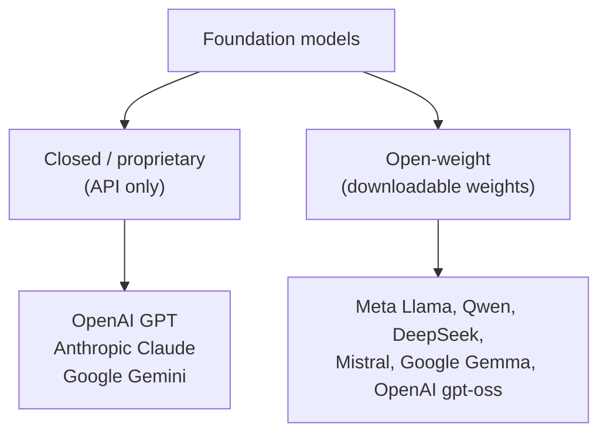
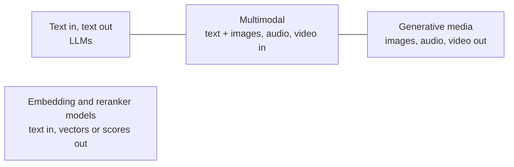
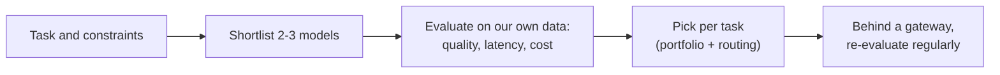

# Chapter 8: The Model Landscape

## 1. The concept, from scratch

### Why this chapter exists

By now you know how models are built ([Chapter 4](../04-transformers-and-attention/README.md)), trained ([Chapter 5](../05-training-llms/README.md)) and run ([Chapter 6](../06-inference-and-generation/README.md)). The next question in every real project is: **which model do we use?** This chapter gives you a map of the landscape and a method for choosing, so you can answer that question in an interview without just naming your favourite.

A warning first. **Model names, versions, prices and rankings change every few weeks.** This chapter names model families as examples (as of Nov 2026) and focuses on the categories and the decision process, which age much more slowly. When you need a specific version or number, read the provider's current model documentation.

### Map 1: who controls the model

**Closed (proprietary) models** are reached through an API or a cloud platform. You can't see or download the weights. Examples (as of Nov 2026): OpenAI's GPT family and its reasoning models, Anthropic's Claude family, Google's Gemini family. The provider runs the infrastructure, ships improvements, and charges per token ([Chapter 31](../31-cost-latency-and-caching/README.md)). The most capable general models have mostly been in this group, although open-weight models have been narrowing the gap.

**Open-weight models** publish their trained parameters, so you can download and run them on your own hardware or a cloud of your choice. Examples (as of Nov 2026): Meta's Llama, Alibaba's Qwen, DeepSeek, Mistral, Google's Gemma, and OpenAI's gpt-oss. You get control over where data goes, how the model is served, and whether you fine-tune it. You also take on the serving, scaling and security work ([Chapter 34](../34-self-hosting-open-weight-models/README.md)).

Two cautions. **Open-weight is not the same as open source.** You usually get the weights but not the training data or full recipe. And **licences differ**: some are permissive (Apache 2.0 or MIT style), while others, such as Meta's Llama community licence, carry conditions on use. Read the actual licence on the model card before you build a product on it.

### Map 2: size and speed tiers

Most providers sell the same family in several sizes. The names differ, but the pattern is the same:

| Tier | What it is | Typical use |
|---|---|---|
| **Frontier / flagship** | Largest, most capable, slowest, most expensive | Hard reasoning, complex agents, difficult writing and code |
| **Mid-tier workhorse** | Strong quality at a balanced price and speed | Most production workloads |
| **Small / mini / flash / haiku-class** | Fast and cheap, good enough for well-defined tasks | Classification, extraction, routing, high-volume jobs, real-time chat |
| **Tiny / on-device** | Small enough to run on a laptop, phone or edge device | Offline use, strict privacy, very low latency |

A **small language model (SLM)** is a model with far fewer parameters, from under a billion to a few billion. Small models are good at narrow, well-defined work, especially when fine-tuned or distilled from a bigger model ([Chapter 10](../10-fine-tuning-and-distillation/README.md)). They are cheaper and faster, and easier to host privately. They are also weaker at open-ended, multi-step reasoning. As we said in [Chapter 7](../07-context-windows-and-context-engineering/README.md), small doesn't mean a small context window: many small models handle 128,000 tokens or more.

The big idea for production: **you rarely want one model for everything.** You want the cheapest model that meets the quality bar for each task, and a way to route between them ([Chapter 36](../36-llm-gateways-and-routing/README.md)).

### Mixture of experts, in one paragraph

Many recent large models use a **mixture-of-experts (MoE)** design. Instead of every parameter being used for every token, the model has many specialised sub-networks ("experts") and a small **router** that picks a few of them for each token. So there are two numbers: **total parameters** (what you must store in memory) and **active parameters** (what's actually computed per token). An MoE model can have the knowledge capacity of a very large model but the per-token compute of a much smaller one. The catch is that you still need memory for all the experts, which matters when you self-host. (Mixtral, from Mistral, is a well-known open example.)

### Map 3: what kind of data the model handles

- **Text LLMs.** The default. Everything so far.
- **Multimodal models.** One model that accepts more than text: images, documents and screenshots, and in some models audio and video. Most major frontier models can read images. This is what makes "upload a photo of the damaged car" or "read this invoice PDF" possible. Which modalities go in and which come out varies by model, so check.
- **Image, audio and video generators.** A different family of models creates media from a prompt. Image generators are typically built on **diffusion**: they start from random noise and refine it step by step into a picture that matches the prompt. Don't confuse this with text LLMs, which produce one token at a time.
- **Diffusion language models.** An emerging idea is to apply the diffusion approach to *text*: produce and refine a whole block of text in parallel, instead of left to right. Early systems, such as Google's experimental Gemini Diffusion and Inception's Mercury, report very high speed, particularly for code. As of Nov 2026 they are still niche, and reported results are mixed, with gaps on harder reasoning tasks in at least some published comparisons. Know the idea, don't build on it without testing.
- **Embedding and reranker models.** Small, specialised models, usually encoder-only ([Chapter 4](../04-transformers-and-attention/README.md)), that turn text into vectors ([Chapter 3](../03-tokens-and-embeddings/README.md)) or score how relevant a passage is to a query ([Chapter 14](../14-improving-retrieval/README.md)). They are separate models from the chat LLM, chosen and priced separately.
- **Speech and other specialists.** Speech-to-text, text-to-speech, code-specialised models, safety classifiers and so on.

This is a good place to restate the **predictive plus generative** point from [Chapter 1](../01-introduction-to-ai/README.md). A real system often chains them: a small classifier or router (predictive) picks the model, an embedding model (predictive) finds the passages, a reranker (predictive) orders them, and then the LLM (generative) writes the answer. A model landscape includes all of them, not only the chat models.

### How to choose a model

Don't start from a leaderboard. **Start from the task and the constraints.**

**Step 1: write down what matters.** The usual dimensions:

| Dimension | Question to ask |
|---|---|
| **Quality** | How good must the answer be on *our* task? |
| **Latency** | Time to first token and total time: does it need to feel instant? |
| **Cost** | Price per million input and output tokens, times our volume ([Chapter 31](../31-cost-latency-and-caching/README.md)) |
| **Context** | How much text must it handle at once? |
| **Modalities** | Text only, or images, audio, documents? |
| **Features** | Tool calling, structured output, thinking, streaming ([Chapter 6](../06-inference-and-generation/README.md)) |
| **Data and compliance** | Can data leave our network or region? Retention terms? ([Chapter 30](../30-privacy-governance-and-compliance/README.md)) |
| **Licence and openness** | Can we use and modify it commercially? Do we need to self-host? |
| **Availability and risk** | Rate limits, regions, uptime, deprecation schedule, vendor lock-in |

**Step 2: shortlist** two or three candidates across tiers, for example a flagship, a mid-tier and a small model, perhaps one open-weight.

**Step 3: test on your own data.** Build a small evaluation set of real examples with known good outcomes, and compare the candidates on quality, latency and cost ([Chapter 26](../26-evaluation-fundamentals/README.md)). Public benchmarks are a starting point, but they measure general ability on someone else's tasks, and scores can be inflated if test questions leaked into training data. Your own evaluation is what counts.

**Step 4: pick per task, not per company.** Often the answer is a **portfolio**: a small model for classification and routing, a mid-tier model for most answers, a flagship or reasoning model only for hard cases.

**Step 5: don't hard-wire the choice.** Models improve and get retired quickly. Put the model behind an abstraction, or an LLM gateway ([Chapter 36](../36-llm-gateways-and-routing/README.md)), keep your evaluation set, and re-test when a new model arrives.

### Where you can get models

Three routes, and a client's constraints usually decide which:

- **Direct from the model provider's API.** Fastest to start, usually first access to the newest features.
- **Through a cloud platform.** The big clouds offer many models, from several providers, behind their own security, billing and compliance (as of Nov 2026, examples are Amazon Bedrock, Microsoft Foundry and Google Vertex AI). This suits enterprises that already trust a cloud for data. Model availability, features and limits can differ from the provider's own API. [Chapter 37](../37-cloud-reference-architectures-and-multi-tenancy/README.md) covers it.
- **Self-hosted open-weight.** Maximum control over data and cost at scale, but you carry the operations ([Chapter 34](../34-self-hosting-open-weight-models/README.md)).

## 2. Analogies across industries

- **Model tiers (healthcare).** A hospital doesn't send every patient to the top specialist. A nurse practitioner handles routine cases, a GP the common ones, and a consultant the hardest. Model tiers work the same way, and a router is the triage nurse. Sending everything to the flagship is like booking a surgeon for a sore throat.
- **Closed vs open-weight (telecom).** Buying capacity from a wholesale carrier is quick and someone else keeps the network running. Building your own network gives control over routing and data, and makes you responsible for every fault at 3am.
- **Mixture of experts (retail).** A department store has specialists per floor. A shopper walks past most of them and only talks to the two or three relevant to what they need. The store holds lots of expertise, but each customer uses a small part of it.
- **Evaluating on your own data (manufacturing).** A buyer doesn't choose a machine by its brochure. They run it on their own parts. Public benchmarks are the brochure, your evaluation set is the trial run on the shop floor.
- **Not hard-wiring a model (travel).** A travel company that books flights through an aggregator can switch airlines when prices or schedules change. A gateway is the aggregator for models.

## 3. How it's used in industry

- **Retail: a portfolio.** An e-commerce company uses a small model to classify incoming customer messages, a mid-tier model to draft most replies, and a reasoning model only for complex disputes. A router sits in front ([Chapter 36](../36-llm-gateways-and-routing/README.md)).
- **Manufacturing: multimodal inspection support.** A factory sends photos of defects, plus the relevant standard, to a multimodal model that drafts a non-conformance report for an engineer to approve.
- **Banking: private deployment.** A bank with strict data-residency rules runs an open-weight model in its own cloud environment for internal document summarisation, and uses a managed cloud platform for lower-risk workloads, keeping both behind one gateway.
- **Telecom: small models at high volume.** An operator summarises millions of call transcripts a month. A small, fine-tuned or distilled model does the job at a fraction of flagship cost, with sampling checked by people.

## 4. Common misconceptions

- **"The top of the leaderboard is the right model."** It's the best on someone else's tasks. For yours, it may be slower, pricier and no better than a mid-tier model.
- **"Bigger is always better."** Bigger is usually more capable, but slower and costlier, and often unnecessary. The cheapest model that clears your quality bar wins.
- **"Open-weight means free."** The weights may be free to download. Serving them on GPUs, scaling, monitoring and securing them isn't.
- **"Open-weight means open source."** Usually not. Check the licence, and note you generally don't get the data.
- **"Small models are useless for serious work."** For narrow, well-defined tasks, small models, especially fine-tuned or distilled ones, are often the best choice on cost and speed.
- **"Multimodal means it can generate images."** Many multimodal models *read* images but only output text. Generating images is a different capability.
- **"Choose a model once."** The landscape moves monthly. Build for replacement.

## 5. Interview questions

### 1. What's the difference between closed and open-weight models?

A closed model, like OpenAI's GPT, Anthropic's Claude or Google's Gemini, is something I can only reach through the provider's API or a cloud platform. I never see the weights, and the provider runs and improves it. An open-weight model, like Llama, Qwen, DeepSeek, Mistral or Gemma, publishes its trained weights so I can download and run it myself. Closed models are generally the easiest way to get top capability quickly and they come with managed infrastructure. Open-weight gives me control: where the data goes, how it's served, whether I fine-tune. In return I take on serving and operations. I'd also point out that open-weight isn't the same as open source, since licences vary and the training data is usually not released.

### 2. How do you choose a model for a new use case?

I start from the task and the constraints, not from a leaderboard. I write down what matters: required quality, latency, cost at our volume, context size, whether it needs images or tools, and any data or compliance limits. Then I shortlist two or three models across tiers, maybe including an open-weight one if there's a privacy driver. The key step is testing them on our own data with a small evaluation set of real examples, comparing quality, latency and cost. Public benchmarks are only a hint, because they measure other people's tasks. I usually end up picking per task rather than one model for everything, and I keep the choice behind an abstraction so I can swap when a better model arrives.

### 3. When would you use a small model instead of a flagship?

When the task is well-defined and the quality bar can be met by something smaller. Classification, extraction, routing, simple summarisation, and high-volume jobs are typical. A small model is faster and much cheaper, which matters at scale and for real-time experiences, and it's easier to host privately. I'd prove it with an evaluation first. Fine-tuning or distilling a small model on outputs from a larger one can close much of the gap on a narrow task. I'd keep the flagship for open-ended reasoning, complex multi-step work and the hard cases, often through a router that escalates when the small model isn't confident.

### 4. Can smaller models improve an AI system?

Yes, and often they improve it more than swapping to a bigger model would. They lower cost and latency, so you can afford more calls per task, which opens up things like validating outputs, retrying, or checking answers with a second pass. They work well as the cheap workers in a pipeline: classifying the query, extracting fields, filtering retrieved passages, or acting as a first-line guardrail. A common pattern is a small model doing the routine work and escalating the hard cases to a larger one. And with fine-tuning or distillation, a small model can match a larger one on a narrow task. The condition is that I measure quality on my own evaluation set, not assume it.

### 5. What is a mixture-of-experts model and why does it matter?

It's an architecture where the model contains many specialised sub-networks called experts, and a router picks only a few of them for each token. So the model has total parameters, which determine memory, and a smaller number of active parameters, which determine the compute per token. That lets a model have the capacity of a very large one while being faster and cheaper to run per token. It matters in practice for two reasons. First, it explains why a model with a huge parameter count can still be fast and affordable through an API. Second, when self-hosting, I still need enough memory for all the experts, so the hardware requirement follows the total size, not the active size.

### 6. What does "multimodal" mean, and what should you check before relying on it?

It means the model accepts more than text as input, typically images and documents, and in some models audio or video. That's what enables things like reading a scanned invoice or describing a photo of damage. Before relying on it, I'd check exactly which modalities go in and which come out, because many models can read images but only produce text. I'd check limits like image size and count, and how well it handles my kind of document, like dense tables or handwriting, by testing real samples. And I'd consider whether a dedicated tool, like an OCR or a specialised vision model, would be more accurate or cheaper for a high-volume job.

### 7. How do diffusion models relate to LLMs?

They're a different way of generating. An LLM produces text one token at a time, left to right. A diffusion model starts from noise and refines the whole output step by step. That's the standard approach for image and video generation. There's also research on applying diffusion to text, with early systems like Google's Gemini Diffusion and Inception's Mercury claiming high speed, especially for code. As of now it's emerging, and published results suggest it can lag on harder reasoning, so I'd treat it as one to watch, and test, not a default.

### 8. Why not just use the best model available for everything?

Cost, speed and risk. The flagship is the slowest and most expensive, and most requests in a real application are easy. If I send a simple order-status question to the biggest model, I pay many times more and wait longer for no extra quality. At scale that's a big bill and a worse user experience. Relying on one model also concentrates risk: if it's rate-limited, down or deprecated, everything stops. So I'd use a portfolio: a small model for classification and routing, a mid-tier model for most answers, and a flagship or reasoning model for the hard cases, with an evaluation set to show where each tier is good enough.

### 9. How do you protect yourself from model churn and vendor lock-in?

Models get updated and retired quickly, so I design for replacement. I keep the model behind my own interface or an LLM gateway, so switching is a config change rather than a rewrite. I keep prompts and settings versioned, because behaviour differs between models. Most importantly I keep an evaluation set that represents real traffic, so when a new model or version arrives I can compare it in an afternoon and decide with data. I'd avoid depending on features unique to one provider unless the benefit is clear, and I'd keep an eye on deprecation schedules. For regulated clients, having a second provider or an open-weight fallback is also a resilience point.

### 10. A client says "we need the most powerful model, price is no object." How do you respond?

I'd respect the goal but ask what outcome they actually need. "Most powerful" usually hides a specific requirement: accuracy on a particular task, handling long documents, reasoning on hard problems, or low risk. I'd turn it into measurable criteria and test a few models on their real examples, including a flagship. Sometimes the flagship wins clearly and I'm happy to recommend it. Often a mid-tier model matches it on their task at a fraction of the cost and latency, and "price is no object" turns out to matter less once they see the speed difference or the volume. I'd also remind them that the best model today may not be in six months, so we should build so we can swap.

## 6. Scenario exercise

A telecom operator wants to analyse about two million customer-service call transcripts a month. Goals: a short summary of each call, a label for the reason for the call, and a flag when the customer sounds likely to cancel. The transcripts contain names, addresses and account details, and the legal team prefers that this data does not leave the operator's own cloud account. A vendor suggests using the most advanced closed model for everything. Budget is tight. You have no access to the data yet.

Which models would you consider and how would you decide? Answer from memory, then check.

Model answer

I'd break it into three tasks, because they don't need the same model. Labelling the call reason and flagging cancellation risk are classification-style tasks. Summarising is a simple generation task. At two million calls a month, using the flagship for all three would be expensive and slow, and probably unnecessary.

First, I'd clear up the data constraint, because it narrows the options before quality does. If the requirement is "data stays in our cloud account", that could be met by a managed model service in the operator's own cloud, with contractual and technical controls, or by self-hosting an open-weight model. I'd confirm with legal what "does not leave" really means, including retention and region, rather than assume.

Then I'd shortlist by tier: a small model for the classification and flagging, a small or mid-tier model for summaries, and maybe one larger model as a benchmark and for ambiguous calls. At least one candidate would be open-weight, since it satisfies the private-deployment preference and is cheap at this volume. I'd build an evaluation set of a few hundred real, redacted calls labelled by agents, and compare candidates on accuracy of labels, summary quality as rated by agents, latency, and cost per call.

I'd likely land on a small, possibly fine-tuned or distilled, model for the labels and flags, a small or mid-tier model for summaries, and escalation to a bigger one only when confidence is low. Calls are processed in batch overnight, so latency isn't a constraint, which favours cheaper options. I'd put it all behind a gateway so models can be swapped, and keep a sample reviewed by people. I'd tell the vendor that the most advanced model may well be a good benchmark, but the data will decide, and I'd show them the cost per call to make the point.

## 7. Key takeaways

- Models split into closed (API only) and open-weight (downloadable), and into tiers from flagship to small; open-weight is not the same as open source, so check licences.
- The landscape also includes multimodal models, image and video generators (diffusion), and the small embedding and reranker models that sit beside the LLM in real systems.
- Choose from the task and constraints, test on your own data, and don't trust leaderboards alone.
- Use a portfolio, not one model: the cheapest model that clears the quality bar for each task, with routing and a gateway.
- Names and prices change monthly, so build for replacement and keep an evaluation set.

## 8. Further reading

- Anthropic, [Models overview](https://platform.claude.com/docs/en/about-claude/models/overview): current Claude models, capabilities and context sizes.
- OpenAI, [Models documentation](https://platform.openai.com/docs/models).
- Google, [Gemini models](https://ai.google.dev/gemini-api/docs/models).
- Jiang et al., [Mixtral of Experts](https://arxiv.org/abs/2401.04088) (2024): a clear, open example of mixture-of-experts.
- Hugging Face, [Open LLM and model hub documentation](https://huggingface.co/docs/hub/index): where open-weight models, licences and model cards live.
