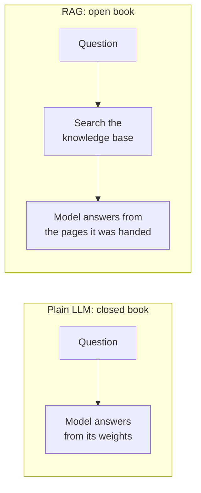
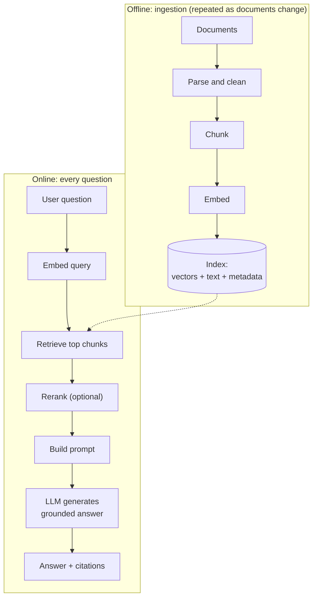
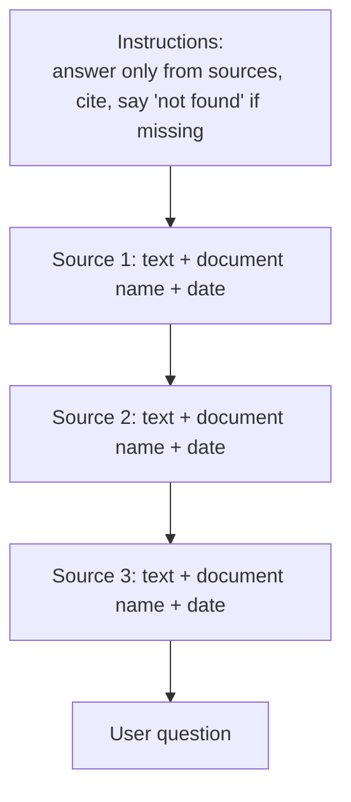

# Chapter 11: RAG Fundamentals

## 1. The concept, from scratch

### The problem RAG solves

An LLM is stateless, it's not a knowledge store, and it only knows what was in its training data up to a cutoff date ([Chapter 5](../05-training-llms/README.md), [Chapter 6](../06-inference-and-generation/README.md)). Ask it about your company's refund policy, last week's incident report or a regulation passed last month, and it either doesn't know or, worse, makes up something fluent and wrong.

You could paste the right documents into the prompt. But you can't paste a whole company's documents into every call ([Chapter 7](../07-context-windows-and-context-engineering/README.md)), and you'd have to know which ones matter. So the idea is: **find the few relevant passages automatically, and put just those in the prompt.**

That's **retrieval-augmented generation, or RAG**: retrieve first, then generate.

> RAG = look up the relevant information, hand it to the model with the question, and let the model write the answer from it.

### Two kinds of memory

The 2020 paper that named RAG (Lewis et al.) framed it as combining two kinds of memory.

- **Parametric memory** is what's stored in the model's weights from training. It's broad, built in, and impossible to inspect or update cheaply. It's fine for general language and common knowledge.
- **Non-parametric memory** is an external store you search, such as a document index. It's specific, can be updated any time, and can be shown to the user as a source.

RAG keeps the model for what it's good at, reasoning and writing, and moves *facts* into an external memory. That's the practical meaning of "the model's value is in reasoning, not in serving as a knowledge store."

A good way to say it in an interview: **a plain LLM is taking a closed-book exam from memory. RAG makes it an open-book exam**: the model still has to read, understand and answer, but it has the right pages open in front of it.

### The two pipelines

Every RAG system has two parts that run at different times.

**Offline: the ingestion pipeline.** Done ahead of time, and repeated as documents change.

1. **Load** documents from their sources: files, wikis, tickets, databases.
2. **Parse and clean** them into text, with structure and metadata.
3. **Chunk** them into passages small enough to retrieve precisely ([Chapter 12](../12-ingestion-and-chunking/README.md)).
4. **Embed** each chunk into a vector with an embedding model ([Chapter 3](../03-tokens-and-embeddings/README.md)).
5. **Index** the vectors, plus the text and metadata, in a store built for search ([Chapter 13](../13-vector-search-and-databases/README.md)).

**Online: the query pipeline.** Runs on every question.

1. **Embed the query** with the *same* embedding model.
2. **Retrieve** the most similar chunks.
3. **Optionally rerank** them with a more accurate model to put the best first ([Chapter 14](../14-improving-retrieval/README.md)).
4. **Build the prompt:** instructions, the retrieved chunks, and the question.
5. **Generate** the answer with the LLM, ideally with citations.
6. **Check and return** it.

### Who does each step

This is a great place to see the **predictive plus generative** point from [Chapter 1](../01-introduction-to-ai/README.md) in action. Most steps in a RAG system are *not* the LLM.

| Step | Done by | Kind |
|---|---|---|
| Parse, clean, chunk | Ordinary code, sometimes helped by a model | Mostly deterministic software |
| Embed chunks and query | Embedding model (encoder) | Predictive |
| Find nearest chunks | Search algorithm in a vector store | Deterministic algorithm |
| Rerank | Reranker model (cross-encoder) | Predictive |
| Write the answer | LLM | Generative |
| Check citations and rules | Code, sometimes a second model | Software and predictive |

So "RAG" isn't one model. It's a **pipeline** in which small predictive models and algorithms find the evidence, and one generative model writes the answer. A common interview mistake is to say the LLM "searches the documents". It doesn't. Our code searches, and the LLM reads what it's given.

### What goes in the prompt

A typical RAG prompt looks like this, in words: the instructions ("answer only from the sources below, cite them, and say you don't know if the answer isn't there"), then the retrieved passages clearly labelled with their source, then the user's question. Everything we learned in [Chapter 9](../09-prompt-engineering/README.md) applies. Keep sources in tagged sections so the model treats them as data, give it an exit, and ask for citations.

### What RAG gives you

- **Fresh knowledge.** Update the documents and the answers change, with no retraining.
- **Fewer hallucinations.** The model has the facts in front of it. This reduces hallucination, but doesn't eliminate it ([Chapter 28](../28-hallucination-and-grounding/README.md)).
- **Citations.** You can show which passage supported each claim, which builds trust and lets people check.
- **Private knowledge.** The model can use your internal data without that data being trained into it.
- **Access control.** You can filter what each user's query may retrieve ([Chapter 15](../15-enterprise-rag/README.md)).
- **Cost.** Usually far cheaper than fine-tuning or retraining ([Chapter 17](../17-rag-vs-fine-tuning-vs-long-context/README.md)).

### Where RAG goes wrong

RAG fails in a few predictable places, and a good engineer can name them. The key idea: **if retrieval doesn't find the right passage, the best LLM in the world can't answer correctly.**

| Failure | What happens |
|---|---|
| **Bad ingestion** | The text was parsed badly, so the answer isn't in the index in a usable form. |
| **Bad chunking** | The answer was split across chunks, or a chunk lost its context. |
| **Retrieval miss** | The right chunk exists but isn't in the top results. |
| **Noise** | Irrelevant chunks come back and distract the model. |
| **Stale or conflicting sources** | Old and new versions both come back. |
| **Generation failure** | The right chunk is there, but the model ignores it, misreads it, or adds claims that aren't in it. |
| **Missing answer** | The answer isn't in the knowledge base, but the model answers anyway. |

When someone says "our RAG hallucinates", the first job is to find *which* of these it is. That's why we measure retrieval and generation separately ([Chapter 27](../27-evaluating-rag-and-agents/README.md)).

### Naive RAG and what comes next

The simple version above, chunk, embed, retrieve the top few, generate, is often called **naive RAG**. It works well for demos and many real cases. Production systems usually add improvements in the same pipeline: better parsing and chunking, hybrid keyword and vector search, query rewriting, reranking, metadata filters, and checks on the answer. Each of those is a later chapter ([Chapter 12](../12-ingestion-and-chunking/README.md) to [Chapter 16](../16-production-rag-architecture-and-scale/README.md)). At the far end, an agent decides what to retrieve and when, which is **agentic RAG** ([Chapter 14](../14-improving-retrieval/README.md) and Part 5).

### RAG isn't the same as a vector database

People often say "RAG" and mean "a vector database". The vector store is one component for finding passages by meaning. RAG is the whole pattern of retrieving evidence and generating from it. The retrieval could come from keyword search, a SQL query, an API or a mix. Don't tie the concept to one tool.

## 2. Analogies across industries

- **Open-book exam (government).** A civil servant answering a citizen's question about a benefit doesn't answer from memory. They pull up the current rule and read it, then explain it in plain words. The explanation is the LLM, and pulling the rule is retrieval. If they pull the wrong rule, the explanation will be fluent and wrong.
- **Two pipelines (travel).** Offline is the airline preparing its reference library: collecting fare rules and airport guides, indexing them, and keeping them up to date. Online is the agent at the desk who, when a customer asks, looks up the right page and answers.
- **Parametric vs non-parametric memory (healthcare).** A doctor's training is their parametric memory: broad, internalised and hard to update. The hospital's drug-interaction database is non-parametric: specific, current and checked before prescribing. A good doctor uses both, and relies on the database for exact details.
- **Retrieval miss (logistics).** A warehouse picker sent to the wrong shelf will bring back the wrong item, however careful the packer is. Generation can't fix a wrong pick.

## 3. How it's used in industry

- **Government: citizen-service assistant.** A public agency builds an assistant over its current policy manuals, so staff can answer benefit questions with the exact rule cited. Updating a manual updates the answers the same day.
- **Healthcare: clinical guideline lookup.** A hospital network lets clinicians ask questions over approved guidelines and formularies, with each answer linked to the section it came from and a clear "not found in the guidelines" response.
- **Travel: support over fare rules and policies.** An airline's assistant retrieves the relevant fare conditions, baggage rules and disruption policies for the customer's ticket type, then drafts an answer for the agent to confirm.
- **Telecom: troubleshooting from internal knowledge.** A telecom support tool retrieves from internal runbooks and past tickets to suggest next steps, cutting the time agents spend searching.

## 4. Common misconceptions

- **"RAG makes hallucination disappear."** It reduces it. The model can still ignore or misread the context, or answer when the sources don't contain the answer.
- **"The LLM searches the documents."** It doesn't. A retrieval step, which is our code, finds passages and hands them to the LLM.
- **"RAG means a vector database."** The vector store is one component. Retrieval can also use keywords, SQL, APIs or a mix.
- **"RAG teaches the model our data."** It doesn't change the model at all. The data is looked up at question time.
- **"More retrieved chunks is always better."** Extra chunks add noise, cost and latency, and can bury the right passage ([Chapter 7](../07-context-windows-and-context-engineering/README.md)).
- **"If the answer is wrong, blame the LLM."** In many cases the failure is in parsing, chunking or retrieval. Find out which part failed before changing the model.
- **"RAG and fine-tuning are alternatives for the same thing."** RAG supplies knowledge, fine-tuning shapes behaviour. They solve different problems and can be used together.

## 5. Interview questions

### 1. What is RAG, and why do we use it?

RAG stands for retrieval-augmented generation. Instead of expecting the model to answer from memory, I first retrieve the passages most relevant to the question from a knowledge base, put them in the prompt with the question, and have the model write the answer from them. I use it because the model isn't a reliable knowledge store: it has a training cutoff, it doesn't know my private data, and it can make things up. RAG gives it fresh, specific facts, lets me show citations, and means I can update knowledge by updating documents, with no retraining. I'd describe it as turning a closed-book exam into an open-book one.

### 2. Walk me through the architecture of a RAG system.

There are two pipelines. The offline ingestion pipeline loads documents, parses and cleans them, splits them into chunks, turns each chunk into an embedding with an embedding model, and stores the vectors with the text and metadata in an index. The online query pipeline takes the user's question, embeds it with the same model, retrieves the most similar chunks, optionally reranks them with a more accurate model, builds a prompt with instructions, the chunks and the question, and has the LLM generate an answer with citations, followed by any checks. Most of the steps aren't the LLM. The embedding and reranking are smaller predictive models, the search is an algorithm, and only the final answer is generative.

### 3. What's the difference between parametric and non-parametric memory?

Parametric memory is knowledge stored in the model's weights during training. It's broad and fast, but it's frozen at the cutoff, I can't inspect it, and I can't update it cheaply. Non-parametric memory is an external store the system searches at question time, like a document index. It's specific, I can update it whenever I like, and I can show where an answer came from. RAG combines the two: the model supplies language and reasoning, and the external memory supplies the facts. That split is why I say the model's value is in reasoning, not in being a knowledge store.

### 4. Why must you use the same embedding model for documents and queries?

Because an embedding model defines its own vector space. Meaning is encoded by closeness within that space, so a query and a document are only comparable if both were placed there by the same model. If I embedded documents with one model and queries with another, the vectors would live in different spaces and the similarity scores would be meaningless. It also means that if I change the embedding model, even to a newer version, I have to re-embed the entire corpus. So I treat the embedding model as a versioned part of the index, and I plan re-indexing as a normal operation.

### 5. Does RAG eliminate hallucination?

No, it reduces it. With the right passage in the prompt the model is much less likely to invent facts, but there are still ways it goes wrong. Retrieval may miss the right passage, so the model works from irrelevant text. The passage may be there but the model misreads it or adds claims that aren't in it. And if the answer isn't in the knowledge base at all, the model may answer anyway unless I've told it not to and given it a way out. So I'd combine RAG with instructions to answer only from the sources, citations that can be checked, an "I don't know" path, and evaluation that measures how often the answers are actually supported by the retrieved text.

### 6. A RAG system gives wrong answers. How do you debug it?

I'd work backwards through the pipeline and separate retrieval from generation. First, for a failing question, I look at what was actually retrieved: was the right passage in the results at all? If not, it's a retrieval problem, and I'd check whether the text was parsed and chunked well, whether the embedding matches how users phrase things, and whether keyword search or reranking would help. If the right passage was retrieved but the answer is still wrong, it's a generation problem: I'd look at the prompt, how many chunks I included, whether the passage was buried, and whether the model needs a stricter instruction. If the answer isn't in the knowledge base, the fix is content or a clear "not found" behaviour. I'd turn each failure into a test case in an evaluation set.

### 7. When would you use RAG instead of fine-tuning?

When the problem is knowledge, I'd use RAG. If the model needs to know my documents, policies or recent information, especially when they change, or when I need citations or per-user access control, retrieval is the right tool. Fine-tuning is for behaviour: a consistent style, a strict format, or a narrow task, and it's poor at storing facts and can't cite sources. They can be combined, for example a fine-tuned small model for the format and retrieval for the facts. I'd start with prompting, add RAG for knowledge, and fine-tune only for the behaviour gap that's left.

### 8. What happens when the answer isn't in the knowledge base?

If I haven't designed for it, the model will often still produce a fluent answer, because that's what it's trained to do. So I design for it. I instruct the model to answer only from the provided sources and to say clearly when they don't contain the answer, and I give it a fixed phrase for that case. I can use retrieval scores as a signal, because very low similarity suggests nothing relevant was found, and in that case I might skip generation altogether and say so. I measure it with test questions I know aren't covered, and check that the system declines them. For sensitive domains I'd add a route to a human.

### 9. How do you decide how many chunks to retrieve and put in the prompt?

It's a trade-off I'd tune with evaluation, not guess. Too few and I risk missing the passage that holds the answer. Too many and I add cost and latency, and the noise can bury the right passage and confuse the model. A common pattern is to retrieve a wider set, say twenty or so, then rerank and pass only the best handful to the model. The right number depends on chunk size, the type of questions, and the model's context handling. I'd measure retrieval recall at different cutoffs and answer quality at different prompt sizes, then choose the smallest number that gives good results.

## 6. Scenario exercise

A regional public-health agency wants an assistant so its call-centre staff can answer questions from clinics and the public about vaccination schedules, eligibility and reporting rules. The guidance lives in about 3,000 PDFs and web pages, and it's updated several times a year, sometimes with conflicting older versions still online. A vendor demo of a chatbot answered smoothly but gave an out-of-date schedule when asked about a recently changed rule. The director asks you to explain what went wrong and how you'd build it properly. You haven't seen the vendor's system.

Answer from memory, then check.

Model answer

I'd explain that the demo was probably a model answering from memory, or from an index that wasn't kept current. A language model isn't a knowledge store: it has a training cutoff and it can't tell you when a rule changed, so it produced a fluent but out-of-date answer. For guidance that changes several times a year, we need the answers to come from the current documents, and that's what retrieval-augmented generation does.

I'd describe it as two pipelines. Offline, we ingest the documents: parse the PDFs and pages into clean text, split them into chunks, embed each chunk, and index them with metadata like document name, publication date, version and status. Online, when staff ask a question, we embed it, retrieve the most relevant chunks, perhaps rerank them, put them in the prompt with an instruction to answer only from those sources, and have the model answer with citations to the document and section. The staff can click through to verify.

Several details matter here. For freshness, we'd have a scheduled process that re-ingests changed documents and removes superseded ones, and we'd store the effective date so conflicting versions can be handled: prefer the latest, or show both with dates. For safety, the assistant must say "not found in current guidance" instead of guessing, and it should escalate to a clinician or supervisor for anything outside scope. I'd build an evaluation set from real questions, with a deliberate group about recently changed rules, and measure whether the right passage is retrieved and whether answers are supported by the sources. And I'd say plainly that the system supports staff and doesn't replace clinical judgment.

If the vendor can't show how their system finds current documents, cites them and handles conflicting versions, I'd treat that as the gap.

## 7. Key takeaways

- RAG means retrieve first, then generate: find relevant passages, put them in the prompt, and let the model answer from them, like an open-book exam.
- It splits knowledge (non-parametric, external, updatable) from reasoning (parametric, in the model).
- Two pipelines: offline ingestion (load, parse, chunk, embed, index) and online query (embed, retrieve, rerank, prompt, generate, check).
- Most steps are not the LLM: predictive models and algorithms find the evidence, and the generative model writes the answer.
- If retrieval misses the right passage the answer will be wrong, so debug retrieval and generation separately. RAG reduces hallucination, it doesn't remove it.

## 8. Further reading

- Lewis et al., [Retrieval-Augmented Generation for Knowledge-Intensive NLP Tasks](https://arxiv.org/abs/2005.11401) (2020): the paper that named RAG.
- Google Cloud, [What is Retrieval-Augmented Generation (RAG)?](https://cloud.google.com/use-cases/retrieval-augmented-generation).
- AWS, [What is RAG?](https://aws.amazon.com/what-is/retrieval-augmented-generation/).
- Anthropic, [Introducing Contextual Retrieval](https://www.anthropic.com/news/contextual-retrieval): a worked example of improving retrieval in a real pipeline.
