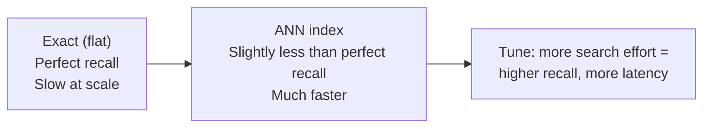
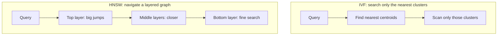
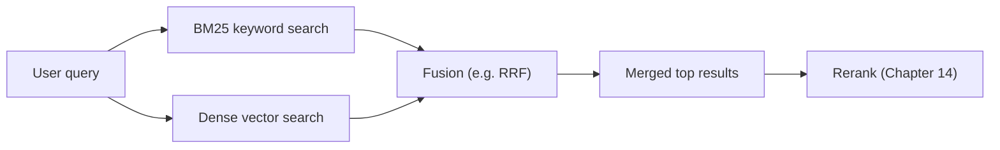

# Chapter 13: Vector Search and Databases

## 1. The concept, from scratch

### The retrieval problem

After ingestion ([Chapter 12](../12-ingestion-and-chunking/README.md)) you have a pile of chunks, each with an embedding ([Chapter 3](../03-tokens-and-embeddings/README.md)). A user asks a question. We embed it and now need to answer one question quickly: **which stored vectors are closest to this one?** Closeness encodes meaning, so the closest vectors are the most relevant chunks.

The simplest way is to compare the query with every stored vector and keep the best few. That's **exact search**, sometimes called brute force or a "flat" index. It's perfectly accurate, and its cost grows in step with the number of vectors. For a few thousand or tens of thousands of chunks, that's fine. For millions or hundreds of millions, it's too slow and too expensive to do on every query.

### Approximate nearest neighbour (ANN)

The fix is **approximate nearest neighbour search, or ANN**. (Note: ANN here means approximate nearest neighbour, not artificial neural network.) ANN builds a clever index so a query only looks at a small, promising part of the data. The price is that it might occasionally miss a true nearest neighbour. We accept that for a huge gain in speed.

The quality of an ANN index is measured by **recall**: of the true top-k nearest vectors, what fraction did the index actually return? A recall of 0.95 means it found 95 percent of them. Every ANN index lets you trade recall against speed, memory and cost.

Say it like this: **vector search is a speed-versus-recall trade-off, and the index type and its settings decide where you land.**

### The main index types

You don't need to implement these, but you should be able to explain the idea of each.

**IVF (inverted file index).** Cluster all the vectors into groups ahead of time, each with a centre point called a **centroid**. At query time, find the few centroids closest to the query and search *only the vectors in those clusters*. It's like a library sorted into sections: you walk to the two or three most likely sections instead of scanning every shelf. The setting that matters is how many clusters to visit per query (often called `nprobe`). Visit more, get better recall and slower queries. A weakness is that if the true answer sits in a cluster you didn't visit, you miss it.

**HNSW (hierarchical navigable small world graph).** Build a graph in which each vector is linked to nearby vectors, arranged in layers. The top layers are sparse with long links, like a motorway network, and the bottom layer is dense with short links, like local streets. A query starts at the top, hops quickly towards the right region, then drops down layer by layer to refine. The idea resembles a skip list, and it scales very well, roughly logarithmically in the size of the data. HNSW is popular because it gives high recall at low latency. Its costs are memory, because the graph and the vectors usually sit in RAM, and slower index building. Its main settings control how many links each vector has and how wide the search is.

**Compression (quantisation).** To shrink memory, store each vector in a lossy, smaller form. **Scalar quantisation** keeps fewer bits per number. **Product quantisation** splits each vector into pieces and replaces each with a short code. Memory falls sharply, with some loss of accuracy. This is the same idea as quantising a model's weights ([Chapter 10](../10-fine-tuning-and-distillation/README.md)), applied to your vectors.

Real systems combine these, for example IVF plus compression, or HNSW with compressed vectors and a final re-check against the full-precision vectors.

| Index | Strength | Weakness | Typical use |
|---|---|---|---|
| **Flat (exact)** | Perfect accuracy, no tuning | Slow as data grows | Small collections, and as the ground truth for testing |
| **IVF** | Memory-friendly, fast to build, works well with compression | Recall depends on clusters visited | Very large collections |
| **HNSW** | High recall, low latency | Memory-hungry, slower to build, updates are more complex | The common default for interactive search |
| **Compressed (PQ, scalar)** | Big memory savings | Some accuracy loss | Huge collections, cost control |

### A quick memory estimate

A back-of-envelope calculation is useful in interviews. Ten million chunks, each with a 1,536-dimension embedding stored as 32-bit floats (4 bytes per number), is 10,000,000 × 1,536 × 4 bytes, about 61 GB, *before* any index overhead and before the text and metadata. Storing the numbers in 8 bits would cut that to roughly a quarter. This is why dimension size, compression and the choice of index matter once you reach tens of millions of vectors ([Chapter 16](../16-production-rag-architecture-and-scale/README.md)). Remember that some embedding models let you shorten vectors ([Chapter 3](../03-tokens-and-embeddings/README.md)), which cuts storage and search cost, at some cost in quality.

### Two ways to match: keywords and meaning

So far we've talked about searching by *meaning*. There's an older and still very useful way: searching by *words*.

**Keyword search (sparse retrieval)** finds documents that contain the query's actual words. The standard scoring method is **BM25**, used in search engines for decades. In plain terms BM25 scores a document higher when:

- it contains the query's words, and more often (but with **diminishing returns**: the tenth mention adds far less than the first),
- those words are **rare** across the collection (a rare word like "TV-4821" is a stronger signal than "the" or "return"), and
- the document isn't just long (a short page that mentions the term is more focused than a huge one that mentions it once, so scores are **adjusted for length**).

Two tuning knobs control saturation and length adjustment. The defaults in Elasticsearch are 1.2 and 0.75, and they're a sensible starting point (as of Nov 2026, per Elastic's documentation). BM25 needs no model and no training, and is quick and cheap.

**Dense retrieval** is the embedding-based approach: turn query and chunks into vectors and find the nearest ones. It matches **meaning**, so "my parcel hasn't arrived" can find "late delivery policy" even with no shared words.

Each has strengths the other lacks.

| | **BM25 (keyword)** | **Dense (embeddings)** |
|---|---|---|
| Matches | Exact words | Meaning |
| Strong at | Product codes, IDs, error codes, names, rare terms, acronyms, exact phrases | Paraphrases, synonyms, natural-language questions, vague queries |
| Weak at | Synonyms and different wording | Exact identifiers, rare or new terms, numbers, negation |
| Needs a model? | No | Yes: an embedding model |
| Explainable? | Yes: you can see which words matched | Harder |
| Cost | Cheap | Embedding cost plus vector index |

### Hybrid search

Because the strengths differ, production systems usually combine them. **Hybrid search** runs both retrievers on the query, then merges the two ranked lists into one.

The merging problem: the two methods produce scores on completely different scales, so you can't just add them. There are two approaches.

- **Weighted score combination.** Normalise both sets of scores to a common scale, then add them with weights. It works, but normalisation is fiddly and the weights need tuning.
- **Reciprocal Rank Fusion (RRF).** Ignore the scores entirely and use only the **ranks**. Each document gets `1 / (k + rank)` from each list it appears in, and the contributions are added up. The constant `k` softens the advantage of the very top ranks, and a value of 60 is a widely used default, from the original 2009 paper's experiments (treat it as a starting point and test on your own queries). A document that appears near the top of *both* lists wins.

**A worked example.** A retail customer asks: "return policy for TV-4821 damaged in delivery". Say the two retrievers return these ranks:

| Document | BM25 rank | Dense rank |
|---|---|---|
| A: Product note for TV-4821 | 1 | 3 |
| B: Damaged-in-delivery return policy | 2 | 1 |
| C: General televisions FAQ | 3 | not in list |
| D: Parcel late-delivery policy | not in list | 2 |

With k = 60 and ranks counted from 1, each document's RRF score is the sum of 1/(60 + rank) over the lists it appears in.

- B: 1/62 + 1/61 = 0.0161 + 0.0164 = **0.0325**
- A: 1/61 + 1/63 = 0.0164 + 0.0159 = **0.0323**
- D: 1/62 = **0.0161**
- C: 1/63 = **0.0159**

The fused order is B, A, D, C. Look at what happened. A is the only document with the exact product code, and BM25 found it. B is the policy that matches the meaning of the question, and dense search put it first. Documents that *both* methods liked rise to the top, and the two together cover what either alone would have missed. Neither list alone had the right top two in the right order. (Rank conventions vary between implementations, with some counting from 0. The idea is the same, but check yours when comparing numbers.)

### Metadata filtering

Real queries rarely mean "search everything". They mean "search *this product's* documents, *current* versions only, that *this user is allowed to see*" ([Chapter 12](../12-ingestion-and-chunking/README.md) metadata, [Chapter 15](../15-enterprise-rag/README.md)). So the search has to combine similarity with filters.

There are two approaches, and the difference matters:

- **Post-filtering:** run the vector search, then throw away results that fail the filter. Simple, but if the filter is strict you may be left with too few results, or none.
- **Pre-filtering (filtered search):** apply the filter *during* the search, so you only look at vectors that qualify. Better results, but harder for the index to do efficiently, and how well each database handles it varies.

When you evaluate a vector store, test filtered search with your real filters, at your real scale, because that is where many demos stop being representative.

### Choosing where to store vectors

There are several kinds of tool, and names change quickly, so think in categories (examples as of Nov 2026, not rankings).

| Category | What it is | Examples | Good when |
|---|---|---|---|
| **Vector library** | A code library that builds and searches an index, but isn't a database. No persistence, replication or access control by itself | Faiss | Prototyping, research, embedding inside your own system |
| **Dedicated vector database** | A database built for vector search, with filtering, scaling and management | Pinecone, Weaviate, Qdrant, Milvus, Chroma | Large scale, vector-heavy workloads, you want managed scaling and rich vector features |
| **Vector support in a general database** | An extension or feature in a database you may already run | PostgreSQL with pgvector, MongoDB, Redis | Moderate scale, you want vectors beside your other data, one system to operate |
| **Search engine with vectors** | A search engine that does keyword and vector search together | Elasticsearch, OpenSearch | You need strong hybrid search, faceting and filtering, and may already run it |
| **Managed cloud services** | Each large cloud offers its own vector or search service | Examples on AWS, Azure and Google Cloud | The client is committed to one cloud and wants its security and billing model |

How to choose, in the order I'd ask:

1. **Scale and growth.** How many vectors now and in two years? At modest scale, almost anything works.
2. **Search features.** Do you need hybrid search, strong filtering, multi-tenancy, or reranking support built in?
3. **Latency and throughput targets.**
4. **Operations.** Managed or self-run? What does the team already know how to run?
5. **Security and compliance.** Access control, encryption, data residency, audit.
6. **Cost.** Memory-hungry indexes on large clusters cost real money.
7. **Existing stack.** If you already run PostgreSQL or Elasticsearch and your scale is moderate, adding vectors there is often the pragmatic start, because it avoids another system. Move to a dedicated store when you outgrow it.

I'd also say plainly: **don't pick by benchmark charts.** Test on your own data, your own filters and your own load.

### Why semantic search alone isn't enough in production

This is a classic interview question, and now you can answer it properly. Pure dense retrieval struggles with:

- **Exact identifiers**: product codes, error codes, case numbers, part numbers, names. Embeddings blur them. BM25 nails them.
- **Rare or new terms**: internal jargon, new product names or acronyms the embedding model has never seen.
- **Numbers, dates and negation**: "policies *not* covering flood" may look similar to "policies covering flood" in vector space.
- **Filters and permissions**: similarity doesn't know who may see what, or which version is current.
- **Ranking precision**: the nearest vectors are *related*, not necessarily *the answer*. A reranker does better at that ([Chapter 14](../14-improving-retrieval/README.md)).
- **No explanation**: when a result is wrong, it's hard to say why.

So the production pattern is: **hybrid retrieval, with metadata filters, then reranking**, and measured on real queries ([Chapter 27](../27-evaluating-rag-and-agents/README.md)).

### Measuring retrieval

Briefly, because [Chapter 27](../27-evaluating-rag-and-agents/README.md) goes deep. For a set of test questions with known right passages, the common measures are **recall@k** (is the right passage in the top k results?), **MRR** (how high does the first right result rank, on average?), and **nDCG** (a score that rewards putting the best results near the top). Retrieval recall is the number to watch first, because everything downstream depends on it.

### Where predictive and generative models sit here

Everything in this chapter is on the *predictive and algorithmic* side of RAG. The embedding model is predictive, BM25 and the ANN index are algorithms, and the reranker that comes next is predictive. The generative model only appears at the end. A strong retrieval layer is how you give the generator good evidence ([Chapter 11](../11-rag-fundamentals/README.md)).

## 2. Analogies across industries

- **Exact vs approximate search (retail).** A shopper can check every aisle in a hypermarket to find the best olive oil, or follow the signs to the likely aisle and check the shelves there. The second is much faster, and you'll occasionally miss a bottle in another aisle. That's ANN.
- **IVF (logistics).** A parcel hub sorts parcels into regional cages. To find a parcel for a given address, you go to the cages for the likely regions, not every cage in the building.
- **HNSW (travel).** Planning a trip, you take the long-haul flight to the right region, then a regional train, then a local bus. Big jumps first, then finer steps. HNSW navigates data the same way.
- **BM25 vs dense (healthcare).** A records clerk searching for a patient by exact ID number is doing keyword search, and it's precise. A doctor who asks "find patients with symptoms like this one" is doing semantic search, and finds relevant cases with different wording. A good hospital system supports both.
- **Hybrid search and RRF (telecom).** Two engineers each shortlist likely causes of a network fault, one working from exact error codes and one from symptom descriptions. A cause that appears near the top of both shortlists gets investigated first. That's rank fusion.

## 3. How it's used in industry

- **Retail: product and policy search.** An online retailer uses hybrid retrieval so that queries containing product codes or model numbers hit the exact item, while natural-language questions like "something warm for hiking in rain" find relevant products by meaning. Results are filtered by market and stock status.
- **Telecom: troubleshooting knowledge.** An operator combines keyword search over error codes and equipment names with dense search over symptom descriptions, and filters by equipment type and software version.
- **Healthcare: guidelines and formularies.** A hospital system uses keyword matching for drug names and codes, which must be exact, and dense retrieval for clinical descriptions, with filters for approved, current documents.
- **Government: large document stores.** An agency keeps millions of chunks in a search engine it already operates, using its filtering and access-control features, because it already runs and secures that platform.

## 4. Common misconceptions

- **"ANN means artificial neural network."** Here it means approximate nearest neighbour.
- **"Vector search always finds the true nearest vectors."** ANN is approximate by design. You tune recall against speed.
- **"A vector database is all you need for RAG."** It's one component. You also need good parsing, chunking, hybrid retrieval, reranking and evaluation.
- **"Dense retrieval beats keyword search."** Neither always wins. Dense handles meaning, BM25 handles exact terms, and hybrid beats both on many real workloads.
- **"We can just add the BM25 and cosine scores."** They're on different scales. Normalise carefully, or use rank-based fusion such as RRF.
- **"The best vector database is whichever tops a benchmark."** Benchmarks use someone else's data and filters. Test on yours.
- **"Higher dimensions are always better."** They cost memory and speed, and gains flatten. Test shortened embeddings.
- **"Once indexed, it stays correct."** Changing the embedding model or chunking means rebuilding the index ([Chapter 12](../12-ingestion-and-chunking/README.md)).

## 5. Interview questions

### 1. What is ANN search and why do we need it?

ANN means approximate nearest neighbour. Exact search compares the query with every stored vector, which is perfectly accurate but gets slow and expensive as the collection grows to millions of vectors. ANN builds an index so a query only examines a small, promising part of the data, and in exchange it might occasionally miss a true nearest neighbour. We measure that with recall, the fraction of the true top results it returns. The point is that I can choose my place on a speed, recall and memory trade-off by picking an index and tuning its settings, and for most applications 95 percent recall at a fraction of the latency is a good deal.

### 2. Explain how HNSW works.

HNSW builds a graph where each vector is connected to nearby vectors, arranged in layers. The top layers are sparse with long-range links, and the bottom layer contains every vector with short links. A search starts at the top layer, greedily moves to whichever neighbour is closest to the query, and when it can't improve it drops to the next layer and continues, finishing with a careful search on the bottom layer. It's like a motorway, then a main road, then local streets. It gives high recall with low latency and scales roughly logarithmically, which is why it's a common default. The trade-offs are that it uses a lot of memory, building the index is slower, and handling deletes and updates is more involved. The tuning knobs are how many connections each node has and how wide the search is at query time.

### 3. How does IVF differ from HNSW, and when would you use each?

IVF clusters the vectors ahead of time and at query time searches only the few clusters whose centres are nearest to the query. It's memory-friendly, quick to build, and combines well with compression, so I'd consider it for very large collections where memory is the constraint. Its recall depends on how many clusters I visit, and the true neighbour may sit in a cluster I skipped. HNSW is a graph, typically gives better recall at lower latency, but needs more memory. For interactive search at moderate to large scale where I can afford the RAM, I'd start with HNSW. For huge collections or tight memory budgets, I'd look at IVF with compression, and I'd test both on my own data.

### 4. BM25 vs dense retrieval vs hybrid: how do you choose?

They're good at different things. BM25 matches exact words, weighted by how rare they are, so it's excellent for product codes, IDs, error messages, names and acronyms, it needs no model, and it's explainable. Dense retrieval matches meaning, so it handles paraphrases and vague natural-language questions, but it can blur exact identifiers and rare terms. In practice, real queries contain both kinds of need, so I'd default to hybrid: run both, fuse the ranked lists, and then rerank. I'd check it on a set of real queries, including the ones with codes and the ones with paraphrases, and keep dense-only or BM25-only only if my data shows the other adds nothing.

### 5. Why isn't semantic search enough for production RAG?

Because embeddings are good at meaning and weak at precision. They blur exact identifiers like part numbers and case IDs, they struggle with rare or brand-new terms the model never saw, they can treat negations and numbers loosely, and similarity says nothing about permissions, versions or freshness. Also, the nearest vectors are related to the query, but not necessarily the best answer. So I'd add keyword search for exact matching, metadata filters for permissions and currency, and a reranker for precision, and I'd measure retrieval on real queries. Semantic search is a strong part of the system, but not the whole system.

### 6. Explain Reciprocal Rank Fusion and why it's used for hybrid search.

RRF merges several ranked lists using only the ranks, not the scores. For each document, I add up one divided by a constant plus its rank, for every list it appears in. The constant, commonly 60, stops the very top ranks from dominating. A document that's near the top of both the keyword and the vector list gets the highest combined score. I use it because BM25 scores and vector similarity are on totally different scales, so adding them directly is meaningless without careful normalisation. RRF avoids that, has almost nothing to tune, and is robust. If my own evaluation showed a weighted combination did better for my data, I could use that, but RRF is the simple, strong default.

### 7. How would you choose a vector database?

I'd start from requirements, not product names. How many vectors now and later, what latency and throughput, whether I need hybrid search, strong metadata filtering and multi-tenancy, what the team can operate, security and compliance needs like access control and data residency, and cost. Then I'd consider the categories: a library like Faiss for prototyping, a dedicated vector database for large scale and rich vector features, vector support in a general database like PostgreSQL if scale is moderate and I want fewer moving parts, or a search engine like Elasticsearch if hybrid search and filtering are central. I'd shortlist two, test them with my own data, filters and load, and not rely on published benchmarks. If the client already runs a database that supports vectors and the scale is moderate, I'd usually start there.

### 8. How does metadata filtering interact with ANN search, and what can go wrong?

If I post-filter, I run the vector search first and then drop results that don't match the filter. That's simple, but with a strict filter I might get back very few results, or none, even though matching documents exist. Pre-filtering applies the filter during the search so the index only considers qualifying vectors, which gives better results, but it's harder for the index to do efficiently, and implementations differ a lot. For things like permissions and tenancy, I need the filter to be enforced reliably, not just best-effort. So I'd test filtered queries with realistic filter selectivity at realistic scale, and check that the result count and recall hold up.

### 9. Roughly how much memory do you need to store 10 million embeddings?

A rough calculation: ten million vectors times the number of dimensions times bytes per number. With 1,536 dimensions stored as 32-bit floats, that's about 61 gigabytes for the raw vectors, before the index structure, the text and the metadata. With 8-bit compression it drops to roughly a quarter, and shortening the embeddings reduces it further, with some quality cost. HNSW adds graph overhead and usually wants the data in memory. So at that scale I'd think about compression, disk-based indexes, or sharding across machines. I'd also test how much recall I lose with compression on my own data before committing.

### 10. Your hybrid search returns the right documents, but not near the top. What do you do?

That's a ranking-precision problem rather than a recall problem, so I'd confirm it with retrieval metrics: is the right passage in the top twenty even if it's not in the top three? If so, the first-stage retrieval is working and I should add or improve a second stage. A reranker, typically a cross-encoder, reads the query and each candidate together and scores them more accurately, so I'd retrieve a wider set, rerank, and pass the best few to the model. I'd also look at the fusion settings, whether chunk context headers would help, and whether metadata boosts, like preferring current documents, make sense. Then I'd re-measure.

## 6. Scenario exercise

An online electronics retailer is building a search-and-answer assistant over 4 million product pages, manuals and policy documents, which becomes about 25 million chunks. Shoppers type things like "TV-4821 wall mount compatible", "cheap laptop for student, light, good battery" and "return policy damaged in delivery". The prototype uses dense vector search only, in a small in-memory index, and is wrong on the first type of query and slow at full scale. The team runs PostgreSQL today and the CTO asks whether they need a dedicated vector database. What do you advise? You don't have the data yet.

Answer from memory, then check.

Model answer

I'd diagnose the failures first. The model-number query fails because dense embeddings blur exact identifiers. The fix is to add keyword search with BM25, so the exact code matches, and combine it with dense search through hybrid retrieval, fusing the ranked lists with something like Reciprocal Rank Fusion, then reranking the merged top results. The "light, good battery" query is vague and natural-language, which is where dense search shines, and the policy question benefits from both plus filters.

For metadata, each chunk should carry product, category, market, document type, and whether it's current, so searches can be filtered, for example to the shopper's market and to in-stock items, with filtering applied during the search, not after.

On scale, 25 million chunks at 1,536 dimensions in 32-bit floats is roughly 150 GB of raw vectors (25 million × 1,536 × 4 bytes) before index overhead. That needs a proper approach: an ANN index such as HNSW if we can afford the memory, or IVF with compression if memory is the constraint, possibly with shortened embeddings, and sharding. I'd tune for recall at the latency target by testing on real queries.

For the database question, I wouldn't decide by brand. I'd list the requirements: hybrid search, strong filtering, 25 million chunks with growth, latency targets, operational skills, and cost. PostgreSQL with a vector extension is a reasonable starting point if they want fewer systems and the scale and latency can be met, but at this size with hybrid and filtering needs, I'd benchmark it against a dedicated vector database and a search engine that supports hybrid search, using their own data and filters. I'd make the choice on measured recall, latency, filtering behaviour and operating cost.

I'd put an evaluation set in place first, with real queries of all three types and known right results, and report recall at the top results before and after each change.

## 7. Key takeaways

- Vector search finds the nearest vectors to the query. Exact search is accurate but doesn't scale, so production uses ANN (approximate nearest neighbour), which trades a little recall for big speed.
- IVF searches only the nearest clusters, and HNSW navigates a layered graph. HNSW gives high recall at low latency but uses more memory. Compression shrinks memory at some accuracy cost.
- BM25 matches exact words and rare terms, dense retrieval matches meaning. Production uses hybrid search, fusing ranks with RRF, then reranking.
- Metadata filters, permissions and versions must work with the search, so test filtered queries at scale.
- Choose the store from your requirements and your own tests, not benchmark charts. A database you already run can be a sensible start at moderate scale.

## 8. Further reading

- Malkov and Yashunin, [Efficient and robust approximate nearest neighbor search using Hierarchical Navigable Small World graphs](https://arxiv.org/abs/1603.09320) (HNSW, 2016).
- Douze et al., [The Faiss Library](https://arxiv.org/abs/2401.08281) (2024): covers IVF, compression and the speed, accuracy and memory trade-off.
- Cormack, Clarke and Büttcher, [Reciprocal Rank Fusion outperforms Condorcet and individual Rank Learning Methods](https://plg.uwaterloo.ca/~gvcormac/cormacksigir09-rrf.pdf) (SIGIR 2009).
- Elastic, [Practical BM25, Part 2: The BM25 algorithm and its variables](https://www.elastic.co/blog/practical-bm25-part-2-the-bm25-algorithm-and-its-variables).
