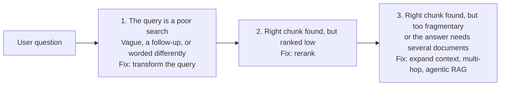
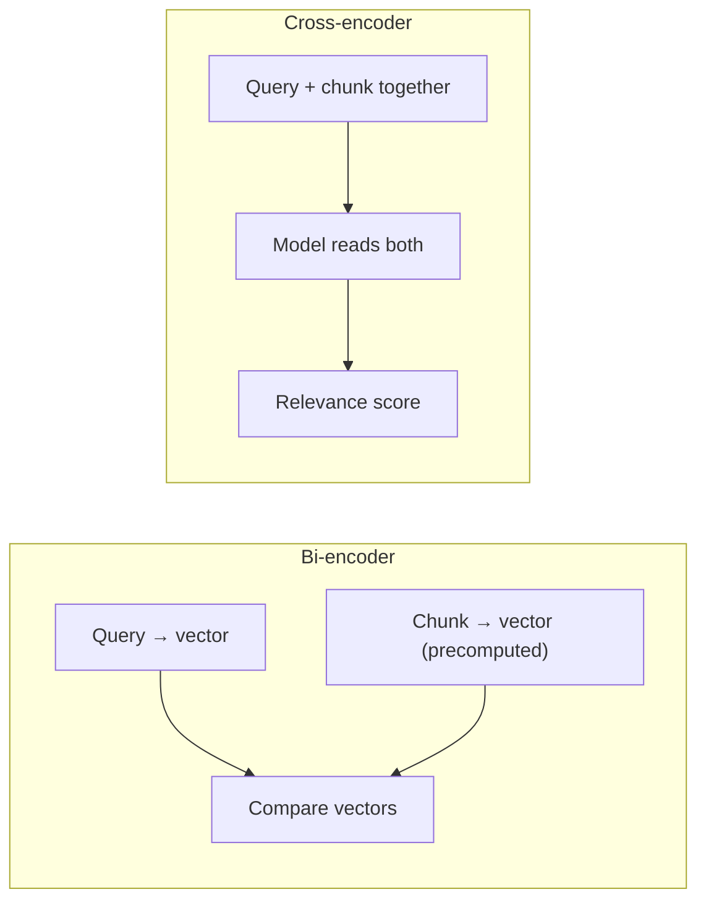
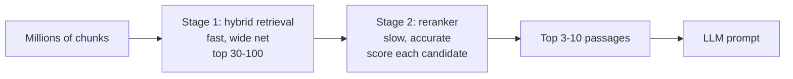
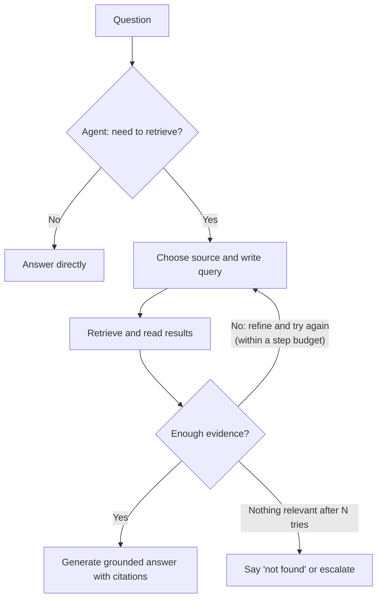

# Chapter 14: Improving Retrieval

## 1. The concept, from scratch

### Where we are

You have a working pipeline from [Chapter 11](../11-rag-fundamentals/README.md) to [Chapter 13](../13-vector-search-and-databases/README.md): good parsing, sensible chunks, hybrid search with filters. It's decent, but it still fails in three typical ways, and each has its own fix.

The order is deliberate. Improve what's cheap and measurable first, and only add loops and agents when the simpler steps run out.

### Recall and precision, in RAG terms

Two words you should be able to use precisely.

- **Recall:** of all the passages that *should* be retrieved, how many did we get? Low recall means the right evidence never reached the model, and nothing downstream can fix that.
- **Precision:** of the passages we retrieved, how many are actually relevant? Low precision means the prompt is full of noise, which wastes tokens, adds cost and distracts the model ([Chapter 7](../07-context-windows-and-context-engineering/README.md)).

They pull against each other. Retrieve more passages and recall goes up while precision goes down. So the standard design is **two stages**: a first stage tuned for **recall** (cast a wide net, cheaply), then a second stage tuned for **precision** (pick the best few, more carefully). Most of this chapter is about those two stages and the steps around them.

### Part A: Transform the query

Users don't write good search queries. Their questions are short, vague, full of pronouns, and phrased differently from the documents. So a common first step is to have a model improve the query *before* retrieval. This is a neat example of generative and predictive models together ([Chapter 1](../01-introduction-to-ai/README.md)): a small LLM rewrites the query, then the retrieval models search.

**Rewriting follow-up questions.** In a chat, the user says "what about the premium plan?" Embedded alone, that means nothing. A rewrite step uses the conversation history to turn it into a standalone query: "What is the cancellation policy for the premium plan?" This one step fixes a lot of real-world failures.

**Multi-query expansion.** Generate several different phrasings of the question, retrieve for each, and merge the results (with RRF, [Chapter 13](../13-vector-search-and-databases/README.md)). It improves recall when the user's wording differs from the documents'.

**Decomposition.** Break a complex question into sub-questions, retrieve for each, and combine. "How do the baggage rules differ between our economy and premium tickets?" becomes one question per ticket type.

**Step-back queries.** Ask a more general question first ("what are the baggage rules for international tickets?") to retrieve broader background, alongside the specific query.

**HyDE (hypothetical document embeddings).** A clever idea from a 2022 paper. Questions and answers look different, so a question's embedding isn't always close to the passage that answers it. HyDE asks an LLM to write a **hypothetical answer** (it may contain invented details), embeds *that*, and searches with it. The made-up answer is closer in style and vocabulary to real answer passages. It can help when queries are short or vague. Costs: an extra LLM call (latency and money), and a risk that a wrong hypothetical drags retrieval in the wrong direction. Treat it as a technique to test, not a default.

**Query routing and self-query.** Decide *where* to search (which index, which database, or whether to search at all) and extract filters from the question ("current policies for Germany" becomes a market filter and a status filter plus a text query).

| Technique | Helps when | Cost |
|---|---|---|
| Rewrite | Follow-ups, pronouns, chat context | One small LLM call |
| Multi-query | Wording mismatch, low recall | Several retrievals plus a merge |
| Decomposition | Questions with several parts | Several retrievals plus a combine step |
| HyDE | Short or vague queries | LLM call, and a risk of drift |
| Routing and filters | Several sources, structured constraints | Small LLM call or a classifier |

All of these add latency. A small, fast model is usually enough for query rewriting ([Chapter 8](../08-the-model-landscape/README.md)), and you should measure whether each one actually helps on your own questions.

### Part B: Rerank

First-stage retrieval has to be fast over millions of chunks, so it uses cheap comparisons. That limits its precision. A **reranker** is a more accurate (and slower) model applied to just the shortlist.

To see why it's more accurate, you need three model designs from [Chapter 4](../04-transformers-and-attention/README.md) and [Chapter 3](../03-tokens-and-embeddings/README.md):

- **Bi-encoder.** Encodes the query and each chunk *separately* into vectors, and compares the vectors. Chunk vectors are computed ahead of time, so search is very fast. This is what embedding-based first-stage retrieval uses. The weakness: the query and chunk never "see" each other while being encoded, so fine detail is lost.
- **Cross-encoder.** Feeds the query and one chunk into the model *together*, so attention can compare them word by word, and outputs a relevance score. Much more accurate. But nothing can be precomputed, so it must run once per query-chunk pair. Far too slow for millions of chunks, fine for 50 or 100.
- **Late interaction (ColBERT-style).** A middle path. Encode query and chunk separately, but keep a vector *per token* instead of one vector for the whole text, and score by matching each query token with its best-matching chunk token. Chunk token vectors can be precomputed, so it's fast, and it keeps more fine-grained matching than a single vector. It can be used for retrieval or for reranking. Cost: much more storage, because of the many vectors per chunk.

**The rule to remember: bi-encoders do first-stage retrieval, and cross-encoders (or late-interaction models like ColBERT) do reranking.**

| Model design | Accuracy | Speed | Used for |
|---|---|---|---|
| **Bi-encoder** | Good | Very fast | First-stage retrieval over everything |
| **Late interaction (ColBERT-style)** | Better | Fast, but more storage | Retrieval or reranking |
| **Cross-encoder** | Best of the three | Slow: one pass per candidate | Reranking a shortlist |

Practical points:

- **Candidate counts.** A common pattern is to retrieve around 30 to 100 candidates, rerank, and keep 5 to 10 for the prompt. These are starting points to tune, not rules.
- **Latency.** A reranker adds tens to hundreds of milliseconds, depending on the model, candidate count, chunk length, hardware and network. Measure it in your setup, because published figures vary a lot.
- **Options.** You can use managed reranking APIs (Cohere Rerank, Voyage and Jina are examples) or self-host open-weight rerankers such as the BGE family (as of Nov 2026). Vendors each claim to lead on their own benchmarks, so test on your data.
- **LLM-as-reranker.** You can also ask an LLM to rank candidates. It's flexible and often strong, but slower and costlier than a dedicated reranker.
- **Business rules.** A reranking stage is also a natural place to boost fresh or authoritative documents, or to drop superseded ones.

Reranking is one of the highest-return additions to a RAG pipeline, because it fixes the "right chunk was found but ranked fifth" problem cheaply.

### Part C: Give the model the right context

**Expand around a hit.** A matched sentence or chunk is often too fragmentary to answer from. Options: return the **neighbouring chunks**, return the **parent section** (parent-child, [Chapter 12](../12-ingestion-and-chunking/README.md)), or use a **sentence window**, where you match on one sentence but pass the surrounding few.

**Tidy the context.** Remove duplicates and near-duplicates, order passages sensibly, and label each with its source. Because models attend unevenly across long prompts ([Chapter 7](../07-context-windows-and-context-engineering/README.md)), put the best passages at the start or end.

**Compress.** If passages are long, extract only the sentences relevant to the question (with a small model), so the prompt stays focused and cheap.

**Add chunk context at ingestion time.** If chunks lose their meaning out of context, fix it at the source with headers or contextual retrieval ([Chapter 12](../12-ingestion-and-chunking/README.md)).

### Part D: Multi-hop questions

Some questions can't be answered from one passage. *"Which supplier provides the pump we replaced in March, and is it still approved?"* needs the maintenance log (to find the pump) and then the supplier register (to check approval). Neither search can be written until the first answer is known. These are **multi-hop** questions: the answer needs a chain of retrievals, where each step depends on the one before.

A single similarity search can't do this, because the second query depends on the first result. Approaches, from simplest:

1. **Decompose, then retrieve.** If the sub-questions are independent, split and search in parallel.
2. **Iterative retrieval.** Retrieve, read, form the next query from what you found, and retrieve again, for a fixed number of rounds.
3. **Graph-based retrieval.** Build a graph of entities and relationships (suppliers, parts, sites) from the documents, and follow links. Microsoft Research's GraphRAG is a well-known example. It can handle cross-document questions well but adds real cost to build and maintain, so reserve it for cases where relationships are central.
4. **Agentic RAG.** Let a model decide each step. That's next.

### Part E: Agentic RAG

In **naive RAG** the pipeline is fixed: always retrieve once, then answer. In **agentic RAG** a model *controls* the retrieval. Retrieval becomes a **tool** ([Chapter 19](../19-tool-calling/README.md)) in an agent loop ([Chapter 18](../18-from-llm-calls-to-agents/README.md)). The agent can:

- decide *whether* to retrieve at all (a greeting doesn't need a search),
- choose *which* source to search (policy index, ticket system, web),
- write and rewrite its own queries,
- read the results, judge whether they're enough, and **search again** if not,
- stop when it has what it needs, or say it couldn't find it.

Research patterns point in the same direction. **Self-RAG** trains a model to decide when to retrieve and to critique whether passages are relevant and its output supported. **Corrective RAG** grades retrieved documents and falls back to another source, such as web search, if the local results are weak. You don't need the details, only the idea: **the system checks its own retrieval and corrects it.**

The trade-offs are what interviewers want to hear.

| Benefit | Cost |
|---|---|
| Handles multi-hop and ambiguous questions | **More latency**: several model calls and retrievals per question |
| Adapts the search to what it finds | **More cost**, and costs vary per question |
| Can self-check and retry | **Less predictable**: harder to test and debug |
| Can use several sources | Risk of **over-searching**, picking the wrong source, or confirming an early wrong idea |

So the rule is: **use the simplest thing that meets the quality bar.** Many applications are well served by one good hybrid retrieval plus a reranker. Reach for agentic RAG when questions are genuinely multi-step or sources are many, and bound it with a **step budget**, timeouts and logging of each step ([Chapter 25](../25-agent-reliability-and-learning/README.md)). Agentic RAG is covered again in Part 5, once we've built the agent concepts it relies on.

### Diagnosing and choosing the fix

When a RAG answer is wrong, find the stage where it went wrong, then apply the matching fix.

| What you see | Likely cause | Try |
|---|---|---|
| Right chunk isn't in the top 50 | Poor query, wrong matching, bad chunking | Query rewriting, hybrid search, better chunking or context headers |
| Right chunk is in the top 50, not in the top 5 | Weak precision | Add or improve a reranker |
| Right chunk is retrieved but the answer is incomplete | Chunk too fragmentary | Neighbour or parent expansion |
| Answer needs facts from several documents | Multi-hop | Decomposition, iterative retrieval, agentic RAG |
| Follow-up questions fail | Missing chat context in the query | Rewrite to a standalone query |
| Results contain old or conflicting versions | Metadata and freshness | Filters, boost current versions ([Chapter 15](../15-enterprise-rag/README.md)) |
| Right passages retrieved, model still answers wrongly | Generation issue | Prompt, fewer chunks, citations ([Chapter 28](../28-hallucination-and-grounding/README.md)) |

The sensible order to add things, cheapest first: hybrid search and filters, then a reranker, then query rewriting for chat, then context expansion, and only then multi-step or agentic retrieval. At each step, **measure on a fixed evaluation set** ([Chapter 27](../27-evaluating-rag-and-agents/README.md)) so you know whether it helped and what it cost in latency.

## 2. Analogies across industries

- **Query rewriting (banking).** A customer says to the contact-centre agent, "what about the other account?" The agent has to work out from the conversation which account and which question before they can look anything up. Rewriting turns a conversational fragment into a proper lookup.
- **HyDE (manufacturing).** A buyer who isn't sure what to search for writes a sample spec sheet of the part they imagine, then looks for real catalogue entries that resemble it. The imagined spec may be wrong in details, but it looks like the thing they want.
- **Two-stage retrieval (travel).** Airport security uses a fast scan on everyone, then a careful manual check on the small number flagged. The first stage has to be quick and wide, and the second can afford to be slow and thorough. Bi-encoders and cross-encoders divide the work the same way.
- **Multi-hop (manufacturing).** A maintenance engineer asked "is the part we fitted in March still approved?" must first look up what was fitted in the log, then check that part number in the approvals register. The second look-up can't be written until the first is done.
- **Agentic RAG (insurance).** A claims investigator doesn't run one search and stop. They read the first file, realise they need the police report, request it, and keep going until they can write the decision, or decide they can't. They also have a time limit.

## 3. How it's used in industry

- **Banking: conversational support.** A bank's help assistant rewrites each follow-up into a standalone query using the conversation, retrieves with hybrid search, and reranks. The rewrite step targets the classic "it forgot what we were talking about" complaint.
- **Manufacturing: maintenance questions.** A plant assistant uses decomposition and iterative retrieval so questions that span the maintenance log, manuals and approved-supplier lists are answered by chaining lookups, with each step logged for review.
- **Travel: policy answers.** An airline retrieves 50 candidate passages from fare rules and policies, reranks them with a cross-encoder, and passes the top five to the model, so that answers cite the fare condition that actually applies to the customer's ticket, not a similar-sounding one.
- **Insurance: investigation support.** An insurer's assistant for investigators uses an agentic loop with a hard step limit, searching claim files, policy wordings and external records, and returns "insufficient evidence" with the searches it tried when it can't find enough.

## 4. Common misconceptions

- **"Retrieve more chunks to be safe."** More chunks mean more noise and cost, and can bury the answer. Retrieve wide, then rerank and pass only the best.
- **"A reranker is just a bigger embedding model."** It's a different design: it reads the query and chunk together, so it's more accurate but can't be precomputed.
- **"Cross-encoders can replace first-stage retrieval."** They're too slow to run over a whole corpus. They work on shortlists.
- **"HyDE always helps."** It can, for short or vague queries, but it adds latency and can drift if the hypothetical answer is wrong.
- **"Agentic RAG is the modern replacement for RAG."** It's an extension for harder questions, with more cost, latency and unpredictability. Many use cases don't need it.
- **"If the answer is wrong, switch to a bigger model."** Usually the problem is upstream, in the query, retrieval or ranking.
- **"Recall and precision are the same thing."** Recall is whether the evidence was found, and precision is how clean the retrieved set is.

## 5. Interview questions

### 1. What's the difference between recall and precision in RAG, and which matters more?

Recall is whether the right evidence made it into the retrieved set, and precision is how much of the retrieved set is actually relevant. Both matter, but at different stages. If recall is low, the model never sees the right passage and can't answer correctly, so I make sure the first stage casts a wide net. If precision is low, the prompt fills with noise, which costs tokens and can distract the model, so the second stage, usually a reranker plus a small cut-off, focuses on precision. The usual design is to retrieve broadly for recall and then rerank for precision, and I'd measure both on a set of real questions.

### 2. Why add a reranker, and how does it work?

First-stage retrieval has to be fast across millions of chunks, so it compares precomputed vectors, and that limits how precisely it can rank. A reranker takes the shortlist, say the top fifty, and scores each candidate against the query more carefully. A cross-encoder reads the query and the passage together, so the model can compare them word by word, which is far more accurate, but it has to run once per pair, so it's only practical on a shortlist. I'd retrieve around fifty or a hundred, rerank, and pass the best handful to the LLM. It's one of the best-value improvements because it fixes the case where the right chunk was found but ranked too low.

### 3. Explain bi-encoders, cross-encoders and ColBERT-style late interaction.

A bi-encoder encodes the query and each chunk separately into single vectors and compares them. Chunk vectors are precomputed, so it's very fast, which is why it's used for first-stage retrieval. A cross-encoder feeds the query and a chunk into the model together, so attention can compare them directly, and it outputs a relevance score. It's much more accurate but can't be precomputed, so it's used to rerank a shortlist. Late interaction, as in ColBERT, keeps a vector per token instead of one per chunk, and scores by matching each query token to its best chunk token. Chunk token vectors can be precomputed, so it's fast, and it keeps finer detail than a single vector, at the cost of more storage. It can be used for retrieval or reranking. So bi-encoders retrieve, and cross-encoders or ColBERT-style models rerank.

### 4. How do you handle follow-up questions in a RAG chat?

I add a query rewriting step. A follow-up like "what about the premium plan?" is meaningless as a search query on its own, so I use the conversation history, with a small, fast model, to rewrite it into a standalone question like "what is the cancellation policy for the premium plan?", and I retrieve with that. I'd keep the history short and relevant so the rewrite stays accurate. I'd also still send the conversation to the answering model, since it may need it for tone and continuity, but retrieval is driven by the standalone query. I'd test it on conversations with pronouns and topic switches.

### 5. What is HyDE and when would you use it?

HyDE stands for hypothetical document embeddings. Instead of embedding the question, I ask an LLM to write a plausible answer, even if it contains invented details, and I embed that and search with it. The idea is that a made-up answer looks more like real answer passages, in style and vocabulary, than the short question does, so it lands closer to them in vector space. I'd consider it when queries are short, vague or phrased very differently from the documents. The costs are an extra model call, and the risk that a wrong hypothetical pulls retrieval in the wrong direction. So I'd test it against plain retrieval on my own questions rather than adopt it by default.

### 6. How would you handle multi-hop questions?

A multi-hop question needs a chain where each lookup depends on the previous one, like finding which pump was replaced and then checking its supplier's approval status. One similarity search can't do that. If the sub-questions are independent, I'd decompose and retrieve in parallel. If they depend on each other, I'd use iterative retrieval: retrieve, read, build the next query from what I found, repeat for a bounded number of rounds. If relationships between entities are central, I might consider a graph-based approach. And if the questions are varied and open-ended, an agentic approach where a model decides each step. I'd bound it with a step limit, log every step, and measure whether the extra cost and latency buy better answers.

### 7. What is agentic RAG, and when is it worth it?

In agentic RAG a model controls the retrieval instead of following a fixed pipeline. Retrieval becomes a tool in an agent loop, and the agent decides whether to retrieve, which source to use, what query to write, whether the results are enough, and whether to try again. It's worth it when questions are genuinely multi-step, ambiguous, or spread across several sources. The costs are real: more latency, higher and less predictable cost, harder testing, and risks like over-searching or settling on an early wrong idea. So I start with a simple pipeline of hybrid retrieval plus a reranker, and move to an agent only where evaluation shows the simple version fails. And I'd bound it with a step budget, timeouts and logging.

### 8. How many chunks should you retrieve, and how many should you pass to the model?

I'd treat them as two separate numbers. For retrieval I want recall, so I'd pull a wider candidate set, maybe thirty to a hundred, from hybrid search. After reranking I want precision, so I'd pass only the best handful, say three to ten, to the model. The exact numbers depend on chunk size, how hard the questions are, and the model's context handling, so I'd tune them on an evaluation set, measuring whether the right passage is in the candidate set and how answer quality changes as I vary what goes in the prompt. I'd choose the smallest prompt that gives good answers, to save cost and latency.

### 9. What does a reranker cost you, and how do you manage it?

It adds latency and money. Latency is typically tens to hundreds of milliseconds, depending on the model, the number of candidates, chunk length, hardware and network, so I'd measure it in my own setup instead of trusting published figures. Cost depends on the pricing model: some APIs charge per search, some per token, so candidate count and chunk length drive the bill. To manage it, I'd limit the candidate count to what's needed, keep chunks reasonably short, batch requests, consider a smaller reranker or self-hosting at high volume, and skip reranking when first-stage scores are already decisive. And I'd check the gain is worth it: if reranking improves precision on my evaluation set by a meaningful amount, the cost is usually justified.

### 10. Retrieval quality is poor. In what order do you try improvements?

I'd start by measuring, with a fixed set of real questions and known right passages, so I can see recall at different cut-offs and tell which stage is failing. If the right chunk isn't in the candidate set, I look at ingestion, chunking and context headers, add keyword search to make it hybrid, and consider query rewriting. If it's in the candidates but ranked low, I add a reranker. If it's found but fragmentary, I expand around the hit. Only if the questions need several steps would I add decomposition or agentic retrieval. I go cheapest and most measurable first, change one thing at a time, and track the latency and cost of each change as well as the quality gain.

## 6. Scenario exercise

A manufacturer's maintenance engineers use an assistant over equipment manuals, a maintenance log, and an approved-supplier register. Engineers ask things like "what torque for the pump housing bolts on line 3?" (works fine), "what about the older model?" (often returns nonsense), and "which supplier provided the seal we fitted in March, and is it still approved?" (often wrong or "not found"). Retrieval metrics show the right manual chunk is usually in the top 30 but often not in the top 5. The head of maintenance wants fewer wrong answers without making the assistant too slow. What would you change, in what order? You haven't seen the system.

Answer from memory, then check.

Model answer

I'd map each symptom to its stage rather than change everything at once.

The "right chunk in the top 30 but not the top 5" finding is a precision problem, and that's the cheapest fix. I'd add a reranker: keep the hybrid retrieval wide, rerank the top thirty or so with a cross-encoder, and pass the best five to the model. I'd measure the added latency and make sure it stays within what engineers will tolerate.

The "what about the older model?" failure is a conversation problem. The follow-up is meaningless as a search query on its own. I'd add a rewrite step using a small, fast model and the recent conversation, so it becomes a standalone query like "what torque for the pump housing bolts on line 3, older pump model?" I'd test it on follow-ups, pronouns and topic switches. I'd also use metadata filters for equipment model where it can be extracted.

The seal-and-supplier question is multi-hop: first find the seal that was fitted in March from the maintenance log, then look that part or supplier up in the approved-supplier register. A single search can't do it because the second query depends on the first result. I'd start with iterative retrieval with a small, fixed number of steps: retrieve from the log, extract the part and supplier, then query the register. If we see many such question types, I'd move to a bounded agentic loop where retrieval over each source is a tool, with a step budget, logging of each step, and a clear "couldn't verify" response with the searches tried. I'd tell the head of maintenance that this is the one change that adds notable latency and cost, so we'd apply it only to questions that need it, using a quick check to route them.

Throughout, I'd keep a fixed evaluation set with all three question types and measure recall, precision and latency before and after each change. The order is reranker, then rewriting, then multi-step retrieval.

## 7. Key takeaways

- Retrieve for recall, then rerank for precision: wide first stage, accurate second stage, small final set in the prompt.
- Bi-encoders do first-stage retrieval, and cross-encoders or ColBERT-style late-interaction models do reranking.
- Transform queries when users are vague or conversational: rewrite follow-ups, expand, decompose, and use HyDE only if tests show it helps.
- Multi-hop questions need chained retrieval. Agentic RAG lets a model drive it, at the price of latency, cost and unpredictability, so bound it with a step budget.
- Diagnose by stage and fix cheapest first: hybrid and filters, reranker, query rewriting, context expansion, then agentic retrieval, measuring each change.

## 8. Further reading

- Gao et al., [Precise Zero-Shot Dense Retrieval without Relevance Labels](https://arxiv.org/abs/2212.10496) (HyDE, 2022).
- Khattab and Zaharia, [ColBERT: Efficient and Effective Passage Search via Contextualized Late Interaction over BERT](https://arxiv.org/abs/2004.12832) (2020).
- Reimers and Gurevych, [Sentence-BERT](https://arxiv.org/abs/1908.10084) (2019): the bi-encoder idea that underlies embedding search.
- Asai et al., [Self-RAG: Learning to Retrieve, Generate, and Critique through Self-Reflection](https://arxiv.org/abs/2310.11511) (2023).
- Yan et al., [Corrective Retrieval Augmented Generation](https://arxiv.org/abs/2401.15884) (2024).
