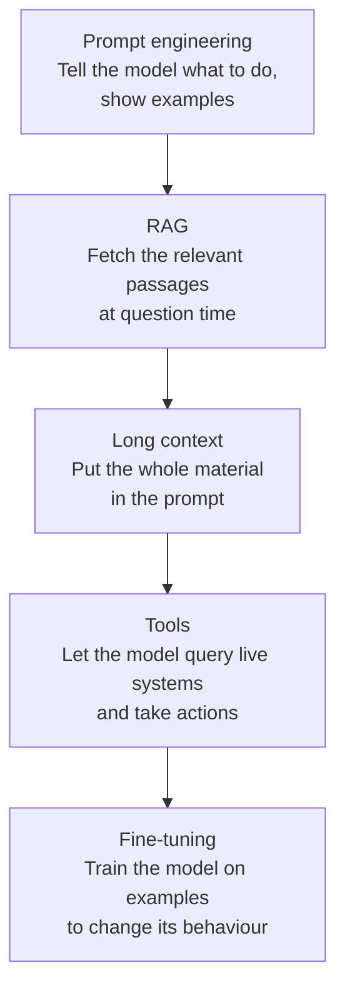
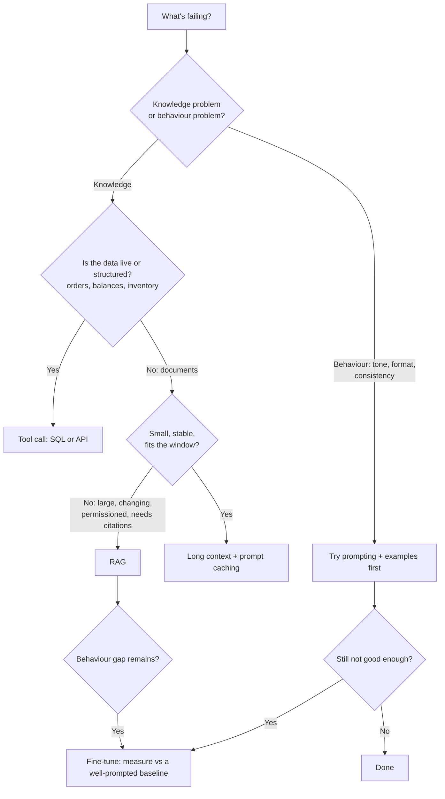

# Chapter 17: RAG vs Fine-Tuning vs Long Context

## 1. The concept, from scratch

### The question every client asks

A client says: "We want the AI to know our business." There are several ways to get there, and choosing badly is one of the most expensive mistakes in AI engineering. This chapter pulls together [Chapter 9](../09-prompt-engineering/README.md), [Chapter 10](../10-fine-tuning-and-distillation/README.md) and Part 4 into one decision framework.

The key move is to split the request into two different problems:

- **A knowledge problem:** the model doesn't know the facts it needs. Your policies, your products, last week's events, a 300-page contract.
- **A behaviour problem:** the model knows enough but doesn't act the way you want. Wrong tone, wrong format, inconsistent decisions, too slow or too costly for the volume.

**Knowledge problems are usually solved by giving the model information (retrieval or long context). Behaviour problems are usually solved by instructions or training (prompting or fine-tuning).** Most failures come from using a behaviour tool on a knowledge problem, usually fine-tuning, to store facts.

### The options



In one sentence each:

- **Prompt engineering** shapes behaviour with instructions and examples ([Chapter 9](../09-prompt-engineering/README.md)). Cheapest, fastest, always the first step.
- **RAG** supplies knowledge on demand by retrieving passages and putting them in the prompt ([Chapter 11](../11-rag-fundamentals/README.md)).
- **Long context** supplies knowledge by putting *all* the material in the prompt, using the large windows modern models offer ([Chapter 7](../07-context-windows-and-context-engineering/README.md)).
- **Tools** let the model look things up in live systems or act, like a SQL query, an API call, or a calendar booking ([Chapter 19](../19-tool-calling/README.md)). For live or structured data, a tool call is often better than RAG.
- **Fine-tuning** changes the model's weights with your examples, to shape style, format, and narrow-task skill ([Chapter 10](../10-fine-tuning-and-distillation/README.md)).

The mnemonic from the earlier chapters: **retrieve for what the model knows, fine-tune for how the model behaves.**

### The comparison

| | **Prompting** | **RAG** | **Long context** | **Fine-tuning** |
|---|---|---|---|---|
| **Solves** | Behaviour, format | Knowledge | Knowledge (small, stable sets) | Behaviour, style, narrow tasks, cost |
| **Handles large knowledge bases** | No | **Yes** | No (limited by the window, cost and accuracy) | Poorly: unreliable at storing facts |
| **Freshness** | n/a | **Update a document, answers change** | Re-send the new text | Retrain to update |
| **Citations** | Only if given sources | **Natural: you know which passages were used** | Possible, you know what you sent | **No**, the model can't say where it learned something |
| **Access control per user** | n/a | **Yes, filter at retrieval** ([Chapter 15](../15-enterprise-rag/README.md)) | Hard: whatever is in the prompt is visible to the model | **No**: knowledge is baked in for everyone |
| **Cost shape** | Tokens per call | Index to build, plus a few passages per call | **Every call pays for all the tokens** (unless cached) | Upfront: data and training. Then lower per call if the prompt gets shorter or the model smaller |
| **Latency** | Fast | Adds a retrieval step | Slower: long prefill | Fast, can be faster with a small model |
| **Effort and skills** | Low | Medium to high: a pipeline to build and run | Low | High: data, training, evaluation, retraining |
| **Main risk** | Brittle, vague | Retrieval misses, stale index | Cost, lost-in-the-middle, noise | Forgetting, staleness, can't update facts, can't cite |

### Long context versus RAG, properly

Windows of around a million tokens exist on several frontier models (as of Nov 2026, [Chapter 7](../07-context-windows-and-context-engineering/README.md)). So "just paste everything in" is a real option. When does it win, and when doesn't it?

**Long context is a good fit when:**
- the material is **one document or a small, stable set** that fits comfortably, such as one contract, one handbook, one codebase module;
- the question needs the model to **see everything at once**: summarising the whole document, finding every mention, spotting contradictions across sections, reviewing a contract end to end;
- you want the **simplest** system with no ingestion pipeline;
- the same material is queried repeatedly and **prompt caching** applies (below).

**RAG is a better fit when:**
- the knowledge base is **large**, beyond the window or beyond what's affordable to send every time;
- it **changes often**, so re-indexing a changed file is easier than re-sending everything;
- you need **per-user permissions** ([Chapter 15](../15-enterprise-rag/README.md));
- you need **precise citations** to specific passages;
- **cost and latency** matter at volume, because RAG sends a few passages instead of the whole corpus on every call.

What does the evidence say? A 2024 study from Google DeepMind and the University of Michigan compared the two across public datasets, using models of that time (Gemini 1.5 Pro, GPT-4o, GPT-3.5 Turbo). It found long-context models generally outperformed RAG when resources allowed, while RAG was much cheaper. The authors proposed **Self-Route**, a hybrid that lets the model decide per query whether the retrieved passages are enough, and only sends the full context when they aren't, and reported substantial cost savings with little quality loss. ```mermaid
flowchart LR
    Q["Query"] --> R["Retrieve a few passages<br/>and try to answer (cheap)"]
    R --> J{"Are the passages<br/>enough?"}
    J -- "Yes" --> A1["Answer from retrieved passages"]
    J -- "No" --> L["Send the full material<br/>to a long-context call (expensive)"]
    L --> A2["Answer from full context"]
```

Treat the exact numbers as belonging to those models and datasets. The durable lessons are that long context can beat RAG on quality when the material fits, that RAG wins on cost and scale, and that routing between them is a sensible design.

Two more practical points:

- **Prompt caching changes the economics.** Providers can cache the processed stable part of a prompt, so repeated calls over the same long document are charged at a much-reduced rate for the cached portion. Anthropic's documentation, for example, lists cache reads at a fraction of the normal input price. But caches expire (the default lifetime is short, minutes unless extended), only the unchanging prefix qualifies, and the rules and prices differ by provider and model, so check current documentation ([Chapter 31](../31-cost-latency-and-caching/README.md)).
- **Bigger context isn't always better quality.** Models can use long inputs unevenly, and irrelevant material adds noise ([Chapter 7](../07-context-windows-and-context-engineering/README.md)). The only reliable answer is to test on your own questions.

### Fine-tuning versus RAG for knowledge

When the goal is to make the model know new facts, the research agrees with the practical advice. A 2023 Microsoft study compared unsupervised fine-tuning with RAG for injecting knowledge, and found RAG consistently did better, for both new facts and facts the model had seen before, while fine-tuning struggled to learn new factual information. It's one study, using the models and methods of the time, but it matches what engineers see in practice: fine-tuning is a weak way to store facts.

The reasons are structural, not just empirical. A fine-tuned model can't point to its source. You can't remove or update a single fact without retraining. You can't give different users different knowledge. And it can pick up the style of your documents without reliably learning their content.

Where fine-tuning is the right tool is **behaviour**: a house style, a strict output format, a classification or extraction skill in your domain, following complex rules consistently, or letting a small, cheap model do a job a larger one does with a long prompt.

### Combining them

These aren't exclusive. The strongest systems layer them, each doing what it's best at.

| Combination | How it works | Example |
|---|---|---|
| **Prompt + RAG** | The default production pattern | Support assistant with retrieved policy passages and clear rules |
| **RAG + fine-tuning** | Retrieval supplies facts. Fine-tuning teaches the *behaviour* of using them well: format, tone, citing sources, saying "not found" | A tuned small model that always answers in the company's structure from retrieved text |
| **RAG + long context** | Retrieve generously, put more passages and surrounding sections into a large window, rerank and order them | A contract assistant that retrieves relevant sections plus their neighbours |
| **Routing between them** (Self-Route style) | A small classifier or the model decides per query: cheap retrieval for simple questions, full context or an agent for hard ones ([Chapter 36](../36-llm-gateways-and-routing/README.md)) | Predictive router, then generative answer |
| **Distilled small model + RAG** | A small model, trained from a bigger one for the task, answers from retrieved evidence at low cost | High-volume classification-plus-explanation |
| **Tools + RAG** | RAG for documents, tool calls for live structured data | "What's my order status and what's the return policy?" |

The predictive and generative theme shows up again: small trained models (classifiers, embedders, rerankers, routers) decide and retrieve, and the generative model writes.

### A decision framework

Work through these questions in order. They also give you a structure for an interview answer.



In words:

1. **Is it knowledge or behaviour?** This one question prevents most mistakes.
2. **Is the data live or structured?** If it's orders, balances or stock levels, use a tool, not RAG.
3. **How big, how changeable, how permissioned is the knowledge?** Small and stable: long context. Large, changing or restricted: RAG.
4. **Do you need citations or an audit trail?** That points to RAG, or long context with sources identified.
5. **What are the volume and cost limits?** At high volume, per-call tokens matter: prefer retrieval, a smaller model, or caching.
6. **What are the latency needs?**
7. **What can the team build and run?** A pipeline, a training process, or just prompts.
8. **What's the risk of a wrong answer?** Higher risk means more grounding, citations, evaluation and human review.

And always: **measure on your own evaluation set at each step** ([Chapter 26](../26-evaluation-fundamentals/README.md)). Start with the cheapest option that might work, and move up only when the evidence says it isn't enough.

### Common wrong decisions

- **Fine-tuning to store facts.** The classic. It's unreliable, uncitable and impossible to update cleanly.
- **Building RAG for one small, stable document.** A pipeline you don't need. Long context is simpler.
- **Pasting a million-document corpus into the prompt.** Cost, latency, noise and permissions all fail.
- **Fine-tuning before trying prompts.** You skip the cheapest fix.
- **Using RAG for live structured data.** A SQL query is exact, a retrieved passage is stale and fuzzy.
- **Using RAG to fix a behaviour problem,** like a wrong output format. Retrieval won't change how the model writes.
- **Choosing without evaluation.** Opinions don't survive contact with data.
- **Picking one technique for everything.** Real systems combine them.

### How to explain it to a non-technical client

Four everyday pictures cover it:

- **Prompting** is a clear **briefing note** to a smart new hire.
- **RAG** is giving them access to the **company library** and teaching them to look things up and cite the page.
- **Long context** is handing them **the whole binder** to read before each conversation. Fine for a slim binder, impractical for a warehouse of files.
- **Fine-tuning** is sending them on a **training course** so their habits change. It teaches *how* to work, not a reliable memory of every fact, and when the rules change you'd send them on the course again, or just hand them the new page.

## 2. Analogies across industries

- **Knowledge vs behaviour (healthcare).** A newly qualified doctor needs two different things: a reference they can look up for today's drug-interaction rules (retrieval) and training in how to write notes the way the department does (fine-tuning). Sending them back to medical school every time a formulary changes would be absurd.
- **Long context vs RAG (government).** A caseworker with one 40-page guidance document reads all of it before the meeting. A caseworker serving a whole department can't read every manual, so they use the index to pull the few relevant pages. The size of the material decides the method.
- **Tools vs RAG (retail).** To tell a customer whether an item is in stock right now, the shop assistant checks the live stock system, not last month's catalogue. Live data wants a lookup, not a document search.
- **Combining them (insurance).** An experienced underwriter combines trained judgement (fine-tuning), the current rate book (RAG), the specific file open on the desk (long context), and a call to the pricing system (tools). No single one is enough.

## 3. How it's used in industry

- **Healthcare: formulary assistant.** A hospital network uses RAG over the current formulary and guidelines, with citations and per-role access, because the content changes monthly and answers must be traceable. It uses a tool call for live stock and patient-specific data.
- **Retail: brand voice at scale.** A retailer fine-tunes a small model on a few thousand approved product descriptions so the voice and structure are consistent and the prompts stay short, and retrieves product specifications from the catalogue for the facts.
- **Public sector: a single handbook.** An agency puts a 300-page staff handbook into a long-context prompt with caching for a small internal Q&A tool, because it's one stable document and the simplest system that works. A separate assistant for the whole policy library uses RAG.
- **Telecom: a routed design.** An operator's assistant uses a small classifier to send simple billing questions to a cheap retrieval path and complex fault diagnosis to a larger model with more context and tools.

## 4. Common misconceptions

- **"Fine-tune it on our documents so it knows our business."** Fine-tuning is poor at storing facts, can't cite sources, and can't be updated cleanly. Use retrieval for knowledge.
- **"Long context makes RAG obsolete."** For one document or a small stable set, it can replace RAG. For large, changing or permissioned data, cost, latency, accuracy and access control still favour retrieval.
- **"RAG is always cheaper than long context."** Per query, usually, but a RAG system has building and running costs, and with prompt caching a long stable document can be cheap to query repeatedly.
- **"RAG and fine-tuning are competitors."** They solve different problems and are often combined.
- **"Fine-tuning makes the model smarter."** It makes it better at your task, and it can weaken other abilities.
- **"The newest technique is the right one."** The right one is the cheapest that meets the quality bar on your evaluation set.
- **"We have to pick one."** Mature systems layer prompts, retrieval, tools, and sometimes a tuned model.

## 5. Interview questions

### 1. Fine-tuning, RAG or prompt engineering: how do you decide?

I start by asking whether it's a knowledge problem or a behaviour problem, because that decides most of it. If the model lacks information, like my company's policies or recent events, I give it the information: retrieval if the knowledge is large, changing or permissioned, a long-context prompt if it's one small stable document, or a tool call if it's live structured data. If the model has the knowledge but doesn't behave right, wrong tone or format or inconsistent decisions, I start with prompting and examples, and fine-tune only if that's not enough, or if I need a smaller, cheaper model to do the job. I always start with the cheapest option and check it on an evaluation set before moving up. The short version is: retrieve for what the model knows, fine-tune for how it behaves.

### 2. Does long context make RAG obsolete?

No, but it changes where RAG is needed. For one document or a small, stable set that fits the window, putting it all in the prompt can be simpler and sometimes more accurate, since the model sees everything. Studies, like one from Google DeepMind in 2024, found long-context models often outperformed RAG when the material fits, while RAG was much cheaper. For large corpora, though, long context fails on cost, because every call pays for all the tokens, on latency, on accuracy as noise grows, and on access control, because anything in the prompt is visible to the model. RAG also gives precise citations and easy updates. So I'd choose by size, change rate, permissions and cost, and often combine them: retrieve generously, then use a large window, or route per query.

### 3. When would you fine-tune and still use RAG?

When I have both a knowledge need and a behaviour need. RAG supplies the facts, so they're current, citable and permission-controlled. Fine-tuning teaches behaviour that prompting couldn't reliably deliver: always answering in the company's structure, using a particular tone, citing the sources in a set format, saying "not found" when the passages don't contain the answer, or doing it with a small, cheap model so the cost per call falls. The fine-tuned model is shaped to *use* retrieved context well, while the facts still come from retrieval. I'd still show first that a well-prompted base model with retrieval falls short, and measure the improvement on an evaluation set.

### 4. A client wants to fine-tune a model on all their documents. What do you say?

I'd ask what they're trying to achieve, because that request usually bundles a knowledge need with a behaviour need. For knowledge, fine-tuning is the wrong tool: it stores facts unreliably, can't cite where an answer came from, can't be updated without retraining, and can't give different people different access. Retrieval does all of those well. For behaviour, like a consistent voice or format, fine-tuning can help, but only after prompting has been tried. So I'd propose retrieval over their documents with citations, a prompt that sets the behaviour, and an evaluation set to prove it works, and keep fine-tuning as a later step if a measurable behaviour gap remains. I'd explain it as handing a new hire the company library, instead of asking them to memorise it.

### 5. When is a tool call better than RAG?

When the data is live or structured. Order status, account balances, inventory and appointments live in databases and systems that change by the minute, and the right way to get them is an exact query or an API call, not a similarity search over documents that might be stale. RAG shines on unstructured text like policies, manuals and tickets. In practice an assistant often needs both, say a tool call for the customer's order and retrieval for the return policy, and the model combines them. The tool call also respects the user's permissions in the source system directly.

### 6. How do the costs of RAG, long context and fine-tuning compare?

They have different shapes. RAG has a build and run cost, with ingestion, an index and a retrieval service, and then a small per-query cost because only a few passages go in the prompt. Long context has little setup, but every call pays for all the tokens in the window, which adds up quickly with volume, unless the stable part is cached, in which case repeated queries over the same document can be much cheaper. Fine-tuning has an upfront cost of data preparation, training and evaluation, plus the cost of retraining when things change, and it can lower the per-call cost if the prompt shrinks or a smaller model can do the job. The honest answer is to model the cost per answered question at the expected volume for each option, with caching and prices from the provider's current documentation.

### 7. How would you evaluate which approach is best for a use case?

With data, not opinion. I'd build an evaluation set of real questions with known good answers, including hard and out-of-scope cases. Then I'd test candidate designs on it: a well-prompted baseline, the same with RAG, the same with long context if the material fits, and a fine-tuned model if there's a behaviour gap. I'd measure answer quality and groundedness, citation accuracy, latency, and cost per answer, and look at the failures by hand. Where several options meet the quality bar, I'd pick the cheapest and simplest, and I'd re-run the comparison when new models arrive, because the trade-offs shift.

### 8. What is Self-Route and why might you use a hybrid design?

Self-Route comes from a 2024 study comparing RAG with long-context models. The idea is that for many queries, RAG and long context give the same answer, so the cheap path is enough. The model first answers from the retrieved passages, and if it judges they're insufficient, the query is sent to the full long-context path. The authors reported significant cost savings with little loss in quality on the models they tested. I'd use that kind of hybrid when I have a mix of simple and hard questions, and cost matters. In general it's an example of routing: use the cheapest approach that can answer, and escalate when needed.

### 9. You have a single 300-page policy handbook and 200 staff. RAG or long context?

I'd lean towards long context, with prompt caching, because it's one stable document that fits in the window, and avoiding a retrieval pipeline makes the system simpler and removes retrieval misses. I'd check that it works well on a set of real staff questions, since long contexts can be used unevenly, and that the cost with caching is acceptable at their volume. I'd switch to RAG if the handbook grows into a library, changes often, needs per-role access, or if cost or accuracy on evaluation say so. I'd also include citations by asking the model to quote the section.

### 10. How would you explain the options to a non-technical executive?

I'd use four pictures. Prompting is a clear briefing note to a smart new hire. RAG is giving them access to the company library and having them look things up and cite the page. Long context is handing them the whole binder before each conversation, fine for a slim binder, impractical for a warehouse. Fine-tuning is sending them on a training course, which changes how they work but isn't a reliable way to memorise every fact. Then I'd say that we start with the cheapest, brief them well, give them the library, and only send them on the course if there's a specific habit they still can't learn, and we'd measure at each step so the decision is based on results.

## 6. Scenario exercise

Three clients come to you in one week.

**Client A, a hospital network.** Clinicians want answers about drug formularies and treatment guidelines. Content changes monthly, answers must show their source, and different clinics have different formularies.

**Client B, an online retailer.** They want product descriptions written in a very specific brand voice and fixed structure. They have 3,000 approved examples. Product facts come from a catalogue that updates daily.

**Client C, a public agency.** They want an internal Q&A tool over a single 300-page staff handbook, updated once a year, for about 200 staff.

For each, which approach would you recommend, and why? Answer from memory, then check.

<details>
<summary>Model answer</summary>

**Client A, the hospital network:** RAG, with citations and access control. This is a knowledge problem: the content is large, changes monthly, must be traceable, and varies by clinic. I'd ingest the formularies and guidelines with metadata for clinic, version and effective date, filter at retrieval by the clinician's clinic and role, cite the section and date, and abstain when nothing relevant is found. Fine-tuning would be a poor fit, since it can't cite or update monthly. Live data such as current stock would come through a tool call. A human stays in the loop for clinical decisions.

**Client B, the retailer:** This is mostly a behaviour problem, so I'd start with prompting and a handful of examples, and then, because they have 3,000 approved examples and a strict voice and structure, fine-tuning a small model is a strong candidate: consistent output with shorter prompts and lower cost per description at volume. The product facts, which change daily, come from the catalogue, supplied through a tool call or retrieval at generation time, never from the fine-tuned weights. I'd prove it by comparing the fine-tune against a well-prompted base model on a held-out set, scored for brand voice, accuracy of facts and cost.

**Client C, the public agency:** Long context with prompt caching. It's one stable document that fits in the window, with a small user base, and avoiding a pipeline keeps it simple. I'd check quality on real staff questions, require the model to quote the section for each answer, and confirm the cost with caching. If the handbook grows into a library or access needs to differ by role, I'd move to RAG.

The common thread: ask whether it's knowledge or behaviour, then size, change rate, permissions, and cost, start with the cheapest option, and validate with an evaluation set.

</details>

## 7. Key takeaways

- Split the request: knowledge problems need information (retrieval, long context, tools), behaviour problems need instructions or training (prompting, fine-tuning).
- Retrieve for what the model knows, fine-tune for how it behaves. Fine-tuning is poor at storing facts, can't cite, and can't be updated cleanly.
- Long context fits small, stable material. RAG wins on large, changing, permissioned and citable knowledge, and on cost at volume. Prompt caching narrows the cost gap for repeated long prompts.
- Live structured data wants a tool call, not RAG. Real systems combine prompting, retrieval, tools and sometimes a tuned model, often with routing.
- Start with the cheapest option, and decide with your own evaluation set, not opinion.

## 8. Further reading

- Li et al., [Retrieval Augmented Generation or Long-Context LLMs? A Comprehensive Study and Hybrid Approach](https://arxiv.org/abs/2407.16833) (2024): the RAG vs long-context comparison and Self-Route.
- Ovadia et al., [Fine-Tuning or Retrieval? Comparing Knowledge Injection in LLMs](https://arxiv.org/abs/2312.05934) (2023).
- Anthropic, [Prompt caching](https://docs.anthropic.com/en/docs/build-with-claude/prompt-caching): how caching a stable prompt prefix changes long-context economics.
- Lewis et al., [Retrieval-Augmented Generation for Knowledge-Intensive NLP Tasks](https://arxiv.org/abs/2005.11401) (2020).
