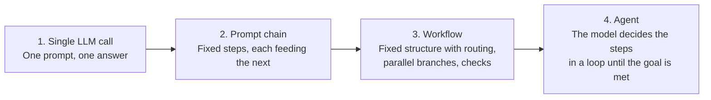
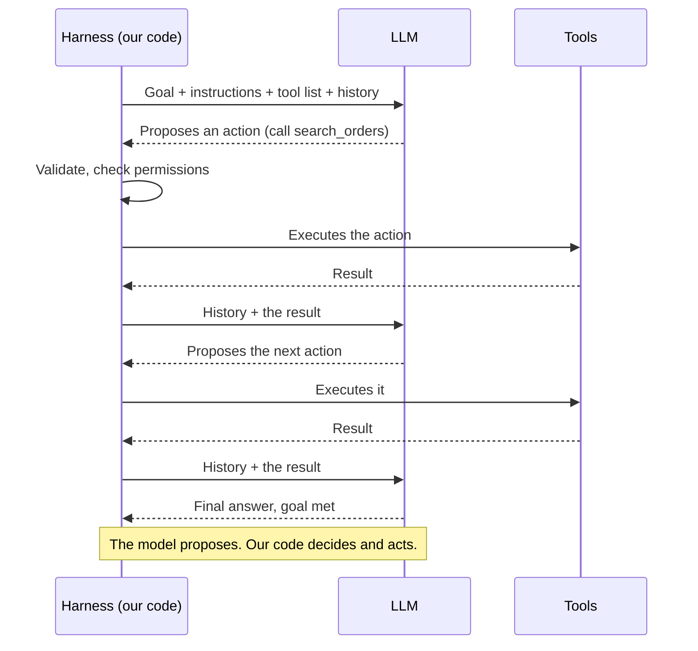
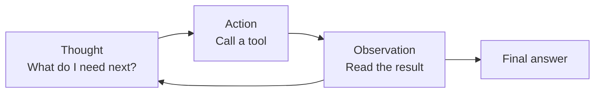
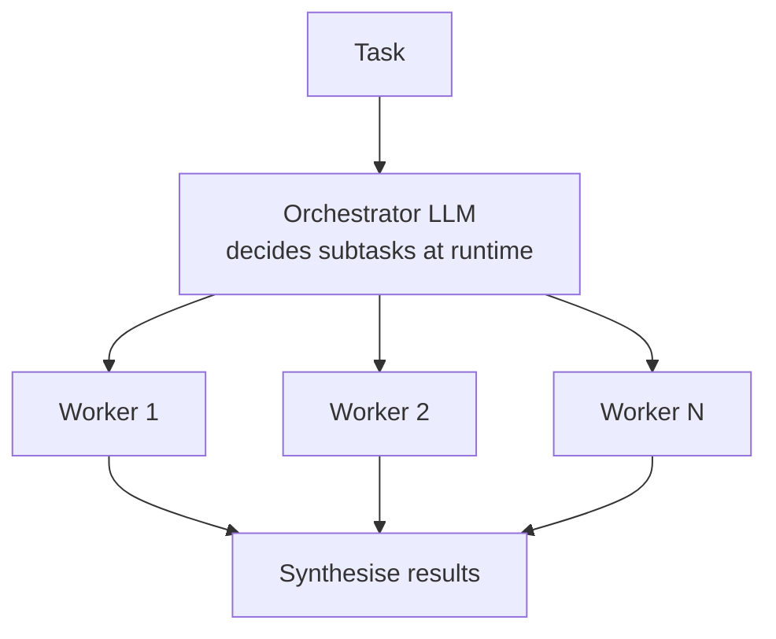

# Chapter 18: From LLM Calls to Agents

## 1. The concept, from scratch

### Where we are

So far, every system in this handbook has been one of two shapes. A single LLM call: prompt in, answer out ([Chapter 6](../06-inference-and-generation/README.md)). Or a fixed pipeline that *we* designed, like RAG: retrieve, then generate ([Chapter 11](../11-rag-fundamentals/README.md)). In both, our code decides what happens next.

An **agent** is what you get when you hand some of that decision-making to the model. This chapter explains what that means, what it costs, and, just as important, when you shouldn't do it.

### The ladder of autonomy

Think of a dial from "we control everything" to "the model controls the steps."

The cleanest way to draw the line comes from Anthropic's widely read engineering post on agents (December 2024):

- A **workflow** is a system where LLMs and tools are orchestrated through **predefined code paths**. We wrote the route.
- An **agent** is a system where the **LLM dynamically directs its own process and tool use**. The model picks the route.

Both are sometimes called "agentic systems". The distinction that matters in interviews is simple: **who decides the next step, our code or the model?**

### What an agent is

Here's the definition to say out loud:

> **An agent is an LLM running in a loop, trying to achieve a goal.**

The LLM is the **brain**: it reads the situation, reasons about it, and decides what to do. The **tools** are the **hands**: they're how anything actually happens in the world, whether that's searching, querying a database, calling an API or sending a message. Recall from [Chapter 6](../06-inference-and-generation/README.md) that an LLM is stateless, can't act on the world, and stops after each generation. An agent works around all three limits with code around the model: something calls the model again and again, feeds it the results of its actions, and keeps the state.

So an agent is made of a few parts:

| Part | What it is |
|---|---|
| **The model** | The reasoning engine that decides what to do next |
| **Instructions** | The goal, the rules, the tone, what it must never do |
| **Tools** | The actions available ([Chapter 19](../19-tool-calling/README.md)) |
| **Memory and context** | What it knows right now and what it can recall ([Chapter 21](../21-agent-memory-and-state/README.md)) |
| **The harness** | The code that runs the loop, executes tools, enforces limits and stops it ([Chapter 22](../22-orchestration-and-harnesses/README.md)) |

### The agent loop

At heart the loop is: look at the situation, decide, act, look at the result, repeat.

Notice who does what. **The model proposes. Our code decides and acts.** The model never touches a tool directly. It emits a request, and our code validates it, checks permissions and runs it ([Chapter 19](../19-tool-calling/README.md)). That boundary is where safety lives.

And notice the cost. Every turn of the loop sends the growing history back to the model ([Chapter 7](../07-context-windows-and-context-engineering/README.md)). An agent that takes ten steps makes ten model calls, each with a larger prompt than the last. That's why agents are slower and costlier than a single call.

**When does the loop stop?** It needs explicit stopping rules, because the model won't always know when to quit:

- the model decides the goal is met and gives a final answer,
- a **step budget** or time limit runs out,
- a **cost limit** is hit,
- a tool fails in a way it can't recover from,
- the agent needs a **human** (approval, missing information).

### ReAct: reasoning and acting together

The pattern behind most agents is called **ReAct**, from a 2022 paper (*Reason + Act*). The model alternates between **thinking** and **doing**:

1. **Thought:** reason about what to do next ("I need the order status before I can answer").
2. **Action:** call a tool (look up the order).
3. **Observation:** read the result ("shipped, arriving Friday").
4. Repeat until it can answer.

The insight is that interleaving the two beats doing either alone. Reasoning without acting can't check facts, and acting without reasoning flails. The paper showed gains on question answering and fact-checking tasks that needed lookups.

Today the pattern is built into how models work. Reasoning models think before and between actions ([Chapter 5](../05-training-llms/README.md)), and provider APIs return tool requests in a structured form, so you rarely write the "Thought:" format by hand. But the loop of think, act, observe is still the heart of nearly every agent.

### Workflow patterns: the ones short of an agent

Before building an agent, know the workflow patterns, because they're often the better answer. These five come from Anthropic's post, and they give you vocabulary for interviews (the post itself notes that tooling has moved on since it was written, but the patterns remain a useful map).

| Pattern | What it does | Example |
|---|---|---|
| **Prompt chaining** | A fixed sequence, each step using the previous output, with optional checks between | Extract details from an email, then classify it, then draft a reply ([Chapter 9](../09-prompt-engineering/README.md)) |
| **Routing** | A classifier sends each input to a specialised path | Simple questions to a small model, hard ones to a large one ([Chapter 36](../36-llm-gateways-and-routing/README.md)) |
| **Parallelisation** | Independent subtasks run at once and are combined, or the same task runs several times and results are voted on | Review a contract for three different risk types at once |
| **Orchestrator-workers** | One LLM breaks a task into subtasks *at runtime* and delegates them to workers | A coding task touching an unknown number of files |
| **Evaluator-optimiser** | One LLM produces, another critiques, in a loop until the criteria are met | Drafting and refining a translation against a quality rubric |

Look at where the pattern's predictive and generative models sit. In routing, a small **classifier** (predictive) picks the path and a larger **LLM** (generative) writes the output, exactly the pattern from [Chapter 1](../01-introduction-to-ai/README.md). Real systems mix workflow steps and agent steps freely.

### Kinds of agent, in plain words

You'll hear many labels. Most describe *what the loop is doing*:

- **Tool-using agent.** The basic kind: calls tools to fetch information or take actions.
- **Planning agent.** Writes a plan first, then executes it step by step, perhaps revising. Good for longer tasks. The alternative is to decide each step as you go.
- **Reflecting agent.** Checks its own work, critiques it and retries. This is the evaluator-optimiser idea inside one agent.
- **RAG agent (agentic RAG).** Retrieval is one of its tools, and it decides what to search for and when to search again ([Chapter 14](../14-improving-retrieval/README.md)).
- **Multi-agent system.** Several agents with different roles cooperating, which is the subject of [Chapter 23](../23-multi-agent-systems/README.md).
- **Computer-use agent.** One that operates a graphical interface, looking at screenshots and clicking, for software with no API. It exists, but is slower and more fragile than calling an API, so it's a last resort.

Another useful label is the **level of autonomy**. An **assistive** agent only suggests, and a human does the work. A **supervised** agent acts but asks for approval on important steps. An **autonomous** agent acts alone within defined limits. Most business deployments sit at the supervised end for anything that matters, which we cover in [Chapter 22](../22-orchestration-and-harnesses/README.md) and [Chapter 24](../24-agent-user-interaction/README.md).

### Workflow or agent? The key decision

This is the most valuable judgement call in the chapter. Anthropic's advice is to find the simplest solution that works, and only add complexity when needed. OpenAI's practical guide to agents makes a similar point and warns that a deterministic solution may be enough. Agents are the most flexible option and also the most expensive, slowest and least predictable.

| | **Workflow** | **Agent** |
|---|---|---|
| **Who chooses the steps** | Our code | The model |
| **Best when** | The steps are known and stable | The steps depend on what's found along the way |
| **Predictability** | High | Lower |
| **Cost and latency** | Lower, bounded | Higher, variable |
| **Testing and debugging** | Easier: each step can be tested | Harder: many possible paths |
| **Flexibility** | Handles only the cases you designed | Handles cases you didn't foresee |
| **Failure behaviour** | Fails in known ways | Can fail in creative ways, including looping |

A rule of thumb: **if you can draw the flowchart in advance, build a workflow. If you can't, because the next step genuinely depends on what the previous step turned up, consider an agent.**

Good candidates for agents:

- tasks with **open-ended paths** that can't be listed in advance, like investigating an issue;
- tasks needing **judgement over messy, unstructured input**;
- tasks where hard-coding every branch would be a nightmare of rules;
- situations where an occasional mistake is **tolerable or catchable** by oversight.

Poor candidates:

- tasks with **fixed, well-understood steps**, where a workflow is cheaper and more reliable;
- **high-stakes actions with no oversight**, like moving money without approval;
- **latency-critical** interactions, since each loop iteration adds delay;
- **low-margin, high-volume** work where per-task cost must stay tiny.

And a warning about compounding error. If each step is 90 percent reliable, six steps in a row succeed only about 53 percent of the time (0.9 to the power six). Longer chains need more reliability per step, or guards, which is the topic of [Chapter 25](../25-agent-reliability-and-learning/README.md).

### What is *not* an agent

A few terms get confused, so be precise:

- **A chatbot** is a conversational interface. It may or may not be an agent. A plain chatbot just answers.
- **A single tool call** isn't an agent. If the model calls one function and answers, that's function calling inside a workflow. An agent needs a **loop** with the model deciding whether to continue.
- **A RAG pipeline** that always retrieves once and answers is a workflow. It becomes agentic when the model controls retrieval.
- **"Autonomous AI employee"** is marketing. In practice, useful agents are bounded: a defined goal, a limited set of tools, budgets and oversight.

## 2. Analogies across industries

- **Workflow vs agent (manufacturing).** An assembly line is a workflow: every station is fixed, the product moves the same way each time, and it's fast and predictable. A master craftsperson repairing an unfamiliar antique is an agent: they inspect, decide what to try, observe, and adapt. You wouldn't build a car with the craftsperson, and you wouldn't repair the antique on an assembly line.
- **The agent loop (insurance).** A claims investigator reads the file, decides they need the police report, requests it, reads it, then decides they need a witness statement, and so on until they can decide the claim. At each step, what they do depends on what they just learned. The step budget is the deadline on the case.
- **Brain and hands (logistics).** A dispatcher decides which truck goes where, but the dispatcher doesn't drive. The drivers and the fleet system are the hands, and the dispatcher's instructions don't move anything until someone acts on them. "The model proposes, our code decides and acts."
- **Autonomy levels (healthcare).** A triage nurse system can suggest priorities (assistive), schedule a scan after a doctor approves (supervised), or automatically book routine follow-ups within clear rules (autonomous within limits). Different actions deserve different levels.

## 3. How it's used in industry

- **Retail: returns handling.** A retailer uses a workflow for standard returns, where the policy is fixed: check the order, check the window, issue the label. For exceptions like a damaged gift sent abroad, an agent investigates the order history, the policy and the carrier's notes, and proposes a resolution for a human to approve.
- **Insurance: claims investigation support.** An assistant for investigators runs a loop over claim files, policy wordings and external records, and returns a summary with the evidence it found and the steps it took. A step budget stops runaway searching, and a person makes the decision.
- **Logistics: disruption handling.** When a shipment is delayed, an agent checks carrier status, alternative routes and customer commitments, and drafts options. Simple, rule-based rerouting stays in a workflow.
- **Telecom: fault diagnosis.** A network operator's agent queries monitoring tools, reads runbooks and tries diagnostic steps in an order that depends on what each reveals, while a workflow handles the routine ticket creation and notification.

## 4. Common misconceptions

- **"An agent is a smarter model."** An agent is a system: a model, tools and a loop. The same model in a loop with tools is an agent, and without them it isn't.
- **"Agents are always better than workflows."** They're more flexible and also costlier, slower and less predictable. Use the simplest thing that works.
- **"Calling a function makes it an agent."** One tool call isn't a loop. The model must decide, repeatedly, what to do next.
- **"The model executes the tools."** It only proposes. Our code validates and runs them.
- **"Agents are autonomous, so you don't need oversight."** Useful production agents have budgets, permissions and human approval for important actions.
- **"More steps means more capable."** Each step adds cost, latency and a chance of error. The best agents take the fewest steps that work.
- **"Agentic AI is a new technology."** It's an old idea (a loop of observe, decide, act) newly practical because LLMs are good enough at reasoning and tool use.

## 5. Interview questions

### 1. What is an AI agent?

An agent is an LLM running in a loop, trying to achieve a goal. The model is the brain: it reasons about the situation and decides what to do next. Tools are the hands: they're how anything actually happens, like searching, querying a database or calling an API. The model on its own is stateless, can't act on the world, and stops after each generation, so the system around it supplies the loop, runs the tools, keeps the state and enforces limits. The key property is that the model, not our code, decides the next step. In practice the model proposes an action, our code validates and executes it, the result goes back to the model, and that repeats until the goal is met or a limit is hit.

### 2. What's the difference between a workflow and an agent?

It comes down to who decides the next step. In a workflow, we define the path in code: the LLM and tools are orchestrated through predefined steps, maybe with routing or parallel branches. In an agent, the model dynamically directs its own process and tool use, deciding at each step what to do next. Workflows are more predictable, cheaper, and easier to test, so I prefer them when the steps are known. Agents are more flexible, because they can handle cases I didn't foresee, but they cost more, run slower, and can fail in unpredictable ways. My rule of thumb is that if I can draw the flowchart in advance, I build a workflow, and if the next step genuinely depends on what the last one found, I consider an agent.

### 3. When would you not use an agent?

When the task has fixed, well-understood steps, because a workflow is cheaper, faster and more reliable. When the action is high stakes and there's no way to supervise it, like moving money or deleting data without approval. When latency matters, since each loop iteration adds a model call. When the per-task cost has to stay very small at high volume. And when I can't evaluate it well, because agents have many possible paths and are harder to test. Reliability also compounds: if each step is ninety percent reliable, six steps succeed only about half the time. So I'd start with the simplest design and only add autonomy where the evidence says it's needed.

### 4. Explain the ReAct pattern.

ReAct stands for reasoning and acting. The model alternates between a thought, an action and an observation. It reasons about what it needs, calls a tool, reads the result, and reasons again, until it can answer. The point of the 2022 paper was that interleaving reasoning and acting works better than either alone: reasoning without tools can't check facts, and acting without reasoning flails around. These days it's built into how models and APIs work. Reasoning models think between steps, and tool requests come back in a structured form, so I rarely write the thought-action format myself, but the loop is the foundation of most agents.

### 5. What does the agent loop look like, and what stops it?

The harness sends the model the goal, instructions, tool list and history. The model proposes an action. Our code validates it and checks permissions, executes the tool, and sends the result back. The model proposes the next action, and so on. It has to stop explicitly, because the model might not know when to quit. Stop conditions are the model giving a final answer, a step or time budget running out, a cost limit, an unrecoverable tool error, or the need for human approval or missing information. I'd always set a step budget and log every step, because an unbounded loop is the classic way agents burn money.

### 6. Is function calling the same as an agent?

No. Function calling is a capability: the model can return a structured request to call a function, and my code runs it. A single call to one function, followed by an answer, is a workflow step with tool use. It becomes an agent when there's a loop in which the model repeatedly decides what to do next based on results, such as choosing among several tools, handling errors, and deciding when it's done. So function calling is a building block, and the agent is the pattern built from it plus a loop and control logic.

### 7. Why are agents more expensive and slower than a single LLM call?

Because each iteration is a full model call, and the history grows. An agent that takes ten steps makes ten calls, and each carries the instructions, tool descriptions and everything that's happened so far, so the prompt gets longer every time. Tool calls add their own latency, and reasoning models add thinking tokens. Costs also vary from task to task, which makes them harder to forecast. I manage it with step and cost budgets, trimming old tool output, caching the stable prefix, using smaller models for simple steps, and giving the agent the fewest tools and steps that work.

### 8. Name some workflow patterns and when you'd use them.

Prompt chaining for a fixed sequence where each step uses the previous output, like extract, classify, then draft. Routing when inputs fall into different categories that need different handling, for example sending easy questions to a small cheap model and hard ones to a larger one. Parallelisation when subtasks are independent, such as checking a document for several kinds of risk at once, or running the same task multiple times and voting. Orchestrator-workers when the subtasks can't be known in advance, so a central LLM decides them at runtime. And evaluator-optimiser when there are clear quality criteria, so one model drafts and another critiques in a loop. These are the patterns I'd consider before a full agent, and real systems often combine them.

### 9. How would you decide how much autonomy to give an agent?

I'd base it on the risk of the action and how reversible it is. Reading and summarising can be autonomous. Actions that are easy to undo and low value can run automatically within limits. Anything high value, irreversible or customer-facing needs approval from a person before it runs. I'd also look at how well I can evaluate the agent, because I'd only widen its autonomy as the evaluation shows it handles cases reliably. I'd build in budgets, permissions with least privilege, an audit log, and an easy way for a human to take over. Then I'd start supervised and relax controls step by step as the evidence builds.

## 6. Scenario exercise

An online retailer asks you to build "an AI agent" to handle refund requests. About 70 percent of requests are straightforward: the item is within the return window, it's a standard product, and the policy is clear. About 30 percent are exceptions: damaged goods, gifts, missing parcels, items bought with a promotion, orders from another country. Agents currently spend most of their time on the exceptions. The business wants lower handling time without paying out wrongly. What would you recommend? You don't have the system details.

Answer from memory, then check.

Model answer

I'd push back gently on "an agent for everything" and propose a split design, because the two kinds of request have different shapes.

The 70 percent of standard requests has fixed, known steps: look up the order, check the window, check the product category, issue the label and the refund. If I can draw that flowchart, I should build a workflow. It's cheaper, faster, predictable and easy to test, and a small model can handle the language parts, like understanding the customer's message. A router, a small classifier, decides whether a request is standard or an exception.

The exceptions are where an agent earns its cost. Whether to refund a damaged gift sent abroad depends on what the order history, the carrier notes and the policy say, and the next step depends on what the last one turned up. So for those I'd build a bounded agent with a small set of tools: order lookup, policy retrieval, carrier tracking, and a tool to propose a resolution. It would run in a loop with a step and cost budget.

On autonomy, I'd keep the agent at the supervised level. It investigates and proposes a resolution with the evidence it found, and a human approves anything above a threshold or anything unusual, while small, clear-cut cases within limits could be approved automatically. The refund tool itself would be controlled by our code: it validates the amount against policy limits and the user's permissions before executing, because the model only proposes. Every step is logged.

I'd measure it before widening anything: an evaluation set of real past requests with the correct outcome, tracking correct decisions, wrong payouts, handling time, cost per request and how often the agent needed a human. If the numbers hold, we can expand the automatic range gradually.

I'd also explain the compounding risk: each additional step is a chance for error, so the agent should use as few steps as possible.

## 7. Key takeaways

- An agent is an LLM running in a loop, trying to achieve a goal. The LLM is the brain and the tools are the hands.
- The model proposes, and our code decides and acts: validation, permissions and execution live outside the model.
- Workflows follow paths we define, agents choose their own. If you can draw the flowchart in advance, build a workflow.
- ReAct (think, act, observe) is the core loop, and chaining, routing, parallelisation, orchestrator-workers and evaluator-optimiser are the patterns short of a full agent.
- Agents cost more, run slower and fail in less predictable ways, so bound them with step and cost budgets, least-privilege tools and human approval for what matters.

## 8. Further reading

- Anthropic, [Building effective agents](https://www.anthropic.com/engineering/building-effective-agents): the workflow versus agent distinction and the five workflow patterns (the post notes some tooling details have since changed).
- Yao et al., [ReAct: Synergizing Reasoning and Acting in Language Models](https://arxiv.org/abs/2210.03629) (2022).
- OpenAI, [A practical guide to building agents](https://cdn.openai.com/business-guides-and-resources/a-practical-guide-to-building-agents.pdf).
- Lilian Weng, [LLM Powered Autonomous Agents](https://lilianweng.github.io/posts/2023-06-23-agent/): a clear survey of planning, memory and tool use.
