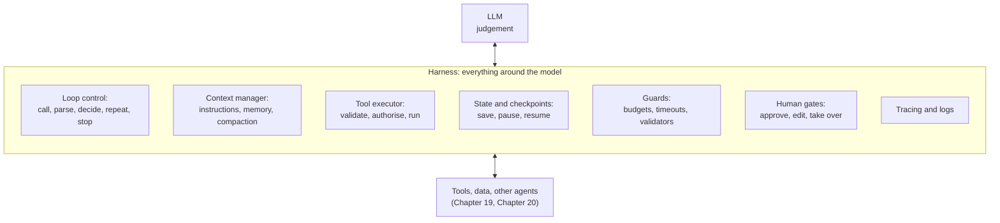
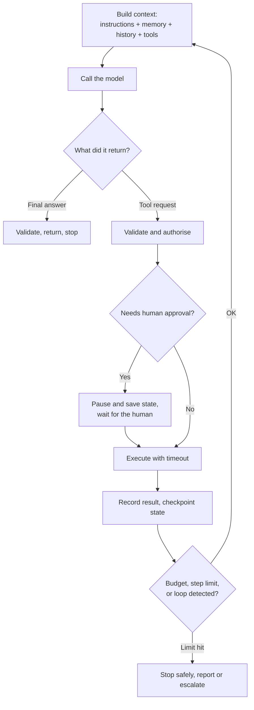
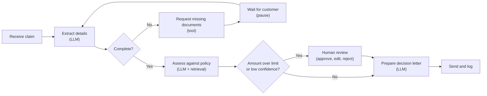
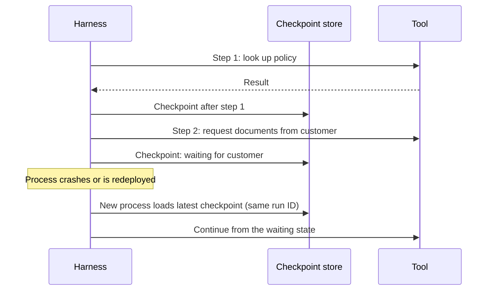

# Chapter 22: Orchestration and Harnesses

## 1. The concept, from scratch

### The model is the small part

In [Chapter 18](../18-from-llm-calls-to-agents/README.md) we said an agent is an LLM running in a loop. But who runs the loop? Not the model. A model can't call itself, run a tool, save its progress or stop when it's spent too much. All of that is ordinary software wrapped around it.

That software has a name: the **harness** (you'll also hear **orchestration layer**, **agent runtime** or **scaffold**). A useful way to say it:

> **An agent is a model plus a harness.** The model supplies judgement. The harness supplies everything else.

A harness does the jobs we've met in earlier chapters, in one place:

Everything the model "can't do" from [Chapter 6](../06-inference-and-generation/README.md) (it's stateless, it can't act, it stops after each generation) is solved here. The harness is where the engineering lives, and it's why two teams using the same model can build very different agents.

### The loop, from the harness's point of view

Here's what the harness does on each turn. Each decision point is somewhere things can go wrong, which is why this is worth knowing precisely.

Notice that most boxes are not AI. They're validation, permissions, persistence and limits. That's the point: **the model proposes, and the harness decides and acts** ([Chapter 19](../19-tool-calling/README.md)).

### Control patterns: who decides the route?

Harnesses implement the workflow and agent patterns from [Chapter 18](../18-from-llm-calls-to-agents/README.md). A useful way to see them is as a spectrum of how much the *code* decides versus the *model*:

| Pattern | Who picks the next step | Example |
|---|---|---|
| **Sequential chain** | Code: fixed order | Extract, classify, draft |
| **Routing** | A classifier or model picks a branch, code runs it | Simple query to small model, hard one to large |
| **Parallel (fan-out, fan-in)** | Code splits work and merges results | Check a contract for five risk types at once |
| **Graph or state machine** | Code defines nodes and edges, some edges are conditional (the model's output can pick one) | Claims workflow with a review loop |
| **Orchestrator-workers** | A model plans subtasks at runtime, code runs workers | Research assistant splitting a question |
| **Free agent loop** | The model, within limits | Open-ended investigation |

A pattern worth knowing well is the **graph** (or state machine). You draw the process as boxes and arrows. Some boxes are LLM steps, some are plain code, some are tool calls, some are human gates, and some arrows are conditional ("if the check fails, go back to drafting, at most twice"). You get structure and predictability, with the model making judgement calls *inside* the boxes. For many business processes this is the sweet spot between a rigid workflow and a free-roaming agent.

### State, checkpoints and durable execution

Simple demos run in seconds. Real agents don't. A claims agent might wait three days for a customer's documents and a manager's approval. Meanwhile servers restart, deployments happen, APIs rate-limit and processes crash. If the agent's progress lives only in memory, any of those events loses the work.

The fix is to save state as you go:

- **State** is everything needed to continue: the conversation so far, the plan, which steps are done, tool results, pending approvals ([Chapter 21](../21-agent-memory-and-state/README.md) separates state from memory).
- A **checkpoint** is a saved snapshot of that state, typically after each step.
- **Resuming** means loading the latest checkpoint and carrying on, in a new process if need be, identified by a run or thread ID.

**Durable execution** is the broader idea: a workflow survives crashes, restarts and long waits, and picks up where it left off. Some agent frameworks provide this directly. LangGraph's documentation, for example, says that with a checkpointer enabled and a thread identifier supplied, you get durable execution: you can pause and resume at any point, including after failures. Separate **durable-execution engines** (Temporal, Inngest and DBOS are examples, as of Nov 2026) record each step of a workflow as an event history, retry failed steps independently with backoff, and can sleep for days then wake and continue. Those engines are not agent frameworks, so they're often paired with one.

Three things to get right, because they're classic interview follow-ups:

1. **Resumption can repeat work.** After a crash, the harness may re-run the step that was in progress. If that step issued a refund, you could pay twice. So tools must be **idempotent** (running them twice has the same effect as once, for example with an idempotency key), and side effects should be isolated into their own recorded steps ([Chapter 19](../19-tool-calling/README.md)). LangGraph's documentation advises keeping workflows deterministic and wrapping side effects in tasks for this reason, and durable-execution engines don't magically make external systems exactly-once.
2. **Durability has a cost.** Writing a checkpoint after every step adds latency. Some systems offer modes that trade a little durability for speed, so decide how much work you can afford to redo.
3. **Changing code under running workflows is risky.** If the replay logic depends on code that has since changed, in-flight runs can break. Version your workflows and drain or migrate running ones on deploy.

Use ordinary databases for checkpoints in production (frameworks typically provide in-memory stores for tests and database-backed ones such as Postgres for production), with retention rules, because checkpoints contain conversation data ([Chapter 30](../30-privacy-governance-and-compliance/README.md)).

### Human-in-the-loop gates

For anything consequential, a person belongs in the loop. The harness implements this as a **gate**: the agent reaches a point, the harness **pauses** it and **saves its state**, a human is notified, and the run resumes when they respond. Importantly, the pause must not hold a server thread open, since the human might answer in three hours or three days. This is exactly what checkpointing enables.

Where to put gates:

- before **irreversible or high-value** actions (large payments, deletions, external messages),
- when the agent's **confidence is low** or the situation is ambiguous,
- when **required information is missing** and only a person can supply it,
- when something **repeatedly fails**, so a person can take over,
- when a **policy or regulation** requires sign-off.

What a human should be able to do at a gate: **approve**, **reject**, **edit and approve** (change the proposed amount or wording), **supply information**, or **take over**. Design the review screen to show what the agent proposes, the evidence it used, and the impact, so approval is informed and not a rubber stamp ([Chapter 24](../24-agent-user-interaction/README.md)).

Two practical cautions. **Approval fatigue**: if people see too many trivial approvals, they click through without reading, so gate only what matters and let low-risk actions run within limits. And **timeouts**: decide in advance what happens if nobody responds (expire, escalate, or default to the safe option).

### Limits and safety rails

An agent without limits is a bill waiting to happen. The harness sets and enforces:

| Limit | Why |
|---|---|
| **Step budget** | Stops endless loops |
| **Token and cost budget** | Caps spend per run ([Chapter 31](../31-cost-latency-and-caching/README.md)) |
| **Wall-clock timeout** | Stops hung runs |
| **Per-tool timeouts and retry caps** | One slow API can't stall everything |
| **Loop detection** | Spots the same call with the same arguments repeating |
| **Rate limits and quotas** per user or tenant | Contains runaway or abusive use |
| **Cancellation and a kill switch** | A person or an alert can stop a run immediately |
| **Sandboxing** for code or file access | Limits damage from a bad action |

When a limit is hit, the harness should **stop safely**: save state, return what it has, say why it stopped, and escalate if needed. More on failure handling in [Chapter 25](../25-agent-reliability-and-learning/README.md).

### Context and memory management

The harness also assembles the prompt on every turn ([Chapter 7](../07-context-windows-and-context-engineering/README.md)): instructions, tool definitions, retrieved memories ([Chapter 21](../21-agent-memory-and-state/README.md)), and the history, trimmed or compacted as it grows, with old tool results cleared. Put the stable parts first so provider prompt caching can reuse them ([Chapter 31](../31-cost-latency-and-caching/README.md)). Bad context handling is a frequent cause of agent failure, so it deserves as much attention as the loop itself.

### Tracing and observability

When an agent misbehaves, "the AI did something odd" isn't a diagnosis. The harness should record a **trace** of every run: each model call (prompt, response, tokens, latency, cost), each tool call (arguments, result, errors), each decision, approval and checkpoint, linked by a run ID. Traces let you replay a failure, see where a run went wrong, measure cost per task, and build evaluation cases from real incidents ([Chapter 32](../32-observability-and-llmops/README.md), [Chapter 27](../27-evaluating-rag-and-agents/README.md)). Build this in from day one, because adding it later is painful.

### The framework landscape

You can write a harness yourself. A basic loop with tools and a few limits is not much code, which is worth knowing: **frameworks are optional.** They earn their place when you need what they provide: persistence, human-in-the-loop, graphs, tracing, multi-agent coordination. Here's the landscape by approach (as of Nov 2026; names and features move fast, so check current documentation, and none of this is a ranking).

| Approach | What it offers | Examples |
|---|---|---|
| **Graph and state-machine orchestration** | You define nodes and edges, conditional routes, loops, checkpoints, interrupts for human input, durable execution | LangGraph |
| **Model-provider agent SDKs** | A ready-made agent loop with tools, handoffs between agents, guardrails or hooks, sessions and tracing, tuned to one provider's models (others can often be plugged in) | OpenAI Agents SDK, Claude Agent SDK |
| **Cloud and enterprise frameworks** | Production-oriented SDKs integrated with a cloud platform's identity, hosting and monitoring | Microsoft Agent Framework |
| **Other open-source frameworks** | Higher-level abstractions, role-based multi-agent setups, or type-safe agents | Google's Agent Development Kit, CrewAI, Pydantic AI, LlamaIndex agents |
| **Managed agent runtimes** | A cloud service that hosts and scales agent loops for you | Amazon Bedrock AgentCore, Microsoft Foundry hosted agents |
| **Durable-execution engines** | Reliable long-running workflows, retries, sleep and resume, used underneath any framework | Temporal, Inngest, DBOS |

A fact worth getting exactly right, because it appears in interviews: **Microsoft Agent Framework is the successor to both AutoGen and Semantic Kernel.** Microsoft's own documentation describes it as the direct successor, created by the same teams, combining AutoGen's simple single- and multi-agent abstractions with Semantic Kernel's enterprise features such as session-based state, type safety, middleware and telemetry, and adding graph-based workflows. Microsoft's developer community blog states that version 1.0 reached general availability on 3 April 2026. So if a source tells you to build on AutoGen or Semantic Kernel for new agent work, it's out of date.

Microsoft's own overview also gives the honest advice that applies to every framework: **if you can write a plain function to do the task, do that instead of using an AI agent.**

### Framework or from scratch?

| Choose a framework when | Write your own when |
|---|---|
| You need checkpointing, pause and resume, and human-in-the-loop soon | The loop is simple and the task is short-lived |
| You want a graph of steps with conditional routing | You want full control and minimal dependencies |
| You need built-in tracing and integrations | You're learning, or the framework's abstractions get in the way |
| Your organisation standardises on one for governance and skills | You worry about churn, since frameworks change quickly |

Whatever you choose, protect yourself from lock-in and churn: keep **model calls, tool definitions and business logic** behind your own thin interfaces, use standards where possible (tools through MCP, [Chapter 20](../20-agent-protocols-mcp-and-a2a/README.md)), keep your evaluation set so you can compare options ([Chapter 26](../26-evaluation-fundamentals/README.md)), and avoid exotic features you can't easily replace.

### Orchestration and predictive-plus-generative design

Orchestration is where predictive and generative models are combined ([Chapter 1](../01-introduction-to-ai/README.md)). Routers and classifiers pick paths, guard models screen inputs and outputs, embedding and reranking models support retrieval, and the LLM does the open-ended reasoning and writing. A good harness treats the LLM as one component among several, used where judgement is needed and not everywhere.

## 2. Analogies across industries

- **The harness (aviation).** A pilot (the model) flies the plane, but the aircraft has autopilot limits, checklists, air traffic control, a flight recorder and ground crews around the pilot. The harness is all of that: it keeps the pilot inside safe limits and records everything. The recorder is tracing.
- **Checkpoints and durable execution (logistics).** A parcel's journey is scanned at every hub. If a van breaks down, the parcel isn't lost: the system knows the last scan and re-dispatches from there. But a re-dispatched parcel mustn't be billed twice, which is idempotency.
- **Human gates (banking).** The maker-checker rule: one person prepares a large payment, a second approves it before release. The agent prepares, a person checks. And just as in a bank, if the checker has to approve a hundred trivial items an hour, they stop checking properly.
- **Graph workflows (insurance).** A claim moves through a defined process: intake, validation, assessment, approval, payment, with branches for missing documents and escalation for large amounts. Individual adjusters use judgement at each desk, but the route is defined. That's a graph with LLM steps.
- **Limits (manufacturing).** A machine has an emergency stop, a maximum cycle count and a thermal cut-out. Nobody trusts a powerful machine without them, and an agent is no different.

## 3. How it's used in industry

- **Insurance: claims processing.** An insurer models intake-to-settlement as a graph with checkpoints. The run waits for customer documents for days, pauses for adjuster approval above a threshold, and can resume after deploys. Every step is traced for audit.
- **Banking: controlled automation.** A bank's agent prepares account-maintenance changes, but a gate requires a second person's approval for anything touching money, with the proposal, evidence and impact shown. Tool calls carry idempotency keys so retries are safe.
- **Logistics: exception handling.** A carrier's agent investigates delayed shipments across tracking systems and drafts customer options. A step and time budget ends runaway searches, and unresolved cases go to a human queue with the full trace attached.
- **Technology services: long-running research agents.** A team uses a provider's agent SDK for a research assistant, with a durable-execution engine underneath so multi-hour runs survive restarts and rate limits.

## 4. Common misconceptions

- **"The agent is the model."** The agent is the model plus the harness. The harness decides how reliable, safe and affordable it is.
- **"You need a framework to build an agent."** A basic loop is simple. Frameworks help with persistence, graphs, human-in-the-loop and tracing, but they add abstraction and churn.
- **"Checkpointing makes everything safe to retry."** Resuming can repeat a step. Without idempotent tools, a retry can double-charge.
- **"Human-in-the-loop means a person watches the agent."** It means defined gates where the agent pauses and state is saved, so a human can respond hours later.
- **"More autonomy is better."** More autonomy means more risk and less predictability. Graphs and gates give structure where you need it.
- **"AutoGen and Semantic Kernel are the Microsoft agent frameworks."** Microsoft Agent Framework is their successor, from the same teams, with 1.0 reaching general availability in April 2026.
- **"Tracing is a nice-to-have."** Without traces you can't debug, evaluate or audit an agent.

## 5. Interview questions

### 1. What is an agent harness, and what does it do?

The harness is all the software around the model that turns it into an agent. The model supplies judgement, and the harness runs the loop: it builds the context each turn, calls the model, parses what comes back, validates and authorises tool requests, executes them with timeouts, records results and checkpoints state, and decides whether to continue or stop. It also enforces budgets and limits, routes risky actions to human approval, and records traces. I'd summarise it as: an agent is a model plus a harness, and the harness is where reliability, safety and cost control live, because the model on its own is stateless and can't act.

### 2. Should you use an agent framework or build the loop yourself?

It depends on what I need. A basic loop with tools and a few limits isn't much code, so for a simple, short-lived agent writing it myself gives control and fewer dependencies. A framework earns its place when I need checkpointing and resumption, human-in-the-loop gates, graph-style workflows with conditional routes, built-in tracing, or an organisational standard. The costs are abstraction, a learning curve, and churn, since these frameworks change quickly. Either way I'd keep my model calls, tool definitions and business logic behind my own thin interfaces, use standards like MCP for tools, and keep an evaluation set, so I can switch later.

### 3. How do you make a long-running agent resilient to crashes?

I'd persist state as the agent goes. After each step, the harness writes a checkpoint of everything needed to continue, such as the history, plan, completed steps and pending approvals, identified by a run ID. If the process crashes or I deploy, a new process loads the latest checkpoint and continues. I can get that from a framework with a checkpointer, or from a durable-execution engine that records each step and retries failures independently. The critical caveat is that a resumed run can repeat the step that was in progress, so tools must be idempotent, with idempotency keys on anything that moves money or sends messages. I'd also version workflows so deploys don't break in-flight runs.

### 4. How do you implement human-in-the-loop approval?

I implement it as a gate in the workflow. When the agent reaches an action that needs approval, like a large refund, the harness pauses it, saves the state, and notifies a reviewer, without holding a server thread open, because the reviewer might take hours. The reviewer sees what the agent proposes, the evidence it used, and the impact, and can approve, reject, edit and approve, or supply missing information. The run resumes from the saved state with their decision. I'd gate based on risk: irreversible or high-value actions, low confidence, missing information and repeated failure, and I'd let low-risk actions run within limits to avoid approval fatigue. I'd also define timeouts, so an unanswered request expires or escalates, and log every decision for audit.

### 5. What limits would you put on an agent, and why?

A step budget, so it can't loop forever. A token and cost budget per run, so spend is capped. A wall-clock timeout, so hung runs end. Timeouts and retry caps per tool, so one slow API can't stall everything. Loop detection for repeated identical calls. Rate limits and quotas per user or tenant, to contain abuse and runaway use. A cancellation mechanism and a kill switch. And sandboxing for anything that runs code or touches files. When a limit is hit the harness should stop safely: save state, report what it has and why it stopped, and escalate if needed. Chapter 25 covers failures in more depth.

### 6. What's the difference between a workflow graph and a free-form agent loop?

In a graph, I define the structure: nodes for LLM steps, tool calls, code and human gates, and edges between them, some conditional. The model makes judgement calls inside nodes, and may influence which conditional edge is taken, but the overall route is mine. It's predictable, testable and easier to debug. In a free-form loop, the model decides each next step from the available tools, which is more flexible for open-ended tasks but harder to predict, test and bound. For most business processes with a known shape, like claims handling, I prefer a graph with agentic steps inside, and I use a free-form loop only where the path genuinely can't be defined in advance.

### 7. A refund tool ran, then the process crashed before the checkpoint was saved. What happens on resume?

The harness will resume from the last saved checkpoint, which is before the refund, so it will likely run the refund step again, and the customer could be paid twice. This is the classic problem with at-least-once execution. The defence is idempotency: the refund call carries a unique idempotency key tied to the run and step, so the payment system recognises the repeat and does nothing the second time. I'd also record side effects as distinct steps, write the intent before acting where possible, and check the downstream system's state before retrying. Resumption doesn't make external systems exactly-once, so the tools have to be designed for it.

### 8. How do you debug and monitor an agent in production?

I rely on traces. Each run records every model call with its prompt, response, tokens, latency and cost, each tool call with arguments, results and errors, and each decision, approval and checkpoint, linked by a run ID. With those I can replay a failure, see exactly where it went wrong, measure cost and latency per task, and turn real incidents into evaluation cases. I'd monitor aggregate metrics too: success rate, steps per run, cost per run, how often limits are hit, approval rates and escalations. Then I'd alert on anomalies like sudden increases in steps or cost. And I'd sample real runs for human review. I'd build this in from the start, because it's hard to add later.

### 9. What do you know about Microsoft Agent Framework, AutoGen and Semantic Kernel?

Microsoft Agent Framework is the successor to both. Microsoft's documentation describes it as created by the same teams, combining AutoGen's simple abstractions for single and multi-agent patterns with Semantic Kernel's enterprise features such as session-based state management, type safety, middleware and telemetry, and adding graph-based workflows for explicit multi-agent orchestration. Microsoft's developer blog says version 1.0 reached general availability on 3 April 2026, with .NET and Python support. So for new agent work on the Microsoft stack, I'd look at Agent Framework instead of starting on AutoGen or Semantic Kernel, and I'd check the migration guidance if I have existing code. As with any framework, I'd confirm the current status in Microsoft's documentation.

### 10. How would you design the orchestration for a claims-processing agent?

I'd model it as a graph, because the process has a known shape. Nodes for intake and extraction, a completeness check with a conditional edge back to requesting missing documents, an assessment step using retrieval over the policy wording, a gate for human review when the amount is over a limit or confidence is low, then preparing and sending the decision. The LLM does the judgement inside the extraction, assessment and drafting steps. I'd checkpoint after each step so the run can wait days for documents and survive deploys, make payment and message tools idempotent, set step, cost and time budgets, trace every run for audit, and keep a person in the loop for decisions that matter. I'd use a framework or a durable-execution engine for the persistence and gates, and keep my business logic behind my own interfaces.

## 6. Scenario exercise

An insurer built a claims-processing agent that works well in demos. In production: runs that wait for customer documents often vanish when the service redeploys (several times a week); a run that crashed after issuing a payment resumed and issued it again; adjusters complain they get dozens of approval requests a day and have started approving without reading; and one run looped for two hours calling the same search tool until finance noticed the cost. The head of claims asks you for a plan. You haven't seen the code.

Answer from memory, then check.

Model answer

I'd see these as four missing harness features and take them in order of risk.

The duplicate payment is the most serious. It's the at-least-once problem: after a crash, the run resumed from a checkpoint before the payment and repeated it. I'd make the payment tool idempotent with a key derived from the claim and step, so a repeat is recognised and ignored, record side effects as separate recorded steps, and check the payment system's state before retrying. I'd reconcile existing payments to find other duplicates.

The vanishing runs mean state lives in memory. I'd add checkpointing to a database after each step, with a run ID, so a new process can resume after a deploy. That's available from a framework with a checkpointer, or from a durable-execution engine. Waiting for documents becomes a paused state, not a held process. I'd version the workflow and handle in-flight runs on deploy, and set retention rules for the stored state because it contains claim data.

The approval fatigue is a gate-design problem. I'd gate by risk, not on everything: payments above a threshold, low-confidence assessments, and missing information, while low-value, clear-cut steps run within limits and are sampled for review afterwards. The review screen would show the proposal, the evidence, and the impact, with approve, edit and reject, and I'd monitor approval rates and time-to-approve, since near-100 percent approvals in seconds suggests rubber-stamping.

The two-hour loop means no limits. I'd add a step budget, a cost and token budget per run, a wall-clock timeout, per-tool retry caps and loop detection on repeated identical calls, with a safe stop that saves state, reports why, and escalates to a person. A kill switch and cost alerts would give finance an early warning.

Underneath all of it, I'd add tracing for every run, so the next incident is a replay and not a mystery, and turn these four failures into regression tests. If a framework would give us checkpointing, gates and tracing, I'd adopt one, keeping our business logic and tools behind our own interfaces.

## 7. Key takeaways

- An agent is a model plus a harness. The harness runs the loop, builds context, executes tools, enforces limits, saves state, gates risky actions and records traces.
- Control patterns run from code-decided chains and graphs to model-decided loops. A graph with LLM steps is often the sweet spot for business processes.
- Checkpoints and durable execution let long-running agents survive crashes and long waits, but resumption can repeat steps, so tools must be idempotent.
- Human-in-the-loop gates pause and save state, give the reviewer the proposal, evidence and impact, and are used for what matters to avoid approval fatigue.
- Frameworks are optional: LangGraph, provider SDKs, Microsoft Agent Framework (successor to AutoGen and Semantic Kernel, 1.0 GA on 3 April 2026), managed runtimes and durable engines each have a place. Keep your own interfaces and evaluation set to avoid lock-in.

## 8. Further reading

- LangChain, [LangGraph durable execution](https://docs.langchain.com/oss/python/langgraph/durable-execution): checkpointers, thread IDs, interrupts and resumption.
- Microsoft, [Microsoft Agent Framework overview](https://learn.microsoft.com/en-us/agent-framework/overview/): the successor to AutoGen and Semantic Kernel, and when not to use an agent.
- Microsoft Tech Community, [Inside Microsoft Agent Framework 1.0](https://techcommunity.microsoft.com/blog/azuredevcommunityblog/the-future-of-agentic-ai-inside-microsoft-agent-framework-1-0/4510698): the general availability announcement.
- Temporal, [Build durable AI agents with Pydantic AI and Temporal](https://temporal.io/blog/build-durable-ai-agents-pydantic-ai-and-temporal): one durable-execution engine paired with an agent framework.
- Anthropic, [Building effective agents](https://www.anthropic.com/engineering/building-effective-agents): the workflow and agent patterns a harness implements.
