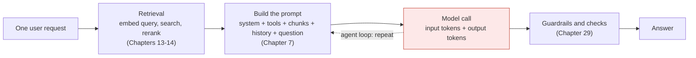
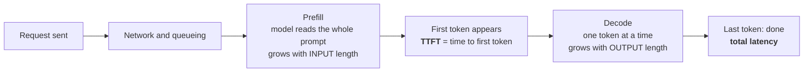
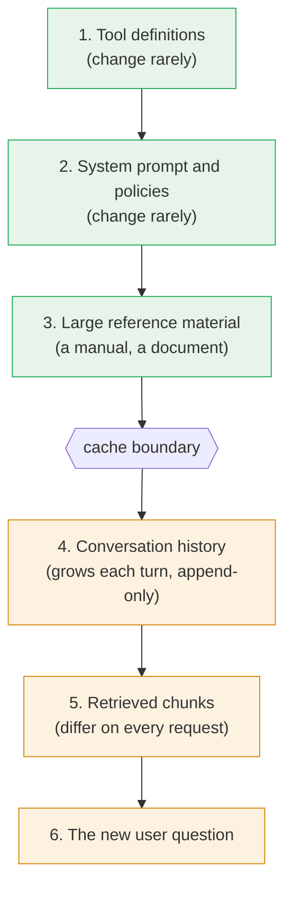
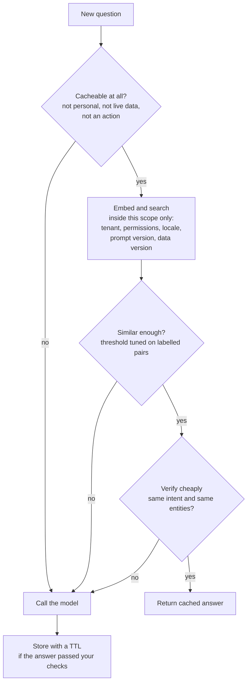
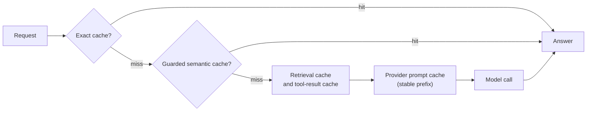
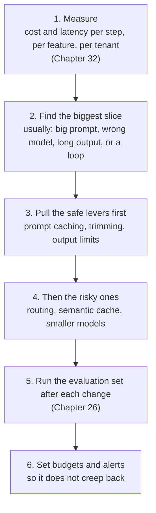

# Chapter 31: Cost, Latency and Caching

> **Prices on this page are illustrative.** Provider prices, discounts and caching rules change often. The worked examples use round made-up numbers so the arithmetic is easy to follow. Provider facts are marked "(as of Nov 2026)" and link to the official docs. Check the current pricing page before you quote a number to a client.

## 1. The concept, from scratch

Parts 1 to 6 were about making an AI system work, and then making it trustworthy. Part 7 is about **running it in production**: paying for it, keeping it fast, seeing inside it, and keeping it up. This chapter starts with the two numbers every client asks about first: **what does it cost, and how long does the user wait?**

The honest answer to both is: **it comes down to tokens.** Remember from [Chapter 3](../03-tokens-and-embeddings/README.md) that a token is the unit a model reads and writes, and from [Chapter 6](../06-inference-and-generation/README.md) that the model generates its answer one token at a time. So:

- **Cost** is roughly *tokens in* × *input price* + *tokens out* × *output price*, summed over every model call.
- **Latency** is roughly the time to *read* the prompt, plus the time to *write* the answer one token at a time.

Almost every optimisation in this chapter either **sends fewer tokens, reuses work already done, or uses a cheaper or faster model for the job.**

The model call is usually the biggest slice of both cost and time. But retrieval, guardrails, tool calls and retries all add up, and in an agent the loop multiplies everything ([Chapter 18](../18-from-llm-calls-to-agents/README.md)).

### What you are actually paying for

Four facts to say out loud in an interview:

1. **You pay per token, and output tokens cost more per token than input tokens.** Providers price them separately, and output is typically a multiple of input. Check the current price list for the ratio. In my worked example below, output is about 6% of the tokens but 25% of the bill.
2. **You pay for the whole prompt on every call.** The model is stateless ([Chapter 6](../06-inference-and-generation/README.md)), so the system prompt, the tool definitions, the retrieved chunks and the conversation history are all resent each time. A long conversation costs more with every turn.
3. **Thinking tokens are output tokens.** A reasoning model spends extra tokens thinking before it answers ([Chapter 5](../05-training-llms/README.md)). You pay for them even if the user never sees them.
4. **Everything around the model costs too:** embedding calls, the vector database, reranker calls, "LLM-as-a-judge" checks ([Chapter 26](../26-evaluation-fundamentals/README.md)), guardrail models, logging and storage, and human review.

### A worked cost example

Say we run a customer-support assistant. All prices here are **made up for the example**: $3 per million input tokens, $15 per million output tokens.

| Part of one request | Tokens |
|---|---|
| Stable prefix: system prompt, policies, tool definitions | 3,500 |
| Retrieved chunks (top 8) | 2,000 |
| Conversation history and the new question | 500 |
| **Total input** | **6,000** |
| **Output** | **400** |

- Input: 6,000 × $3 / 1,000,000 = **$0.018**
- Output: 400 × $15 / 1,000,000 = **$0.006**
- **Total: $0.024 per request.** At one million requests a month, that is **$24,000 a month.**

Now apply levers one at a time, and watch the number fall. (The caching step assumes every request hits the cache, and uses a cached-read price of one tenth of the normal input price. Real hit rates are lower, which we cover below.)

| Step | Change | New cost per request |
|---|---|---|
| Baseline | | $0.0240 |
| 1. Cache the 3,500-token stable prefix | Those tokens now cost 0.1× | $0.0146 |
| 2. Rerank, keep 4 chunks instead of 8 | 1,000 fewer input tokens | $0.0116 |
| 3. Ask for concise answers, about 250 tokens | 150 fewer output tokens | $0.0093 |
| 4. Route 70% of traffic to a model at one-fifth the price (and the same token counts) | needs an evaluation to prove quality holds | about $0.0041 |

That is roughly **61% lower after the first three steps and about 83% lower after routing**, on invented numbers. The point is not the percentage. The point is the **order and the method**: measure where the tokens go, then pull the cheapest, safest levers first, and check quality after each one.

### Agents: why the bill grows faster than you expect

In an agent loop, each step resends everything so far. If the context grows by about 2,000 tokens per step, then over ten steps you send 2k + 4k + 6k + ... + 20k, which is **110,000 input tokens**, not 20,000. The cost grows roughly with the *square* of the number of steps. This is why agents need **step limits, token budgets and cost alerts** ([Chapter 22](../22-orchestration-and-harnesses/README.md), [Chapter 25](../25-agent-reliability-and-learning/README.md)), and why caching helps so much: the growing context is an append-only prefix, which is exactly what a prompt cache can reuse.

### What "latency" really means

People say "it's slow" about three different things. Separate them:

- **Time to first token (TTFT):** how long until the user sees *anything*. It depends on network, queueing, and **prefill**: reading the prompt. Longer prompts mean longer prefill.
- **Output speed (tokens per second):** how fast the answer streams out after that. Total time is roughly TTFT plus *output tokens ÷ output speed*.
- **Total latency:** when the last token arrives. A 400-token answer at 50 tokens per second takes eight seconds to write, however good the TTFT.

Two things follow. First, **long outputs are slow, because decode is sequential**: each token needs the previous one. Second, **streaming does not make the answer faster, it makes it feel faster**, because the user starts reading at TTFT instead of staring at a spinner until the end. Chapter 33 explains *why* prefill and decode behave so differently ([Chapter 33](../33-inference-engineering/README.md)). Chapter 35 covers streaming as an engineering problem ([Chapter 35](../35-reliability-scaling-and-streaming/README.md)).

The latency levers, roughly in order of effect:

1. **Use a smaller or faster model for the job.** The most direct lever. Anthropic's latency guide names model choice first ([Anthropic: reducing latency](https://platform.claude.com/docs/en/test-and-evaluate/strengthen-guardrails/reduce-latency), as of Nov 2026). Reasoning models can be run with a lower thinking effort when the task is simple.
2. **Generate fewer output tokens.** Ask for concise answers, use structured output with short fields, and set a sensible max length.
3. **Send fewer input tokens, and cache the stable ones.** This cuts prefill, so it improves TTFT.
4. **Stream.** Improves *perceived* speed.
5. **Parallelise independent steps.** If an agent needs three unrelated lookups, run them at once ([Chapter 19](../19-tool-calling/README.md)). Run guardrail checks alongside generation where you can ([Chapter 29](../29-guardrails-and-ai-security/README.md)).
6. **Cut the non-model time.** A slow vector search or reranker, a cold start, or a distant region can cost more than you expect. Measure each stage before you blame the model.
7. **Move non-interactive work off the request path.** If nobody is waiting, batch it (below).

**Cost and latency are linked but not the same.** Fewer tokens helps both. But a big model on reserved capacity may be fast and expensive, and a batch job may be cheap and slow. Say which one you are optimising.

### Caching: the biggest lever, and the one with traps

"Caching" in an LLM application means several different things, with very different risk. This is the table to learn.

| Cache | What is stored | When it hits | Saves | Main risk |
|---|---|---|---|---|
| **Provider prompt cache** (prefix cache) | The model's *already-processed* version of the start of your prompt, held by the provider | The new request starts with the **exact same tokens** | Cost and TTFT on the repeated part. The answer is still generated fresh | None for correctness. It only helps if you keep the prefix stable |
| **Exact response cache** | The full answer, keyed by a hash of the (normalised) request | The request is **identical** | The whole call: cost and latency | Stale answers, so you need a TTL. Low hit rate on free-form text |
| **Semantic cache** | The full answer, keyed by the *embedding* of the question | A new question is **similar enough** to an old one | The whole call | **Wrong answers** for questions that look alike but differ. Cross-user leakage. Staleness |
| **Retrieval cache** | Query embeddings, search results, reranked lists | Same or near-same query | Embedding and search cost, and time | Stale index, or results shown to someone without access |
| **Tool-result cache** | Output of a deterministic tool (catalogue lookup, FX rate) | Same arguments | Tool latency and calls | Stale data: flight prices and stock levels change |

Read the first row carefully, because it is the most misunderstood. **Prompt caching does not cache the answer.** It caches the *work of reading the prompt*. The model still writes a new answer every time. That makes it safe, and it is why you should reach for it first.

### How provider prompt caching works

When the model reads your prompt, it builds internal state for each token (you'll see this as the **KV cache** in [Chapter 33](../33-inference-engineering/README.md)). If the next request begins with exactly the same tokens, the provider can reuse that state instead of recomputing it. You are charged a **reduced price for the reused tokens**, and TTFT drops because there is less to read.

The catch is the word *prefix*. The match must start at the beginning and stop at the first difference. So **order your prompt from most stable to least stable**:

Anything that changes early in the prompt, such as a timestamp or the user's name in the system prompt, **breaks the cache for everything after it.** Put such details near the end.

What the main providers do (as of Nov 2026, from their own docs; check them for current prices and limits):

- **Anthropic Claude** has automatic and explicit caching. A cache write costs more than a normal input token (1.25× for the default five-minute lifetime, 2× for one hour), and a cache read costs far less (0.1× for most models, lower for some newer ones). These multipliers stack with the batch discount. The lifetime refreshes each time the cache is used. Changing tools or the system prompt invalidates what follows ([Anthropic: prompt caching](https://platform.claude.com/docs/en/build-with-claude/prompt-caching)).
- **OpenAI GPT** enables prompt caching by default for supported models, reports how many tokens were served from cache in the response usage, and says cached input is discounted by up to 95% depending on the model. Newer models add a cache-lifetime option and a cache key that helps route similar requests together ([OpenAI: prompt caching](https://developers.openai.com/api/docs/guides/prompt-caching)).
- **Google Gemini** has implicit caching on by default for 2.5 and newer models, and explicit caching on some models, where you create a cache object and pay for its storage ([Google: context caching](https://ai.google.dev/gemini-api/docs/caching)).
- **Amazon Bedrock** supports implicit caching (best effort, no configuration) and explicit caching with cache checkpoints for supported models. Minimum cacheable length per checkpoint ranges from 512 to 4,096 tokens depending on the model. The lifetime resets on each hit, and a one-hour option exists for select Claude models ([AWS: prompt caching](https://docs.aws.amazon.com/bedrock/latest/userguide/prompt-caching.html)).
- **Open-weight models** you serve yourself get prefix caching from the inference server ([Chapter 33](../33-inference-engineering/README.md), [Chapter 34](../34-self-hosting-open-weight-models/README.md)).

**When does caching lose money?** Where a write costs extra, caching only pays if the prefix is reused before it expires. Using the Anthropic multipliers: with a five-minute lifetime, one write plus one read costs 1.25 + 0.1 = 1.35 units, versus 2 units without caching, so it pays off after **one** reuse. With a one-hour lifetime, a write costs 2, so you need **two** reuses to come out ahead. A prefix that's used once, or rarely, is a net loss. Measure your **cache hit rate** (the share of input tokens served from cache), because that's the number that decides everything.

### Semantic caching, and why it needs guardrails

A **semantic cache** is attractive: embed the new question, find the nearest stored question, and if it is close enough, return the stored answer with no model call at all. You save the whole call. But you are now answering a question with an answer written for a *different* question. That is where it goes wrong.

Think of a telecom call centre where agents use canned replies. "How do I cancel my plan?" and "How do I cancel my plan *without a penalty*?" look almost identical, and a canned reply for the first is a bad answer to the second. A semantic cache makes that same mistake at machine speed.

The research backs the worry. A study of semantic caching, [MeanCache](https://arxiv.org/abs/2403.02694), reports that a loosely set similarity threshold produces **false hits**, and that the best threshold depends on the embedding model, so you cannot copy a number from a blog post. Treat any "use 0.9" advice as a starting guess to test, not an answer.

The guards, as rules:

1. **Only cache what is safe to cache.** General, stable, public answers: "what is your returns policy?". Never personal answers ("where is *my* order?"), live data, or anything that triggers an action.
2. **Scope the cache.** The cache key must include the tenant, the user's permission level, language, and the prompt and model version. Without this, one customer's answer can be served to another, which is the leak described in [Chapter 15](../15-enterprise-rag/README.md) and [Chapter 30](../30-privacy-governance-and-compliance/README.md).
3. **Tune the threshold on real data.** Collect labelled pairs of questions (same meaning, different meaning) and pick the threshold that keeps the **false-hit rate** acceptably low, not the one that maximises hits. Re-tune when you change the embedding model.
4. **Add a cheap verification step** before serving a hit: a reranker or a small model that checks the two questions really ask the same thing, including names, dates and numbers.
5. **Use a TTL, and invalidate on change.** When the source document changes, the cached answers built from it must go.
6. **Only store good answers.** Cache answers that passed your quality and safety checks, ideally reviewed ones, for the highest-traffic questions.
7. **Monitor it.** Track hit rate *and* sample hits for correctness. A semantic cache fails silently: wrong answers look like normal answers.

On AWS, a common building block is a vector-capable cache such as Amazon ElastiCache, which added vector search for semantic caching in 2025 ([AWS: ElastiCache semantic cache with Amazon Bedrock](https://aws.amazon.com/blogs/database/lower-cost-and-latency-for-ai-using-amazon-elasticache-as-a-semantic-cache-with-amazon-bedrock)). The guard rules above apply no matter which store you use.

### Putting the caches together

Cheap, safe layers go first. The provider prompt cache sits right in front of the model, and it applies to every call that gets that far.

### Batch: pay less when nobody is waiting

If a job does not need an answer right now, such as summarising yesterday's call transcripts, classifying a backlog, generating embeddings, or running an evaluation set ([Chapter 26](../26-evaluation-fundamentals/README.md)), use a **batch API**. You submit many requests together and collect results later, in return for a discount and higher rate limits.

(As of Nov 2026) OpenAI's Batch API offers 50% lower cost with a 24-hour completion window ([OpenAI: Batch API](https://developers.openai.com/api/docs/guides/batch)). Anthropic's Message Batches API says most batches finish within an hour, results expire if processing does not finish within 24 hours, and its caching multipliers stack with the batch discount ([Anthropic: batch processing](https://platform.claude.com/docs/en/build-with-claude/batch-processing)). Amazon Bedrock lists batch inference at a lower price than on-demand for select models, so check the pricing page for your model and Region ([AWS: Bedrock pricing](https://aws.amazon.com/bedrock/pricing/)).

The rule of thumb: **interactive work uses real-time calls; background work uses batch.** The design question is "is a person waiting?"

### The other cost levers, and which chapter owns them

You have met most of these already. Here they are in one place:

| Lever | Effect | Where |
|---|---|---|
| Right-size the model, route easy requests to cheap models | Large | [Chapter 36](../36-llm-gateways-and-routing/README.md) |
| Smaller or distilled model for a narrow task | Large, with upfront work | [Chapter 10](../10-fine-tuning-and-distillation/README.md) |
| Shorter prompts, trimmed tool lists, summarised history | Medium | [Chapter 7](../07-context-windows-and-context-engineering/README.md), [Chapter 21](../21-agent-memory-and-state/README.md) |
| Fewer, better chunks (rerank, then cut) | Medium | [Chapter 14](../14-improving-retrieval/README.md) |
| Lower thinking effort on simple tasks | Medium | [Chapter 5](../05-training-llms/README.md) |
| Concise outputs, structured outputs, output limits | Medium | [Chapter 9](../09-prompt-engineering/README.md) |
| Cheaper self-hosted inference at high volume | Large, with ops cost | [Chapter 34](../34-self-hosting-open-weight-models/README.md) |
| Step limits, token budgets, kill switches for agents | Prevents runaway cost | [Chapter 25](../25-agent-reliability-and-learning/README.md), [Chapter 29](../29-guardrails-and-ai-security/README.md) |

### The order to work in

Step 5 is the one people skip. **A cost saving that quietly lowers quality is not a saving, it is a delayed incident.** Every lever that changes what the model sees or which model answers has to pass the same evaluation set you use for quality, and you judge the result as **cost per successful task**, not cost per call. A cheaper model that fails more often, forcing retries or human fixes, can cost more per resolved ticket.

### Estimating cost before launch

For a design review or a client proposal, a back-of-the-envelope estimate is expected. The method:

1. **Tokens per request:** stable prefix, retrieved context, history, question, and expected output. Include thinking tokens if you use a reasoning model.
2. **Calls per task:** one for a simple Q&A, many for an agent. Multiply, and remember that agents resend context each step.
3. **Requests per month:** peak and average. Add retries (a few percent).
4. **Apply prices,** with a cache-hit-rate assumption, and a batch share for background jobs.
5. **Add everything else:** embeddings, vector database, reranker, guardrails and judge calls, logging, evaluation runs, and people.
6. **Give a range, not a number,** and say which assumptions drive it. Then plan to replace estimates with measurements in the first weeks of the pilot.

## 2. Analogies across industries

- **Provider prompt cache is a forward warehouse (logistics and retail).** An online retailer doesn't ship every order from the central depot. It stocks popular, unchanging items closer to the customer. Orders for those items leave faster and cheaper. But if the product *changes* (a new version of the item), the stocked copy is useless. Stable prefix, fast and cheap; change the first line, and you restock everything after it.
- **Semantic cache is a call-centre canned reply (telecom).** Agents keep canned answers for common questions, and they are fast and consistent. The danger is picking a canned reply for a question that only *sounds* the same. Good centres limit canned replies to well-understood questions, review them, and retire them when the policy changes. That is your threshold, scope, verification and TTL.
- **Batch versus real-time is freight versus express courier (logistics).** Overnight freight is much cheaper per parcel than same-day courier, so you use the courier only when someone is waiting. Same trade: a lower price in return for a longer, looser delivery window.
- **Token cost is a taxi meter (travel).** The fare is about distance, and you pay for the detours too: retries, long prompts resent each turn and agent loops are the scenic route.

## 3. How it's used in industry

- **E-commerce support assistant.** A retailer's returns and delivery assistant has a long, stable block of policies and tool definitions, so it caches that prefix and sees both a lower bill and a faster first token. It puts a guarded semantic cache only in front of the top public FAQ answers, and leaves order-specific questions to the live path.
- **Travel search and planning.** A travel assistant calls flight and hotel search tools in parallel, streams the answer as it forms, and caches tool results for a *very short* time, since fares change quickly. A long TTL here would show customers prices that no longer exist.
- **Telecom call summarisation.** A carrier summarises and tags millions of call transcripts overnight. Nobody is waiting, so the work goes through a batch API at a discount, and the results feed dashboards the next morning.
- **Healthcare documentation.** A clinic's note-drafting tool needs a fast first token while the clinician is still in the room, so it uses a smaller, faster model with streaming. A nightly batch job handles lower-urgency coding suggestions. Nothing patient-specific goes into a shared cache ([Chapter 30](../30-privacy-governance-and-compliance/README.md)).

## 4. Common misconceptions

- **"Cost is just the price per token."** Cost is tokens × calls × retries, plus everything around the model. Measure **cost per successful task**.
- **"Output tokens are a small part of the bill."** They are a small part of the *token count* and a large part of the *cost*, and they drive the decode time. Shorter answers help both.
- **"Prompt caching caches the answer."** It caches the *processing of the prompt prefix*. The answer is generated fresh each time. That is why it's safe.
- **"Caching always saves money."** Where writes cost extra, a prefix you rarely reuse costs *more*. Know the break-even, and measure hit rate.
- **"Semantic caching is just caching."** It returns an answer to a *different* question. Without scoping, a tuned threshold and verification, it is a source of wrong answers and data leaks.
- **"Streaming makes the model faster."** It makes the response *feel* faster, because the first words arrive early. Total time is unchanged.
- **"A smaller model is always cheaper."** Only if it is good enough. A weaker model that needs retries, longer prompts or human correction can cost more per resolved task.
- **"Latency is the model's problem."** Retrieval, guardrails, tool calls, cold starts and network distance often add as much. Trace every stage.

## 5. Interview questions

### 1. What drives the cost of an LLM application?

It's mostly tokens. Every call costs input tokens times the input price, plus output tokens times the output price, and output is priced higher per token. The part people miss is that the model is stateless, so I pay for the entire prompt on every call: system prompt, tools, retrieved chunks and the whole conversation so far. In an agent, that repeats at every step, so cost grows faster than the number of steps. Then there's everything around the model: embeddings, the vector database, reranking, guardrail and judge calls, logging, and evaluation runs. So when I estimate cost I count tokens per request, calls per task, and requests per month, then add the surrounding services. And I measure it as cost per successful task, because a cheap call that fails and gets retried is not cheap.

### 2. What's the difference between time to first token and total latency?

Time to first token is how long the user waits before anything appears. It covers network, queueing, and the model reading the prompt, which is called prefill, so it grows with prompt length. Total latency is when the last token arrives. After the first token the model writes one token at a time, so total time is roughly TTFT plus the number of output tokens divided by the output speed. A long answer is slow no matter how good TTFT is. For a chat product I care most about TTFT and stream the rest, because the user starts reading immediately. For a background job I only care about total time and cost.

### 3. Why do output tokens cost more and take longer than input tokens?

The model can read all the input tokens in parallel in one pass, which is the prefill step, and that is efficient on a GPU. Output is different. The model has to generate one token, feed it back, and generate the next, so it's sequential and each step is comparatively memory-bound. Providers reflect that in price by charging more per output token. The practical consequence is that shortening the answer is one of the cheapest ways to cut both cost and latency, and that reasoning models, which produce a lot of hidden thinking tokens, are noticeably more expensive and slower. I'd go into the mechanics of why decode is memory-bound in the inference chapter, but the engineering takeaway is the same.

### 4. How does streaming help, and what does it not fix?

Streaming sends tokens to the client as they're generated instead of waiting for the full answer. It makes the product feel responsive because the user sees text at TTFT, and for a long answer that can be the difference between one second and eight seconds of staring at a spinner. What it doesn't do is reduce total generation time or cost. It also has complications: if I run an output guardrail, I either have to check before streaming, which adds delay, or check as I stream and be ready to retract, so I need to decide that deliberately. And proxies and gateways in the path must not buffer the stream.

### 5. How does prompt caching work, and how do you structure a prompt for it?

When the model reads a prompt it builds internal state for each token. If a later request starts with exactly the same tokens, the provider can reuse that state, charge a reduced price for those tokens, and skip the work, so cost and time to first token both drop. It's a prefix match: it works from the start of the prompt and stops at the first token that differs. So I structure the prompt from most stable to least stable: tool definitions, system prompt and policies, large reference material, then conversation history, then retrieved chunks and the new question. I keep anything volatile, such as timestamps or user names, out of the early part. It doesn't cache the answer, only the processing of the prefix, so it's safe. I check the provider's minimum length, lifetime and write price, and I track the cache hit rate, since a write usually costs a bit more than a normal token and caching only pays off if the prefix is reused before it expires.

### 6. What types of caching can you use in an LLM application, and how do they differ?

There are five I think about. The provider prompt cache reuses the processed prompt prefix, so it saves cost and TTFT with no correctness risk. An exact response cache stores whole answers keyed on an identical request, which is safe but has a low hit rate on free text. A semantic cache stores answers keyed on the meaning of the question, so it matches paraphrases, but it can return the wrong answer for a question that only looks similar. A retrieval cache stores embeddings and search results. And a tool-result cache stores outputs of deterministic tools, with a TTL matched to how fast the data changes. I'd start with prompt caching, add retrieval and tool caches where data is stable, and treat the semantic cache as the riskiest and add it last and carefully.

### 7. When is a semantic cache dangerous, and how do you make it safe?

It's dangerous when two questions look alike but need different answers, for example "cancel my plan" versus "cancel my plan without a penalty", or when the answer depends on the user, like their order or balance. It's also dangerous across users, because a cached answer can leak one customer's information to another, and it goes stale when the source changes. To make it safe, I only cache general, stable, public answers. I scope the cache key by tenant, permissions, language, prompt version and data version. I pick the similarity threshold from labelled same-meaning and different-meaning pairs, aiming at a low false-hit rate rather than a high hit rate, and I retune it if I change the embedding model. I add a cheap verification step, a TTL, invalidation when documents change, and I sample cache hits for correctness in monitoring, because this failure is silent.

### 8. You need to cut the cost of an LLM feature by half without hurting quality. What do you do?

First I measure, because I don't want to guess. I trace each request and break cost and tokens down by step, feature and customer. That usually shows one or two big slices: a huge prompt, the wrong model for easy requests, long outputs, or an agent loop. Then I pull the safe levers first: cache the stable prefix, trim the prompt and tool list, retrieve fewer and better chunks, cap output length, lower thinking effort on simple tasks. Then the riskier ones: route easy requests to a smaller model, add a guarded semantic cache for top FAQs, or move background work to batch. After every change I run the evaluation set and compare quality, and I judge the result as cost per successful task. At the end I set budgets and alerts so the cost doesn't creep back. If the quality gate fails on a change, I roll it back or narrow it.

### 9. How would you estimate the cost of an AI feature before launch?

I would build it bottom-up. For one request I'd estimate the tokens: the stable prefix, the retrieved context, the history and question, and the output, including thinking tokens if the model reasons. Then I'd multiply by calls per task, which is one for simple Q&A and many for an agent, remembering that agent steps resend context. Then by requests per month at average and peak, plus a few percent for retries. I'd apply current prices, with an assumed cache hit rate and a share of work running in batch. Then I'd add the surrounding costs: embeddings, vector database, reranker, guardrails, judge calls, logging, evaluation runs and any human review. I'd present a range with the assumptions that matter most, such as hit rate and the share of traffic needing the big model, and I'd refine it with real measurements during the pilot.

### 10. An agent's cost per task is much higher than forecast. How do you diagnose and control it?

I'd look at traces to see steps per task and tokens per step. The usual causes are too many steps because the agent is looping or retrying, context that grows every step because I'm resending full tool outputs, a big tool list on every call, and using the top model for every step. To fix it, I'd add a step limit and a token budget per task with a graceful stop and escalation to a human. I'd trim and summarise tool outputs before they go back into the context, cache the stable prefix, since the growing context is append-only and cache-friendly, and use a smaller model for routine steps and the large one for planning. I'd also add per-task and per-customer cost alerts so the next runaway shows up in minutes, not on the invoice.

### 11. When would you use a batch API rather than real-time calls?

When no one is waiting for the answer. Examples are overnight summaries of call transcripts, classifying a backlog of documents, bulk embeddings, and running my evaluation suite. Batch APIs from providers like OpenAI and Anthropic offer roughly a 50% discount and larger rate limits in return for a completion window of up to 24 hours, and Bedrock offers lower batch prices on select models. The trade-off is latency and a more complex workflow, because I submit a job, poll or get notified, and handle partial failures. I would never put an interactive user flow on batch, but I'd move everything that isn't interactive onto it, since it's one of the easiest savings.

## 6. Scenario exercise

A European online retailer launched a returns-and-delivery assistant three months ago. The monthly model bill is about four times what the business case assumed, and customers complain that the first words take "forever" to appear at busy times. The team says: "It uses our best model everywhere, the system prompt includes the full returns policy, we send the whole chat history each turn, we retrieve the top ten chunks, and reasoning is switched on because quality was important." They have no cost breakdown and no quality baseline.

**Your task:** What do you do first, what do you change and in what order, and what do you tell the client about risk? Answer from memory, then compare.

Model answer

I'd start by saying that I don't want to change anything before I can see where the money and time go, and I'd also want a quality baseline, because otherwise I can't prove that a saving didn't hurt. So the first week is measurement. I'd turn on tracing for each request, with tokens in and out, thinking tokens, retrieval time, model time and cost, broken down by step, by conversation turn and by intent. I'd also build a small evaluation set from real conversations, with the business, so every later change has a before-and-after.

From what the team described, I can already guess the main causes. A large stable block, the policy and tool definitions, is being resent and reprocessed on every turn. The whole history is resent on every turn, so long conversations get expensive. Ten chunks per question is probably more than needed. The best model with reasoning is used for simple questions like "where is my parcel". And at busy times the long prompt plus the reasoning tokens would push time to first token out, which is the customer complaint.

My order would be the safe changes first. One: restructure the prompt so the stable parts come first and turn on provider prompt caching, which reduces both cost and time to first token with no quality risk. I'd check the hit rate. Two: summarise old turns instead of resending them in full, and rerank and keep four or five chunks instead of ten. Three: cap output length and lower the thinking effort for simple intents. Four, with evaluation behind it: route simple intents such as order status and policy FAQs to a smaller, faster model and keep the large one for complex or sensitive cases, using a classifier to decide. Five, only if the data shows repeated public questions, a guarded semantic cache for the top FAQ answers, scoped by language and policy version, never for order-specific questions. I'd also move non-urgent jobs like nightly conversation tagging to a batch API. Streaming goes on if it isn't already, so people see words early.

After each step I'd run the evaluation set and look at cost per resolved conversation, not just cost per call. I'd set budgets and alerts per day and per customer segment, and cap the steps and tokens per conversation.

For the client, I'd be clear about the risks. Routing and caching change what the model sees or which model answers, so each change goes behind an evaluation gate and can be rolled back. A semantic cache can serve a wrong answer if it is loose, so it's limited to vetted FAQs. And I'd give a range, not a promise, for the saving, say that the estimate improves as we measure, and agree what quality drop, if any, is acceptable before we start.

## 7. Key takeaways

- **Cost and latency are mostly token problems:** you pay per token on every call, output costs more per token and sets the decode time, and agents resend context at every step.
- **TTFT is prefill, total time is TTFT plus decode.** Streaming improves how fast it *feels*, not how long it *takes*.
- **Prompt caching is the safe, first lever:** it caches the processed prefix, not the answer, so order the prompt from stable to volatile and watch the hit rate.
- **Semantic caching needs guardrails:** scope it, tune the threshold on labelled pairs, verify hits, use a TTL, and never use it for personal or live answers.
- **Measure, pull safe levers first, and gate every change with evaluation:** judge by cost per successful task, and use batch for anything nobody is waiting on.

## 8. Further reading

- Anthropic, [Prompt caching](https://platform.claude.com/docs/en/build-with-claude/prompt-caching): how caching works, write and read multipliers, and what invalidates the cache.
- OpenAI, [Prompt caching](https://developers.openai.com/api/docs/guides/prompt-caching) and [Batch API](https://developers.openai.com/api/docs/guides/batch): automatic prefix caching, cache usage reporting, and the 24-hour batch window.
- AWS, [Prompt caching in Amazon Bedrock](https://docs.aws.amazon.com/bedrock/latest/userguide/prompt-caching.html): implicit and explicit caching, checkpoints and limits per model.
- Anthropic, [Reducing latency](https://platform.claude.com/docs/en/test-and-evaluate/strengthen-guardrails/reduce-latency): TTFT, model choice, output length and streaming.
- Gill et al., [MeanCache: User-Centric Semantic Caching for LLM Web Services](https://arxiv.org/abs/2403.02694): evidence that similarity thresholds and false hits are the hard part of semantic caching.
