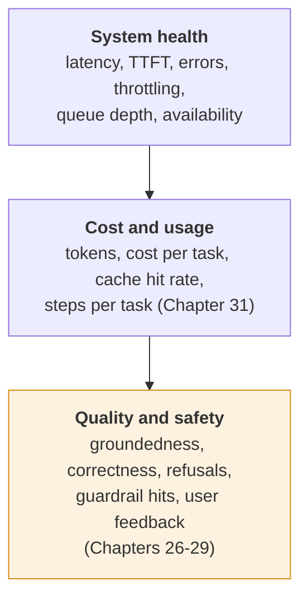
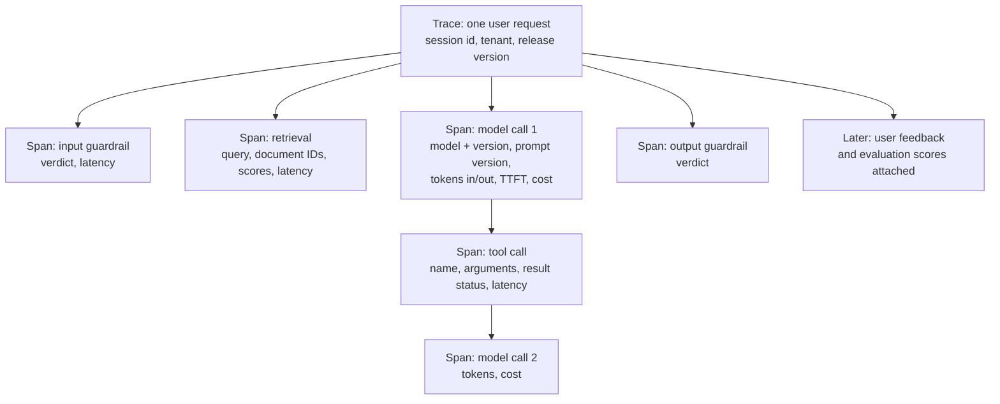
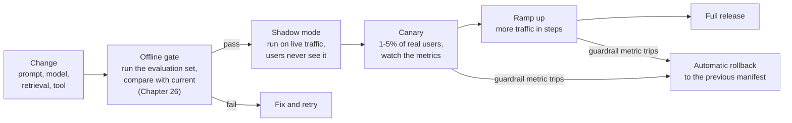
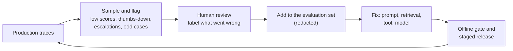
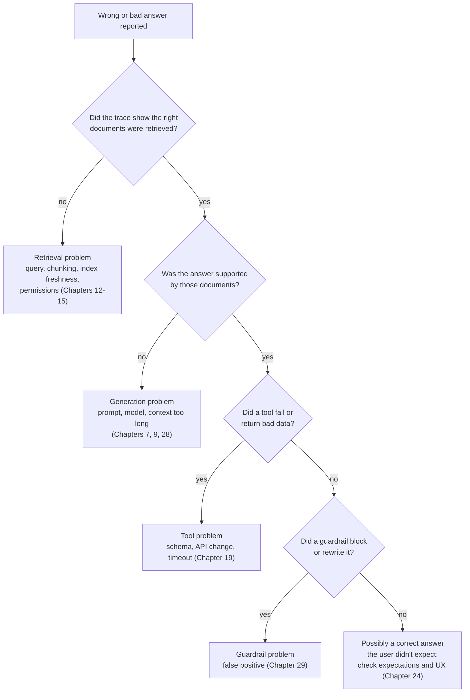

# Chapter 32: Observability and LLMOps

## 1. The concept, from scratch

[Chapter 31](../31-cost-latency-and-caching/README.md) said "measure first". This chapter is about **how**. Once an AI system is live, three questions come up every week:

1. **What is it doing right now?** (Is it up, fast, and within budget?)
2. **Is it still giving good answers?** (Quality, safety, and trust.)
3. **How do we change it without breaking it?** (New prompts, new models, new data.)

The first is **observability**. The third is **LLMOps**. The second sits between them, and it is the part that makes AI different from ordinary software.

**Observability** means being able to understand what a system is doing *from the outside*, using the data it emits: **logs** (events), **metrics** (numbers over time) and **traces** (the path of one request through every step). **LLMOps** is the set of practices for **releasing, running and improving** applications built on language models. It borrows from DevOps (ship safely, roll back fast) and MLOps (version your models and data), and adds the things unique to LLM apps.

The one idea to hold on to: **in an LLM application, the prompt, the model version, the retrieval settings, the tool definitions and the index are all things you deploy.** None of them is "code" in the traditional sense, and any of them can break production. So they need the same discipline as code: versioning, review, testing, staged rollout and rollback.

### Why ordinary monitoring is not enough

Traditional software fails loudly. A crash, a 500 error, a timeout. An LLM application usually fails **quietly**. The request returns HTTP 200 in 1.2 seconds, and the answer is confidently wrong. Your dashboards stay green while customers lose trust. So we monitor three layers, and the top one is new.

Systems you already know how to watch give you the bottom layer. The middle layer needs token-aware metrics. The top layer needs **evaluation running on live traffic**, which is what makes this chapter different from standard DevOps.

### Traces: the unit of understanding

A **trace** records everything that happened for one user request, as a tree of **spans**. Each span is one step: a retrieval call, a model call, a tool call, a guardrail check. For an AI system the trace is the most useful object you have, because the question you'll be asked is always "why did it say *that*?" ([Chapter 22](../22-orchestration-and-harnesses/README.md) introduced the idea for agents.)

What a useful span carries:

- **Identity:** a trace ID, a session or conversation ID so you can follow a whole chat, and a tenant ID. Use pseudonymous user IDs where you can.
- **Release information:** the **prompt version, model version, index version and configuration** that produced this answer. This is the single most useful field in a postmortem. Without it, you cannot say what was running when something went wrong.
- **Operational data:** latency (and TTFT for model calls), tokens in and out, cache hit, cost, retries, errors.
- **Evidence:** the IDs and scores of the retrieved documents, the tool name and arguments, the guardrail verdicts. With this, you can tell a retrieval failure from a generation failure ([Chapter 27](../27-evaluating-rag-and-agents/README.md)).
- **Attached later:** user feedback, and evaluation scores from automatic or human review.

### What to log, and what not to

The trace is useful *because* it contains content. It is also risky *because* it contains content. Prompts and answers hold customer data ([Chapter 30](../30-privacy-governance-and-compliance/README.md)). The working rules:

- **Always capture metadata** (IDs, versions, timings, token counts, verdicts). It's cheap and low risk.
- **Capture content deliberately.** Decide per environment whether to store full prompts and responses, store only a **sampled** subset, or store **redacted** content. Redact personal data *before* it is written ([Chapter 29](../29-guardrails-and-ai-security/README.md)).
- **Treat the logs as a data store.** They need access control, encryption, a retention period and a deletion path, like any other copy of personal data.
- **Keep audit logs and operational logs separate.** The audit log is the tamper-evident record for accountability; operational traces are for debugging and can be sampled and expire sooner ([Chapter 30](../30-privacy-governance-and-compliance/README.md)).

### What to measure

| Layer | Examples |
|---|---|
| **System health** | Request rate, error rate, **p50 / p95 / p99 latency, TTFT**, provider throttling (rate-limit errors), timeouts, retries |
| **Cost and usage** | Tokens in/out, cost per request and **per successful task**, cost per tenant, cache hit rate, steps per agent task |
| **Retrieval** | Empty-result rate, top-score distribution, index freshness, share of answers with citations |
| **Quality (online)** | Sampled groundedness and correctness scores, abstain rate, escalation-to-human rate, regeneration rate, thumbs-down and edit rate |
| **Safety** | Guardrail block rate by type, refusal rate, suspected injection attempts, PII-redaction counts |
| **Agents** | Task completion, steps per task, tool error rate, loop or step-limit hits, human-approval rate ([Chapter 25](../25-agent-reliability-and-learning/README.md)) |

For the quality row, you can't run a big judge over every request. The usual pattern is: **score a sample** with an LLM-as-a-judge or rule checks, send a smaller sample to **human reviewers**, and **calibrate the judge against the humans** ([Chapter 26](../26-evaluation-fundamentals/README.md)). Treat thumbs-up and thumbs-down as a signal, not a score: few users click, and those who do are not typical. Behavioural signals such as copy, edit, retry, abandon and escalate are often more honest.

Alert on **symptoms and changes**, not on single numbers. A jump in cost per hour, a spike in p95 TTFT, a rise in empty-retrieval rate, a drop in the sampled quality score, a change in refusal rate. For quality, compare against your own baseline, not an absolute threshold.

### Tools and standards

You don't have to build any of this. Landscape, as of Nov 2026 (this changes quickly; check each project):

- **OpenTelemetry (OTel)** is the vendor-neutral standard for traces, metrics and logs. It has **GenAI semantic conventions**: agreed names for the attributes of a model call (model, token counts, operation) and for agent and tool spans. The conventions have moved into their own repository, and the sources I found still described them as being in development rather than stable, so check the status before betting on exact attribute names ([OpenTelemetry: GenAI conventions](https://opentelemetry.io/docs/specs/semconv/gen-ai/)). The benefit of OTel is that your instrumentation isn't tied to one backend.
- **LLM-specific platforms** such as **Langfuse** (open source, can be self-hosted) and **LangSmith** offer tracing, prompt management, datasets and evaluation in one place. Comparison articles are mostly written by the vendors themselves, so judge them on a trial with your own traffic.
- **Cloud-native on AWS.** Amazon **Bedrock model invocation logging** can deliver model inputs and outputs to Amazon S3, CloudWatch Logs, or both, for calls through the runtime endpoint ([AWS: model invocation logging](https://docs.aws.amazon.com/bedrock/latest/userguide/model-invocation-logging.html)). **CloudWatch generative AI observability** adds ready-made views of model invocations (token use, latency percentiles, errors) and end-to-end tracing for supported frameworks ([AWS: generative AI observability](https://docs.aws.amazon.com/AmazonCloudWatch/latest/monitoring/GenAI-observability.html)). **Amazon Bedrock AgentCore Observability** emits OTel-compatible traces, metrics and logs for agents, stored in CloudWatch, and AgentCore API activity is recorded in CloudTrail ([AWS: AgentCore observability](https://docs.aws.amazon.com/bedrock-agentcore/latest/devguide/observability.html)). Note that invocation logging captures prompts and responses, so everything in the previous section applies to it.

### LLMOps: the things you release

List everything that can change the answer. Each is a release artefact:

| Artefact | Why it needs versioning |
|---|---|
| **Prompts** and templates ([Chapter 9](../09-prompt-engineering/README.md)) | A one-line edit can change behaviour everywhere |
| **Model and version** | Providers update and retire models |
| **Tool definitions and schemas** ([Chapter 19](../19-tool-calling/README.md)) | The model reads them as instructions |
| **Retrieval configuration**: chunking, embedding model, index, top-k, reranker ([Chapter 12](../12-ingestion-and-chunking/README.md), [Chapter 14](../14-improving-retrieval/README.md)) | Changes what the model sees |
| **Guardrail rules and policies** ([Chapter 29](../29-guardrails-and-ai-security/README.md)) | Change what's blocked |
| **Evaluation set and judge prompts** ([Chapter 26](../26-evaluation-fundamentals/README.md)) | Change what "good" means |
| **Agent graph and harness code** ([Chapter 22](../22-orchestration-and-harnesses/README.md)) | Ordinary code, but tightly coupled to the above |

The practical device is a **release manifest**: a small record that names the exact version of each artefact, stamped on every trace. "Release 41 = prompt v12, model snapshot X, index v7, guardrails v3". Then "what changed between the good week and the bad week?" has an answer.

A **prompt registry** (a store of versioned prompts with named labels such as `staging` and `production`) lets you change a prompt without redeploying the application. Rolling back means pointing the `production` label at the previous version, which takes seconds. The trade-off is that prompt changes now bypass your normal code review and CI unless you build the same approvals and tests around the registry. Prompts are code, so give them code's controls ([Chapter 30](../30-privacy-governance-and-compliance/README.md) covers change control).

### Releasing safely

The same staged-rollout ideas from conventional engineering apply:

- **Offline gate first.** A candidate must beat or match the current version on your evaluation set, and must not regress the critical cases. Cheap, repeatable, and catches most problems.
- **Shadow mode.** Run the candidate on real requests in parallel and compare outputs, but only show users the current version. This catches problems your evaluation set didn't anticipate, at zero user risk.
- **Canary and ramp.** Send a small share of real traffic to the new version and watch the *guardrail metrics*: error rate, TTFT, cost per task, refusal rate, sampled quality, thumbs-down. If any trips, roll back automatically.
- **A/B testing** goes further. Split users deliberately, compare a business metric, and decide on evidence ([Chapter 27](../27-evaluating-rag-and-agents/README.md)).
- **Feature flags and kill switches** let you turn a tool, an agent capability or a whole feature off without a deploy.
- **Index rollbacks need planning.** Re-indexing is slow, so keep the previous index version available and switch over only when the new one is ready (a blue-green approach), so you can switch back ([Chapter 16](../16-production-rag-architecture-and-scale/README.md)).

### Drift: why a system that didn't change can get worse

Nothing in your code changed, and quality dropped. This is normal enough that you should plan for it. Four sources:

1. **Model drift.** The provider updates or retires the model behind a name. A **floating alias** can point to a newer snapshot over time, whereas a **dated, pinned version** stays put until it is retired. Providers publish deprecation schedules: Anthropic says it gives at least 60 days' notice before retiring a publicly released model ([Anthropic: model deprecations](https://platform.claude.com/docs/en/about-claude/model-deprecations), as of Nov 2026), and Amazon Bedrock models move through Active, Legacy and End-of-Life states ([AWS: model lifecycle](https://docs.aws.amazon.com/bedrock/latest/userguide/model-lifecycle.html)). So: **pin versions, record them in the manifest, subscribe to deprecation notices, and treat any model upgrade as a release.**
2. **Data drift.** Users change what they ask: a new product, a new season, a news event. Your evaluation set slowly stops representing real traffic.
3. **Knowledge drift.** Source documents change, and the index goes stale or half-updated ([Chapter 28](../28-hallucination-and-grounding/README.md)).
4. **Upstream and dependency drift.** A tool's API changes, a library updates, an embedding model is swapped. Changing the embedding model means re-embedding everything ([Chapter 13](../13-vector-search-and-databases/README.md)).

### The feedback loop: production makes the system better

Every real failure becomes a permanent test. That is how an evaluation set grows from a starter set into a true picture of your traffic ([Chapter 26](../26-evaluation-fundamentals/README.md)). **Replay** is the practical tool: take the exact inputs of a failed trace (with the same retrieved context and tool results where possible) and run them against a new prompt or model, to check the fix before release. And as [Chapter 25](../25-agent-reliability-and-learning/README.md) warns, change the system **deliberately** through this loop. Don't let it rewrite itself from raw production data.

### When something goes wrong: debugging and incidents

The trace tells you which stage failed. Walk it in order:

For an **incident** (a spike in bad answers, a cost explosion, a safety event), the playbook is the familiar one, with AI-specific moves:

1. **Detect** through an alert or a report.
2. **Mitigate first, diagnose second.** Roll back the prompt label, **pin** the previous model version, switch off a tool or feature with a flag, or move to a safe mode (retrieval-only, or hand off to a human). Stop the bleeding before the root cause.
3. **Find the cause** by comparing the release manifests and the traces before and after.
4. **Fix and add a regression test** to the evaluation set.
5. **Write a blameless postmortem.** What changed, how we detected it, how long it took, and what we change in the process.

Define **service level objectives (SLOs)** that include quality, not only uptime. For example: availability, p95 TTFT, a sampled quality score above an agreed level, cost per task under budget. These give the on-call engineer a clear signal for when to act.

## 2. Analogies across industries

- **Traces are lot traceability on a production line (manufacturing).** When a defective batch of parts is found, a good plant can trace it to the line, the shift and the supplier material, and recall only the affected lots. A **release manifest** is the lot number, and a **trace** is the record that says which lot a given answer came from. Without lot numbers, every defect means recalling everything.
- **The staged release is a pilot ward before a hospital-wide rollout (healthcare).** A hospital doesn't switch a new protocol on in every ward at once. It trials it on one ward, watches the outcomes, and extends it only if the numbers hold, with a clear rule for stopping. That's shadow mode, canary and rollback.
- **Tracing and drift detection are the flight data recorder and the pre-flight checklist (aviation).** The recorder lets investigators reconstruct what happened; the checklist (your evaluation gate) is run *before* every departure. And just as an airline monitors engine health in flight, not only at the gate, you monitor quality on live traffic, not only before launch.
- **Provider model updates are a supplier changing a raw material (manufacturing).** The part spec didn't change, but the supplier's alloy did. You'd want the incoming-goods inspection and the lot records to catch it. Pinning the version is the contract clause that says "no changes without notice".

## 3. How it's used in industry

- **Manufacturing maintenance copilot.** A copilot answers technicians' questions from equipment manuals. Each trace records the manual version retrieved. When a new manual revision is ingested and answers about one machine type get worse, the team sees it at once in retrieval metrics and traces, and rolls back to the previous index version while they investigate.
- **Healthcare clinical documentation.** A note-drafting tool captures metadata for every request but stores full content only in a redacted, sampled form with strict access. Clinicians' edits to the draft are the main quality signal, and reviewed failures are anonymised and added to the evaluation set.
- **E-commerce shopping assistant.** Before a peak-season sale, the team runs a candidate prompt in shadow mode against real traffic, then canaries it to a small percentage of shoppers with automatic rollback on conversion, cost-per-session and refusal-rate guardrails.
- **Travel customer service.** A travel company pins its model version and keeps a one-switch fallback to a human queue. During a major disruption, the cost and escalation dashboards show the surge within minutes, and the team turns on a tighter token budget through a flag without redeploying.

## 4. Common misconceptions

- **"Our existing monitoring covers it."** Existing monitoring catches crashes and slowness. An AI failure is usually a *well-formed, fast, wrong answer*. You need quality signals as well.
- **"We tested it before launch, so we're fine."** Offline results measure the traffic you imagined. Production traffic drifts, and so do models and documents. You need continuous online evaluation.
- **"It's only a prompt change, so no release process."** A prompt change can alter behaviour as much as a code change. Version it, test it, stage it, and keep it reversible.
- **"The provider's model is a fixed thing."** Aliases can move and models get retired. Pin, record, and plan upgrades.
- **"Log everything, we may need it."** Logs become a second copy of your customers' data. Log metadata always and content deliberately.
- **"Thumbs-down rate is our quality metric."** It's sparse and biased. Use it as one signal beside sampled evaluation and behavioural signals.
- **"An LLM judge online replaces human review."** It scales, but it drifts too. Calibrate it against human labels regularly ([Chapter 26](../26-evaluation-fundamentals/README.md)).
- **"Rolling back means redeploying."** It can, but a prompt registry and flags make it a switch. Indexes and fine-tuned models are slower to roll back, so plan for them.

## 5. Interview questions

### 1. What is LLMOps, and how does it differ from DevOps and MLOps?

LLMOps is the discipline of releasing, running and improving applications built on language models. It borrows the delivery side from DevOps: automate, ship in small steps, observe, and roll back quickly. It borrows from MLOps the idea of versioning the things that aren't code, such as models and data. What's different is that in most LLM apps I'm not training the model. I'm composing a system out of a hosted model, a prompt, retrieval, tools and guardrails, and every one of those can change behaviour. So the extra work is versioning prompts and configuration, evaluating output quality continuously instead of just checking that the service is up, handling provider model changes, and controlling cost per token. If I had to say it in one line: it's DevOps for systems where the behaviour lives in prompts, models and data, and where "it returned 200" doesn't mean "it was right".

### 2. What's a trace, and what should one contain for an LLM application?

A trace is the record of everything that happened for one user request, as a tree of spans, one per step: retrieval, each model call, each tool call, each guardrail check. For an LLM app I want a trace to answer "why did it say that?" So each span carries timings and errors, and each model span carries the model and prompt version, tokens in and out, time to first token and cost. The retrieval span carries the document IDs and scores. The tool span carries the name, arguments and result status. And the whole trace carries a session ID, a tenant ID, and the release version. User feedback and evaluation scores get attached later. The most valuable field in a postmortem is the release version, because it lets me say exactly what was running.

### 3. What would you monitor on a production LLM app beyond latency and error rate?

I think in three layers. System health is the familiar part: latency, time to first token, errors, provider throttling. Then cost and usage: tokens, cost per successful task, cache hit rate, steps per agent task. Then quality and safety, which is the layer people forget: the abstain and refusal rate, the empty-retrieval rate, guardrail hit rates, a sampled quality score from an automated judge calibrated against human review, and behavioural signals like regenerations, edits, escalations to a human, and thumbs-down. I alert on changes against my own baseline rather than fixed numbers, because a rise in refusals or a drop in the sampled score is often the first sign that a model update or a data change has hurt us.

### 4. What should you log in an LLM application, and what shouldn't you?

I always log metadata: IDs, versions, timings, token counts, costs and guardrail verdicts. That's cheap, low risk and extremely useful. Content is the judgement call. Full prompts and answers are what make debugging possible, but they also contain customer data, so I decide per environment whether to store them in full, sample them, or store a redacted version, and I redact before writing, not after. I treat the log store as a data store with access control, encryption, a retention period and a deletion path. I also keep the tamper-evident audit log separate from debugging traces, because they have different retention and access needs. On AWS, for example, Bedrock model invocation logging can write prompts and responses to S3 or CloudWatch Logs, which is powerful, but means I must apply those controls to wherever it writes.

### 5. How would you roll back a bad prompt?

The way I make it easy is to design for it up front. Prompts live in a versioned registry, and the application reads whichever version has the `production` label. Rolling back is pointing that label at the previous version, which takes effect in seconds and needs no code deploy. Every trace records the prompt version, so I can confirm the rollback worked by watching the metrics change, and I can see exactly which requests were affected. After the rollback I'd add the failing cases to the evaluation set so it can't happen again. The thing I'd be careful about is governance: if prompts can change without a deploy, they must still go through review and the offline evaluation gate, otherwise I've created a way to change production without any controls.

### 6. How do you release a prompt or model change safely?

I treat it like any risky release, with extra steps because behaviour is probabilistic. First, an offline gate: run the candidate on my evaluation set and compare it to the current version, and block it if the headline metrics drop or any critical case regresses. Second, shadow mode: run the candidate on real traffic without showing users, and compare. Third, a canary: send a small slice of real users to it and watch guardrail metrics, such as error rate, TTFT, cost per task, refusal rate and sampled quality, with automatic rollback if one trips. Then ramp up in steps. For anything with business impact I'd run a proper A/B test. Behind all that, I want the previous version one switch away, a kill switch for risky features, and the new version's manifest recorded on every trace.

### 7. How do you detect quality drift in production?

By measuring quality continuously on live traffic instead of only before launch. I'd sample a fixed percentage of production traces and score them, with an automated judge or rule checks, and send a smaller sample to human reviewers, then calibrate the judge against those humans. I'd track those scores over time alongside indirect signals: abstain and refusal rates, empty retrieval, escalations, edits and thumbs-down. I'd keep a fixed "canary" evaluation set that I run on a schedule against the live configuration, because that isolates changes in the model or the data from changes in traffic. When something moves, I compare release manifests and traces before and after to find out whether it was a model change, a prompt or index change, or just new kinds of questions.

### 8. A provider updates its model and quality drops, though you changed nothing. What do you do?

First I confirm it's real, using the sampled scores and the fixed evaluation set run against the current setup. Then I find out what actually changed: the traces and release manifests tell me which model version served the bad answers, and I check the provider's changelog and deprecation notes. If we were on a floating alias, that explains it. To mitigate, I pin the last known good model version, if it's still available, and watch the metrics recover. Then I run the candidate model through the normal release process: evaluate, adjust prompts for the new behaviour, shadow, canary. For the long term I pin versions by default, subscribe to deprecation notices, keep a standing evaluation set that I can run against any new model in an afternoon, and make sure the model version is on every trace.

### 9. How do you use production data to improve the system without creating privacy or quality risks?

I use it through a controlled loop rather than automatically. I sample traces, particularly low-scoring ones, escalations and thumbs-down, and have people review and label what went wrong. The failures, redacted and checked against the privacy rules and retention policy, become new cases in the evaluation set. Then I fix the underlying cause, whether that's retrieval, a prompt, a tool or the model choice, and the fix has to pass the offline gate and a staged release. I avoid training or updating memory directly from raw production data, because bad or malicious inputs would be learned, private data could leak into a model, and I couldn't easily test or roll it back.

### 10. A user reports a wrong answer from a RAG assistant. How do you debug it using observability?

I'd find the trace using the session ID and go through it in order. First, retrieval: were the right documents retrieved, and with what scores? If not, it's a retrieval problem, so I look at the query, chunking, index freshness or permissions. If the right documents were retrieved, I check whether the answer was supported by them. If it wasn't, it's a generation problem, so I look at the prompt, the model version and whether the context was too long or noisy. Next, whether a tool failed or returned bad data, and whether a guardrail blocked or rewrote the answer. If everything checks out, maybe the answer was right and the expectation was wrong. Whatever the cause, I'd replay the same inputs against a fix, add the case to the evaluation set, and note the trace's release version so I know whether it's a regression.

## 6. Scenario exercise

A manufacturer runs a maintenance copilot that answers technicians' questions from equipment manuals, using a hosted model called through its general-purpose alias. About two weeks ago, plant managers started reporting that answers on one line of machines are "off", and the thumbs-down rate is clearly up. The team says: "We didn't change any code. We did ingest a batch of updated manuals three weeks ago. The model name in our config is the provider's latest alias. We log only the request time and the response time." There's no evaluation set beyond a handful of demo questions.

**Your task:** How do you find out what happened, what do you do right now, and what do you put in place so you can answer the question quickly next time? Answer from memory, then compare.

Model answer

I'd start by saying that with only request and response times logged, we can't yet prove what changed, so the first job is to rebuild enough evidence to separate the suspects. There are three: the manual ingestion three weeks ago, a change behind the provider's alias, and a shift in what technicians are asking. They don't fit the timeline equally. The ingestion was three weeks ago and the complaints started two weeks ago, so it's possible but not an obvious match. The alias could have moved at any point, and we have no record of it. So I'd treat all three as open.

Right now, I'd mitigate before diagnosing. I'd pin the model to the most recent dated version that I can reasonably say was serving before the complaints, if the provider still offers it, and I'd watch the thumbs-down rate. If the index has a previous version, I'd consider switching the affected machine line back to it for a day to see if that changes things. Whichever lever moves the metric points to the cause. If neither does, it's probably a change in the questions.

To investigate, I'd take real questions about the affected machine line, from before and after the complaints, from whatever the app stored or from the technicians themselves, and build a small labelled set with the reliability engineers who know the right answers. Then I'd run that set against combinations: old index and new index, and the old and new model versions where available. That isolates the variable. I'd also check the retrieval side directly: for these questions, are the new manual chunks being retrieved, are there duplicate or conflicting old and new revisions of the same procedure, and is the chunking of the new manuals different? Updated manuals with overlapping content from two revisions would produce exactly this kind of "off" answer.

For the longer term, I'd put in place the things whose absence made this hard. Tracing on every request with the prompt version, the pinned model version, the index version and the retrieved document IDs and revisions, so the question "what was running?" has an answer. A release manifest. A proper evaluation set built from real technician questions and from every failure we review, run automatically on every change and on a schedule against the live configuration, so drift shows up as a score drop. Sampled online quality scoring with human calibration. Alerts on refusals, empty retrieval and thumbs-down. A policy of pinning model versions and treating any upgrade, or any manual ingestion, as a release with a gate, a shadow run and a canary. And an index that keeps the previous version so we can switch back.

I'd tell the client plainly that I can't yet say which of the three it was, that the pin-and-compare approach should answer that within a day or two, and that the lesson is process: a system whose behaviour depends on a model, a prompt and an index has to be released and observed like software, even though none of those three is code.

## 7. Key takeaways

- **AI systems fail quietly:** "200 OK in a second" can still be a wrong answer, so monitor system health, cost, **and quality**, including evaluation on live traffic.
- **The trace is your main tool:** one span per step, with the release version, tokens, retrieved document IDs and verdicts, so you can answer "why did it say that?"
- **Prompts, models, indexes, tools and guardrails are all release artefacts:** version them, stamp a release manifest on every trace, and make rollback a switch.
- **Release in stages and expect drift:** offline gate, shadow, canary, automatic rollback; pin model versions; and treat any model or data change as a release.
- **Close the loop deliberately:** review production failures, add them to the evaluation set, and log content with the same privacy care as any other customer data.

## 8. Further reading

- OpenTelemetry, [Generative AI semantic conventions](https://opentelemetry.io/docs/specs/semconv/gen-ai/): the vendor-neutral standard for tracing model and agent calls. The page points to the repository where the conventions now live.
- AWS, [Generative AI observability in Amazon CloudWatch](https://docs.aws.amazon.com/AmazonCloudWatch/latest/monitoring/GenAI-observability.html) and [Monitor model invocation with CloudWatch Logs and S3](https://docs.aws.amazon.com/bedrock/latest/userguide/model-invocation-logging.html): how model and agent telemetry is collected on AWS.
- AWS, [Observability for Amazon Bedrock AgentCore](https://docs.aws.amazon.com/bedrock-agentcore/latest/devguide/observability.html): traces, metrics and audit logging for agents.
- Langfuse, [Documentation](https://langfuse.com/docs): an open-source example of tracing, prompt management, datasets and evaluation in one tool.
- Anthropic, [Model deprecations](https://platform.claude.com/docs/en/about-claude/model-deprecations): how a provider handles retirement, notice periods and migration.
