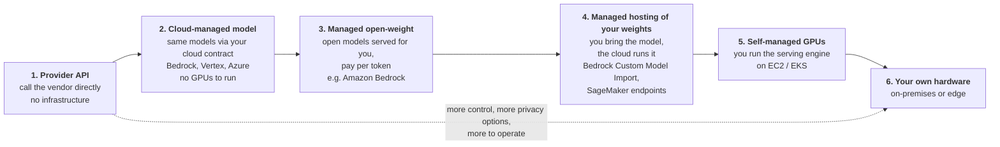
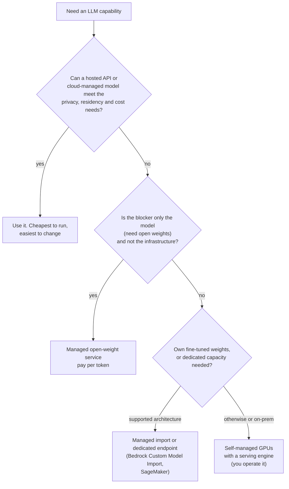
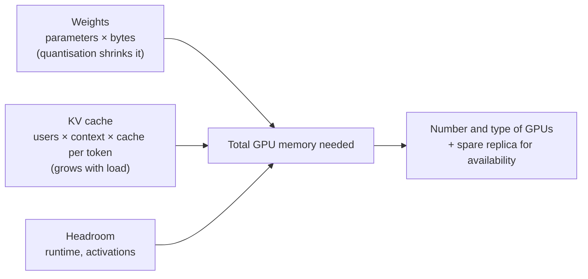
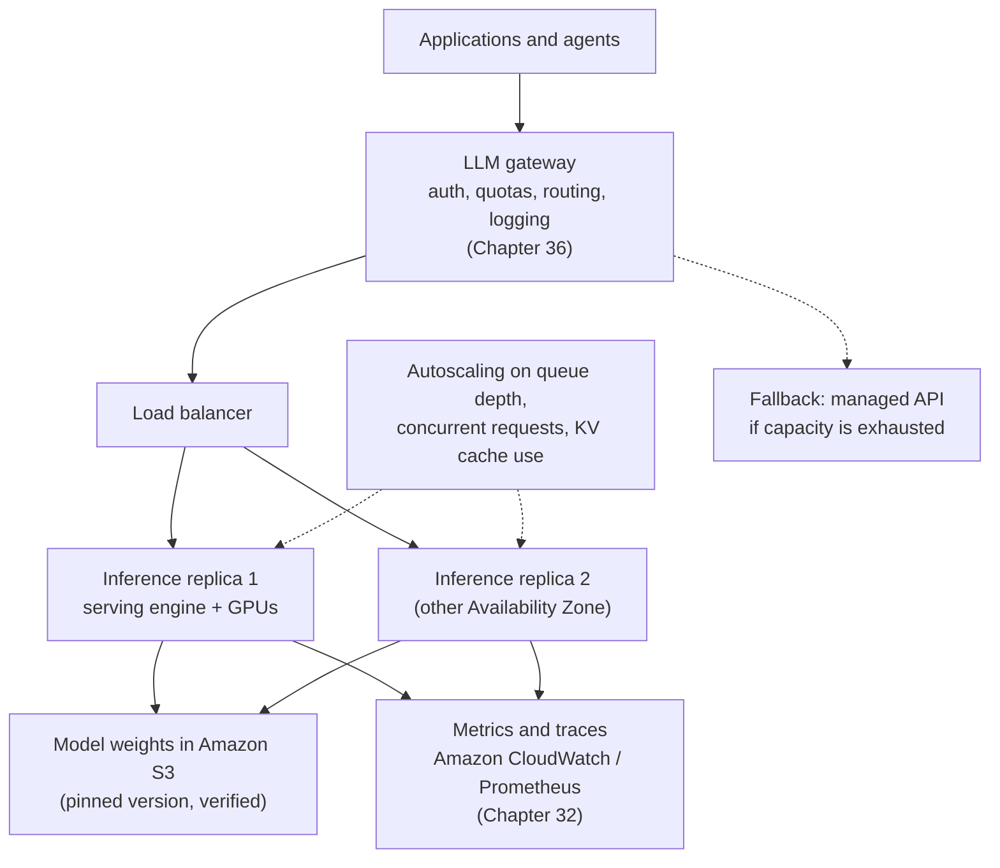
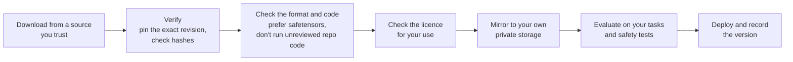

# Chapter 34: Self-Hosting Open-Weight Models

> **Prices, GPU sizes and throughput numbers here are illustrative.** I use round, made-up figures so you can follow the method and reuse it. Model licences, model catalogues, instance types and serving software change quickly. Facts that can change are marked "(as of Nov 2026)" and link to the source. Check the live pages before you commit a client to anything.

## 1. The concept, from scratch

Up to now we have mostly called models through someone else's API. [Chapter 33](../33-inference-engineering/README.md) explained what happens inside a serving system. This chapter asks the practical question that comes right after: **should we run the model ourselves, and if so, how?**

An **open-weight model** is one whose trained weights (the learned numbers, [Chapter 5](../05-training-llms/README.md)) are published for anyone to download and run. **Self-hosting** means you run those weights on infrastructure you control, instead of calling a provider's API. Examples of open-weight families (as of Nov 2026): Meta **Llama**, OpenAI **gpt-oss**, Alibaba **Qwen**, **DeepSeek**, Mistral and Google **Gemma** ([Chapter 8](../08-the-model-landscape/README.md)). Closed models such as OpenAI's GPT flagship models, Anthropic **Claude** and Google **Gemini** are available only through the provider or a cloud partner.

Two clarifications that interviewers like to test.

**"Open-weight" is not "open source."** The Open Source Initiative's definition of open-source AI asks for much more than weights: information about the training data, the code used to train and run the model, and the parameters under OSI-approved terms ([OSI: Open Source AI Definition](https://opensource.org/ai/open-source-ai-definition)). Most popular "open" models publish weights but not their training data, so the accurate word is **open-weight**. A few projects, such as AI2's OLMo, publish more than weights.

**"Self-hosting" is a spectrum, not a switch.** Many teams jump to "buy GPUs" when what they need is somewhere in the middle.

As of Nov 2026, Amazon Bedrock offers many open-weight models as fully managed, pay-per-token services, including OpenAI's gpt-oss, Qwen3, DeepSeek and Llama models, and its catalogue keeps growing ([AWS: Bedrock open-weight models](https://aws.amazon.com/about-aws/whats-new/2025/12/amazon-bedrock-fully-managed-open-weight-models)). So "we want an open model" often does **not** mean "we need to run GPUs". Always check step 3 before you plan step 5.

### Why self-host, and why not

| Reason to self-host | What it really means |
|---|---|
| **Data residency and sovereignty** | Data must stay in a country, a network or a building. Check first whether an in-region managed service already satisfies the rule ([Chapter 30](../30-privacy-governance-and-compliance/README.md)) |
| **Cost at high, steady volume** | Paying for a GPU by the hour beats paying per token **only if you keep it busy** (see the break-even below) |
| **Control and customisation** | Serve your own fine-tuned model or adapters ([Chapter 10](../10-fine-tuning-and-distillation/README.md)), constrain decoding, pin an exact version forever |
| **Latency and locality** | Run next to your data or users, or at the edge, with no internet round trip |
| **Independence** | No provider rate limits, outages or deprecations ([Chapter 32](../32-observability-and-llmops/README.md)) |
| **Offline or air-gapped use** | Factories, ships, defence, clinics with poor connectivity |

| Reason not to | What it really means |
|---|---|
| **Operational burden** | GPUs to provision, a serving engine to tune, autoscaling, upgrades, on-call. This is a platform team's work |
| **Quality gap** | The strongest closed models are often ahead on hard tasks. Open models are close or equal on many, so **evaluate on your own tasks** ([Chapter 26](../26-evaluation-fundamentals/README.md)) |
| **Idle cost** | You pay for the GPU whether or not anyone is using it |
| **You own the safety and security layer** | A raw model has no provider-side safeguards. You add guardrails ([Chapter 29](../29-guardrails-and-ai-security/README.md)) |
| **Model churn** | New models arrive every few months. You inherit the upgrade work |
| **Capacity risk** | GPUs can be scarce. You may not get the instances when you need them |

### The cost question: it's all about utilisation

A hosted API charges **per token, so idle time is free**. A GPU node charges **per hour, whether busy or not**. That is the whole economics.

**A worked example** with made-up numbers. Say a GPU node costs $30 per hour, and with good batching ([Chapter 33](../33-inference-engineering/README.md)) it can process about 5,000 tokens per second (input and output combined).

- At full load it handles 5,000 × 3,600 = **18 million tokens per hour**, so the cost is $30 ÷ 18 = about **$1.67 per million tokens**.
- If the node is only busy **30%** of the time, you still pay $30 an hour but process 5.4 million tokens, so the cost is about **$5.56 per million**.
- If an API charges, say, $3 per million tokens for a comparable model, the break-even is $1.67 ÷ $3, so you need roughly **56% sustained utilisation** just to match the API price, *before* counting the other costs.

And there are other costs: at least **two replicas** for availability (so half your capacity is often a spare), the engineers who run it, storage and networking, monitoring, security reviews, and your time re-evaluating each new model. The honest summary: **self-hosting wins when volume is high, steady and predictable, or when a hard requirement (residency, offline) leaves no choice.** It loses for spiky, low or uncertain traffic. Daytime peaks with empty nights can be improved by filling idle hours with batch work ([Chapter 31](../31-cost-latency-and-caching/README.md)).

### Sizing: how much GPU memory do you need?

The first question for any self-hosted model is "does it fit, and for how many users?" The method is simple arithmetic.

> **Weights** = number of parameters × bytes per parameter
> **KV cache** = tokens in flight × KV cache per token ([Chapter 33](../33-inference-engineering/README.md))
> **Total** = weights + KV cache + headroom

| Model size | 16-bit (2 bytes) | 8-bit (1 byte) | 4-bit (half a byte) |
|---|---|---|---|
| 8 billion parameters | about 16 GB | about 8 GB | about 4 GB |
| 70 billion | about 140 GB | about 70 GB | about 35 GB |

These are approximations. Real files are somewhat larger because some parts are kept at higher precision and quantised formats store extra scaling data.

**A worked example.** You want to serve a 70-billion-parameter model at 8-bit for **40 concurrent users**, each with an average of **8,000 tokens** of context.

- Weights: about **70 GB**.
- KV cache: using the imaginary model from Chapter 33 (128 KB per token), each user holds about 1 GB, so 40 users hold about **40 GB**.
- Subtotal: 110 GB. Add headroom for the runtime and activations. I start with about 20% (my own planning habit, not a standard) and then measure: **about 130 GB**.
- If each GPU has 80 GB, you need **at least two GPUs**, with the model split across them by tensor parallelism ([Chapter 33](../33-inference-engineering/README.md)), and that's before any spare replica for availability.

Notice what moves the number. Doubling concurrent users or context adds KV cache. Dropping to 4-bit saves about 35 GB of weights, but you must check quality ([Chapter 33](../33-inference-engineering/README.md), [Chapter 26](../26-evaluation-fundamentals/README.md)). Models with grouped-query attention need less cache. And **mixture-of-experts** models need memory for *all* experts even though few are active per token ([Chapter 8](../08-the-model-landscape/README.md)). Speed is a separate question, set by memory bandwidth and batching ([Chapter 33](../33-inference-engineering/README.md)).

### Choosing a serving stack

You rarely write the serving engine. You pick one. As of Nov 2026:

| Option | What it is | Notes |
|---|---|---|
| **vLLM** | Open-source serving engine with PagedAttention, continuous batching, prefix caching and chunked prefill | The common default. Exposes an OpenAI-compatible API, supports many quantisation formats and LoRA adapters ([vLLM docs](https://docs.vllm.ai/en/latest/)) |
| **SGLang** | Open-source serving framework in the same family | Often chosen for workloads with shared prefixes, such as multi-turn agents. Compare it on your own traffic ([SGLang docs](https://docs.sglang.ai)) |
| **TensorRT-LLM** | NVIDIA's optimised inference library | Tuned for NVIDIA GPUs, with more setup work |
| **Hugging Face TGI** | Earlier popular engine | Now in **maintenance mode**. Its own docs recommend vLLM, SGLang, llama.cpp and MLX for new work ([TGI docs](https://huggingface.co/docs/text-generation-inference/index)) |
| **llama.cpp, Ollama** | Lightweight engines for laptops, small servers and edge devices | Good for development, demos and offline use. Not usually the choice for high-concurrency production |

The practical point: most engines expose an **OpenAI-compatible API**, so your application can switch between a hosted model and a self-hosted one by changing a base URL and a model name. That's what makes the hybrid designs in [Chapter 36](../36-llm-gateways-and-routing/README.md) easy.

### What AWS gives you

You asked for AWS in depth where it is common in the industry, so here is how the ladder from the first diagram maps onto AWS (as of Nov 2026; all of this changes, so check the pages).

**Managed open-weight models on Amazon Bedrock.** Pay per token with no GPUs, using your AWS account, Regions and controls. For many "we need an open model" cases, this is the right answer ([AWS: Bedrock models](https://docs.aws.amazon.com/bedrock/latest/userguide/models-supported.html)).

**Bedrock Custom Model Import.** If you have your own fine-tuned open-weight model, you can import it and have Bedrock serve it. Limits from the docs: it must be one of the supported architectures (including Llama, Mistral, Mixtral, Qwen and GPT-OSS families, with some caveats per family), in Hugging Face weights format; text-model weights must be under 200 GB; the context length must be under 128K; and embedding models are not supported ([AWS: Custom Model Import](https://docs.aws.amazon.com/bedrock/latest/userguide/model-customization-import-model.html)). It trades flexibility for not running the serving layer yourself.

**Amazon SageMaker AI endpoints with large model inference (LMI) containers.** AWS-provided containers that package a serving engine (including vLLM) with support for quantisation, tensor parallelism and continuous batching, so you pick an instance type and backend and deploy a managed endpoint ([AWS: LMI containers](https://docs.aws.amazon.com/sagemaker/latest/dg/large-model-inference-tutorials.html)). AWS also publishes vLLM deep learning containers ([AWS: vLLM containers](https://aws.github.io/deep-learning-containers/vllm/)). You choose the model and the hardware; AWS handles endpoint plumbing.

**Self-managed on Amazon EC2 or Amazon EKS (Kubernetes).** You run vLLM or a similar engine on GPU nodes yourself. Maximum control, maximum work. Typical when you already run a Kubernetes platform.

**Hardware.** NVIDIA GPU instances: the P5 family (H100) and P5e (H200) for large models and training-class workloads, and the G6e family (L40S) aimed at lower-cost inference ([EC2 P5](https://aws.amazon.com/ec2/instance-types/p5/), [EC2 G6e](https://aws.amazon.com/ec2/instance-types/g6e/)). AWS also offers its own accelerators, **Inferentia2** and **Trainium**, used through the AWS Neuron SDK ([EC2 Inf2](https://aws.amazon.com/ec2/instance-types/inf2/)). AWS cites better price-performance for these, but they need model and framework support, so test your model before you plan around them. Check GPU memory per instance and current pricing on those pages, because that's the input to the sizing method above.

**Capacity.** GPU instances can be hard to get at short notice. AWS offers ways to reserve capacity, such as EC2 Capacity Blocks for ML, which reserve GPU instances for a fixed period ([AWS: Capacity Blocks](https://docs.aws.amazon.com/AWSEC2/latest/UserGuide/ec2-capacity-blocks.html)). Plan capacity as part of the design, not an afterthought.

### A reference architecture on AWS

Design points that interviewers look for:

- **At least two replicas in different Availability Zones**, so one failure doesn't take the service down ([Chapter 35](../35-reliability-scaling-and-streaming/README.md)).
- **Autoscale on the right signal.** CPU is meaningless here. Use queue depth, concurrent requests, or KV cache usage and time-to-first-token. Engines like vLLM expose these metrics for Prometheus, and you can forward them to CloudWatch ([Chapter 32](../32-observability-and-llmops/README.md)).
- **Cold starts are slow.** Loading tens or hundreds of gigabytes of weights onto a new GPU takes minutes, and large-model deployments usually need raised startup timeouts. So you can't scale from zero to meet a spike in seconds. Keep a warm minimum, bake weights into images or use fast storage, and scale up early.
- **Private networking.** Keep traffic inside your VPC with private endpoints, encrypt data in transit and at rest, and restrict who can reach the endpoint ([Chapter 30](../30-privacy-governance-and-compliance/README.md)).
- **A fallback path.** If capacity runs out, the gateway can overflow to a managed API, if your data rules allow it.
- **Version the model like any release artefact** and record it on every trace ([Chapter 32](../32-observability-and-llmops/README.md)). A fine-tuned adapter can sit on a shared base model, and vLLM supports serving LoRA adapters, which is a cheap way to serve many customised variants.

### Model supply chain and safety

Downloading a model is downloading software, and it deserves the same care ([Chapter 29](../29-guardrails-and-ai-security/README.md) lists supply-chain risk in the OWASP list).

- **Format matters.** Python's pickle format, still common in older model files, can run code when loaded. The **safetensors** format stores only tensors and avoids that, which is why Hugging Face's own docs warn about pickle ([Hugging Face: safety](https://huggingface.co/docs/text-generation-inference/basic_tutorials/safety)). Separately, a loading option such as `trust_remote_code` executes Python from the model repository, so don't enable it without reading that code.
- **Pin and mirror.** Use an exact revision, keep your own copy, and don't pull "latest" into production.
- **Own the safety layer.** A hosted API usually adds provider-side safeguards. A self-hosted model gives you the raw model, so input and output guardrails, injection defences and logging are yours to build ([Chapter 29](../29-guardrails-and-ai-security/README.md)).
- **Evaluate before you trust.** Model behaviour on your tasks is what matters, not leaderboard position ([Chapter 26](../26-evaluation-fundamentals/README.md)).

### Licences: open-weight does not mean "free for anything"

Licence terms differ model by model, and even by version, so read the one that ships with the weights you choose. Examples checked on Hugging Face model pages (as of Nov 2026): OpenAI's **gpt-oss** models and **Qwen3-32B** use the permissive **Apache 2.0** licence; **DeepSeek-R1** uses the **MIT** licence; **Mistral-7B-Instruct v0.3** is Apache 2.0; **Llama 3.3** uses Meta's own community licence; **Gemma** uses Google's Gemma terms; and **Qwen2.5-72B** uses a custom Qwen licence. The same family can change licence between versions.

Questions to ask of any licence:

- Is **commercial use** allowed, and are there **size or scale thresholds**? Meta's Llama licences, for example, have required a separate licence from companies above a very large user count (700 million monthly active users in the versions I checked).
- Are there **attribution or naming requirements**? Some Llama versions require visible attribution.
- Is there an **acceptable-use policy** you must pass on to your own users?
- Can you **use the model's outputs to train another model**? Some licences restrict training a competing model.
- Can you **redistribute** fine-tuned derivatives, and under what terms?
- Does anything restrict **fields or regions**?

For the exact terms of each version, read the licence text (for example [Meta's Llama 4 licence](https://developer.meta.com/ai/llama4/license/)) and involve legal for anything commercial. This is not legal advice.

## 2. Analogies across industries

- **Self-hosting is a factory running its own power generator (manufacturing).** The grid charges per kilowatt-hour and never sits idle on your bill. A private generator has a big fixed cost, needs maintenance staff and a backup unit, and only pays off if the plant draws a high, steady load (or if there's no reliable grid). Utilisation decides everything.
- **Data residency is the national archive's reading room (government).** Some records may not leave the building or the country. A public body can use a contracted in-country facility, run its own vault, or, for the most sensitive material, keep everything on its own premises. The spectrum from managed in-region service to your own hardware is the same ladder.
- **Owning GPUs versus paying per token is owning a fleet versus renting cars (travel).** A rental company charges per day and you only pay when you drive. Owning a fleet is cheaper per mile only if the cars are on the road most of the time. Idle cars still cost insurance and parking.
- **Pinning and verifying weights is incoming-goods inspection (manufacturing).** You wouldn't put an unlabelled part from an unknown supplier into a product. You check the source, the batch and the spec before it reaches the line.

## 3. How it's used in industry

- **Public sector assistant.** A government agency must keep citizen data inside the country. It first uses a managed open-weight model in an in-country cloud Region, and keeps a self-managed deployment on its own infrastructure only for the most sensitive units.
- **Healthcare clinical summarisation.** A hospital group deploys a quantised open-weight model inside its own cloud network so that patient notes never travel to a third party. It sizes GPUs for the morning-round peak and fills overnight idle time with batch jobs such as coding suggestions.
- **Telecom ticket triage at high volume.** A carrier fine-tunes a small open-weight model to classify and summarise millions of support tickets, serves it on a few GPUs kept busy all day, and sends only the hard cases to a larger hosted model.
- **Manufacturing at the edge.** A plant with poor connectivity runs a small model on local hardware, using a lightweight engine to answer maintenance questions from manuals with no internet needed, and syncs logs when connected.

## 4. Common misconceptions

- **"Open-weight means open source."** It usually means the weights are downloadable, not that the data and code are open, and the licence may restrict use.
- **"Self-hosting is cheaper."** Only at high, steady utilisation. Idle GPUs, spare replicas and engineers often outweigh the per-token savings.
- **"Self-hosting is automatically more private or secure."** The data stays with you, but you also own the security: network, access, patching, model supply chain and guardrails.
- **"Open models are as good as closed ones."** On many tasks they're close, on some they're not. Evaluate on your own data.
- **"We need GPUs to use an open model."** Not necessarily. Managed services serve open-weight models per token.
- **"You can scale an LLM service like a web service."** Cold starts take minutes, GPUs are scarce, and the right scaling signals are queue depth and KV cache use, not CPU.
- **"Any model file from a hub is safe."** Files and repository code can be malicious. Pin, verify, prefer safetensors and mirror.
- **"Quantise it to fit and nothing changes."** Quality can change. Test it.

## 5. Interview questions

### 1. What's the difference between an open-weight model and an open-source model?

An open-weight model is one where the trained weights are published so anyone can download and run it. That's different from open source in the strict sense. The Open Source Initiative's definition for AI asks for more than weights: information about the training data, the code for training and running the model, and the parameters under OSI-approved terms. Most popular models that people call open, like Llama or Qwen, publish weights and often a licence with conditions, but not the full training data, so open-weight is the more accurate label. It matters in practice because the licence decides what I can do commercially, and "open" doesn't tell me that. I'd read the actual licence for the specific version I plan to use.

### 2. When would you self-host a model instead of using an API?

When there's a clear reason that a hosted or cloud-managed model can't meet. The common ones are data residency or sovereignty rules that a managed in-region service doesn't satisfy, offline or air-gapped environments, very high and steady volume where owning the GPUs is cheaper than paying per token, and a need for control, such as serving my own fine-tuned weights or pinning an exact model forever. I'd also be honest about the costs: I'd need a team to run GPUs, autoscaling and upgrades, I'd own the safety layer, and quality may be behind the best closed models on hard tasks. So I'd check the cheaper rungs first: an API, a cloud-managed model, a managed open-weight service. I'd only self-host when those fail on a hard requirement or the numbers clearly favour it.

### 3. What are the hosting options on AWS for an open-weight model?

I think of it as a ladder from least to most operational work. At the bottom, Amazon Bedrock serves many open-weight models as managed, pay-per-token services, so I get an open model with no GPUs to run. Next, if I have my own fine-tuned weights in a supported architecture, Bedrock Custom Model Import can serve them for me, within limits on size and context length. Then SageMaker endpoints with the large model inference containers, where I choose the model, the serving backend such as vLLM, and the instance type, and AWS manages the endpoint. Then self-managed on EC2 or EKS, where I run vLLM or similar on GPU nodes myself. Then on my own hardware. I'd choose the lowest rung that meets the requirements.

### 4. How would you estimate the GPU memory needed to serve a 70-billion-parameter model?

I'd add three things. First, the weights: parameters times bytes per parameter, so about 140 GB at 16-bit, 70 GB at 8-bit and 35 GB at 4-bit. Second, the KV cache, which depends on how many users are in flight and how long their contexts are. I'd compute cache per token from the model's layers, KV heads and head size, multiply by tokens in flight, and for an example model that might be about 1 GB per user at 8,000 tokens, so forty users add forty gigabytes. Third, headroom for the runtime and activations, which I start at around twenty percent and then measure. For forty users at 8-bit that comes to about 130 GB, so at least two 80 GB GPUs with tensor parallelism, plus a spare replica for availability. Then I'd check that the speed meets my latency target.

### 5. How do you compare the cost of self-hosting with an API?

It comes down to utilisation. An API charges per token, so idle time is free. A GPU node costs the same per hour whether it's busy or not. So I compute the cost per million tokens at full load, which is the hourly cost divided by the tokens per hour, then scale it by the utilisation I can realistically sustain. With made-up numbers, a thirty-dollar-an-hour node that does five thousand tokens per second costs about $1.67 per million at full load, and about $5.56 at 30% utilisation. Then I'd add what people forget: at least two replicas for availability, the engineers and on-call, storage and networking, monitoring, and the cost of re-evaluating models. Self-hosting only wins for high, steady, predictable volume, or when a hard requirement leaves no choice. And I'd test traffic patterns, because a daytime peak with idle nights lowers the average utilisation.

### 6. What are the main licensing concerns with open-weight models?

That the licence is a legal document, not a formality, and it varies by model and by version. Some, like gpt-oss and several Qwen and Mistral models, use permissive licences such as Apache 2.0, and DeepSeek-R1 uses MIT. Others, like Llama and Gemma, use custom licences with conditions. I'd check whether commercial use is allowed, whether there are scale thresholds, which for the Llama licences I checked meant a separate licence above a very large user count, whether I must show attribution, whether I need to pass an acceptable-use policy on to my users, whether I can use outputs to train another model, and whether I can redistribute fine-tuned versions. I'd get legal to review it for anything commercial, and I'd record the licence and version in the model inventory.

### 7. Which serving engine would you choose for a self-hosted deployment, and why?

For production I'd start with vLLM because it's widely used, has continuous batching, PagedAttention, prefix caching, quantisation support and LoRA adapters, and exposes an OpenAI-compatible API, which makes it easy to swap with a hosted model. SGLang is a strong alternative, often chosen for multi-turn and prefix-heavy workloads, and TensorRT-LLM can squeeze more from NVIDIA hardware with more setup. Hugging Face's TGI is now in maintenance mode, and its docs recommend vLLM and SGLang for new work. For a laptop, demo or edge device, I'd use llama.cpp or Ollama. I wouldn't decide from a blog benchmark. I'd run the shortlist on my own traffic shape and compare goodput, time to first token and cost.

### 8. How would you deploy and scale a self-hosted LLM service on AWS?

I'd run at least two replicas of the serving engine in different Availability Zones behind a load balancer, fronted by an LLM gateway for authentication, quotas and logging. The weights would come from a versioned S3 location, with the exact revision pinned. I'd scale on queue depth, concurrent requests and KV cache use, not on CPU, and I'd keep a warm minimum because loading large weights onto a new GPU takes minutes, so I can't scale from zero in time for a spike. I'd keep traffic private inside the VPC, send engine metrics to CloudWatch or Prometheus, and record the model version on every trace. I'd plan GPU capacity ahead, using reservations if needed, and add a fallback to a managed API for overflow, if my data rules allow it.

### 9. What are the security risks of downloading and running open model weights?

A model is software, so there's a supply-chain risk. Older pickle-format files can execute code when loaded, and some loading options run Python code from the model's repository, so a tampered download could compromise the host. I'd prefer the safetensors format, avoid running unreviewed repository code, pin the exact revision and verify hashes, mirror the approved copy into my own private storage, and scan it. Beyond that, a self-hosted model has no provider-side safeguards, so I own the guardrails, injection defences and logging. And I'd evaluate the model on my own tasks and safety tests before deploying, and treat each new model version as a release.

### 10. Why is autoscaling an LLM service harder than autoscaling a web service?

A few reasons. A new replica needs a GPU, which can be scarce, and then has to load tens or hundreds of gigabytes of weights, which takes minutes, so I can't react to a sudden spike in seconds. CPU is not a useful signal, because the bottleneck is GPU memory and batching, so I scale on queue depth, concurrent requests, KV cache use or time to first token. Each request also varies enormously in cost, from a short question to a huge document, so request count alone is misleading. And scaling down is costly too, because GPUs are expensive and throwing away a warm replica means paying that cold-start cost again. So I keep a warm baseline, scale up early, and use fallbacks or queues to absorb spikes.

## 6. Scenario exercise

A hospital group in a country with a strict rule that patient data may not leave national borders wants an assistant that summarises clinical notes and drafts discharge letters for about 2,000 clinicians. Use is concentrated around morning ward rounds and early afternoon. The group has no machine-learning platform team, a limited budget, and a deadline in four months. Their IT lead says: "We'll buy a rack of GPUs and run an open-source model in our own data centre."

**Your task:** What would you ask, what options would you lay out, and what would you recommend? Answer from memory, then compare.

Model answer

I'd start by questioning two assumptions: that the rule requires on-premises hardware, and that the model is "open source". First I'd ask privacy and legal exactly what the rule says. Does the data have to stay inside the country, or inside the hospital's own network? Is processing in a cloud Region located in the country acceptable, with a contract and appropriate controls? That answer decides the whole shape of the project. I'd also ask what "summarise" and "draft" mean in terms of volume and quality: how many notes per day, how long they are, how fast clinicians need results, and what happens if the system is down. And I'd ask how much of the note content is identifiable, since redaction can sometimes lower the bar.

Then I'd lay out the ladder. If an in-country cloud Region is acceptable and it offers a managed open-weight model, that's the cheapest and fastest route: pay per token, no GPUs, no platform team, and we can pilot in weeks. If we need our own fine-tuned weights or dedicated capacity, a dedicated managed endpoint in that Region is the next step. Only if the rule forbids any third-party infrastructure would I go to hardware in their own data centre, and I'd be clear that this is the expensive, slow option for a team with no platform engineers: they'd need to buy and install GPUs, run a serving engine, patch and monitor it, handle redundancy, and re-evaluate every new model. That's a lot to land in four months.

For sizing, I'd estimate it from the workload, not from instinct. A typical note might be a few thousand tokens in and a few hundred out, and morning rounds create a sharp peak. I'd work out the number of concurrent requests at peak, compute the weights plus KV cache for the model size I need, and see what fits. I'd test a mid-sized model, perhaps quantised, against a gold set of real, de-identified notes reviewed by clinicians, because summarisation quality and factual accuracy matter more than a benchmark ranking. I'd compare it with a larger hosted model, if rules allow, so the client sees the trade-off.

The economics are peaky: heavy at rounds, quiet overnight. That hurts self-hosted utilisation, so I'd propose filling off-peak hours with batch jobs such as coding suggestions or quality review, and I'd show the break-even honestly. I'd also build the rest of the system around the model: redaction before logging, audit logs, access control by clinician role, a human-in-the-loop requirement because the drafts go into medical records, guardrails for clinical safety, and a clear fallback if the service is unavailable.

My recommendation would be a phased plan. Phase one, a pilot on a managed in-country service, if the legal answer allows it, with a small group of clinicians and a measured evaluation. Phase two, decide on evidence whether managed is good enough, or whether a dedicated or on-premises deployment is justified. I'd tell the client plainly that buying a rack of GPUs is a decision to make last, not first, that the dominant risks are legal interpretation and clinical quality, not the hardware, and that I'd give them a range for cost with the assumptions that drive it.

## 7. Key takeaways

- **Open-weight is not open source, and "self-hosting" is a ladder:** API, cloud-managed, managed open-weight, managed import or endpoints, self-managed GPUs, own hardware. Take the lowest rung that meets the requirement.
- **Self-hosting is a utilisation bet:** a GPU costs the same busy or idle, so it wins only with high, steady volume or a hard requirement such as residency or offline use.
- **Size with arithmetic:** weights plus KV cache plus headroom, then decide the GPU count and keep a spare replica.
- **Treat models as supply-chain software:** pin and verify weights, prefer safetensors, check the licence for your use, and add your own guardrails.
- **Operate it like a service:** replicas across zones, autoscale on queue and KV cache not CPU, expect slow cold starts, and record the model version on every trace.

## 8. Further reading

- Open Source Initiative, [The Open Source AI Definition](https://opensource.org/ai/open-source-ai-definition): what "open source AI" requires beyond weights.
- AWS, [Import a customized open-source model into Amazon Bedrock](https://docs.aws.amazon.com/bedrock/latest/userguide/model-customization-import-model.html): supported architectures and limits for Custom Model Import.
- AWS, [Large model inference containers on Amazon SageMaker AI](https://docs.aws.amazon.com/sagemaker/latest/dg/large-model-inference-tutorials.html): deploying open-weight models with vLLM and other backends.
- vLLM project, [Documentation](https://docs.vllm.ai/en/latest/): serving features, quantisation, LoRA and metrics.
- Hugging Face, [Text Generation Inference: safety](https://huggingface.co/docs/text-generation-inference/basic_tutorials/safety): why pickle is risky and what safetensors changes.
