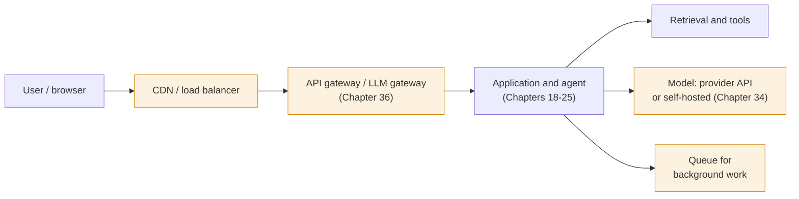
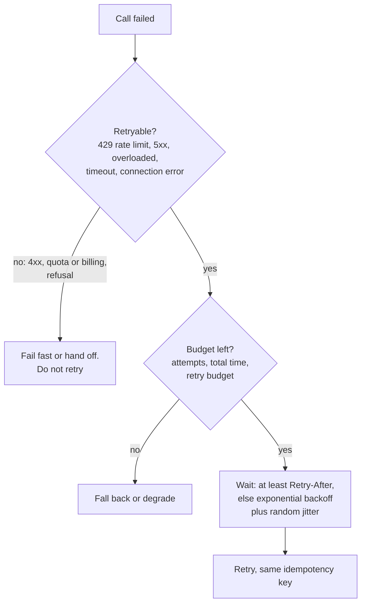
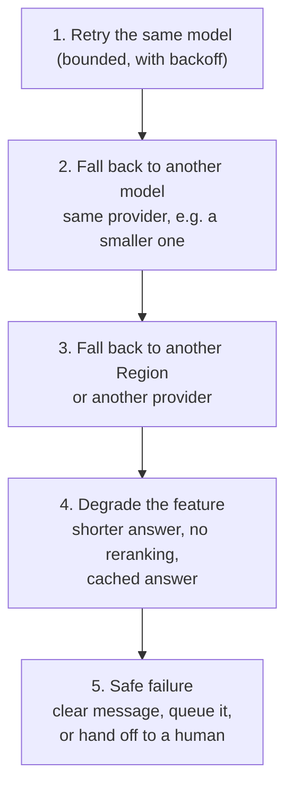
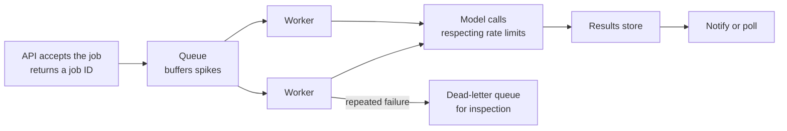
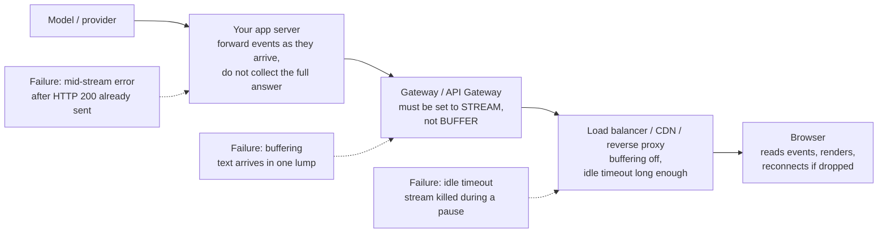

# Chapter 35: Reliability, Scaling and Streaming

> **Numbers here are illustrative.** Quotas, limits, timeouts and default behaviours differ by provider and change often. I use round, made-up figures so you can follow the arithmetic. Facts that can change are marked "(as of Nov 2026)" and link to the source. Check the live docs and your own account's quotas before you plan a launch.

## 1. The concept, from scratch

[Chapter 31](../31-cost-latency-and-caching/README.md) was about spending less and being fast. [Chapter 32](../32-observability-and-llmops/README.md) was about seeing what happens. [Chapters 33](../33-inference-engineering/README.md) and [34](../34-self-hosting-open-weight-models/README.md) opened the model-serving box. This chapter is about the question every production system eventually faces: **what happens when traffic spikes, a provider has a bad hour, or a connection drops in the middle of an answer?**

**Reliability** means the system keeps doing its job under stress and failure, or fails in a way you chose. **Scaling** means handling more load without falling over or overspending. **Streaming** means sending the answer to the user as it is produced, which makes the product feel fast but creates its own engineering problems.

### Why LLM systems fail differently

A normal web dependency answers in milliseconds, costs almost nothing per call, and returns the same thing each time. An LLM dependency is different in five ways that shape everything below:

1. **It's slow.** A call takes seconds, sometimes minutes. Requests pile up, and connections stay open for a long time.
2. **It's limited by tokens, not just requests.** You hit **tokens-per-minute** quotas long before you hit a requests-per-second limit.
3. **Failures are often partial.** A stream can die after the user has already read half the answer.
4. **Retrying costs real money and adds load.** A failed call may still have used tokens, and thousands of clients retrying together can make an outage worse.
5. **Agents act on the world.** A retried tool call can charge a card twice ([Chapter 19](../19-tool-calling/README.md)).

Every box can fail, and the shaded ones are where LLM systems get surprised: proxies that buffer streams or time out, a gateway or quota that throttles, a model that is slow or overloaded, and queues that back up.

### Failures: what they mean and what to do

Don't treat "an error" as one thing. The right reaction depends on the kind.

| Failure | Typical meaning | Retry? |
|---|---|---|
| **429, rate limit** | You exceeded requests, input tokens or output tokens per minute. Often includes a `Retry-After` header | Yes, after waiting at least the stated time |
| **429, spend cap or quota exhausted** | You hit a billing or monthly limit. Anthropic's docs show this returns a 429 with **no** `Retry-After`, and retrying fails until access resumes | **No.** Alert a human |
| **5xx or "overloaded" (for example 529)** | The provider is temporarily busy or failing | Yes, with backoff and a cap |
| **Timeout** | Slow, not necessarily failed. The work may still be running | Carefully: you may pay twice |
| **4xx, bad request** | Your request is wrong (too long, invalid format) | **No.** Fix it |
| **Mid-stream error** | The stream began, then failed | Depends: see the streaming section |
| **Bad output** (invalid JSON, empty) | The call "succeeded" but is unusable | Retry once, perhaps with a repair prompt ([Chapter 9](../09-prompt-engineering/README.md)) |
| **Refusal or guardrail block** | Working as designed | No. Handle in the product ([Chapter 29](../29-guardrails-and-ai-security/README.md)) |

(Sources, as of Nov 2026: [Anthropic rate limits](https://platform.claude.com/docs/en/api/rate-limits), [Anthropic errors](https://platform.claude.com/docs/en/api/errors), [OpenAI rate limits](https://developers.openai.com/api/docs/guides/rate-limits).)

### Rate limits and capacity: do the arithmetic

Providers limit you on several dimensions at once. Anthropic, for example, measures requests per minute, input tokens per minute and output tokens per minute, uses a **token bucket** (capacity refills continuously rather than resetting on the clock), and also applies **ramp limits** that can return a 429 after a sharp jump in usage even if you're under your per-minute limits ([Anthropic: rate limits](https://platform.claude.com/docs/en/api/rate-limits), as of Nov 2026). On Amazon Bedrock, quotas are tracked **per model, per Region**, with tokens per minute (input and output combined) tracked separately for on-demand use and for cross-Region inference ([AWS: Bedrock quotas](https://docs.aws.amazon.com/bedrock/latest/userguide/quotas-runtime.html)).

So capacity planning is a unit conversion. **A worked example** with made-up numbers: at peak you expect **5 requests per second**, each using about **6,500 tokens** in and out.

> 5 × 6,500 = 32,500 tokens per second × 60 = **1.95 million tokens per minute**

If your quota is 1 million tokens per minute, you will be throttled at peak even though 5 requests a second sounds tiny. This is the single most common surprise in launches.

A Bedrock detail worth knowing for interviews: AWS explains that token-based throttling counts input tokens, output tokens **and the tokens reserved by `max_tokens`**. If you don't set `max_tokens`, it can default to the model's maximum output (AWS's example is 64,000 tokens for one Claude model), so a modest request can reserve far more quota than it uses ([AWS: optimise for scale on Bedrock](https://aws.amazon.com/blogs/machine-learning/optimize-your-applications-for-scale-and-reliability-on-amazon-bedrock)). **Set `max_tokens` to a realistic value.**

The ways to get more capacity, roughly in order of effort:

1. **Use fewer tokens.** Trim prompts, retrieve fewer chunks, cap outputs ([Chapter 31](../31-cost-latency-and-caching/README.md)). Also cache safe answers.
2. **Request a higher quota** through the provider or AWS Service Quotas. Do it weeks before launch, not on the day.
3. **Spread across capacity pools.** On Bedrock, cross-Region inference profiles route requests across multiple Regions. A geographic profile keeps traffic inside a group of Regions, while a global profile routes across all supported commercial Regions and, per AWS's docs, is positioned for cost optimisation. Check the data-residency implications first ([Chapter 30](../30-privacy-governance-and-compliance/README.md); [AWS: cross-Region inference](https://docs.aws.amazon.com/bedrock/latest/userguide/cross-region-inference.html)).
4. **Buy dedicated capacity,** such as Bedrock Provisioned Throughput, or run your own GPUs for the steady base load ([Chapter 34](../34-self-hosting-open-weight-models/README.md)).
5. **Split by model and provider,** sending easy requests to cheaper, higher-limit models ([Chapter 36](../36-llm-gateways-and-routing/README.md)).

### Retries done right

Retries are the first tool, and the easiest to misuse. AWS's engineers call retries "selfish": each retry spends more of the server's time to improve your own odds. Used badly, they turn a small problem into an outage.

The rules:

- **Retry only transient errors.** Never retry quota, billing or invalid-request errors. OpenAI's guide says exactly this: don't retry errors that need you to act.
- **Exponential backoff:** wait longer after each failure (for example 1 s, 2 s, 4 s...), with a **cap**.
- **Add jitter:** randomise the wait. If a thousand clients all hit a limit together and all retry after exactly two seconds, they stampede the server in lockstep again. AWS's simulations showed that adding jitter substantially reduces client work and server load compared with backoff alone ([AWS: exponential backoff and jitter](https://aws.amazon.com/blogs/architecture/exponential-backoff-and-jitter/)).
- **Respect `Retry-After`** as a minimum, and add a small random delay on top (OpenAI's advice).
- **Limit both the attempts and the total time.** A user will not wait two minutes for a chatbot.
- **Use a retry budget.** Cap retries to a small fraction of normal traffic, so that during an outage you don't multiply your load. AWS's Builders' Library describes a token bucket for local retries for this reason ([AWS: timeouts, retries and backoff with jitter](https://aws.amazon.com/builders-library/timeouts-retries-and-backoff-with-jitter/)).
- **Beware nested retries.** The SDK retries, your application retries, and the gateway retries. Anthropic's SDK, for example, retries transient errors twice by default, which is three attempts. If your application also tries three times, one user request can become **nine** model calls. Choose one layer to own retries and turn the others off or account for them.
- **Make retried actions idempotent** (below).

### Timeouts

A timeout stops a stuck call from holding a worker forever. For LLM calls you need several, not one:

- **Time to first token:** if nothing arrives in a few seconds, something is wrong.
- **Idle gap between tokens in a stream:** a stream that goes silent mid-answer is stuck.
- **Total deadline** for the whole user request, including every retry and every agent step. Pass the remaining time down so deeper calls don't outlive the user's patience.

For long generations, use **streaming** rather than one huge blocking call. Anthropic's docs recommend the streaming API for long-running requests ([Anthropic: errors](https://platform.claude.com/docs/en/api/errors), as of Nov 2026).

### Fallbacks, circuit breakers and graceful degradation

When retries are not enough, you need somewhere else to go. Plan the ladder before you need it.

Points to be ready to discuss:

- **A fallback model is not a free swap.** Different models respond differently to the same prompt, so test the fallback on your evaluation set in advance ([Chapter 26](../26-evaluation-fundamentals/README.md)), including its output format and tool-calling behaviour.
- **Check the rules first.** Falling back to another Region or provider may breach residency or contract terms ([Chapter 30](../30-privacy-governance-and-compliance/README.md)).
- **Circuit breaker.** After repeated failures, **stop calling** the failing dependency for a cooling-off period and go straight to the fallback. It has three states: *closed* (normal), *open* (blocked, fail fast), and *half-open* (let a trial request through to test recovery). AWS's guidance on Bedrock throttling recommends this pattern so you don't make a bad situation worse.
- **Graceful degradation.** Decide in advance what to switch off under stress: expensive reasoning modes, long context, reranking, optional tools, long outputs.
- **Load shedding and priorities.** When you can't serve everyone, reject early and clearly (a 429 or 503 with `Retry-After`) rather than letting every request queue forever. Protect high-priority traffic (interactive users, safety-critical flows) over low-priority (batch jobs, free tier).
- **Availability maths.** If a request needs three dependencies in a row and each is 99.9% available, the chain is about 99.7% (0.999 × 0.999 × 0.999). Two *independent* providers in parallel can do much better in theory, but outages are often correlated (shared Region, shared overload), so don't count on the textbook figure.

### Scaling: concurrency, queues and the long-connection problem

Because calls are slow, you need many more concurrent connections than you'd expect. **Little's law** gives the sizing rule: concurrent requests = arrival rate × time each takes. If **100 requests per second** each hold a streaming connection for **10 seconds**, you have about **1,000 requests in flight** at once. Your servers must hold open that many connections cheaply, so use asynchronous I/O, not one thread per request.

For work nobody is waiting on, don't make users hold a connection. Put it on a **queue**:

A queue smooths bursts, lets you control how fast you call the model (so you stay under the quota), retries safely, and isolates a failure to one job. Add a **dead-letter queue** for jobs that keep failing, and a **priority** lane for interactive work. On AWS, this is typically Amazon SQS with workers, and long-running multi-step agent work benefits from durable orchestration that **checkpoints** progress so a crash doesn't restart the whole task ([Chapter 22](../22-orchestration-and-harnesses/README.md), [Chapter 25](../25-agent-reliability-and-learning/README.md)). For batch-style workloads, provider batch APIs are even cheaper ([Chapter 31](../31-cost-latency-and-caching/README.md)).

Also plan **per-tenant limits** so one customer's spike can't use everyone's quota ([Chapter 37](../37-cloud-reference-architectures-and-multi-tenancy/README.md)), and scale self-hosted GPUs on queue depth and KV cache use, not CPU ([Chapter 34](../34-self-hosting-open-weight-models/README.md)).

### Idempotency: safe retries for agents

If an agent's tool call is retried after a timeout, did the first attempt happen? Maybe. With a plain "charge the card" call, the answer could be a double charge. The fix is **idempotency**: the operation is designed so that doing it twice has the same effect as doing it once. The usual way is an **idempotency key**: the caller attaches a unique ID to the request, and the receiving system records it and returns the original result if it sees the same key again. Distributed systems can't promise "exactly once", but they can do **at-least-once delivery plus idempotent handling**. Also save a record of what each agent step did, so a restart can resume rather than repeat ([Chapter 25](../25-agent-reliability-and-learning/README.md)), and require human approval for irreversible actions ([Chapter 24](../24-agent-user-interaction/README.md)).

### Streaming

[Chapter 31](../31-cost-latency-and-caching/README.md) explained that streaming improves how fast the answer *feels*. Now the engineering.

**What it is.** The server sends the answer in small pieces as the model generates them. The common web mechanism is **Server-Sent Events (SSE)**: an ordinary HTTP response with the content type `text/event-stream`, kept open, where the server writes small text messages separated by blank lines, and the browser reads them as they arrive. It is one-way (server to client), reconnects automatically in browsers, and lines starting with a colon are comments that can serve as keep-alives ([MDN: server-sent events](https://developer.mozilla.org/en-US/docs/Web/API/Server-sent_events/Using_server-sent_events)).

**SSE or WebSockets?** Token streaming is one-way, so SSE is usually simpler: plain HTTP, works with most infrastructure, easy to debug. **WebSockets** give a two-way channel and suit things like live voice, interrupting the model mid-answer, or collaborative sessions, at the cost of more infrastructure complexity (stateful connections, harder load-balancing). Pick the simplest that meets the product need.

Provider streams are made of typed events. Anthropic's, for example, begin with a start event, then send content deltas, periodic pings, and a final stop event, and **may send an error event inside the stream** ([Anthropic: streaming](https://platform.claude.com/docs/en/build-with-claude/streaming), as of Nov 2026).

The path from model to screen has many hops, and each can break streaming.

**The common problems and their fixes**

1. **Buffering.** Proxies and gateways often hold a response until it is complete, or until a buffer fills. nginx buffers proxied responses by default, and you can turn that off with `proxy_buffering off` or by returning an `X-Accel-Buffering: no` header ([nginx: proxy module](https://nginx.org/en/docs/http/ngx_http_proxy_module.html)). On Amazon API Gateway REST APIs, the default response transfer mode is `BUFFERED`, and you must set it to `STREAM` for streaming integrations such as Lambda response streaming ([AWS: API Gateway response streaming](https://docs.aws.amazon.com/apigateway/latest/developerguide/response-transfer-mode.html), as of Nov 2026). The symptom is always the same: the whole answer arrives in one lump, so you've lost the benefit.
2. **Idle timeouts.** Load balancers, gateways and CDNs close connections that look idle. API Gateway documents idle timeouts for streams (about five minutes on Regional endpoints and 30 seconds on edge-optimised ones, as of Nov 2026), and Application Load Balancers have a configurable connection idle timeout. A model "thinking" silently for a while can look idle, so send **keep-alive** comments or ping events, and raise timeouts where appropriate.
3. **Errors after the status code is sent.** Once the first byte is out, the HTTP status is already 200. A failure later must be reported **inside the stream** as an error event, and your client must handle it. This is why a stream can "succeed" at the HTTP level and still fail the user.
4. **The user disconnects.** If the browser closes, **cancel the upstream model call**. Otherwise you keep paying for tokens and holding GPU or quota that nobody will read.
5. **Guardrails.** Chapter 29's output checks need the full text, but streaming shows text before it exists. The options: check **before** streaming (adds delay), stream while checking chunks and be ready to **retract** or cut the stream if something trips, or stream only for low-risk flows and buffer for high-risk ones. Decide deliberately ([Chapter 29](../29-guardrails-and-ai-security/README.md)).
6. **Structured output and tool calls.** A partial JSON object is not valid JSON. Either wait for the full object, or use a parser built for incremental input.
7. **Reconnection and ordering.** Mobile networks drop. SSE supports event IDs so a reconnecting client can say where it left off, but model providers can't resume a half-finished generation. In practice, you either replay what you saved or restart.

**When a stream fails halfway,** the user has already read part of an answer. Reasonable designs: keep the partial text visible and mark it clearly as interrupted with a retry button; or retry quietly and replace the text if you can do it quickly; save what you have so a later retry can continue from the conversation. Never silently present a truncated answer as complete.

### Test the failure paths

Reliability you haven't tested is a guess.

- **Load test with realistic token sizes,** not tiny prompts. Mix short and very long requests.
- **Inject failures:** simulated 429s, 5xx errors, timeouts, slow tokens and mid-stream cuts ([Chapter 27](../27-evaluating-rag-and-agents/README.md)).
- **Game days:** rehearse "the provider is down" and "traffic is five times normal", and check that fallbacks, alerts and runbooks work ([Chapter 32](../32-observability-and-llmops/README.md)).
- **Set service level objectives** that include time to first token and quality, and alert on the early signals: queue depth, 429 rate, retry rate, circuit-breaker state, quota usage.

## 2. Analogies across industries

- **The fallback ladder is airline rebooking (travel).** When a flight is cancelled, the airline tries the next flight on the same carrier, then a partner airline, then a hotel voucher, then a refund. Each step is worse for the customer but better than being stranded. Your ladder is retry, smaller model, other Region or provider, degraded answer, human handoff.
- **Load shedding is a virtual waiting room at a sale (e-commerce).** When a launch drives more shoppers than the site can handle, a waiting room lets some in and holds the rest, instead of letting everyone crash the checkout. Better a short, honest queue than an outage for all.
- **Overload control in a phone network (telecom).** When a network is swamped (for example after a disaster), it deliberately blocks new calls so that calls already connected, and emergency calls, still work. That is **priority-based load shedding**: protect important traffic by rejecting the rest early.
- **Priority queues are a hospital's emergency department (healthcare).** Patients are seen by urgency, not arrival order, so a flood of minor cases can't starve a critical one. Your interactive and safety-critical requests go in the fast lane, and batch jobs wait.

## 3. How it's used in industry

- **E-commerce peak season.** A retailer's shopping assistant sees many times normal traffic on a sale day. It trims prompts, serves approved FAQ answers from a guarded cache, spreads load across Regions, and puts non-urgent jobs such as review summarisation on a queue until the rush is over.
- **Travel disruption.** When storms cancel flights, an airline's rebooking assistant is flooded within minutes. It degrades non-essential features, prioritises customers with imminent departures, and hands off to human agents when the assistant is rate-limited rather than leaving customers with errors.
- **Telecom outage-day support.** A carrier's support chat surges when its own network has a problem. It sheds low-priority traffic early with a clear message, streams answers so people see progress, and cancels generation immediately for users who leave.
- **Insurance claims backlog.** An insurer processes thousands of claim documents after a regional storm. Documents go onto a queue, workers pace themselves to the provider's token quota, repeatedly failing documents land in a dead-letter queue for review, and every step is idempotent so retries can't double-process a claim.

## 4. Common misconceptions

- **"Just retry on every error."** Retrying quota, billing or bad-request errors is useless, and retrying everything amplifies outages. Retry only transient errors, with backoff, jitter and a budget.
- **"More retries mean more reliability."** Past a small number they mostly add load and delay. Nested retry layers multiply, so one request can become many.
- **"Rate limits are about requests per second."** Token limits usually bite first, and some providers also apply ramp limits to sudden growth.
- **"We can just scale out the servers."** Your app tier can, but the **quota** and the **GPUs** are the real ceilings.
- **"A fallback model is a drop-in replacement."** It can behave differently, so test it, and check that it is allowed by your data rules.
- **"A 200 status means the stream worked."** Errors can arrive after the 200, inside the stream.
- **"Streaming is just a flag."** It touches proxies, gateways, timeouts, guardrails, cancellation and client code.
- **"Exactly-once is achievable."** Aim for at-least-once delivery with idempotent handling.
- **"Two providers give us 99.9999%."** Only if their failures are independent, which they often aren't.

## 5. Interview questions

### 1. How do you handle rate limits from a model provider?

I'd treat them as a normal operating condition, not an exception. First, I'd know my limits and do the arithmetic: peak requests per second times tokens per request gives tokens per minute, and I compare that to the quota, because token limits usually bite first. In the code, I'd retry rate-limit errors with exponential backoff and jitter, wait at least as long as the `Retry-After` header says, and cap the attempts and total time. I'd smooth traffic with a queue or a client-side limiter so I stay under the quota, set realistic maximum output tokens so I don't reserve more quota than I need, and request higher quotas well before launch. Beyond that I'd have fallbacks, such as another model or Region, and alerts on the 429 rate so I see pressure before users do.

### 2. Which errors should you retry and which shouldn't you?

I retry transient ones: rate limits, 5xx errors, an overloaded response, timeouts and connection errors. I don't retry errors that won't change on a second attempt, like a bad request, an authentication error, or a quota or billing limit that needs a person to act. Anthropic's docs show that hitting a spend cap comes back as a 429 without a retry-after header, and retrying just fails until access resumes, so I'd look at the error details, not only the status code. Also, I don't retry refusals or guardrail blocks, because they're working as designed. And for anything that has side effects, I only retry if the operation is idempotent.

### 3. Why use exponential backoff with jitter?

Backoff spaces retries further apart each time, which gives an overloaded service room to recover instead of hammering it. But backoff alone has a problem: if a thousand clients fail at the same moment, they all wait the same time and retry together again, creating repeated spikes. Jitter adds randomness to the wait so the retries spread out. AWS's own simulations showed that adding jitter greatly reduces the work clients do and the load on the server compared with backoff alone. I'd cap the delay and the number of attempts, and I'd honour any `Retry-After` header as a minimum.

### 4. What is a retry storm, and how do you avoid one?

It's when failures cause retries, retries add load, the extra load causes more failures, and the system spirals. The classic trigger is many clients retrying in sync, or several layers each retrying. For example, an SDK that retries twice, plus my application retrying three times, plus a gateway retrying, can turn one user request into a dozen model calls. To avoid it I'd retry only transient errors, use backoff with jitter, cap attempts and total time, use a retry budget so retries stay a small fraction of normal traffic, and make exactly one layer responsible for retries. And I'd add a circuit breaker so that when a dependency is clearly down, I stop calling it and go to a fallback.

### 5. What's a circuit breaker, and how would you use it with LLM calls?

It's a pattern that stops you repeatedly calling something that is failing. It has three states. Closed is normal. After enough failures it opens, and calls fail fast or go straight to a fallback, which gives the dependency time to recover and saves my users from long timeouts. After a cooling-off period it goes half-open and lets a trial request through, and if that succeeds it closes again. For LLM calls I'd put one around each provider, model or Region, using error rate and latency as the signals, and connect it to my fallback ladder, so that when the primary model's breaker opens, traffic moves to a secondary model that I've already evaluated.

### 6. Your model provider has an outage. What happens to your application?

It should degrade, not collapse, and I'd have designed that in advance. A circuit breaker notices the failures and opens, so requests don't wait on timeouts. The fallback ladder takes over: a second model from the same provider, if the outage is limited to one model, then another Region or another provider, if my data rules allow it, and I'd have tested those fallbacks on my evaluation set beforehand. If nothing is available, I'd degrade the feature, with a shorter answer, a cached answer for common questions, or a clear message with a queue or handoff to a human. Alerts fire, the status goes on the dashboard, and afterwards I'd review it in a postmortem. The important thing is that the failure mode was chosen, not accidental.

### 7. How do you stream LLM tokens to a browser, and when would you use WebSockets instead of SSE?

For normal chat I'd use Server-Sent Events. It's an ordinary HTTP response with content type text/event-stream, where the server writes small messages as tokens arrive and the browser reads them as they come. It's one-way, which is all token streaming needs, the browser reconnects automatically, and it works with most infrastructure. I'd use WebSockets when I need a genuinely two-way channel, like real-time voice, letting the user interrupt the model mid-answer, or collaborative sessions, accepting the extra complexity of stateful connections and load balancing. On the server I'd forward each event from the model as it arrives instead of collecting the full answer first, and I'd send periodic keep-alive messages.

### 8. How do you stream through proxies and gateways without the response being buffered?

I'd go hop by hop, because any one of them can buffer. In my app, forward chunks immediately. At a reverse proxy like nginx, which buffers by default, I'd turn buffering off for that route, either in the config or with a response header. On Amazon API Gateway REST APIs the default transfer mode is buffered, so I'd switch the integration to stream mode. I'd check each hop's idle timeout, since a pause in generation can look like an idle connection, and send keep-alive comments or pings. Then I'd test it end to end, from a real client, by watching when the first chunk appears versus the last, because a stream that arrives in one lump has all the cost and none of the benefit.

### 9. What do you do if a stream fails halfway through, and how does streaming interact with output guardrails?

The HTTP status was already 200 by then, so the failure has to be signalled inside the stream, and the client must handle an error event. In the UI I'd keep the partial text, clearly mark it as interrupted, and offer a retry, or retry quietly and replace it if that's fast, and I'd never present a cut-off answer as complete. I'd also save what was produced. For guardrails, the tension is that output checks want the whole answer but streaming shows text early. My options are to check before streaming, which adds delay, to stream while checking chunks and be ready to retract or cut the stream, or to buffer only the high-risk flows. I'd decide per flow based on the harm if bad text is briefly visible.

### 10. AI traffic is expected to grow a hundred times. How do you prepare?

I'd start by measuring tokens, not requests, because that's what the limits and costs track: how many tokens per request, what the peak looks like, and which parts of the traffic are interactive versus background. Then I'd reduce what each request needs, with prompt caching, trimmed context, concise outputs and a guarded cache for common answers. I'd move non-interactive work to queues and batch APIs. I'd split traffic across models, routing easy requests to cheaper, higher-limit ones. For capacity, I'd request higher quotas early, spread across Regions or providers where the rules allow, and consider dedicated capacity or self-hosting for the steady base load. I'd add per-tenant limits, load shedding and fallbacks, test with realistic load and injected failures, and set budgets and alerts so cost doesn't grow by a hundred times too.

### 11. How do you make agent actions safe to retry?

By making the operations idempotent. When the agent calls a tool that changes something, like creating an order or sending a payment, I attach a unique idempotency key to the request, and the receiving system remembers it and returns the original result if it sees the same key again. That way a retry after a timeout can't create a duplicate. I'd design for at-least-once execution plus idempotent handling, since exactly-once isn't realistically achievable. I'd also checkpoint the agent's progress, so a restart resumes instead of repeating steps, set timeouts and step limits, and require human approval for actions that can't be undone.

## 6. Scenario exercise

An online fashion retailer runs a shopping assistant on one model from one provider in a single Region. Three weeks from now is its biggest sale of the year, and marketing expects peak traffic of about **five times** the normal peak. Today at normal peak, which is about 4 requests per second at roughly 6,000 tokens each, the team already sees occasional 429 errors, and the provider quota is about 1.5 million tokens per minute. Answers stream through a CDN and a load balancer. The team says: "We'll just ask for a higher quota and add retries."

**Your task:** What's wrong with that plan, and what would you do in the three weeks? Answer from memory, then compare.

Model answer

I'd say a quota increase and retries are two useful pieces of a plan, but not a plan. Let me do the arithmetic first. Today's peak is 4 requests per second times 6,000 tokens, which is 24,000 tokens per second, or about 1.44 million per minute. That's already almost the whole 1.5 million quota, which explains the occasional 429s. Five times that is about 7.2 million tokens per minute. So a modest quota bump won't be enough, and retries would make it worse: when you're over a limit, retrying adds load, and unsuccessful requests can still count against you. I'd also want to know whether they set a maximum output length, because on some platforms the reserved output tokens count toward the quota.

So the plan is to reduce what we need, increase what we have, and survive what's left. To reduce demand: trim the prompt, since 6,000 tokens per request is a lot, by retrieving fewer, reranked chunks and tightening the system prompt; cap output length; use prompt caching for the stable prefix; and serve approved answers to common questions, such as shipping times and returns policy, from a guarded cache scoped by policy version. If that takes the average to 4,000 tokens and removes 30% of requests, then the peak is about 14 requests per second, times 4,000 tokens, or about 3.4 million tokens per minute. That's less than half the raw number, though still well over the current quota.

To increase capacity: request a quota increase now, since approvals can take time, and spread load by using a second Region or a cross-Region profile, if our data rules allow, and possibly a second model or provider for the easy traffic, like order status and FAQs, which also gives us a fallback. If the volume justifies it, consider dedicated capacity for the base load.

To survive the rest: build the fallback ladder and test it on the evaluation set, so a smaller or alternate model takes over when the primary is throttled; add a circuit breaker; add load shedding with priorities, so checkout-related help stays responsive and low-value traffic, like product-review summaries, goes on a queue or is switched off for the day; and make exactly one layer responsible for retries, with backoff, jitter and a budget, so we don't create a retry storm. I'd also write the graceful degradation plan in advance: shorter answers, no reranking, cached recommendations.

For streaming, I'd verify end to end that the CDN and load balancer aren't buffering and that their idle timeouts are compatible, and that closing the browser cancels the upstream call so we don't pay for abandoned answers. I'd put a per-user rate limit in place to prevent abuse.

In the last week, I'd run load tests with realistic token sizes at, say, one and a half times the expected peak, inject 429s and a provider slowdown, and rehearse the runbook. Dashboards and alerts for token use against quota, 429 rate, retry rate, circuit-breaker state, TTFT and cost per hour would be live. I'd tell the client that the biggest risk is the quota and provider capacity, not our servers, and that we should have a decision point a week out: if the increased quota isn't confirmed, we switch to the degraded mode by default for the sale.

## 7. Key takeaways

- **LLM dependencies are slow, token-limited, costly to retry and sometimes fail halfway.** Do the arithmetic from requests per second to tokens per minute before you launch.
- **Retry only transient errors,** with exponential backoff, jitter, `Retry-After`, a cap and a budget, and own retries in exactly one layer. Never retry quota or billing errors.
- **Plan a fallback ladder** (retry, another model, another Region or provider, degrade, hand off), protected by circuit breakers and load shedding, and test the fallbacks on your evaluation set.
- **Scale with concurrency maths and queues,** and make agent actions idempotent, because exactly-once doesn't exist but at-least-once with idempotency does.
- **Streaming is a systems problem:** turn off buffering at every hop, handle idle timeouts, signal errors inside the stream, cancel upstream on disconnect, and decide how guardrails work on partial text.

## 8. Further reading

- AWS Builders' Library, [Timeouts, retries and backoff with jitter](https://aws.amazon.com/builders-library/timeouts-retries-and-backoff-with-jitter/): the standard reference on retry storms and how to avoid them.
- AWS Architecture Blog, [Exponential backoff and jitter](https://aws.amazon.com/blogs/architecture/exponential-backoff-and-jitter/): the simulations showing why jitter matters.
- AWS Machine Learning Blog, [Optimize your applications for scale and reliability on Amazon Bedrock](https://aws.amazon.com/blogs/machine-learning/optimize-your-applications-for-scale-and-reliability-on-amazon-bedrock): throttling, quotas, retries and circuit breakers for Bedrock.
- Anthropic, [Rate limits](https://platform.claude.com/docs/en/api/rate-limits) and [Streaming messages](https://platform.claude.com/docs/en/build-with-claude/streaming): token buckets, ramp limits, and how stream events and errors work.
- MDN, [Using server-sent events](https://developer.mozilla.org/en-US/docs/Web/API/Server-sent_events/Using_server-sent_events): the SSE format, keep-alive comments and reconnection.
