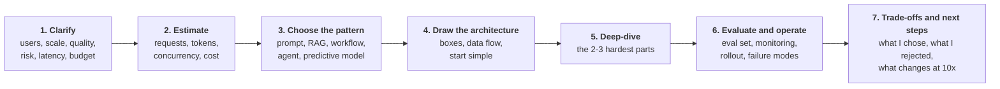
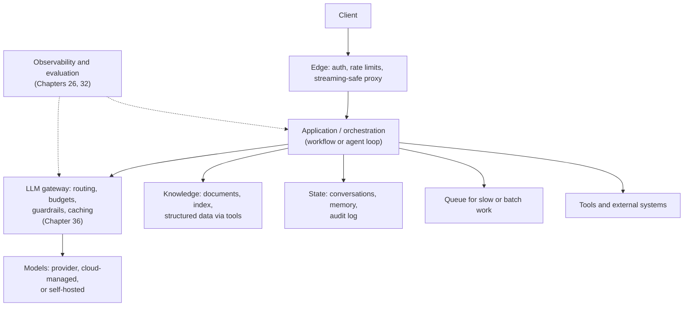
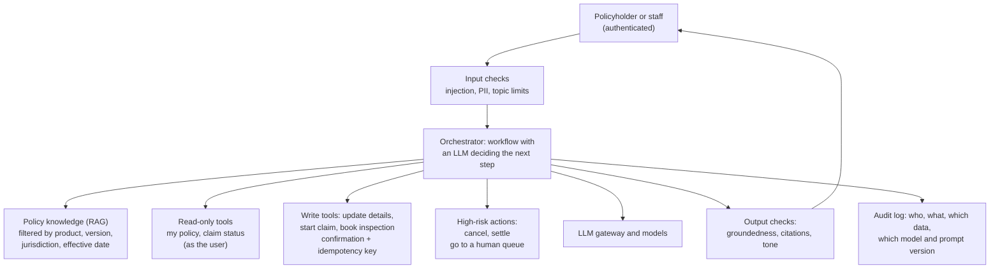
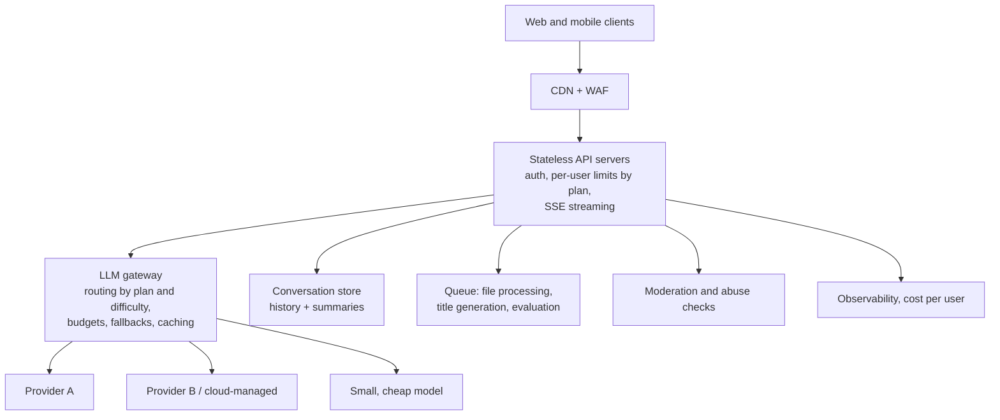
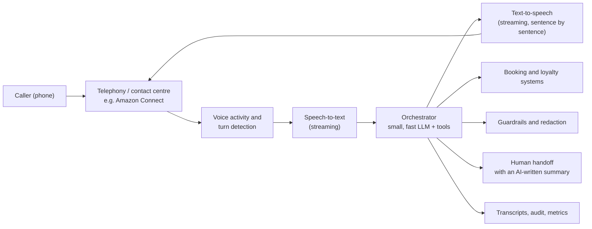
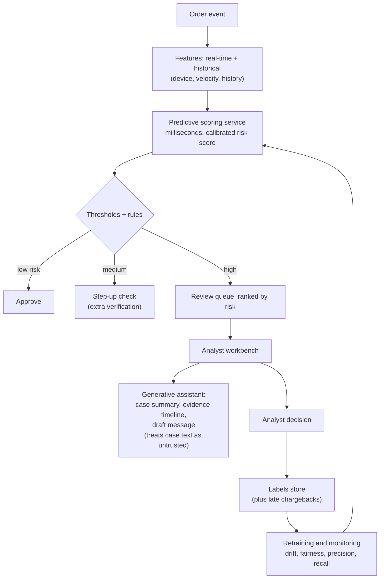

# Chapter 39: AI System Design

> **All numbers in the worked examples are illustrative assumptions,** chosen to be round so you can follow the arithmetic. In a real interview you state your own assumptions out loud and adjust. Product facts that can change are marked "(as of Nov 2026)" and link to the docs.

## 1. The concept, from scratch

Interviewers don't ask system design questions to see whether you've memorised one architecture. They ask to see **how you think**: whether you ask before you build, whether you size the problem, whether you pick the simplest thing that works, whether you spot the risks, and whether you can explain trade-offs clearly. The same method works for any prompt, so this chapter teaches the method first and then runs it on four cases.

Every earlier chapter is a component. This chapter is the order in which you put them on the whiteboard.

### The method: seven steps

A rough time budget for a 45-minute interview: clarify about 5 minutes, estimate about 5, pattern and architecture about 10, deep-dives about 15, evaluation and operations about 5, and trade-offs about 5. Keep the clock in mind. The most common failure is spending 30 minutes drawing boxes and leaving none for evaluation, risk or trade-offs.

### Step 1: Clarify

Never start drawing. Ask **five to eight** questions, then **say your assumptions out loud** so the interviewer can correct them. The questions, by theme:

| Theme | What to ask |
|---|---|
| **Users and use** | Who uses it, for what task, in which channel? What do they do today? |
| **Scale** | How many users, requests per day, peak versus average? Growth? |
| **Quality and risk** | How bad is a wrong answer? Is a human in the loop? Any regulated content? |
| **Latency** | Does a person wait? How long is acceptable? Does it need to stream? |
| **Data** | What knowledge or records does it need? How fresh, how sensitive, who may see what? |
| **Actions** | Does it only answer, or can it change things? Are the actions reversible? |
| **Constraints** | Budget, Region and residency, existing systems, team size, cloud |
| **Success** | How will we know it works? What number would the sponsor care about? |

If the interviewer says "you decide", say "I'll assume X, Y and Z", and move on. That's a good answer, not a weak one.

### Step 2: Estimate

A back-of-the-envelope estimate shows you think about reality. The chain:

> users → active users → requests per day → average and **peak** requests per second → tokens per request (input and output) → **tokens per minute** at peak → **concurrent connections** → **cost** per request and per month

Two formulas to remember. For concurrency, use **Little's law**: requests in flight = arrival rate × time each takes ([Chapter 35](../35-reliability-scaling-and-streaming/README.md)). For cost, use input tokens × input price + output tokens × output price, summed over calls ([Chapter 31](../31-cost-latency-and-caching/README.md)). The estimate tells you what's hard: if peak tokens per minute exceeds a provider's quota, you have a capacity problem. If cost per user exceeds what a user pays, you have an economics problem.

### Step 3: Choose the pattern

Use the sequence from [Chapter 38](../38-forward-deployed-engineering/README.md): rules or existing software first, then a predictive model for scores, then prompting a general model, then RAG for company knowledge, then a workflow for fixed steps, and an agent only for open-ended work with tools. Fine-tune only when evidence says so ([Chapter 17](../17-rag-vs-fine-tuning-vs-long-context/README.md), [Chapter 18](../18-from-llm-calls-to-agents/README.md)). **Say why you rejected the alternatives.** That sentence is worth more than the choice itself.

### Step 4: Draw the architecture

Draw the **simplest thing that could work**, then evolve it. A good default skeleton for most AI systems:

Name each box's job in one sentence, show the data flow with arrows, and mark where **identity and permissions** are enforced ([Chapter 15](../15-enterprise-rag/README.md)). Cloud specifics (as in [Chapter 37](../37-cloud-reference-architectures-and-multi-tenancy/README.md)) go on a second pass, once the logic is agreed.

### Step 5: Deep-dive the hard parts

Don't try to cover everything. **Pick the two or three parts where this problem is hard** and go deep. The usual candidates:

- **Retrieval quality and permissions** (RAG systems): chunking, hybrid search, reranking, metadata, citations ([Chapters 12-15](../12-ingestion-and-chunking/README.md)).
- **Safety of actions** (agents): approval, idempotency, least privilege, injection ([Chapter 19](../19-tool-calling/README.md), [Chapter 29](../29-guardrails-and-ai-security/README.md)).
- **Latency** (interactive and voice): streaming at every stage, caching, small models ([Chapter 31](../31-cost-latency-and-caching/README.md), [Chapter 33](../33-inference-engineering/README.md)).
- **Scale and cost** (consumer apps): quotas, routing, queues, fallbacks ([Chapter 35](../35-reliability-scaling-and-streaming/README.md), [Chapter 36](../36-llm-gateways-and-routing/README.md)).
- **Decision quality** (scoring and triage): thresholds, delayed labels, drift, fairness.

### Step 6: Evaluate and operate

This is where many candidates stop early, and where strong ones stand out. Say how you would **measure** the system (an evaluation set built from real cases, retrieval and answer metrics, outcome and trajectory checks for agents; [Chapter 26](../26-evaluation-fundamentals/README.md), [Chapter 27](../27-evaluating-rag-and-agents/README.md)), how you'd **monitor** it in production and detect drift ([Chapter 32](../32-observability-and-llmops/README.md)), how you'd **roll out** safely (shadow, canary, human in the loop), and **what happens when it fails** (fallbacks, degradation, a human route).

### Step 7: Trade-offs and next steps

Finish by summarising the key decisions, what you rejected and why, the main risks, and what you'd do at ten times the scale. A sentence like "I chose X over Y because Z, and I'd revisit if W" shows judgement.

### What interviewers listen for

- You asked before you designed, and stated assumptions.
- You sized the problem with numbers, even rough ones.
- You chose the simplest pattern that works and explained why not the others.
- You treated **evaluation, safety, cost and failure** as part of the design, not extras.
- You separated **deterministic code** from **probabilistic models** and used each where it belongs.
- You went deep on the right two or three things.
- You communicated clearly and checked in with the interviewer.

### Mistakes that sink answers

- Naming a model or tool in the first minute, before the problem is understood.
- Designing for a scale you never calculated.
- An agent, or fine-tuning, for something a prompt or workflow would do.
- No evaluation or monitoring story.
- Ignoring permissions, privacy and prompt injection.
- Describing only the happy path.
- Boxes without data flow, or a diagram nobody can follow.

## 2. Analogies across industries

- **Clarifying first is a travel agent asking about the trip (travel).** "Where, when, how many people, what budget, what matters most?" A good agent never books before asking, because the same destination means different trips for a honeymoon and a conference.
- **Estimating is sizing a fleet before you lease it (logistics).** A planner works out parcels per day, peak season, delivery windows and vehicle capacity before signing a contract. Skipping that is how you end up with too few trucks in December or a depot full of idle ones.
- **A voice latency budget is takt time on an assembly line (manufacturing).** If the line must produce a unit every 60 seconds, each station gets a slice, and if one station overruns, the whole line stalls. A voice assistant's response time is divided among speech detection, transcription, thinking, and speech synthesis in the same way.
- **Risk-based triage is airport and customs screening (government and travel).** Most passengers go through the normal lane, some are selected for extra checks, a few are stopped. A risk model with an approve, review or step-up outcome works the same way, and review capacity is the limit on how many can be pulled aside.

## 3. How it's used in industry: four worked examples

Each case below is a common real-world pattern from a different industry: insurance, consumer software, travel and e-commerce. Each one runs the seven steps, so you can see the method repeat while the hard parts change.

### Worked example 1: An enterprise assistant that can also take actions

**The prompt.** "Design an assistant for an insurer's policyholders and call-centre staff. It should answer questions about policies and be able to do things like update contact details, start a claim and book an inspection."

**Clarify and assume.** Users: policyholders in an app and staff in a console. Assume 2 million policyholders and 100,000 chats a day, with a modest peak. Wrong answers about cover are costly. Some actions are low risk (update an email address), some are higher risk (start a claim), and some must never be automatic (cancel a policy, settle a claim). Privacy and audit are mandatory, and the assistant must not give advice that is legally binding. Assume cloud, English plus two other languages.

**Pattern.** It's two problems. **Answering questions** about cover is RAG over policy documents. **Answering questions about *my* policy** ("what's my excess?") needs the document **and** the user's own policy data, which should come from an API call by a tool, not from the vector index. **Actions** are tool calls inside a **workflow with approvals**, not a free-roaming agent ([Chapter 18](../18-from-llm-calls-to-agents/README.md)). I'd reject fine-tuning (policy content changes, and citations matter) and a fully autonomous agent (risk).

**Deep-dives.**

1. **Retrieval and correctness.** Policy answers depend on product, version, jurisdiction and effective date, so I'd put those in metadata and filter on them before search, not after. Hybrid search and reranking, and cited answers with an **abstain** option when the documents don't support an answer ([Chapter 28](../28-hallucination-and-grounding/README.md)). Questions that combine documents and personal data use both sources and show which came from where.
2. **Safe actions.** Tools run **as the user** with their permissions, not a shared super-account ([Chapter 20](../20-agent-protocols-mcp-and-a2a/README.md)). Reads are free. Writes show a confirmation ("update your email to X?") and carry an **idempotency key** so a retry can't duplicate ([Chapter 35](../35-reliability-scaling-and-streaming/README.md)). High-risk actions are only *proposed* to a human. The principle to say aloud: **the model proposes, our code decides and acts.** Treat uploaded documents and retrieved text as untrusted, because they can carry injected instructions ([Chapter 29](../29-guardrails-and-ai-security/README.md)).
3. **Evaluation.** An evaluation set built with claims and policy experts. Retrieval metrics (recall at k), answer groundedness and citation accuracy, and for actions, outcome and trajectory grading: did it call the right tool with the right arguments and stop when it should ([Chapter 27](../27-evaluating-rag-and-agents/README.md)). Red-team injection and out-of-scope requests. Start in **suggest-only mode for staff**, then read-only for customers, then low-risk writes, earning autonomy in steps ([Chapter 38](../38-forward-deployed-engineering/README.md)).

**Trade-offs and risks.** Stricter safeguards slow the experience and lower automation. Citations and abstention reduce wrong answers but increase escalations. Costs are modest at this volume, and I'd cache the stable prefix and route simple intents to a smaller model ([Chapter 36](../36-llm-gateways-and-routing/README.md)). Privacy: redact before logging, retention limits, and an audit trail ([Chapter 30](../30-privacy-governance-and-compliance/README.md)).

### Worked example 2: A ChatGPT-style app for a million users (and the multi-tenant variant)

**The prompt.** "Design a general-purpose AI chat assistant for one million users."

**Clarify and assume.** One million **registered** users, with 20% active on a given day. A free tier and a paid tier. Features: chat with history, file upload, streaming. Web and mobile. No regulated data, but abuse and cost are concerns. Assume one Region to start.

**Estimate** (illustrative).

- Daily active users: 200,000. Messages per active user per day: 8. So **1.6 million messages a day**, an average of about **18.5 per second**.
- Assume the **peak is five times the average**, about **93 per second**.
- Per message: about 3,000 input tokens (history plus the new message) and 400 output tokens, so about 3,400 tokens. At peak that is roughly 316,000 tokens per second, about **19 million tokens per minute**. That's far above a typical default provider quota, which tells you capacity is the first hard problem.
- If a streamed answer takes about 10 seconds, concurrent streams at peak are about 93 × 10 = **930**. That's easily manageable for asynchronous servers.
- Cost with made-up prices of $3 per million input tokens and $15 per million output tokens: $0.009 + $0.006 = **$0.015 per message**, so about **$24,000 a day, or roughly $720,000 a month** if every message uses the large model. Per active user, that is about 240 messages × $0.015 = **$3.60 a month**, which a free tier can't afford.

**Pattern.** A plain LLM application with conversation state, optional tools and strong scale controls. No RAG is needed at first.

**Deep-dives.**

1. **Capacity and quota.** 19 million tokens per minute needs several levers together: request higher quotas early, spread across providers and Regions, and **route** traffic. Send free-tier and simple messages to a small, cheap model, and keep the large model for paid users and hard prompts ([Chapter 36](../36-llm-gateways-and-routing/README.md)). If 70% of messages go to a model that costs one-fifth as much, the blended cost per message drops from $0.015 to about $0.0066, a reduction of more than half, on these made-up numbers. That is an assumption to verify with evaluation, not a promise.
2. **Context and cost growth.** History makes every message more expensive than the last. **Summarise or compact** old turns, cap the context, and cache the stable prefix ([Chapter 7](../07-context-windows-and-context-engineering/README.md), [Chapter 31](../31-cost-latency-and-caching/README.md)).
3. **Streaming and reliability.** SSE with buffering turned off at every hop, keep-alives, upstream cancellation when the user leaves, and mid-stream error handling. A **fallback ladder** (retry, smaller model, other provider, degrade, queue) with circuit breakers, and load shedding that protects paid users first ([Chapter 35](../35-reliability-scaling-and-streaming/README.md)).
4. **Abuse and unit economics.** Per-user and per-plan rate limits and token budgets, bot detection on free signups, and safety filters. Track **cost per active user** against revenue per plan.

**The multi-tenant variant.** If the same product is sold to businesses as a platform, each business is a **tenant**. Add tenant identity in the token, per-tenant budgets and rate limits at the gateway, and tenant-scoped storage, caches and logs. Small tenants are pooled, and large or regulated ones get dedicated indexes and keys, with isolation tests and per-tenant cost reporting ([Chapter 37](../37-cloud-reference-architectures-and-multi-tenancy/README.md)).

**Trade-offs and next steps.** Quality of the small model on the free tier versus cost. Multi-provider resilience versus the complexity of keeping prompts working across models. At 10 times the scale: dedicated capacity or self-hosted models for the base load ([Chapter 34](../34-self-hosting-open-weight-models/README.md)), multiple Regions, and cells to limit the impact of failures.

### Worked example 3: A real-time voice assistant

**The prompt.** "Design a voice assistant for an airline's phone line that helps passengers rebook after a disruption."

**Clarify and assume.** Callers by phone, in several languages. Rebooking is a **write** action with money and seat implications, so some steps need confirmation and a human fallback. Disruptions cause **sudden spikes**. Calls are recorded, so consent and privacy matter. Latency matters more than in text, because silence on a phone feels broken. Human conversation has very short gaps between turns: a study across ten languages found that speakers in all of them minimise silence between turns ([Stivers et al., PNAS 2009](https://pubmed.ncbi.nlm.nih.gov/19553212/)).

**Pattern: two ways to build the voice loop.**

| | **Cascaded pipeline** (speech to text, then LLM, then text to speech) | **Speech-to-speech model** (one model hears and speaks) |
|---|---|---|
| **Latency** | Sum of three stages, so it needs streaming at each | Potentially lower, a single streaming connection |
| **Control** | High: you see and can filter the text, and swap each part | Lower: less visibility into the middle |
| **Guardrails and logging** | Easy on the text transcript | Harder, though transcripts may be available |
| **Tool use** | Mature, in the text LLM | Supported by some models |
| **Voice quality and naturalness** | Depends on the text-to-speech engine | Often more natural, with better handling of interruptions |

Speech-to-speech services exist, such as Amazon Nova Sonic on Bedrock, which uses a bidirectional streaming API and documents support for interruptions, retrieval-augmented generation and function calling ([AWS: Amazon Nova Sonic](https://docs.aws.amazon.com/nova/latest/userguide/speech.html), as of Nov 2026), and OpenAI's Realtime API. For a regulated, transactional use like rebooking, I'd lean towards the **cascaded pipeline** for control and auditability, and mention the speech-to-speech option as the alternative to evaluate.

**A latency budget** (illustrative, to be agreed with the client). If the target is to start speaking about a second after the caller stops:

| Stage | Budget |
|---|---|
| Detect that the caller has finished (end-of-speech) | about 300 ms |
| Final speech-to-text | about 150 ms |
| Model: first token | about 400 ms |
| Text-to-speech: first audio | about 200 ms |
| Network and telephony | about 150 ms |
| **Total** | **about 1.2 s** |

Each stage **streams into the next**: partial transcripts, tokens turned into speech sentence by sentence, so the caller hears the start of the answer while the rest is still being written.

**Deep-dives.**

1. **Interruptions (barge-in).** Callers talk over the assistant. Voice activity detection notices, the system **stops speaking, cancels the generation and the audio queue**, and keeps only what was actually heard in the conversation. Weak turn detection (cutting the caller off, or waiting too long) is the most common voice complaint.
2. **Speech recognition errors.** Names, booking codes and airport codes are error-prone. Use **spell-back confirmation** ("that's B as in boy, K, 7...?"), keypad entry as a fallback, and a custom vocabulary where the service supports it.
3. **Voice is not text.** Keep answers short, don't read long lists, and offer options one or two at a time. Use a short filler ("let me check that") while a tool call runs, and start slow lookups early, such as fetching the booking as soon as the caller is identified.
4. **Spikes and capacity.** A phone call is a live session that cannot be queued like a text request, so a disruption means thousands of concurrent calls. Plan concurrency limits, provider quotas, and graceful behaviour at the limit: offer a callback or route to a human queue instead of failing ([Chapter 35](../35-reliability-scaling-and-streaming/README.md)).
5. **Safety and privacy.** Disclose it is an automated assistant, get recording consent, redact personal data in transcripts, never take payment details through the model, and require explicit confirmation before any change ([Chapter 29](../29-guardrails-and-ai-security/README.md), [Chapter 30](../30-privacy-governance-and-compliance/README.md)).

**Evaluation.** Measure latency per stage at p50 and p95, transcription accuracy on names and codes, task completion and containment (calls resolved without a human), interruption handling, handoff quality, and customer satisfaction. Test with accents, noise and bad connections, and run shadow mode on real calls before launch.

**Trade-offs.** Control and auditability against naturalness. A smaller model for speed against reasoning depth. Automating rebooking against the risk of a costly error, so start with simple rebookings and hand off complex itineraries.

### Worked example 4: A fraud and risk-triage workflow

**The prompt.** "Design a system to triage suspicious orders for an online marketplace, so the fraud team reviews the riskiest ones and legitimate customers aren't blocked."

**Clarify and assume.** 100,000 orders a day. About 0.5% are fraudulent (500). The team can review about 400 cases a day. A **missed fraud** costs money (assume $120 on average), and a **wrongly blocked** customer costs a sale and goodwill. A decision at checkout needs to take milliseconds, so scoring must be fast. Fraud labels arrive **late**, weeks later, when chargebacks come in. Explainability matters for the analysts, and automated refusals may be regulated ([Chapter 30](../30-privacy-governance-and-compliance/README.md)). Assume cloud.

**Pattern: this is mostly a predictive problem, and that's the point of the case.** The risk **score** should come from a **predictive model** trained on tabular features (order, customer, device, history). A model of that kind is fast, cheap, stable and can be calibrated and audited. A large language model is the wrong tool for the scoring itself: it's slow, costly, variable and hard to calibrate. Generative AI earns its place around the edges, where **language** matters:

- summarising the evidence on a case for the analyst;
- reading unstructured text such as support chats, seller descriptions and messages;
- drafting the customer or seller message;
- explaining, in plain language, the model's *real* score drivers (taken from the model's actual features, not invented by the LLM).

This is the predictive-plus-generative pattern: **a predictive model decides, a generative model helps people understand and act.**

**Deep-dives.**

1. **Choosing thresholds.** It's an economic and capacity decision, not just a statistical one. Suppose review capacity is 400 cases a day and the model's top 400 contain 300 of the 500 frauds (so 75% of reviewed cases are real fraud, and 60% of all fraud is caught). On the illustrative numbers, that prevents about 300 × $120 = **$36,000** of loss a day at a review cost of about 400 × $3 = **$1,200**, while the 200 missed frauds cost about **$24,000**. Moving the threshold trades missed fraud against review workload and customer friction. Present it as a curve and pick the point that fits the capacity and the cost of each error.
2. **Delayed and biased labels.** Chargebacks arrive weeks later, so the freshest data has no labels. And only reviewed orders get an analyst label, so the training data is biased by past decisions. Mitigations: use delayed-label windows, keep a small random sample reviewed regardless of score to measure what the model misses, and watch for feedback loops.
3. **Drift and adversaries.** Fraudsters adapt. Monitor score distributions, precision and recall by segment, and retrain on a schedule or on drift. Run new models in **shadow mode** against the live one before switching.
4. **The LLM's safe role.** Case text, seller descriptions and chat messages are **untrusted input** and can contain injected instructions ([Chapter 29](../29-guardrails-and-ai-security/README.md)). The assistant has read-only access, cannot approve or decline anything, and every summary links to the underlying evidence. The final decision is a person's, or a deterministic policy applied to the model's score.
5. **Fairness and explainability.** Check that no customer segment is flagged disproportionately, keep reason codes from the predictive model, and keep an audit trail for each decision.

On AWS (as of Nov 2026), note that **Amazon Fraud Detector stopped accepting new customers on 7 November 2025**, and AWS points to Amazon SageMaker, the open-source AutoGluon library, and AWS WAF Fraud Control for account-creation fraud as alternatives ([AWS: Fraud Detector availability change](https://docs.aws.amazon.com/frauddetector/latest/ug/frauddetector-availability-change.html)). So I'd train and host the scoring model on SageMaker, and use Amazon Bedrock for the analyst assistant.

**Evaluation.** For the model: precision and recall at the operating threshold, review hit rate, money saved, false-positive rate by segment. For the assistant: summary accuracy against the evidence (sampled, reviewed by analysts), analyst time per case, and the rate of analyst corrections. Business results: fraud loss, customer-friction metrics, and review cost.

**Trade-offs.** Lower thresholds catch more fraud and add workload and friction. Faster automation reduces cost and raises the risk of unfair or wrong declines. Starting with the assistant in a **suggest-only** role is the low-risk way to prove value.

## 4. Common misconceptions

- **"A good answer names the right model or tool."** A good answer shows structure: questions, numbers, a pattern chosen for a reason, and trade-offs. Tools come last.
- **"There is one correct architecture."** There are many defensible ones. What matters is that yours fits the stated requirements and that you can explain what you gave up.
- **"More components make a stronger design."** Every box is a cost and a failure point. Start with the simplest thing that works and add parts only for a named reason.
- **"Estimation is a formality."** The numbers decide what's hard: a quota limit, a latency budget, or unit economics. Skipping them means deep-diving the wrong thing.
- **"The LLM should do everything."** Scoring, arithmetic, lookups and rules belong in deterministic code or predictive models. The language model is for language.
- **"Evaluation and safety come after the architecture."** They are part of it. A design without an evaluation and failure story is unfinished.
- **"Voice is chat plus text-to-speech."** Voice has hard real-time constraints, interruptions, recognition errors and no queue, which change the design.
- **"Scale means more servers."** In AI systems the limits are token quotas, GPU capacity and cost, not just compute for your own application.

## 5. Interview questions

### 1. How do you approach an open-ended AI system design question?

I follow the same seven steps so I never freeze. First I clarify, asking five to eight questions about users, scale, quality and risk, latency, data, actions and constraints, and I state my assumptions out loud. Then I estimate requests, tokens, concurrency and cost, so I know what's actually hard. Then I choose the simplest pattern that works, whether that's rules, a predictive model, prompting, retrieval, a workflow or an agent, and say why I rejected the others. I draw the architecture with the data flow, go deep on the two or three hardest parts, then cover evaluation, monitoring, rollout and failure handling. I finish with the trade-offs I made and what I'd change at ten times the scale. I watch the clock so evaluation and risk don't get squeezed out.

### 2. What clarifying questions do you ask first?

I ask about who uses it and for what task, how many users and the peak load, how bad a wrong answer is and whether a human is in the loop, how fast it needs to respond and whether it streams, what data it needs and who may see which of it, whether it only answers or also takes actions and whether those are reversible, what the budget, Region and existing systems are, and how success will be measured. If the interviewer doesn't know, I say "I'll assume this", write the assumption down and carry on. The goal is to avoid designing the wrong thing, and to show that I think about risk and cost before architecture.

### 3. How do you do a back-of-envelope estimate for an LLM system?

I walk from users to tokens. Registered users to daily active users, times messages per user gives requests per day. I divide to get the average per second and apply a peak factor. Then I estimate tokens per request, input including history and retrieved context and output, which gives tokens per minute at peak, and I compare that with provider quotas. For concurrency I use Little's law, requests per second times seconds per request, which matters for streaming connections. For cost I multiply tokens by prices and get cost per request, per user and per month. The point of the estimate is to find what's hard, whether that's quota, latency, or unit economics, and to guide where I deep-dive.

### 4. How do you choose between prompting, RAG, fine-tuning and agents in a design?

I start with the simplest option and move up only when I have a reason. If fixed rules or existing software solve it, I use that. If the output is a score or classification, a predictive model. If it needs language ability, I prompt a general model and measure it. If it needs the company's own, changing knowledge, I add retrieval so the answers are grounded and cited. If the steps are fixed, I use a workflow, and if it needs open-ended decisions with tools, an agent with limits and approvals. I'd only fine-tune when evaluation shows prompting and retrieval can't reach the quality or cost target, because it adds training and maintenance. And I say out loud why I rejected the alternatives.

### 5. Design a ChatGPT-style app for a million users.

I'd clarify registered versus active users, the free and paid tiers, and the features, then estimate. Say a million registered, twenty percent active, eight messages each: that's about 1.6 million messages a day, around 19 a second on average and perhaps 90 at peak. At around 3,400 tokens per message, peak is about 19 million tokens a minute, which exceeds default provider quotas, so capacity is the first problem. The design is stateless API servers behind a CDN with per-plan rate limits and streaming, an LLM gateway that routes across providers and models, a conversation store with summaries, a queue for slow work, moderation, and cost observability per user. I'd route free-tier and easy messages to a small model, compact the history, cache the stable prefix, and use a fallback ladder with load shedding that protects paid users. Cost per active user has to fit the price of the plan, so I'd track it closely. At ten times the scale I'd look at dedicated capacity and multiple Regions.

### 6. Design an enterprise assistant that answers questions and can take actions.

I'd treat it as two problems. For answers, RAG over policy documents with metadata filtering on product, version, jurisdiction and date, hybrid search, reranking, citations, and the ability to abstain. For personal questions, I'd fetch the user's own data through a read-only tool, not the vector index. For actions, a workflow with tool calls that run as the user, with confirmation and idempotency keys on writes, and high-risk actions only proposed to a human. The principle is that the model proposes and our code decides and acts. I'd treat retrieved and uploaded text as untrusted, keep an audit log, and evaluate retrieval, groundedness, and the agent's actions, with red-teaming for injection. And I'd roll out in stages: suggest-only for staff, then read-only for customers, then low-risk writes, earning autonomy as the measurements allow.

### 7. Design a real-time voice assistant.

The key constraint is latency, so I'd set a budget, say starting to speak about a second after the caller stops, and divide it among end-of-speech detection, speech-to-text, the model's first token, text-to-speech and the network. Every stage streams into the next, so the caller hears the start of the answer while the rest is being generated. I'd compare a cascaded pipeline of speech-to-text, a fast model and text-to-speech against a speech-to-speech model, and for a regulated, transactional use I'd lean towards the pipeline for control and logging, while evaluating the other. I'd design for barge-in, so the system stops speaking and cancels generation when interrupted, for recognition errors on names and codes with spell-back confirmation, for short spoken answers, and for spikes, where calls can't queue like text, using callbacks or a human queue. Consent, redaction and explicit confirmation come before any action.

### 8. Design a fraud or risk-triage system that uses AI.

I'd say the scoring should be a predictive model, not an LLM, because it must be fast, cheap, stable and calibrated. Features come from the order, customer, device and history, the model produces a risk score in milliseconds, and thresholds route each case to approve, a step-up check, or a ranked review queue sized to the analysts' capacity. Generative AI helps around the edges: summarising the case evidence, reading unstructured text, drafting messages, and explaining the model's real score drivers in plain language, always treating case text as untrusted input and never letting it approve or decline anything. I'd handle delayed labels, biased feedback and drift with sampling, shadow deployment and monitoring by segment, check fairness, and keep an audit trail. So a predictive model decides, and a generative model helps people understand and act.

### 9. How do you make an AI system design safe and trustworthy?

I build it in as layers, not as an afterthought. Identity and permissions are enforced before content reaches the prompt, so users only retrieve what they're allowed to see. Untrusted text, such as documents, web pages and tool results, is treated as data, not instructions, with injection defences and least-privilege tools. Risky actions need human approval, writes are idempotent, and the model proposes while our code decides. Outputs are grounded with citations and the system can abstain. Personal data is minimised and redacted before logging, with retention rules and an audit trail. And I'd evaluate and red-team before launch, monitor in production, and have a rollback and a human route. I'd also say which risks remain and who owns them.

### 10. How would your design change at ten times the scale?

I'd re-run the estimate to see what breaks first, usually quota, then cost, then reliability. For capacity I'd secure higher quotas, spread across providers and Regions, add dedicated or reserved capacity, and consider self-hosting for the steady base load. For cost, more aggressive routing to smaller models, better caching, summarised context, and batch for background work. For reliability, cells or multiple Regions to limit the blast radius, circuit breakers, and load shedding that protects the most important traffic. For quality, a bigger evaluation set and per-segment monitoring, since problems that were invisible at small scale show up. And for the organisation, per-tenant or per-team budgets and ownership, so the system stays governable.

### 11. The interviewer says: "Cut the cost by half." What do you do?

I'd start by finding where the money goes, with a cost breakdown by step and feature, because I don't want to guess. Then I'd pull the safe levers first: cache the stable prompt prefix, trim the prompt and the retrieved context, cap output length, and lower reasoning effort on simple tasks. Then the riskier ones: route easy requests to a smaller model, add a guarded semantic cache for common questions, and move non-interactive work to batch. After each change I'd run the evaluation set, because a saving that lowers quality isn't a saving, and I'd measure cost per successful task, not per call. I'd finish with budgets and alerts so the cost doesn't creep back, and I'd tell the interviewer the target is plausible only if the evaluation shows quality holds.

## 6. Scenario exercise

An interviewer says: "Design an AI assistant for a freight company's dispatchers. They juggle shipments, delays, customs paperwork and customer calls all day." That's all you're given.

**Your task:** Work through the method. What do you ask, what do you assume, what pattern and architecture do you propose, and what do you flag? Answer from memory, then compare.

Model answer

I'd start by asking questions, because "assistant" could mean five different products. Who are the dispatchers and what is the most painful part of their day? What systems do they use today, such as a transport management system, email and the phone? How many dispatchers and how many shipments? What are the decisions they make, and which are costly if wrong? Does the assistant only answer and summarise, or can it change things, like rebooking a carrier or notifying a customer? What is the latency expectation, and what regulation applies to customs and customer data? What is the budget and cloud environment? If the interviewer says "you decide", I'd write down assumptions: say 500 dispatchers, an existing transport management system with an API, a mix of structured shipment data and unstructured emails and documents, English plus a few languages, and a focus on exceptions, which is where dispatchers spend most of their time.

I'd estimate quickly. 500 dispatchers, perhaps 100 interactions a day each, is 50,000 interactions a day, a few per second at peak, with a few thousand tokens each once shipment context is included. That's modest in volume, so capacity isn't the main problem. Quality and trust are, because dispatchers will stop using it the first time it gives a wrong ETA.

For the pattern, I'd split the needs. Questions about a shipment's status and ETA are structured data, so they should come from tools that query the transport system, not from a language model's memory. Understanding emails, customs documents and carrier messages is a language task, where an LLM helps extract and summarise. Procedures and policies are company knowledge, which suits RAG with citations. Any prediction, such as the likelihood a shipment will be late, is a predictive model, and the LLM can explain it. Actions like rebooking a carrier or notifying a customer would be a workflow with confirmation and, for costly ones, approval. I'd reject an autonomous agent at the start and a fine-tuned model, and explain that I'd revisit once evaluation shows the need.

The architecture: dispatchers use a chat and side-panel inside their existing tool, authenticated with their identity. The orchestrator is a workflow that calls read-only tools for shipment, carrier and customs data, a retrieval service over procedures, and a document-understanding step for emails and customs forms. A gateway sits in front of the models for routing, budgets and guardrails. Write actions go through confirmation with idempotency keys, and the high-impact ones need approval. There's an audit log, and observability with traces, cost per task and quality sampling.

For deep-dives I'd pick three. First, correctness for structured facts: never let the model state an ETA or status that didn't come from a tool result, show the source and timestamp, and abstain when data is missing. Second, document understanding and exception handling: extracting fields from customs documents and flagging mismatches, with confidence signals and human review for low-confidence cases, plus treating inbound emails as untrusted, since they could contain injected instructions. Third, safe actions: dispatchers' permissions, confirmations and an approval path for costly changes.

For evaluation I'd build a set from real past exceptions with dispatchers, measure answer correctness against system data, extraction accuracy on documents, and for actions, whether it chose the right tool and stopped when it should. I'd run suggest-only in shadow mode first and measure time saved per exception and dispatcher trust, with sampled review and feedback buttons, and expand autonomy in steps.

Trade-offs and risks: speed against safety on actions, extraction accuracy on messy documents, and the cost of keeping integrations current. At ten times the scale I'd look at multi-Region, caching shipment context, and routing simple lookups to a small model. And I'd close by saying what I'd measure first in a pilot: time saved per exception, error rate on sampled answers, and how often dispatchers override it.

## 7. Key takeaways

- **The method beats the memorised answer:** clarify, estimate, choose the pattern, draw the architecture, deep-dive two or three hard parts, evaluate and operate, then state the trade-offs.
- **Estimate to find what's hard:** quota, latency, or unit economics. Use Little's law for concurrency and tokens times price for cost.
- **Use the right tool for each job:** predictive models for scores, retrieval for company knowledge, workflows for fixed steps, and agents only when needed. The model proposes, our code decides and acts.
- **Treat evaluation, safety, cost and failure as part of the design,** not extras. That separates strong answers from average ones.
- **Different problems need different deep-dives:** retrieval and permissions for assistants, quota and routing for consumer scale, latency and interruptions for voice, and thresholds, labels and drift for risk triage.

## 8. Further reading

- Anthropic, [Building effective agents](https://www.anthropic.com/engineering/building-effective-agents): choosing between workflows and agents, and keeping designs simple.
- AWS, [Generative AI Lens (Well-Architected)](https://docs.aws.amazon.com/wellarchitected/latest/generative-ai-lens/generative-ai-lens.html): a structured way to review a generative AI design.
- AWS, [Amazon Nova Sonic speech-to-speech](https://docs.aws.amazon.com/nova/latest/userguide/speech.html): a bidirectional streaming speech model, with interruption handling and tool use.
- AWS, [Amazon Fraud Detector availability change](https://docs.aws.amazon.com/frauddetector/latest/ug/frauddetector-availability-change.html): the notice and the suggested alternatives for fraud detection on AWS.
- Stivers et al., [Universals and cultural variation in turn-taking in conversation](https://pubmed.ncbi.nlm.nih.gov/19553212/): why short gaps between turns matter for voice design.
