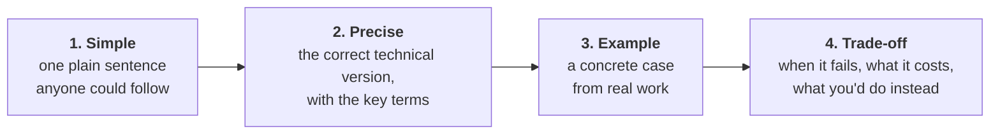
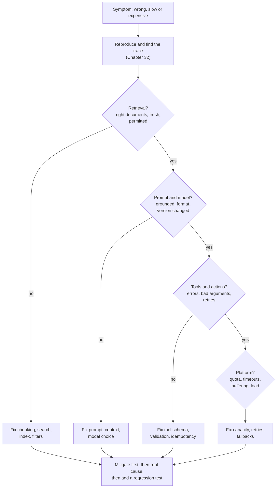

# Chapter 40: Interview Playbook

> **About the questions in this chapter.** There's no official list of "real" interview questions. What exists publicly is mostly **prep-site and blog material**, not first-hand candidate reports, and I couldn't verify who was asked what or where. So I use the questions that **recur across many prep guides** as a picture of what to expect, mark each as widely listed or from a single guide, and never claim a question was asked at a particular company. Treat them as practice, not as a leaked question bank.

## 1. The concept, from scratch

Parts 1 to 7 gave you the content. Chapters 38 and 39 gave you the two big formats: the client conversation and the design round. This last chapter is about **delivery**: how to turn what you know into answers that sound like a senior engineer who has done this before.

An AI engineering, forward deployed or solution architect interview tests four things, and most candidates only prepare the first:

1. **Knowledge:** do you understand how these systems work?
2. **Judgement:** do you pick sensible options, see the risks, and know when *not* to use AI?
3. **Experience:** have you operated real systems, and do you know what breaks?
4. **Communication:** can you explain it clearly to different people, and be honest about what you don't know?

Interview prep guides describe the loop in broadly the same way (as reported by prep sites in 2026, not verified): a recruiter screen, a technical screen on LLM fundamentals and some coding, one or two deep technical rounds on topics like RAG and evaluation, a system design round, and a behavioural or hiring-manager round. For forward deployed roles, guides also describe a **decomposition or customer-scenario round**, where you break a vague, real-world problem into parts and propose a solution, with little or no code ([Exponent's FDE guide](https://www.tryexponent.com/blog/forward-deployed-engineer-interview-the-definitive-2026-guide-fde) is one example of that secondary material).

### The 60-90 second answer: four beats

For concept questions ("What is RAG?", "Why do models hallucinate?"), most good answers have the same shape.

For example, "What is RAG?" Simple: "It lets the model look things up before it answers." Precise: "We retrieve relevant chunks from our own documents at question time, put them in the prompt, and ask the model to answer from them and cite them." Example: "A support assistant that answers from the current policy documents." Trade-off: "It's only as good as retrieval, and it adds latency and cost, so I'd measure retrieval separately from generation." That's 20 seconds, and it shows depth.

Spoken answers also need **signposting**. Say "there are three things", then say them. Lead with the answer, then explain. Use the exact phrases interviewers listen for: *traditional code is deterministic, generative AI is probabilistic; predictive versus generative; the model proposes, our code decides and acts; retrieval and generation are measured separately; evaluation before optimisation.*

### Three other shapes

**"How would you...?" questions** (a design or approach): **clarify, principle, steps, risks, measure.** Ask one or two questions, state the principle ("start simple and measure"), walk through the approach in order, name the main risks, and say how you'd know it worked.

**"Something broke" questions** (debugging): move through the layers in order. Symptom first, then hypotheses by layer, then how you'd *measure* to tell them apart, then mitigate, then prevent.

**Design questions:** the seven steps in [Chapter 39](../39-ai-system-design/README.md). **Behavioural questions:** STAR and your own stories ([Chapter 38](../38-forward-deployed-engineering/README.md)).

### When you don't know

Everyone hits a question they can't fully answer. What separates strong candidates is **how they handle it.**

- **Say what you do know,** then reason from first principles. "I haven't used that product, but the underlying problem is X, and the way I'd approach it is Y."
- **State assumptions,** and flag where you're unsure. "I believe the default is around that, but I'd check the docs before relying on it." Interviewers value honest calibration, especially in a field where facts change monthly.
- **Map unknown tools to capabilities.** If they name a vendor you haven't used, translate: "That's a managed vector store with metadata filtering, so I'd look at how it handles tenant isolation and consistency."
- **Never bluff,** and never invent a number. A made-up statistic is worse than "I don't remember the figure, but the order of magnitude is..., and I'd measure it."
- **If you're pushed back on,** don't collapse and don't dig in. Restate the challenge, check whether they're right, and either update ("good point, that changes my answer") or hold your position with evidence.
- **If the question is ambiguous,** ask. Clarifying is a strength.

### Your background is an advantage

If you come from software engineering, much of AI engineering is **familiar problems wearing new clothes.** Say so, with specifics, because it signals that you will be productive quickly.

| What you already know | Where it appears in AI engineering |
|---|---|
| Idempotency, retries, backoff, circuit breakers | Agent tool calls, provider rate limits ([Chapter 35](../35-reliability-scaling-and-streaming/README.md)) |
| Observability: logs, metrics, traces | Tracing prompts, retrieval and tools ([Chapter 32](../32-observability-and-llmops/README.md)) |
| CI/CD, canary and rollback | Evaluation gates and staged model and prompt releases ([Chapter 32](../32-observability-and-llmops/README.md)) |
| Access control, least privilege, input validation | Retrieval permissions, tool scopes, prompt injection ([Chapter 29](../29-guardrails-and-ai-security/README.md)) |
| Capacity planning and cost modelling | Tokens per minute, quotas, unit economics ([Chapter 31](../31-cost-latency-and-caching/README.md)) |
| Multi-tenant SaaS design | Tenant isolation in RAG and agents ([Chapter 37](../37-cloud-reference-architectures-and-multi-tenancy/README.md)) |
| Working with stakeholders and delivery | Forward deployed engineering ([Chapter 38](../38-forward-deployed-engineering/README.md)) |

The honest framing is: "The model part is new to me in these ways, and the production part is not." Then be specific about both.

### Questions to ask the interviewer

They're part of the interview. Good questions show you think like an owner. A few that work for these roles:

- What does a successful first 90 days look like, and what would a failure look like?
- How do you evaluate your AI systems today, and who owns that?
- What was the last AI project that didn't make it to production, and why?
- How do customers or users react when the system is wrong, and what's the escalation path?
- What's the split between building new things and keeping existing ones running?
- How are model and prompt changes released, and how do you roll back?
- For customer-facing roles: how much of the time is spent with customers, and how are scope and expectations set?

### The facts that were wrong in common notes

A lot of circulating study material repeats a handful of errors. Interviewers do notice. Here is the corrected list, each with the chapter that explains it.

| Often said | Say instead | Chapter |
|---|---|---|
| "Tokenisation and embedding are the same step." | Text becomes tokens, then token IDs, then vectors. These are separate steps | [3](../03-tokens-and-embeddings/README.md) |
| "ANN is an artificial neural network." | In vector search, ANN means **approximate nearest neighbour** | [13](../13-vector-search-and-databases/README.md) |
| "Use a cross-encoder for first-stage search." | **Bi-encoders** do first-stage retrieval. **Cross-encoders and late-interaction models** such as ColBERT rerank | [14](../14-improving-retrieval/README.md) |
| "Small models have tiny context windows, and most LLMs handle about 32K tokens." | Context windows vary widely and many models, including small ones, now offer 128K tokens or more (as of Nov 2026). Check the model's documentation | [7](../07-context-windows-and-context-engineering/README.md), [8](../08-the-model-landscape/README.md) |
| "Quantisation means going from 32 to 16 bits." | It commonly means 8-bit or 4-bit weights, and quality should be tested | [10](../10-fine-tuning-and-distillation/README.md), [33](../33-inference-engineering/README.md) |
| "Distillation is compression of the same model." | Distillation trains a **small model to imitate a large model's outputs** | [10](../10-fine-tuning-and-distillation/README.md) |
| "MCP understands the user's query." | The **LLM decides**. MCP is the standard way to connect it to tools and data | [20](../20-agent-protocols-mcp-and-a2a/README.md) |
| "There are three agent protocols: MCP, A2A and ACP." | ACP merged into A2A in 2025, so cover **MCP and A2A** | [20](../20-agent-protocols-mcp-and-a2a/README.md) |
| "AutoGen and Semantic Kernel are Microsoft's agent frameworks." | **Microsoft Agent Framework** is their successor (1.0 reached general availability in April 2026, per the earlier chapter) | [22](../22-orchestration-and-harnesses/README.md) |
| Quoting exact speed-ups for batching, caching or quantisation. | Quote none unless you can source it. Explain the mechanism and say you'd measure | [31](../31-cost-latency-and-caching/README.md), [33](../33-inference-engineering/README.md) |
| Quoting model parameter counts or task-duration claims you can't source. | Say you don't have a verified figure, and describe what matters instead | [8](../08-the-model-landscape/README.md) |

## 2. Analogies across industries

- **The four-beat answer is a clinical handover (healthcare).** Clinicians use a short, fixed structure when handing over a patient, such as SBAR: situation, background, assessment, recommendation. It exists because under pressure, a predictable order makes you complete and easy to follow. Simple, precise, example, trade-off does the same job for an answer.
- **Thinking aloud is flight-deck callouts (travel and aviation).** Pilots say what they see and what they're about to do, so the other person can catch a mistake. Narrating your assumptions and reasoning in an interview lets the interviewer correct you early, and shows how you work.
- **Stating assumptions is an underwriter writing down exclusions (insurance).** A good underwriter is explicit about what a decision rests on and what it doesn't cover. "I'm assuming X, and if X is wrong, I'd change Y" is the same discipline.
- **Signposting is a shipping manifest (logistics).** A manifest tells the receiver exactly what is in the container and in what order, so nothing is missed. "Three things: first, second, third" does the same for a listener.

## 3. How it's used in industry: the roles and what each emphasises

The same knowledge is tested differently depending on the role. As described by prep guides (not verified first-hand):

| Role | Where it sits | What gets emphasis |
|---|---|---|
| **AI engineer** at a product company | Builds and runs AI features | RAG and agent design, evaluation, cost and latency, production debugging |
| **Forward deployed engineer** at an AI lab or platform company | Embeds with customers | Decomposing vague problems, discovery, prototyping, communication, then production depth |
| **AI solution architect** at a cloud vendor or consultancy | Designs and advises | Reference architectures, trade-offs, security, cost, cloud services, executive communication |
| **Platform or MLOps engineer** at an enterprise | Runs the shared AI platform | Gateways, quotas, observability, governance, multi-tenancy |

A practical use of this table: before an interview, decide which two columns of the handbook this role leans on, and rehearse those chapters out loud. For an FDE loop that is Chapters 38, 39 and 29-30. For a solution architect loop it's Chapters 37, 39 and 36. For an AI engineer loop it's 11-17, 26-28 and 31-32.

## 4. Common misconceptions

- **"Memorise definitions and you'll be fine."** Definitions get you through screening. Senior rounds probe judgement: why, when not, what breaks, what it costs.
- **"Mention every framework and buzzword."** A list of tools is not an answer. One well-argued choice with a trade-off beats ten names.
- **"There's one right answer."** Most questions have several defensible answers. The interviewer wants your reasoning and your awareness of what you gave up.
- **"Silence means I'm failing."** A short pause to structure your answer is fine. Say "let me think about the structure for a second."
- **"Admitting I don't know hurts me."** Bluffing hurts you. Honest, calibrated uncertainty with a way to find out is a senior behaviour.
- **"Behavioural rounds are soft."** For FDE and architect roles they're often the heaviest, because the job is mostly judgement and communication.
- **"Newer is better."** Reaching for agents, fine-tuning or the latest model first is a red flag. Start simple, measure, and add complexity with evidence.
- **"Facts from notes are safe to repeat."** Many circulating notes carry errors (see the table above) and numbers nobody can source. Check, and say "as of" when a fact moves quickly.

## 5. Interview questions

Each question below is tagged by how widely it appears in prep material: **widely listed** (appears across many guides I checked) or **one guide** (seen in a single guide). Easiest first.

### 1. Why are you moving into AI engineering? (widely listed in behavioural rounds)

I've spent my career building and operating production systems, so I've dealt with the things that make software hard to run: reliability, security, cost, change, and getting a real organisation to adopt something. What drew me to AI engineering is that these systems bring those same problems back in a new form. The model is probabilistic, so evaluation and monitoring matter much more, the cost scales with tokens, and the failure modes are unusual. I want to work where that engineering discipline is the difference between a demo and a product. I've been deliberate about it: I've studied how the models work, built and evaluated retrieval and agent systems, and I can explain the trade-offs. What I bring on top is judgement from running systems in production, and what I'm still deepening is the model side and the newest tooling. *(Illustrative shape. Make it yours, with a real example.)*

### 2. Explain how a large language model works. (widely listed)

In plain words, it's a very large neural network trained to predict the next token. Text is split into tokens, each token becomes a vector, and a stack of transformer layers uses attention to let every token look at the others and build meaning in context. At the end it produces probabilities for the next token, we pick one, add it to the input, and repeat, which is why generation is a loop. It's pre-trained on a huge amount of text, then post-trained with examples and human feedback so it follows instructions. It doesn't look facts up. It generates plausible continuations, which is why it can be fluent and wrong. And it's stateless: every call, we resend the context. In practice that's why we ground it with retrieval, evaluate its outputs, and put deterministic code around it.

### 3. When would you use RAG, and when fine-tuning? (widely listed)

I'd use RAG when the model needs knowledge that's private, large or changing, because retrieval gives it the current facts at question time, lets me cite sources, and lets me enforce permissions on what's retrieved. I'd consider fine-tuning when the problem is behaviour rather than knowledge: a specific format, tone or narrow task, or when I need a smaller, cheaper model that imitates a larger one. They aren't exclusive: you can fine-tune for style and use RAG for facts. My default is to start with prompting, add RAG if knowledge is the gap, and fine-tune only when evaluation shows prompting and retrieval can't reach the quality or cost target, because fine-tuning adds training, versioning and maintenance.

### 4. How do you reduce hallucinations in production? (widely listed)

I use layers, because no single fix removes them. First, ground the answer: retrieve from trusted sources, tell the model to answer only from them, and require citations. Second, make it able to say "I don't know," and measure abstention as well as accuracy. Third, check the output: verify that quoted citations actually appear in the sources, validate formats, and use a second check for high-risk claims. Fourth, reduce the opportunity: keep context focused, use structured output where possible, and put deterministic code in charge of numbers and lookups. And I measure, with an evaluation set and sampled online review, because a hallucination rate I haven't measured is a guess. For high-stakes cases, a human reviews before it reaches the customer.

### 5. How do you evaluate an LLM application? (widely listed)

I build an evaluation set from real cases with the domain experts, including hard and ugly ones, and agree what a good answer looks like before optimising anything. For RAG I evaluate retrieval separately, with recall and ranking metrics, and generation separately, for groundedness, correctness and citation accuracy. For agents I grade the outcome and also the trajectory: did it call the right tools with the right arguments and stop when it should. I use automated checks and an LLM judge that I calibrate against human labels, plus human review of a sample. I run the set on every change as a regression gate, and then monitor sampled quality in production, because traffic drifts. And I report quality, cost and latency together.

### 6. Explain chunking, and why it matters for RAG. (widely listed)

Chunking is how we split documents into pieces before embedding them. It matters because retrieval returns chunks, so a bad split gives bad retrieval: too small and a chunk loses its meaning, too large and it dilutes the match and wastes context. I'd start with structure-aware splitting, keeping headings, sections, tables and lists together, add a little overlap, and attach metadata such as source, section, date and permissions. Then I'd measure retrieval on real questions and adjust, because the right size depends on the documents and queries. For hard cases I'd consider adding context to each chunk, or retrieving small chunks and returning their larger parent. Chunking is one of the cheapest places to improve quality, and it's easy to get wrong silently.

### 7. What's the difference between an agent and a workflow, and when would you avoid an agent? (widely listed)

A workflow follows steps that I defined in code, with the model doing some of the steps. An agent is a model running in a loop, choosing its own next action and using tools until it reaches a goal. The LLM is the brain and tools are the hands, and the model proposes while our code decides and acts. I avoid agents when the steps are known and fixed, when mistakes are costly and hard to reverse, or when I can't evaluate the behaviour, because agents are slower, costlier and less predictable. I prefer to start with a prompt or workflow, measure it, and only add agentic freedom where the task is open-ended and the evidence shows it's needed, with step limits, permissions and human approval for risky actions.

### 8. How would you defend an agent against prompt injection? (widely listed)

I'd start from the principle that instructions and data share one stream, so I can't rely on the model to tell them apart. The defences are layered. Treat everything retrieved or returned by tools as untrusted data. Give tools least privilege and enforce authorisation in the downstream systems, not by trusting the model. Require human approval for high-impact actions. Be careful about combining private data, untrusted content and an exfiltration path in the same agent. Filter and validate inputs and outputs, sandbox risky tools, and log everything. Then red-team it, because I can't prove it's safe, only make attacks harder and limit the damage when one succeeds.

### 9. An agent gets stuck in a loop or keeps calling the same tool. What do you do? (widely listed)

First I'd look at the trace to see why: the same tool with the same arguments again, an error the model can't interpret, a missing stop condition, or a goal it can't achieve. To control it, I'd set hard limits on steps, time, tokens and tool calls, detect repeated identical calls, and make errors informative so the model can change course. After a few failures it should stop and escalate to a human, not keep retrying. For actions with side effects I'd make them idempotent so a repeat can't do damage. And I'd add the failing case to the evaluation set so I know the fix works.

### 10. What are MCP and A2A, and how do they differ? (widely listed)

MCP, the Model Context Protocol, is a standard way to connect an AI application to tools, data and prompts, so I don't write a custom integration for every pairing. The model decides what to call, and MCP is the standard connection. A2A, the Agent2Agent protocol, is for agents to discover and work with other agents, even from different vendors, using agent cards and tasks, keeping each agent's internals opaque. So MCP is agent-to-tool and A2A is agent-to-agent. A third protocol, ACP, was merged into A2A in 2025. Both are governed under the Linux Foundation, and both specs are still evolving, so I'd check the current versions before committing.

### 11. How do you reduce the cost and latency of an LLM feature? (widely listed)

I start by measuring where tokens and time go, per step. Then the safe levers: cache the stable prompt prefix, trim the prompt and retrieved context, cap output length, stream so it feels fast, and move non-interactive work to batch. Then riskier ones: route easy requests to a smaller model, add a guarded semantic cache for common questions, or fine-tune a smaller model for a narrow task. After each change I run the evaluation set, because a saving that lowers quality isn't a saving, and I judge cost per successful task, not per call. And I set budgets and alerts so it doesn't creep back.

### 12. Design a RAG system that handles conflicting information across sources. (one guide)

I'd start by deciding what "conflict" means: different versions of a document, different authorities, or contradicting facts. I'd carry metadata on every chunk, such as source, authority level, date, version and jurisdiction, and use it in two places. At retrieval, filter out superseded versions and boost the authoritative source. At generation, instruct the model to compare the evidence and, when conflicts remain, say so, cite both sources and explain which it prefers and why, instead of silently picking one. For high-stakes conflicts I'd route to a human. I'd evaluate with a set of known-conflict cases and measure whether the answer notices the conflict and cites correctly. And I'd fix the root cause upstream, because conflicting documents are often a content-governance problem.

### 13. The quality of your AI feature dropped after nothing changed on your side. What do you do? (widely listed)

I'd first confirm it's real, using sampled scores and a fixed evaluation set run against the live setup. Then work out what changed, using release information on traces: the model version, the prompt version, the index, the data and the traffic mix. A provider update behind a floating model alias is a common cause, as is a content update or a shift in what users ask. To mitigate, I'd pin the last known good model version or roll back the index or prompt, and watch the metrics. Then I'd fix the cause, add the failure to the evaluation set, and change the process: pin versions, subscribe to deprecation notices, and treat any model change as a release with a gate and a canary.

### 14. How do you isolate tenant data in a multi-tenant AI system? (widely listed for SaaS-style roles)

I'd choose the isolation model by tenant tier: pool for many small tenants, a dedicated index or key for larger ones, and fully separate stacks for regulated ones. In a pooled design, the tenant ID comes from the verified token, the filter is built on the server and applied inside the search, and the system fails closed if the tenant is missing. A metadata filter is logical isolation, not a hard boundary, so for strict contractual or regulatory separation I'd use separate indexes with IAM-enforced access and their own encryption keys. I'd scope caches, memory and logs by tenant too, apply per-tenant rate limits so one tenant can't use everyone's quota, and test isolation with cross-tenant attempts and canary strings.

### 15. Tell me about a project that failed or didn't reach production, and what you learned. (widely listed in behavioural rounds)

Use the structure from [Chapter 38](../38-forward-deployed-engineering/README.md): situation, what you owned, what you did, what happened, and what you changed afterwards. Choose a real story where you can be specific and honest about your part. A strong answer names the cause precisely (an unclear owner, no evaluation, data access that arrived late, expectations not set), shows what you'd do differently, and ends with something you now do routinely because of it. Avoid blaming others, and avoid a story where the failure was "I worked too hard". *(Prepare your own, and rehearse it for two minutes.)*

## 6. Scenario exercise: a mock interview round

Here's a short round with escalating follow-ups, like a real one. Answer each prompt out loud, in about a minute, before you open the answers. The two threads are drawn from the themes that recur in prep material about RAG and agents.

**Thread A: RAG.**
1. "Our internal RAG chatbot gives wrong answers sometimes. How would you investigate?"
2. "You check and retrieval looks fine: the right documents are coming back. What next?"
3. "After the fix, users say it feels slow. What do you look at?"

**Thread B: agents.**
1. "We built an agent that can send emails and update our CRM. How would you make it safe to run?"
2. "It sent two copies of the same email last week. Why might that happen and what do you do?"
3. "A customer put hidden text in a document that told the agent to forward data elsewhere. How do you prevent that?"

Model answers

**Thread A.**

*1. Investigate wrong answers.* I'd start by looking at specific bad examples and their traces, not guessing, and separate retrieval from generation. For each bad answer I'd ask: were the right documents retrieved, was the answer supported by what was retrieved, and was the source itself correct and current? That splits the problem into retrieval, generation and content. I'd also check whether anything changed recently, such as the model version, the prompt, the index or the documents, and whether the failures cluster in a topic, a user group or a document type. I'd turn the examples into an evaluation set so I can measure fixes.

*2. Retrieval looks fine.* Then it's a generation or content problem. For generation: is the context too long or noisy so the model ignores the right chunk, does the prompt require answering only from the sources and allow "I don't know", did the model change, is it ignoring citations. I'd test by giving the right chunks directly and seeing if the answer is correct. For content: are the documents outdated, contradictory or ambiguous, or are two versions retrieved together. And I'd check for permission problems: the "right" documents for one user may not be the right ones for another. The fix depends on which it is: prompt and context changes, a smaller, better-ranked context, abstention, version filtering, or content cleanup with the owners.

*3. It feels slow.* I'd measure latency per stage, with p50 and p95: query rewriting, embedding, search, reranking, prompt building, the model's time to first token, and generation. Then fix the biggest piece. Common wins: stream the answer so it feels faster, trim the prompt and retrieve fewer, better chunks to cut the prefill time, cache the stable prefix, run independent steps in parallel, use a smaller model for rewriting or routing, and check whether reranking or guardrails are adding more than they're worth. And I'd re-run the evaluation set to make sure speed-ups didn't lower quality.

**Thread B.**

*1. Make the agent safe.* I'd start with the principle that the model proposes and our code decides and acts. Concretely: tools run with the user's permissions and least privilege, not a shared super-account. Reads are free, but writes like sending an email or updating a CRM record show a confirmation or need approval, especially for external or irreversible actions. Each write has an idempotency key and validation of its arguments. There are limits on steps, time and spend, and an audit log of every action. I'd roll it out in stages, suggest-only first, then drafting, then acting with approval, and only low-risk actions autonomously, with an evaluation set that tests tool choice and arguments, and red-teaming for misuse.

*2. Duplicate email.* Likely a retry after a timeout or a transient error, where the first attempt actually succeeded, or the agent loop repeated the step, or two workers processed the same task. Because the system was at-least-once without idempotency, the effect happened twice. I'd look at the trace to find which. The fix is idempotency keys on every external action, so the same key returns the original result instead of repeating, plus a record of completed steps so a restart resumes rather than repeats, and a limit on retries. I'd also add the case to the tests and consider a short delay and confirmation for outbound emails.

*3. Hidden instructions in a document.* That's indirect prompt injection: instructions and data share one stream, so I can't depend on the model to ignore them. I'd treat documents as untrusted data, and, more importantly, limit what the agent could do even if it were fooled. Authorisation should be enforced in the email and CRM systems, so the agent can only send to approved domains or recipients and can't forward data to arbitrary addresses, and high-impact actions need approval. I'd avoid giving one agent private data, untrusted content and an outbound channel all at once, or isolate them in separate steps. Filtering and scanning for injection patterns helps, and logging and alerting on unusual behaviour. Then I'd red-team it, because I can't prove safety, only reduce the risk and limit the blast radius.

## 7. Key takeaways

- **Interviews test knowledge, judgement, experience and communication,** and senior rounds weigh the last three heavily.
- **Use shapes:** simple, precise, example, trade-off for concepts. Clarify, principle, steps, risks, measure for "how would you". Layers in order for "it broke". The seven steps for design. STAR for behavioural.
- **Be honest when you don't know:** state what you do know, reason from first principles, flag assumptions and say how you'd verify. Never bluff or invent a number.
- **Your engineering background is an advantage:** reliability, observability, security, cost and delivery all carry over, so connect them explicitly to AI systems.
- **Repeat the corrected facts, not the common errors,** and say "as of" for anything that moves quickly.

## 8. Further reading

- Anthropic, [Building effective agents](https://www.anthropic.com/engineering/building-effective-agents): the clearest short statement of "start simple" for agent design.
- OWASP, [Top 10 for LLM applications](https://genai.owasp.org/llm-top-10/): the standard vocabulary for LLM security questions.
- AWS, [Generative AI Lens](https://docs.aws.amazon.com/wellarchitected/latest/generative-ai-lens/generative-ai-lens.html): a structured way to review and discuss an AI architecture.
- Exponent, [Forward deployed engineer interview guide](https://www.tryexponent.com/blog/forward-deployed-engineer-interview-the-definitive-2026-guide-fde): a prep-site overview of the FDE loop (secondary material, not first-hand reports).
- KDnuggets, [10 essential agentic AI interview questions](https://www.kdnuggets.com/10-essential-agentic-ai-interview-questions-for-ai-engineers): an example of the recurring agent questions in prep material (secondary material).
